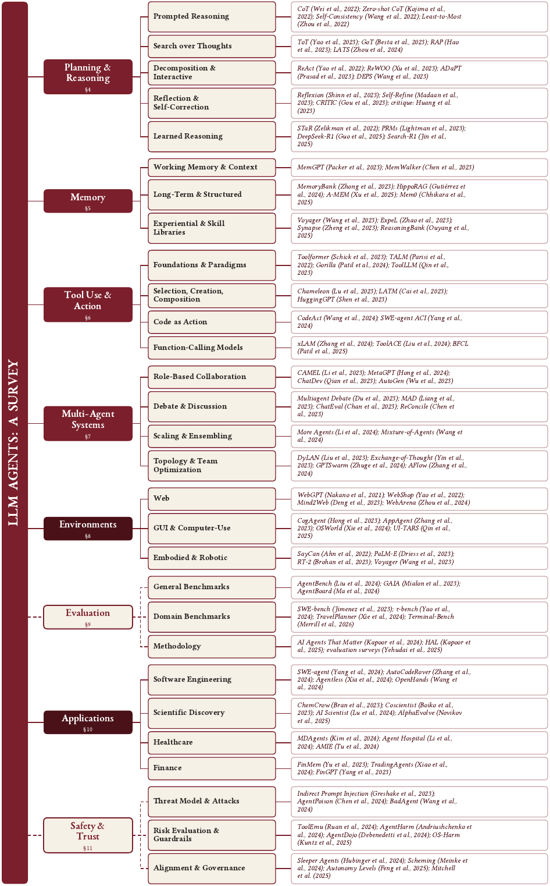

<h1 align="center">🤖 Awesome LLM Agent Papers</h1>

<p align="center"><a href="README.md">English</a> · <a href="README.ko.md">한국어</a> · <a href="README.zh-CN.md">简体中文</a> · <a href="README.ja.md">日本語</a> · <a href="README.pt-BR.md">Português</a> · <b>Español</b></p>

<p align="center">
<b>Más de 200 artículos imprescindibles, actualizados con regularidad</b>: la lista comentada de lecturas para construir<br>
agentes basados en LLM que planifican, recuerdan, usan herramientas y cooperan. Acompaña a la revisión <i>“LLM Agents: A Survey”</i>.
</p>

<!-- Identity & credibility -->
<p align="center">
<a href="https://awesome.re"></a>

<a href="https://doi.org/10.20944/preprints202608.0265.v1"></a>
<a href="LICENSE"></a>
<a href="CONTRIBUTING.md"></a>
</p>

<!-- Live star / fork counts. -->
<p align="center">
<a href="https://github.com/js-lee-AI/awesome-llm-agent-papers/stargazers"></a>
<a href="https://github.com/js-lee-AI/awesome-llm-agent-papers/network/members"></a>
</p>

<p align="center">
📄 <b><a href="https://www.preprints.org/manuscript/202608.0265">Lee la revisión → “LLM Agents: A Survey”</a></b> &nbsp;·&nbsp; <a href="paper/llm-agents-a-survey.pdf">PDF en este repositorio</a><br>📖 <b><a href="https://llm-agents-a-survey.gitbook.io/llm-agents-a-survey-docs/es/">Libro en línea en GitBook</a></b> &nbsp;·&nbsp; ⭐ <b><a href="#starter-kit">Empieza por el Kit de inicio</a></b>
</p>

<p align="center"><sub><i> LLM agents · LLM agent papers · autonomous agents · agentic AI · multi-agent systems · tool use · ReAct · planning · memory · agent benchmarks · agent safety &amp; prompt injection</i></sub></p>

<p align="center"></p>

## ✨ Destacados

| | Qué encontrarás aquí |
|---|---|
| 📚 **Todas las referencias de la revisión, y más** | Las 228 referencias de *“LLM Agents: A Survey”*, más artículos publicados después de que se escribiera la revisión. Se siguen añadiendo artículos nuevos. |
| 🧭 **Organizada por funciones** | 10 secciones que siguen la estructura de la revisión: Revisiones, Arquitecturas, Planificación, Memoria, Uso de herramientas, Multiagente, Entornos, Aplicaciones, Evaluación y Seguridad. |
| ✍️ **Comentada** | Cada entrada lleva una nota de una línea sobre lo que aporta, el congreso o la revista y el año de publicación, y un enlace `[code]` cuando existe una implementación oficial. |
| ⭐ **Kit de inicio** | Una [lista de 10 artículos](#starter-kit) para orientarte, con una nota que explica por qué conviene leer cada uno antes que los demás. |
| 🔎 **Fácil de recorrer** | Un [índice](#contents) con el número de artículos de cada sección y secciones que se pueden plegar. |

**Temas:** cognitive architectures · ReAct y la combinación de razonamiento y acción · planificación long-horizon · memoria de agentes · LLM aumentados con herramientas · colaboración multiagente · agentes web / de código / embodied · benchmarks y evaluación de agentes · seguridad, alineación y prompt injection indirecta.

> 📖 **La revisión como libro en línea**: en GitBook, [**LLM Agents: A Survey**](https://llm-agents-a-survey.gitbook.io/llm-agents-a-survey-docs/es/) reescribe la revisión para quienes empiezan en el área, en diez capítulos que parten de los conceptos básicos. Igual que en la revisión, los enfoques que no dieron resultado ocupan tanto espacio como los que funcionaron.

> 🔁 **La lista de la segunda revisión**: [**Awesome Agent Loop Papers**](https://github.com/js-lee-AI/awesome-agent-loop-papers) reúne trabajos sobre el propio bucle del agente, con 524 artículos y 60 proyectos de código abierto (frameworks, harnesses de programación, infraestructura de memoria y de sandbox, bibliotecas de skills, registros). Acompaña a *The Agent Loop: A Survey of Control Strategies, Skills, and Harnesses for LLM Agents*.

Este repositorio reúne artículos imprescindibles sobre **agentes basados en LLM**: modelos de lenguaje que, con planificación, memoria, uso de herramientas y coordinación entre varios agentes, persiguen objetivos que requieren muchos pasos. Los artículos siguen la taxonomía de la revisión que acompaña a esta lista y cubren los componentes centrales de un agente, los entornos y las aplicaciones en los que se despliegan los agentes, y las cuestiones transversales de evaluación y seguridad. Cada entrada enlaza al artículo y, cuando existe una implementación oficial, a su código.

Esta es una **selección cuidada y actualizada de forma continua**, no una copia de la bibliografía de la revisión. Las secciones aparecen plegadas por defecto; haz clic en **Mostrar N artículos** para desplegarlas.

> **Leyenda:** ⭐ = artículo del [Kit de inicio](#starter-kit) (para leer primero) · `[code]` = enlace a una implementación oficial.

<a id="starter-kit"></a>
## ⭐ Kit de inicio

¿Empiezas en este campo? Estos diez artículos son un buen punto de partida.

| # | Artículo | Área | Por qué empezar por aquí |
|---|-------|------|----------------|
| 1 | [ReAct: Synergizing Reasoning and Acting](https://arxiv.org/abs/2210.03629) | Planificación | El patrón del bucle de los agentes actuales: alternar el razonamiento con las acciones. |
| 2 | [Reflexion: Verbal Reinforcement Learning](https://arxiv.org/abs/2303.11366) | Planificación | La self-reflection se guarda en memoria y funciona como un bucle de mejora sin gradientes. |
| 3 | [Toolformer: LMs Can Teach Themselves to Use Tools](https://arxiv.org/abs/2302.04761) | Uso de herramientas | El artículo pionero sobre el uso de herramientas aprendido de forma autosupervisada. |
| 4 | [Generative Agents: Interactive Simulacra](https://arxiv.org/abs/2304.03442) | Multiagente | Memoria y reflection a escala de toda una población; el diseño clásico de memoria de agentes. |
| 5 | [Voyager: An Open-Ended Embodied Agent](https://arxiv.org/abs/2305.16291) | Memoria / Entornos | Aprendizaje permanente mediante una biblioteca de skills ejecutables que se amplía con el tiempo. |
| 6 | [Cognitive Architectures for Language Agents (CoALA)](https://arxiv.org/abs/2309.02427) | Fundamentos | El vocabulario (memoria, action space, bucle de decisión) con el que se organiza esta lista. |
| 7 | [A Survey on LLM-based Autonomous Agents](https://arxiv.org/abs/2308.11432) | Revisión | La revisión general de referencia del campo. |
| 8 | [LLM-based Multi-Agents: A Survey](https://arxiv.org/abs/2402.01680) | Multiagente | La referencia estándar para la rama multiagente. |
| 9 | [AgentBench: Evaluating LLMs as Agents](https://arxiv.org/abs/2308.03688) | Evaluación | El benchmark estándar para evaluar agentes en varios entornos. |
| 10 | [Not what you've signed up for (Indirect Prompt Injection)](https://arxiv.org/abs/2302.12173) | Seguridad | El artículo que estableció el modelo de amenazas de la seguridad de agentes. |

<a id="to-watch"></a>
## 🔥 10 artículos para seguir (2026)

Trabajos de 2026, publicados hace poco, que ya están llamando la atención.

| Artículo | Área | Stars |
|-------|------|-------|
| [GenericAgent: A Token-Efficient Self-Evolving LLM Agent via Contextual Information Density Maximization](https://arxiv.org/abs/2604.17091) | Arquitecturas |  |
| [SimpleMem: Efficient Lifelong Memory for LLM Agents](https://arxiv.org/abs/2601.02553) | Memoria |  |
| [AutoSci: A Memory-Centric Agentic System for the Full Scientific Research Lifecycle](https://arxiv.org/abs/2605.31468) | Aplicaciones |  |
| [Mobile-Agent-v3.5: Multi-platform Fundamental GUI Agents](https://arxiv.org/abs/2602.16855) | Entornos |  |
| [AgentDoG: A Diagnostic Guardrail Framework for AI Agent Safety and Security](https://arxiv.org/abs/2601.18491) | Seguridad |  |
| [Agentic Reasoning for Large Language Models](https://arxiv.org/abs/2601.12538) | Revisiones |  |
| [UniToolCall: Unifying Tool-Use Representation, Data, and Evaluation for LLM Agents](https://arxiv.org/abs/2604.11557) | Uso de herramientas |  |
| [Graph-of-Agents: A Graph-based Framework for Multi-Agent LLM Collaboration](https://arxiv.org/abs/2604.17148) | Multiagente |  |
| [Can AI Agents Answer Your Data Questions? A Benchmark for Data Agents (DataAgentBench)](https://arxiv.org/abs/2603.20576) | Evaluación |  |
| [Harness Updating Is Not Harness Benefit: Disentangling Evolution Capabilities in Self-Evolving LLM Agents](https://arxiv.org/abs/2605.30621) | Planificación |  |

<sub><a href="#contents">↑ Volver al índice</a></sub>

## <a id="contents"></a>Índice

- [⭐ Kit de inicio](#starter-kit)
- [🔥 10 artículos para seguir (2026)](#to-watch)
- **🧭 Fundamentos**
  - [📚 Revisiones y artículos de posición (62)](#surveys)
  - [🏗️ Arquitecturas y frameworks de agentes (54)](#architectures)
- **🧱 Parte I: Componentes principales**
  - [🧠 Planificación y razonamiento (55)](#planning)
  - [💾 Memoria (61)](#memory)
  - [🔧 Uso de herramientas (51)](#tools)
  - [🤝 Sistemas multiagente (59)](#multi-agent)
- **🌍 Parte II: Agentes en entornos y aplicaciones**
  - [🌐 Entornos interactivos (60)](#environments)
  - [🚀 Aplicaciones (60)](#applications)
- **⚖️ Parte III: Cuestiones transversales**
  - [📊 Evaluación y benchmarks (62)](#evaluation)
  - [🛡️ Seguridad y alineación (62)](#safety)

## 🧭 Fundamentos

<a id="surveys"></a>
### 📚 Revisiones y artículos de posición (62)
*En la revisión: §1-§3 (Introducción, Fundamentos, Taxonomía).*

<details>
<summary><b>Mostrar 62 artículos</b></summary>

- **[A Survey on Large Language Model based Autonomous Agents](https://arxiv.org/abs/2308.11432)** (Wang et al., arXiv 2023) - *La revisión general de referencia sobre agentes LLM y la más citada.* ⭐ [[code](https://github.com/Paitesanshi/LLM-Agent-Survey)]
- **[The Rise and Potential of Large Language Model Based Agents: A Survey](https://arxiv.org/abs/2309.07864)** (Xi et al., arXiv 2023) - *Junto con Wang et al. 2023, es una de las dos revisiones generales que fundaron el área.* [[code](https://github.com/WooooDyy/LLM-Agent-Paper-List)]
- **[Cognitive Architectures for Language Agents](https://arxiv.org/abs/2309.02427)** (Sumers et al., TMLR 2023) - *El vocabulario conceptual y arquitectónico más adoptado para describir agentes LLM.* ⭐ [[code](https://github.com/ysymyth/awesome-language-agents)]
- **[ReAct: Synergizing Reasoning and Acting in Language Models](https://arxiv.org/abs/2210.03629)** (Yao et al., ICLR 2023) - *El precursor técnico más citado de los agentes LLM actuales.* ⭐ [[code](https://github.com/ysymyth/ReAct)]
- **[Reflexion: Language Agents with Verbal Reinforcement Learning](https://arxiv.org/abs/2303.11366)** (Shinn et al., NeurIPS 2023) - *Estableció el bucle 'self-reflection + memoria' como alternativa al RL basado en gradientes para que el agente mejore por sí mismo.* ⭐ [[code](https://github.com/noahshinn/reflexion)]
- **[Toolformer: Language Models Can Teach Themselves to Use Tools](https://arxiv.org/abs/2302.04761)** (Schick et al., NeurIPS 2023) - *Artículo pionero sobre uso de herramientas, en el que se apoya el pilar de 'aumento con herramientas' de las taxonomías de agentes LLM.* ⭐
- **[Generative Agents: Interactive Simulacra of Human Behavior](https://arxiv.org/abs/2304.03442)** (Park et al., arXiv 2023) - *Demostración fundacional de sociedades y simulaciones de agentes impulsados por LLM.* ⭐ [[code](https://github.com/joonspk-research/generative_agents)]
- **[Voyager: An Open-Ended Embodied Agent with Large Language Models](https://arxiv.org/abs/2305.16291)** (Wang et al., TMLR 2023) - *Ejemplo pionero de agentes LLM embodied, basados en skills escritas como código y con aprendizaje permanente.* ⭐ [[code](https://github.com/MineDojo/Voyager)]
- **[HuggingGPT: Solving AI Tasks with ChatGPT and its Friends in Hugging Face](https://arxiv.org/abs/2303.17580)** (Shen et al., NeurIPS 2023) - *Ejemplo fundacional del patrón de agente 'LLM como orchestrator de herramientas/modelos'.* [[code](https://github.com/microsoft/JARVIS)]
- **[MRKL Systems: A Modular, Neuro-Symbolic Architecture that Combines Large Language Models, External Knowledge Sources and Discrete Reasoning](https://arxiv.org/abs/2205.00445)** (Karpas et al., arXiv 2022) - *El primer precursor neurosimbólico muy citado de las arquitecturas de agentes y de uso de herramientas con LLM.*
- **[Agent AI: Surveying the Horizons of Multimodal Interaction](https://arxiv.org/abs/2401.03568)** (Durante et al., arXiv 2024) - *Amplía el panorama de revisiones sobre agentes LLM a la IA de agentes multimodales y embodied.*
- **[Igniting Language Intelligence: The Hitchhiker's Guide From Chain-of-Thought Reasoning to Language Agents](https://arxiv.org/abs/2311.11797)** (Zhang et al., arXiv 2023) - *Conecta la literatura sobre razonamiento (CoT) con la literatura sobre agentes.* [[code](https://github.com/Zoeyyao27/CoT-Igniting-Agent)]
- **[Large Language Model based Multi-Agents: A Survey of Progress and Challenges](https://arxiv.org/abs/2402.01680)** (Guo et al., IJCAI 2024) - *La revisión de referencia dedicada específicamente a la rama multiagente de los agentes LLM.* ⭐ [[code](https://github.com/taichengguo/LLM_MultiAgents_Survey_Papers)]
- **[Understanding the Planning of LLM Agents: A Survey](https://arxiv.org/abs/2402.02716)** (Huang et al., arXiv 2024) - *Cubre la planificación, un tema que las revisiones fundacionales no trataban por separado.*
- **[Tool Learning with Large Language Models: A Survey](https://arxiv.org/abs/2405.17935)** (Qu et al., arXiv 2024) - *La revisión definitiva sobre el uso de herramientas, uno de los pilares de los agentes LLM.* [[code](https://github.com/quchangle1/LLM-Tool-Survey)]
- **[A Survey on the Memory Mechanism of Large Language Model based Agents](https://arxiv.org/abs/2404.13501)** (Zhang et al., arXiv 2024) - *La revisión estándar sobre el subsistema de memoria de los agentes LLM.* [[code](https://github.com/nuster1128/LLM_Agent_Memory_Survey)]
- **[Agentic Large Language Models, a Survey](https://arxiv.org/abs/2503.23037)** (Plaat et al., arXiv 2025) - *Revisión general reciente y muy citada, con una taxonomía compacta en tres ejes: razonar, actuar e interactuar.*
- **[Large Language Model Agent: A Survey on Methodology, Applications and Challenges](https://arxiv.org/abs/2503.21460)** (Luo et al., arXiv 2025) - *Una de las revisiones generales más completas y recientes (2025).* [[code](https://github.com/luo-junyu/Awesome-Agent-Papers)]
- **[Fully Autonomous AI Agents Should Not Be Developed](https://arxiv.org/abs/2502.02649)** (Mitchell et al., arXiv 2025) - *Artículo de posición crítico, destacado y muy debatido, sobre la autonomía de los agentes.*
- **[AI Agents vs. Agentic AI: A Conceptual Taxonomy, Applications and Challenges](https://arxiv.org/abs/2505.10468)** (Sapkota et al., arXiv 2025) - *Aclara la terminología y los conceptos del área, y se cita cada vez más porque los términos se usan de forma inconsistente.*
- **[LLM-Based Human-Agent Collaboration and Interaction Systems: A Survey](https://arxiv.org/abs/2505.00753)** (Zou et al., arXiv 2025) - *Trata la rama de cooperación entre humanos y agentes que ya identificaban las primeras revisiones fundacionales.* [[code](https://github.com/HenryPengZou/Awesome-Human-Agent-Collaboration-Interaction-Systems)]
- **[Levels of Autonomy for AI Agents](https://arxiv.org/abs/2506.12469)** (Feng et al., arXiv 2025) - *Ofrece un marco operativo muy citado para comparar el grado de autonomía de distintos sistemas de agentes LLM.*
- **[Advances and Challenges in Foundation Agents: From Brain-Inspired Intelligence to Evolutionary, Collaborative, and Safe Systems](https://arxiv.org/abs/2504.01990)** (Liu et al., arXiv 2025) - *Revisión de referencia firmada por 48 autores que organiza el campo en torno a módulos cognitivos inspirados en el cerebro, la autoevolución, la inteligencia colectiva y la seguridad.*
- **[The Landscape of Agentic Reinforcement Learning for LLMs: A Survey](https://arxiv.org/abs/2509.02547)** (Zhang et al., arXiv 2025) - *La revisión de referencia sobre agentic RL: entrenar LLM como agentes que toman decisiones y no como generadores pasivos.*
- **[A Comprehensive Survey of Self-Evolving AI Agents: A New Paradigm Bridging Foundation Models and Lifelong Agentic Systems](https://arxiv.org/abs/2508.07407)** (Fang et al., arXiv 2025) - *Revisa las técnicas con las que los agentes optimizan sus propios componentes a partir de datos de interacción, y conecta los modelos fundacionales con los sistemas agénticos de aprendizaje permanente.*
- **[Deep Research Agents: A Systematic Examination and Roadmap](https://arxiv.org/abs/2506.18096)** (Huang et al., arXiv 2025) - *Primera revisión sistemática de los agentes autónomos de investigación en tareas long-horizon (búsqueda, uso de herramientas, síntesis de informes).*
- **[A Survey of AI Agent Protocols](https://arxiv.org/abs/2504.16736)** (Yang et al., arXiv 2025) - *Describe la nueva capa de protocolos (MCP, A2A y sus sucesores) y propone dimensiones para evaluar los estándares de interoperabilidad entre agentes.*

- **[Agentic Reasoning for Large Language Models](https://arxiv.org/abs/2601.12538)** (Wei et al., arXiv 2026) - *Revisión que organiza el razonamiento agéntico en capas (un solo agente, autoevolución, multiagente) y conecta el razonamiento en contexto con el post-entrenamiento.* [[code](https://github.com/weitianxin/Awesome-Agentic-Reasoning)]
- **[Memory for Autonomous LLM Agents: Mechanisms, Evaluation, and Emerging Frontiers](https://arxiv.org/abs/2603.07670)** (Du et al., arXiv 2026) - *Plantea la memoria del agente como un bucle de escritura, gestión y lectura, con una taxonomía de mecanismos, benchmarks y aplicaciones.*
- **[Anatomy of Agentic Memory: Taxonomy and Empirical Analysis of Evaluation and System Limitations](https://arxiv.org/abs/2602.19320)** (Jiang et al., arXiv 2026) - *Clasifica las estructuras de memoria de los agentes y muestra de forma empírica, en varios sistemas, la saturación de los benchmarks y problemas de validez de las métricas.*
- **[Beyond Individual Intelligence: Surveying Collaboration, Failure Attribution, and Self-Evolution in LLM-based Multi-Agent Systems](https://arxiv.org/abs/2605.14892)** (Qi et al., arXiv 2026) - *Propone un marco unificado, 'LIFE' (foundation, integrate, find faults, evolve), para la colaboración multiagente, la failure attribution y la autoevolución.*
- **[A Technical Taxonomy of LLM Agent Communication Protocols](https://arxiv.org/abs/2606.19135)** (Sander et al., arXiv 2026) - *Analiza nueve protocolos abiertos de comunicación entre agentes en cinco dimensiones y prevé que acabarán convergiendo en una pila de protocolos federada.*
- **[Bridging the Agent-World Gap: Text World Models for LLM-based Agents](https://arxiv.org/abs/2606.09032)** (Li et al., arXiv 2026) - *Sistematiza los modelos del mundo textuales (LLM-as-WM frente a code-as-WM), que permiten a los agentes predecir el entorno de forma explícita para planificar y verificar.* [[code](https://github.com/sustech-nlp/awesome-text-world-models)]
- **[Agents That Know Too Much: A Data-Centric Survey of Privacy in LLM Agents](https://arxiv.org/abs/2606.26627)** (Lahjouji et al., arXiv 2026) - *Revisión centrada en los datos que organiza la investigación sobre privacidad de agentes según la superficie de datos y no según el tipo de ataque, y señala las carencias de gobernanza.*
- **[Self-Improvements in Modern Agentic Systems: A Survey](https://arxiv.org/abs/2607.13104)** (Ren et al., arXiv 2026) - *Presenta un agente moderno como un modelo fundacional más un scaffold operativo, y organiza la automejora según qué se actualiza (los pesos o el scaffold) y qué señal impulsa el cambio.* [[code](https://github.com/selfimproving-agent/awesome-Self-Improving-Agents)]
- **[Dynamic Agent Skills: A Lifecycle Survey and Taxonomy of Evolving Skill Libraries](https://arxiv.org/abs/2607.10113)** (Li et al., arXiv 2026) - *Revisa 124 artículos sobre bibliotecas de skills que evolucionan, vistas como almacenes de artefactos gestionados a lo largo de su ciclo de vida, y sostiene que las etapas decisivas son la admisión y la reparación, no la adquisición.*
- **[From Question Answering to Task Completion: A Survey on Agent System and Harness Design](https://arxiv.org/abs/2606.20683)** (Guo et al., arXiv 2026) - *Analiza los agentes separando el modelo del harness, divide el harness en seis responsabilidades en tiempo de ejecución y se pregunta dónde está realmente el cuello de botella del rendimiento.* [[code](https://github.com/ggjy/Awesome-Agent-Engineering)]
- **[Isolation as a First-Class Principle for LLM-Agent System Safety: Concepts, Taxonomy, Challenges and Future Directions](https://arxiv.org/abs/2607.12406)** (Jing et al., arXiv 2026) - *Artículo de posición que replantea la prompt injection, el mal uso de herramientas y el memory poisoning como un único problema estructural: la falta de límites de aislamiento en cinco interfaces del agente.*
- **[Always-On Agents: A Survey of Persistent Memory, State, and Governance in LLM Agents](https://arxiv.org/abs/2606.30306)** (Ding et al., arXiv 2026) - *Revisa 435 trabajos sobre agentes con estado persistente entre sesiones y concluye que la literatura da prioridad a la acumulación y la recuperación de información, y descuida la gobernanza y la recuperación ante fallos.*
- **[Externalization in LLM Agents: A Unified Review of Memory, Skills, Protocols and Harness Engineering](https://arxiv.org/abs/2604.08224)** (Zhou et al., arXiv 2026) - *Interpreta la evolución de los agentes como una externalización: las capacidades salen de los pesos y pasan a la memoria, las skills, los protocolos y la infraestructura del harness.*
- **[SoK: Agentic Skills -- Beyond Tool Use in LLM Agents](https://arxiv.org/abs/2602.20867)** (Jiang et al., arXiv 2026) - *Sistematiza las skills agénticas como procedimientos reutilizables que se pueden invocar, y marca la diferencia entre una skill y una llamada atómica a una herramienta.*
- **[From Storage to Experience: A Survey on the Evolution of LLM Agent Memory Mechanisms](https://arxiv.org/abs/2605.06716)** (Luo et al., arXiv 2026) - *Revisa la memoria de los agentes como una evolución en tres etapas (almacenamiento, reflection y experiencia), impulsada por la consistencia, la dinámica y el aprendizaje continuo.* [[code](https://github.com/FeishuLuo/Evolving-LLM-Agent-Memory-Survey)]
- **[LLM agents security duality: a comprehensive survey of self-security and empowered cybersecurity](https://arxiv.org/abs/2606.28450)** (Xu et al., arXiv 2026) - *Revisión que organiza a la vez las amenazas de seguridad para los agentes LLM y sus mitigaciones con una taxonomía según el origen de la amenaza, junto con un marco que relaciona las capacidades de los agentes con todo el ciclo de vida del ataque y la defensa cibernéticos.*
- **[Agentic Environment Engineering for Large Language Models: A Survey of Environment Modeling, Synthesis, Evaluation, and Application](https://arxiv.org/abs/2606.12191)** (Li et al., arXiv 2026) - *Esta revisión organiza la investigación sobre entornos para agentes basados en LLM en torno a un ciclo de vida de ingeniería (modelado, síntesis, evaluación y aplicación) y propone una clasificación de los entornos según ocho atributos.*
- **[Toward Efficient Agents: Memory, Tool learning, and Planning](https://arxiv.org/abs/2601.14192)** (Yang et al., arXiv 2026) - *Revisión que estudia la eficiencia de los sistemas de agentes LLM en tres componentes (memoria, aprendizaje de herramientas y planificación) y plantea la relación entre la eficacia y lo que cuesta obtenerla como una frontera de Pareto.*
- **[Agentic Artificial Intelligence (AI): Architectures, Taxonomies, and Evaluation of Large Language Model Agents](https://arxiv.org/abs/2601.12560)** (Arunkumar V et al., arXiv 2026) - *Revisión que propone una taxonomía unificada de seis componentes (Percepción, Cerebro, Planificación, Acción, Uso de herramientas, Colaboración) para agentes LLM, repasa sus arquitecturas, entornos de operación y prácticas de evaluación, y cierra con problemas abiertos como las hallucinations en las acciones, los bucles infinitos y la prompt injection.*
- **[A Survey on Long-Term Memory Security in LLM Agents: Attacks, Defenses, and Governance Across the Memory Lifecycle](https://arxiv.org/abs/2604.16548)** (Lin et al., arXiv 2026) - *Revisa las amenazas de seguridad a la long-term memory de los agentes LLM, organiza los ataques, las defensas y la gobernanza en seis fases del ciclo de vida de la memoria y cuatro objetivos de seguridad, y defiende un marco de "Verifiable Memory Governance".*
- **[Uncertainty Quantification in LLM Agents: Foundations, Emerging Challenges, and Opportunities](https://arxiv.org/abs/2602.05073)** (Oh et al., arXiv 2026) - *Sostiene que la cuantificación de la incertidumbre tiene que pasar de las preguntas y respuestas de un solo turno a los agentes interactivos. Da una formulación general y los cuatro retos propios de los agentes: la elección del estimador, las entidades heterogéneas, la dinámica de la incertidumbre y la falta de benchmarks de grano fino.*
- **[Multi-Agent Debate Strategies: Survey, Taxonomy, and Challenges](https://arxiv.org/abs/2607.26212)** (Motger et al., arXiv 2026) - *Revisa 141 estudios de debate multiagente y encuentra que el campo ha adoptado de forma tácita topologías estáticas fully connected con votación, por convención y no a partir de comparaciones controladas.*
- **[Beyond the Leaderboard: A Synthesis of Tool-Use, Planning, and Reasoning Failures in Large Language Model Agents](https://arxiv.org/abs/2607.05775)** (Albayaydh et al., arXiv 2026) - *Sintetiza 27 artículos de evaluación sobre 19 benchmarks en seis grupos de fallos, y encuentra que los fallos se acumulan de forma no lineal con la longitud de la tarea y que añadir scaffolding no mejora la fiabilidad de manera consistente.*
- **[How Agents Ask for Permission: User Permissions for AI Agents, from Interfaces to Enforcement](https://arxiv.org/abs/2607.13718)** (Michael et al., arXiv 2026) - *Contrasta 21 propuestas de permisos para agentes con cinco agentes comerciales, clasifica cómo se especifican las políticas del usuario, cómo se derivan de lo que el usuario introduce y cómo se aplican en tiempo de ejecución, y señala dónde quedan carencias.*
- **[Blockchain Empowered Trustworthy Agent Networks: Foundations, Taxonomy, and Future Directions](https://arxiv.org/abs/2608.04626)** (Zhu et al., arXiv 2026) - *Revisa el paso de los sistemas multiagente clásicos a las redes abiertas de agentes entre 1980 y 2026. Sostiene que, en cuanto agentes de distintos propietarios realizan transacciones entre sí, el problema de la confianza se traslada a la red en su conjunto, y que los mecanismos de seguridad pensados para un solo agente no pueden resolverlo.*
- **[Software Engineering for and with GUI Agent](https://arxiv.org/abs/2608.09278)** (Yu et al., arXiv 2026) - *Revisa 336 artículos sobre agentes GUI publicados entre enero de 2018 y abril de 2026. Encuentra que las arquitecturas convergen en bucles modulares de percibir, razonar y actuar, mientras que la recuperación ante fallos, la escalation a un humano, la aplicación de medidas de seguridad y la auditabilidad siguen poco desarrolladas, y que la evaluación sigue centrada en el éxito de la tarea y es difícil de comparar entre protocolos.*
- **[Agent Safety Should Be a Runtime Contract](https://arxiv.org/abs/2608.11274)** (Ng et al., arXiv 2026) - *Artículo de posición que sitúa la seguridad del agente en el harness, como un contrato en tiempo de ejecución con una cara preventiva (sandboxes, controles de permisos, monitores) y una cara probatoria (ejecuciones de prueba, capturas de logs, diffs de archivos). Se apoya en 52 incidentes documentados, en una auditoría del esquema de trajectories de 12 sistemas de agentes públicos y en una auditoría por títulos de los 28.560 artículos de NeurIPS, ICML e ICLR de 2023-2025, que muestra un desequilibrio agregado de 8 a 12 veces entre las publicaciones sobre entrenamiento y las publicaciones sobre despliegue.*
- **[Information Retrieval Misses the Mark for LLM Agents](https://doi.org/10.2139/ssrn.6903579)** (Sun et al., SSRN 2026) - *Artículo de posición que responde a quienes, a partir de lo que se ve en producción, sostienen que "RAG ha muerto, a los agentes les basta con grep". Admite que la base tecnológica ha cambiado, pero sostiene que el desajuste es estructural en cinco dimensiones: el corpus, la entrada, el objetivo, el episodio y la unidad recuperable que presupone la recuperación de información no encajan con un agente que planifica, navega, llama a herramientas y decide si seguir buscando. Para comprobarlo, mantiene fijo el agente y cambia la recuperación (BM25, vectorial, grep, híbrida y closed-book) en HotpotQA-distractor y 2WikiMultihopQA, y propone replantear la recuperación como una política de obtención de evidencias condicionada al estado.*
- **[Terminal Agents: A Survey of AI Agents in Command-Line Environments](https://arxiv.org/abs/2608.20485)** (Bin et al., arXiv 2026) - *Organiza el campo en torno a la terminal y no al dominio de la tarea: estudia los agentes cuyo bucle de avance pasa por la ejecución de comandos y la retroalimentación textual, y los describe según arquitectura, adquisición de competencias y evaluación con un perfil de competencias de siete dimensiones. Sus propios diagnósticos en condiciones fijas muestran que cada familia de benchmarks revela señales de proceso distintas y que las comparaciones entre sistemas en igualdad de condiciones dependen del benchmark, lo que limita hasta qué punto un resultado puede atribuirse a un solo componente.*
- **[Autonomous Research Agents: A Survey of AI Scientists and the Verification Gap](https://arxiv.org/abs/2608.05179)** (Ding et al., arXiv 2026) - *Codifica 26 de los 125 sistemas de científico de IA examinados según siete dimensiones de auditoría y encuentra que el cuello de botella ya no está en la capacidad sino en la posibilidad de verificar: el 83% de los 24 sistemas ejecutables publica su código, pero solo el 38% publica semillas o trazas de ejecución y solo el 38% informa de alguna verificación de novedad. De los nueve sistemas de bucle cerrado, siete son reejecuciones mecánicas, y en todo el corpus no hay ningún oracle dentro del bucle validado externamente.*
- **[Jev in the Wild: A Data-Driven Analysis of the Jev Model's Functionality, Applications and Ecosystem](https://arxiv.org/abs/2609.30216)** (Ling et al., arXiv 2026) - *Clasifica 2170 proyectos públicos de GitHub que usan Jev, recogidos una semana después de su lanzamiento, y encuentra que se usa mucho más para juzgar entradas que para elegir acciones: el juicio de atributos aparece en el 77% de los proyectos y la selección de acciones en el 31%, aunque la selección de acciones es cerca de la mitad de las etiquetas en los proyectos de agentes de interfaz y de simulación y control, y los proyectos de routing y de agentes de interfaz son el 19,6% del total pero reciben el 63% de las estrellas; un agente LLM decidió qué repositorios entran y etiquetó cada proyecto, con un segundo agente revisando, y el artículo no presenta ninguna comparación con etiquetas humanas.*
- **[Why Agentic Workflows Fail: A Taxonomy Derived from Literature and Empirical Data](https://arxiv.org/abs/2610.17418)** (Li et al., arXiv 2026) - *Clasifica los fallos de los workflows agénticos en cuatro dimensiones, la fuente responsable (agente, sistema externo o ambos), el mecanismo entre 65 tipos, la fase del workflow y la capacidad del agente, y aplica el esquema a 397 registros de fallos tomados de artículos y a 1196 tomados de issues y pull requests de GitHub en 229 repositorios: los fallos de GitHub se concentran en la actuación durante la ejecución, el 64,8% de los registros frente al 14,1% en la literatura, y el 61% de ellos no son culpa del agente, como una API externa que falla; 68 de 69 registros de artículos posteriores encajan en los tipos existentes, y los recuentos no son estimaciones de prevalencia.*
- **[Distilling Agentic Systems: A Roadmap across Models, Artifacts, and Harnesses](https://arxiv.org/abs/2609.36630)** (Luo et al., arXiv 2026) - *Amplía la distillation de un modelo maestro a un agente maestro y ordena la literatura según dónde guarda el alumno lo que aprendió: en los pesos, en artefactos reutilizables como memorias, skills y herramientas, en el harness de ejecución mediante workflows, enrutamiento y verificación, o entre estos, como cuando un workflow textual se compila en un controlador o un artefacto se convierte en una regla obligatoria; exige a cada afirmación de transferencia evidencia intrínseca, causal y end-to-end, y concluye que ningún lugar es preferible en general, aunque cada método se clasifica bajo un único lugar principal.*
- **[Agentic Societies Need a Social Harness](https://arxiv.org/abs/2609.17527)** (Chugh et al., arXiv 2026) - *Sostiene que los agentes que actúan en nombre de personas distintas necesitan un harness social que gobierne los mensajes entre ellos, por encima del harness de cada agente, y respalda la tesis con agentes OpenClaw que programan reuniones en una universidad, todos con GPT-5.4 o con uno de ellos en Claude Opus 4.8: en diez ejecuciones por configuración, las sesiones aisladas por interlocutor hacen que la configuración mixta falle en todas las reuniones de grupo con más de un profesor asistente, las sesiones compartidas elevan el éxito del 0% al 90% con siete, y las cancelaciones falsas transmitidas entre agentes funcionan en el 100% de las ejecuciones con GPT-5.4; la pila de cinco capas propuesta, de la identidad verificable a las instituciones sociales, no se construyó ni se midió su coste.*
- **[Harness Engineering for Language Agents: The Harness Layer as Control, Agency, and Runtime](https://doi.org/10.20944/preprints202603.1756.v2)** (He et al., Preprints 2026) - *Artículo de posición que divide la capa que rodea al modelo en control (instrucciones, mapas del repositorio, pruebas, permisos), agency (las herramientas, interfaces y roles a través de los que actúa el modelo) y runtime (memoria, checkpoints, reintentos, presupuestos), y propone HarnessCard, una plantilla para informar del harness de un agente junto con el modelo. En su revisión de 63 trabajos, los 38 artículos y benchmarks destacan sobre todo la observabilidad, las interfaces y el feedback, mientras que las 25 notas de ingeniería, protocolos y artículos técnicos destacan runtime, control y gobernanza. Los autores aclaran que la revisión comprueba qué aparece en un conjunto seleccionado con etiquetas interpretativas y no cuenta el campo entero, se apoyan en buena medida en notas de ingeniería de unos pocos laboratorios de frontera y no hacen ningún experimento que separe los efectos del modelo de los del harness.*
</details>

<sub><a href="#contents">↑ Volver al índice</a></sub>

<a id="architectures"></a>
### 🏗️ Arquitecturas y frameworks de agentes (54)
*En la revisión: §2 (Fundamentos) y los ejemplos que se usan a lo largo del texto.*

<details>
<summary><b>Mostrar 54 artículos</b></summary>

- **[Auto-GPT for Online Decision Making: Benchmarks and Additional Opinions](https://arxiv.org/abs/2306.02224)** (Yang et al., arXiv 2023) - *El único estudio empírico, de nivel cercano al de una publicación revisada por pares, sobre el patrón de diseño de agente autónomo de AutoGPT, muy influyente aunque nunca tuvo un artículo propio.* [[code](https://github.com/younghuman/LLMAgent)]
- **[AgentBench: Evaluating LLMs as Agents](https://arxiv.org/abs/2308.03688)** (Liu et al., ICLR 2024) - *El benchmark de referencia para medir la capacidad general de un solo agente en entornos heterogéneos.* ⭐ [[code](https://github.com/THUDM/AgentBench)]
- **[WebArena: A Realistic Web Environment for Building Autonomous Agents](https://arxiv.org/abs/2307.13854)** (Zhou et al., ICLR 2024) - *El banco de pruebas estándar de facto para las arquitecturas de un solo agente que navegan por la web.* [[code](https://github.com/web-arena-x/webarena)]
- **[Gorilla: Large Language Model Connected with Massive APIs](https://arxiv.org/abs/2305.15334)** (Patil et al., NeurIPS 2024) - *Artículo clave sobre el uso de herramientas con un solo agente: muestra que el fine-tuning combinado con recuperación permite que un agente invoque de forma fiable grandes catálogos de API reales.* [[code](https://github.com/ShishirPatil/gorilla)]
- **[ReWOO: Decoupling Reasoning from Observations for Efficient Augmented Language Models](https://arxiv.org/abs/2305.18323)** (Xu et al., arXiv 2023) - *Alternativa influyente al bucle de ReAct, orientada a la eficiencia, que ilustra la disyuntiva de diseño entre planificar primero y ejecutar después o intercalar ambos pasos.* [[code](https://github.com/billxbf/ReWOO)]
- **[Tree of Thoughts: Deliberate Problem Solving with Large Language Models](https://arxiv.org/abs/2305.10601)** (Yao et al., NeurIPS 2023) - *Arquitectura central de razonamiento por búsqueda deliberada, en la que se basan frameworks posteriores de planificación y búsqueda para un solo agente, como LATS.* [[code](https://github.com/princeton-nlp/tree-of-thought-llm)]
- **[WebGPT: Browser-assisted question-answering with human feedback](https://arxiv.org/abs/2112.09332)** (Nakano et al., arXiv 2021) - *Precursor temprano, anterior a ChatGPT, de los agentes web LLM actuales, que estableció el patrón de usar una herramienta de navegación combinada con retroalimentación humana.*
- **[SELF-REFINE: Iterative Refinement with Self-Feedback](https://arxiv.org/abs/2303.17651)** (Madaan et al., NeurIPS 2023) - *Bucle mínimo y muy adoptado de automejora de un solo agente, que se reutiliza como subrutina dentro de muchas arquitecturas de agentes más grandes.* [[code](https://github.com/madaan/self-refine)]
- **[SWE-agent: Agent-Computer Interfaces Enable Automated Software Engineering](https://arxiv.org/abs/2405.15793)** (Yang et al., NeurIPS 2024) - *Muestra que el diseño de la interfaz cambia de forma sustancial la capacidad de un solo agente, un enfoque que hoy es estándar en el diseño de agentes de programación.* [[code](https://github.com/princeton-nlp/SWE-agent)]
- **[Language Agent Tree Search Unifies Reasoning, Acting, and Planning in Language Models](https://arxiv.org/abs/2310.04406)** (Zhou et al., ICML 2024) - *Representa la convergencia, en el estado del arte, de la planificación mediante búsqueda con la línea de trabajo de ReAct y Reflexion.* [[code](https://github.com/lapisrocks/LanguageAgentTreeSearch)]
- **[Executable Code Actions Elicit Better LLM Agents](https://arxiv.org/abs/2402.01030)** (Wang et al., ICML 2024) - *Estableció el 'código como acción' como una de las principales alternativas de diseño del action space para un solo agente.* [[code](https://github.com/xingyaoww/code-act)]
- **[Describe, Explain, Plan and Select: Interactive Planning with Large Language Models Enables Open-World Multi-Task Agents](https://arxiv.org/abs/2302.01560)** (Wang et al., NeurIPS 2023) - *Arquitectura clave de planificación de un solo agente para tareas de mundo abierto y tareas embodied.* [[code](https://github.com/CraftJarvis/MC-Planner)]
- **[OS-Copilot: Towards Generalist Computer Agents with Self-Improvement](https://arxiv.org/abs/2402.07456)** (Wu et al., arXiv 2024) - *Uno de los principales ejemplos recientes de agente único de propósito general que trabaja sobre el sistema operativo y se mejora a sí mismo; lleva la autonomía al estilo de AutoGPT a entornos informáticos reales.* [[code](https://github.com/OS-Copilot/OS-Copilot)]
- **[AppAgent: Multimodal Agents as Smartphone Users](https://arxiv.org/abs/2312.13771)** (Zhang et al., CHI 2025) - *Arquitectura reciente y representativa de un solo agente que extiende el paradigma de ReAct y uso de herramientas al control de GUI y de dispositivos móviles.* [[code](https://github.com/TencentQQGYLab/AppAgent)]
- **[The Landscape of Emerging AI Agent Architectures for Reasoning, Planning, and Tool Calling: A Survey](https://arxiv.org/abs/2404.11584)** (Masterman et al., arXiv 2024) - *Revisión centrada específicamente en los patrones de diseño de arquitecturas de agentes, directamente útil para clasificar los frameworks de un solo agente.*
- **[MetaGPT: Meta Programming for A Multi-Agent Collaborative Framework](https://arxiv.org/abs/2308.00352)** (Hong et al., ICLR 2024) - *Framework muy citado que muestra cómo las plantillas de roles y procedimientos de cada agente mejoran la fiabilidad; marca el punto de transición entre el diseño de frameworks de un solo agente y el de frameworks multiagente.* [[code](https://github.com/geekan/MetaGPT)]
- **[Gemini 2.5: Pushing the Frontier with Advanced Reasoning, Multimodality, Long Context, and Next Generation Agentic Capabilities](https://arxiv.org/abs/2507.06261)** (Comanici et al., arXiv 2025) - *Informe técnico de un modelo de frontera que presenta el uso agéntico de herramientas y el computer use como capacidades principales.*
- **[Kimi K2: Open Agentic Intelligence](https://arxiv.org/abs/2507.20534)** (Kimi Team, arXiv 2025) - *Modelo abierto insignia construido explícitamente en torno al post-entrenamiento agéntico a gran escala.* [[code](https://github.com/MoonshotAI/Kimi-K2)]

- **[GenericAgent: A Token-Efficient Self-Evolving LLM Agent via Contextual Information Density Maximization](https://arxiv.org/abs/2604.17091)** (Liang et al., arXiv 2026) - *Agente autoevolutivo eficiente en tokens que acumula experiencia contextual; uno de los frameworks de agentes de 2026 con más estrellas.* [[code](https://github.com/lsdefine/GenericAgent)]
- **[Orchestral AI: A Framework for Agent Orchestration](https://arxiv.org/abs/2601.02577)** (Roman et al., arXiv 2026) - *Framework para componer y orquestar agentes especializados detrás de una única interfaz.* [[code](https://github.com/orchestralAI/orchestral-ai)]
- **[AgentArk: Distilling Multi-Agent Intelligence into a Single LLM Agent](https://arxiv.org/abs/2602.03955)** (Luo et al., arXiv 2026) - *Destila la inteligencia multiagente en un solo agente LLM y conserva las mejoras que aporta la colaboración con un gasto menor.* [[code](https://github.com/AIFrontierLab/AgentArk)]
- **[The Interplay of Harness Design and Post-Training in LLM Agents](https://arxiv.org/abs/2606.25447)** (Kim et al., arXiv 2026) - *Muestra que el diseño del harness y el post-entrenamiento interactúan, de modo que un post-entrenamiento que tiene en cuenta el harness mejora el rendimiento tanto dentro como fuera de la distribución.*
- **[Next-Generation Agentic Reinforcement Learning Systems Enable Self-Evolving Agents](https://arxiv.org/abs/2607.01120)** (Ran Yan et al., arXiv 2026) - *Sostiene que lo que hace posibles los agentes que modifican sus propios componentes, y no solo sus pesos, es la pila de sistemas de agentic RL y no el algoritmo.*
- **[From Atomic Actions to Standard Operating Procedures: Iterative Tool Optimization for Self-Evolving LLM Agents](https://arxiv.org/abs/2607.07321)** (Ding et al., arXiv 2026) - *Convierte las secuencias de acciones que se repiten en las trazas de ejecución en procedimientos de orden superior que se pueden invocar, y después fusiona, evalúa y poda el conjunto de herramientas resultante.*
- **[Self-Evolving World Models for LLM Agent Planning](https://arxiv.org/abs/2606.30639)** (Zhang et al., arXiv 2026) - *Refina el modelo del mundo interno del agente en tiempo de prueba mientras mantiene fijo el ejecutor, y así hace más preciso el bucle de planificar y simular.*
- **[Scaling Self-Evolving Agents via Parametric Memory](https://arxiv.org/abs/2606.04536)** (Ren et al., arXiv 2026) - *Saca la autoevolución de la context window y la lleva a los parámetros, de modo que la experiencia acumulada escala sin que el prompt se haga más largo.*
- **[Inside the Scaffold: A Source-Code Taxonomy of Coding Agent Architectures](https://arxiv.org/abs/2604.03515)** (Rombaut et al., arXiv 2026) - *Construye, a partir del código fuente, una taxonomía de 13 scaffolds abiertos de agentes de programación e identifica cinco primitivas de bucle combinables que los sistemas recombinan.*
- **[Agentic Harness Engineering: Observability-Driven Automatic Evolution of Coding-Agent Harnesses](https://arxiv.org/abs/2604.25850)** (Lin et al., arXiv 2026) - *Hace evolucionar de forma automática el harness de un agente de programación a partir de señales de observabilidad y sube su resultado en Terminal-Bench 2 de 69,7 a 77,0.*
- **[AgentFactory: A Self-Evolving Framework Through Executable Subagent Accumulation and Reuse](https://arxiv.org/abs/2603.18000)** (Zhang et al., arXiv 2026) - *Acumula capacidades guardando las soluciones exitosas como código ejecutable de subagentes reutilizable, en lugar de prompts de texto, y lo refina con la retroalimentación de la ejecución.* [[code](https://github.com/zzatpku/AgentFactory)]
- **[CORAL: Towards Autonomous Multi-Agent Evolution for Open-Ended Discovery](https://arxiv.org/abs/2604.01658)** (Qu et al., COLM 2026) - *Sustituye las reglas de exploración fijadas en el código por agentes de larga duración que exploran, reflexionan y colaboran a través de una memoria persistente compartida, con espacios de trabajo aislados y evaluadores separados. Logra el estado del arte en 10 tareas de optimización, con una tasa de mejora por evaluación de 3 a 10 veces mayor, y cuatro agentes que coevolucionan bajan la tarea de kernel de Anthropic de 1363 a 1103 ciclos.* [[code](https://github.com/Human-Agent-Society/CORAL)]
- **[LogicHunter: Testing LLM Agent Frameworks with an Agentic Oracle](https://arxiv.org/abs/2607.06195)** (Long et al., arXiv 2026) - *Propone LogicHunter, un framework de fuzzing guiado por especificaciones que se combina con un oracle agéntico basado en ReAct, capaz de consultar la documentación, recorrer el código fuente e inspeccionar el estado en tiempo de ejecución. En tres frameworks de agentes muy usados encontró 40 errores desconocidos hasta entonces (30 confirmados y 26 corregidos), y el oracle alcanzó una precisión del 91,17% frente al 29,27% del mejor enfoque pasivo.*
- **[AgentFlow: Building Agent Dependency Graphs for Static Analysis of Agent Programs](https://arxiv.org/abs/2607.01640)** (Wang et al., arXiv 2026) - *Presenta AgentFlow, un framework de análisis estático que recupera las dependencias entre agentes a partir del código fuente de agentes LLM. Para ello construye un Agent Dependency Graph independiente del framework, cuyos nodos tipados cubren agentes, prompts, modelos, capacidades, estados de memoria y políticas de control. En 5399 programas de agentes reales detecta 238 riesgos de tipo taint en los que un prompt llega hasta una herramienta.*
- **[SEAGym: An Evaluation Environment for Self-Evolving LLM Agents](https://arxiv.org/abs/2606.17546)** (Zheng et al., arXiv 2026) - *Presenta SEAGym, un entorno de evaluación para agentes LLM autoevolutivos que mide las modificaciones del harness del agente en varias dimensiones (entrenamiento, validación, prueba held-out, repetición y gasto) en lugar de usar una sola puntuación de tarea.*
- **[Harness-MU: A Safe, Governed, and Effective Harness for Multi-User LLM Agents](https://arxiv.org/abs/2606.21856)** (Fan et al., arXiv 2026) - *Propone Harness-MU, un harness independiente del modelo y que no requiere ajuste, que aplica a los agentes LLM un control de acceso multi-principal mediante hooks de ejecución deterministas, en lugar de salvaguardas internas del modelo.* [[code](https://github.com/YuanJrShiuan/Harness-MulUser)]
- **[Co-Evolving Skill Generation and Policy Optimization](https://arxiv.org/abs/2606.08755)** (Zhang et al., arXiv 2026) - *Propone un framework en línea para agentes de lenguaje con skills que estima la utilidad marginal de cada skill candidata, que depende del contexto, mediante grupos de comparación emparejados (skills recuperadas con y sin la candidata). Así descarta las skills ineficaces o dañinas antes de guardarlas, sin salir del presupuesto estándar de rollouts, y entrena a la propia política para generar skills.*
- **[DemoEvolve: Overcoming Sparse Feedback in Agentic Harness Evolution with Demonstrations](https://arxiv.org/abs/2605.24539)** (Che et al., arXiv 2026) - *DemoEvolve usa trajectories de demostración de expertos humanos para guiar la búsqueda en la evolución de harnesses agénticos y aborda la inestabilidad que causan las recompensas dispersas en entornos estocásticos complejos como Balatro, donde la práctica del propio agente no basta.*
- **[Self-Evolving Software Agents](https://arxiv.org/abs/2604.27264)** (Robol et al., arXiv 2026) - *Propone una arquitectura que combina el razonamiento BDI (creencias, deseos e intenciones) con modelos de lenguaje grandes, en la que un módulo de evolución automática extrae nuevos requisitos de la experiencia y sintetiza el diseño y el código correspondientes.*
- **[Codified Context: Infrastructure for AI Agents in a Complex Codebase](https://arxiv.org/abs/2602.20478)** (Vasilopoulos et al., arXiv 2026) - *Propone una infraestructura de tres componentes (una constitución de convenciones, 19 agentes especializados y una base de conocimiento con 34 documentos de especificación) para dar contexto persistente a los asistentes de programación basados en LLM.* [[code](https://github.com/arisvas4/codified-context-infrastructure)]
- **[LLM-as-a-Verifier: A General-Purpose Verification Framework](https://arxiv.org/abs/2607.05391)** (Kwok et al., arXiv 2026) - *Trata la verificación como un eje de escalado propio: las puntuaciones continuas obtenidas de los logits de los tokens de puntuación, escaladas mediante la granularidad, la evaluación repetida y la descomposición de criterios, llegan al 86,5% en Terminal-Bench V2 sin entrenamiento adicional.* [[code](https://github.com/llm-as-a-verifier/llm-as-a-verifier)]
- **[Molt: A Scalable PyTorch-Native Training Framework for Agentic Reinforcement Learning](https://arxiv.org/abs/2607.21653)** (Hu et al., arXiv 2026) - *Muestra que un entrenador compacto de agentic RL nativo de PyTorch, lo bastante pequeño para que un investigador o un asistente de programación lo lea de principio a fin, da resultados estadísticamente comparables a los de una pila basada en Megatron.* [[code](https://github.com/NVIDIA-NeMo/labs-molt)]
- **[Baselines Before Architecture: Evaluating Coding Agents for Autonomous Penetration Testing](https://arxiv.org/abs/2607.13085)** (Dhakal et al., arXiv 2026) - *Los agentes de programación de línea de comandos, con su configuración por defecto, ya resuelven una gran parte de las 104 tareas del benchmark XBOW, y ejecutar varias veces un agente sin modificar puede igualar a las arquitecturas de harness publicadas cuando se usa el mismo modelo.*
- **[Argus: A General-Purpose Agentic Runtime for Long-Horizon Reasoning](https://arxiv.org/abs/2608.05144)** (Li et al., arXiv 2026) - *Entorno de ejecución persistente en el que Manager, Planner, Engineer y Reviewer llevan a cabo misiones acotadas sobre un estado del proyecto duradero, y que solo admite memorias, skills y verificadores después de que los revise el rol responsable. Los pesos no cambian, y el 78% en SWE-Bench Pro, frente al 59% de un baseline directo, se debe solo al estado del entorno de ejecución.*
- **[Architectural Implications of Agentic AI Workflows](https://arxiv.org/abs/2608.04458)** (Yang et al., arXiv 2026) - *Caracteriza las cargas de trabajo agénticas como un problema de centro de datos mediante un estudio en producción en Azure. Encuentra que la orquestación y las herramientas ponen la CPU en el critical path y que la ejecución fragmentada deja sin aprovechar capacidad de CPU y de GPU en los servidores uniformes convencionales.*
- **[Ouroboros: A Self-Developing Frontier Coding Agent with Reviewed Core Evolution](https://arxiv.org/abs/2608.08311)** (Razzhigaev et al., arXiv 2026) - *Harness de agente de programación cuyas herramientas, prompts, montaje del contexto e implementación central mejoran mediante commits revisados, que pasan a ser el entorno de ejecución del trabajo posterior. Informa de un 86,74% en Terminal-Bench 2.1 y un 90,69% en OSWorld-Verified con snapshots congelados, mientras un despliegue independiente de 161 días sigue evolucionando en producción.* [[code](https://github.com/razzant/ouroboros)]
- **[The Scaffolding Matters More Than the Interface: A Controlled Comparison of MCP and CLI Tool Use Across Seven Agent Scaffoldings, Five Language Models, and One Software Task](https://arxiv.org/abs/2608.08654)** (Alier Forment et al., arXiv 2026) - *Una misma tarea de git, ejecutada con siete scaffoldings de agentes y cinco modelos de lenguaje, muestra que lo que determina el gasto es el scaffolding y no la interfaz (MCP o CLI). Los dos scaffoldings sin soporte de MCP completaron todas las ejecuciones por la CLI y, contando solo las ejecuciones por CLI, fueron entre 5,0 y 28 veces más baratos que los cinco scaffoldings compatibles con MCP; trece cocientes MCP/CLI estrictamente emparejados van de 0,43x a 29x, y el 12,9% del dinero gastado en ejecuciones con MCP no produjo ningún trabajo completado, frente al 2,2% en las ejecuciones por CLI.*
- **[Persistent Recursive Worlds Enable Autonomous Software Evolution](https://arxiv.org/abs/2608.10450)** (Huang et al., arXiv 2026) - *Hace persistente el proyecto de software en lugar del agente: agentes de vida limitada proponen cambios locales y solo las consecuencias aceptadas hacen avanzar el historial de versiones. Una ejecución de más de 120 horas construyó en Rust un compilador de C de unas 250.000 líneas que superó la c-testsuite completa, con un gasto de 44 dólares estadounidenses en tokens del modelo.*
- **[What Does Multi-Harness RL Learn? Credit Assignment and Portability in Coding Agents](https://arxiv.org/abs/2609.04518)** (Le et al., arXiv 2026) - *Reproduce registros congelados de Aider, OpenHands, Qwen Code y SWE-agent para aislar si agrupar varios harnesses dentro de un mismo grupo de ventaja produce una capacidad transferible, y el harness de evaluación pesa más que todo lo demás: en 24.000 evaluaciones selladas mueve la tasa media de resolución del 2,14% al 9,27%, mientras que la receta de entrenamiento la mueve en 1,16. Agrupar entre harnesses supera a agrupar dentro de cada harness por 0,25 puntos en un harness held-out, con un intervalo de confianza que incluye el cero y es más estrecho que el rango de semillas de cada regla.*
- **[TROVE: Adaptive Agent Skill Orchestration via Trace-Grounded Route Validation and Editing](https://arxiv.org/abs/2609.05019)** (Wang et al., arXiv 2026) - *Trata una ruta planificada como provisional y no como definitiva. Fuera de línea, destila trazas evaluadas de búsqueda de workflows en skills atómicas y compuestas y en un grafo de transiciones condicionado al resultado; en línea, conserva la continuación válida, inserta una respuesta local respaldada por las trazas o sustituye solo el sufijo inválido, de modo que la evidencia en tiempo de ejecución lleva a una reparación local en lugar de una replanificación completa. Las ablaciones atribuyen la mayor parte del beneficio fuera de línea a las skills compuestas y la mayor parte de la mejora de eficiencia a la sustitución del sufijo.*
- **[SwiftSage: A Generative Agent with Fast and Slow Thinking for Complex Interactive Tasks](https://arxiv.org/abs/2305.17390)** (Lin et al., NeurIPS 2023) - *Divide el agente en un modelo pequeño con fine-tuning que actúa rápido y un planner con GPT-4 al que solo se recurre ante ciertas señales, como una acción estancada o inválida, y supera a SayCan, ReAct y Reflexion en 30 tipos de tareas de ScienceWorld.*
- **[R2V Agent: Teaching SLMs When to Ask for Help](https://arxiv.org/abs/2605.16604)** (Hemadri et al., arXiv 2026) - *Enruta en cada paso y no en cada consulta, porque la dificultad cambia a mitad de la trajectory: un router calibrado con la puntuación de Brier pasa de un modelo pequeño destilado a un LLM maestro solo cuando el riesgo residual de fallo es alto, y sube la tasa de éxito en TextWorld del 64,6% al 98,2% con un 41,7% de escalation.* [[code](https://github.com/RaghuHemadri/r2v-agent)]
- **[REFLEX with Jev for Efficient Selective Control in LLM Agents](https://arxiv.org/abs/2609.26532)** (Wu and Lim, arXiv 2026) - *Deja que Jev, un modelo que responde con una decisión tipada en lugar de texto, tome las decisiones acotadas del agente, y solo llama a un LLM potente cuando la confidence es baja o hace falta texto: logra un 95% de éxito con un 72,7% menos de llamadas al modelo potente en un benchmark congelado de 100 tareas, pero apenas mejora frente a una cascade generativa barata en BFCL y en tareas de tipo τ.*
- **[What Does a Harness Buy? Tokens, Mostly](https://arxiv.org/abs/2610.04433)** (Liu and Han, arXiv 2026) - *Ejecuta cinco modelos en Claude Code, mini-SWE-agent y OpenCode sobre SWE-bench Verified y repite cada configuración para medir el ruido: en 447 tareas, Claude Code y mini-SWE-agent resultan equivalentes dentro de 5 puntos con los dos modelos Qwen que se ejecutaron allí; en las 45 tareas más difíciles, cambiar de harness invierte el resultado del 13% de las tareas, la misma proporción que una repetición; y el único efecto por encima del ruido es que OpenCode queda hasta 9 puntos por detrás. En cambio, el coste por tarea varía hasta el triple, por un preámbulo fijo de 16k tokens en Claude Code frente a menos de mil en mini-SWE-agent. Un solo benchmark.* [[code](https://github.com/YangzeLiu/what-does-a-harness-buy)]
- **[When Sub-Agents Work in Parallel: The Promises and Pitfalls of Dynamic Concurrency in Long-Horizon Coding Tasks](https://arxiv.org/abs/2610.10263)** (Li et al., arXiv 2026) - *Activa y desactiva la concurrencia dinámica integrada en Codex (GPT-5.4), Claude Code (Claude Opus 5) y Kimi Code (Kimi K3), en la que el agente principal decide en tiempo de ejecución si lanza subagentes en paralelo, en 354 tareas de programación: las tasas de aprobación se mueven entre una caída de 11,9 puntos y una ganancia de 2,3 puntos, mientras el uso de tokens crece entre 1,41 y 3,31 veces; Claude Code baja del 83,0% al 59,0% en SWE-bench Verified, pero sube del 7,1% al 21,4% en LoopsBench, de tareas long-horizon; y el 33,2% de los 804 fallos anotados son problemas de estado compartido y de fusión. Cada configuración se ejecutó una vez por tarea.*
- **[Ask Your Advisor: Learning When to Consult Stronger Models in Agentic Systems](https://arxiv.org/abs/2610.13870)** (Sowietzki et al., arXiv 2026) - *Aprende cuándo un ejecutor barato debe consultar a un asesor más fuerte, eligiendo callar o consultar en cada punto de contacto del workflow a partir de una abstracción compacta del estado, con control Monte Carlo sobre resultados penalizados por el coste: en Magentic-One, con gemini-3-flash-preview ejecutando y gemini-3.1-pro-preview asesorando, alcanza el 48,0% en SWE-bench Verified-Mini por $22,09, frente al 18,0% del ejecutor solo y el 62,0% por $45,90 del asesor solo, y supera a RouteLLM (30,0% por $25,03) y a la consulta aleatoria con un volumen parecido (28,0%), pero solo empata con una heurística en Terminal-Bench, con un 34,7%. Usa un solo par de modelos, un solo framework y conjuntos de prueba de 50 tareas.* [[code](https://github.com/Pasl4/ARIA)]
</details>

<sub><a href="#contents">↑ Volver al índice</a></sub>

## 🧱 Parte I: Componentes principales

<a id="planning"></a>
### 🧠 Planificación y razonamiento (55)
*En la revisión: §4 (Planificación y razonamiento).*

<details>
<summary><b>Mostrar 55 artículos</b></summary>

- **[Chain-of-Thought Prompting Elicits Reasoning in Large Language Models](https://arxiv.org/abs/2201.11903)** (Wei et al., NeurIPS 2022) - *La técnica fundacional en la que se basan prácticamente todos los módulos de razonamiento y planificación de los agentes LLM; el punto de partida de toda la línea CoT/ToT/ReAct.*
- **[Self-Consistency Improves Chain of Thought Reasoning in Language Models](https://arxiv.org/abs/2203.11171)** (Wang et al., ICLR 2023) - *Estrategia estándar de ensemble y verificación en tiempo de inferencia, muy reutilizada dentro de los pipelines de razonamiento y planificación de agentes.*
- **[Large Language Models are Zero-Shot Reasoners](https://arxiv.org/abs/2205.11916)** (Kojima et al., NeurIPS 2022) - *Demostró que la capacidad de razonar está latente y puede activarse con un prompt zero-shot, lo que hizo posibles las plantillas de prompts de propósito general para agentes.* [[code](https://github.com/kojima-takeshi188/zero_shot_cot)]
- **[Least-to-Most Prompting Enables Complex Reasoning in Large Language Models](https://arxiv.org/abs/2205.10625)** (Zhou et al., ICLR 2023) - *Una de las primeras formalizaciones de la descomposición de tareas, una primitiva central de planificación que reutilizan casi todos los planners de tareas de agentes LLM posteriores.*
- **[STaR: Bootstrapping Reasoning With Reasoning](https://arxiv.org/abs/2203.14465)** (Zelikman et al., NeurIPS 2022) - *Precursor del paradigma de entrenamiento de reasoning models con RL (por ejemplo, DeepSeek-R1 y o1), que se usa para que los agentes aprendan de los razonamientos que ellos mismos generan.* [[code](https://github.com/ezelikman/STaR)]
- **[Graph of Thoughts: Solving Elaborate Problems with Large Language Models](https://arxiv.org/abs/2308.09687)** (Besta et al., AAAI 2024) - *Lleva los frameworks de razonamiento estructurado y de búsqueda que usan los agentes más allá de los árboles, y mejora la calidad y reduce el gasto en tareas complejas de varios pasos.* [[code](https://github.com/spcl/graph-of-thoughts)]
- **[Reasoning with Language Model is Planning with World Model](https://arxiv.org/abs/2305.14992)** (Hao et al., EMNLP 2023) - *Conecta la planificación clásica entendida como búsqueda (MCTS, modelos del mundo) con el razonamiento de los LLM, algo directamente relevante para la planificación de agentes en condiciones de incertidumbre.* [[code](https://github.com/maitrix-org/llm-reasoners)]
- **[CRITIC: Large Language Models Can Self-Correct with Tool-Interactive Critiquing](https://arxiv.org/abs/2305.11738)** (Gou et al., ICLR 2024) - *Une la self-critique con la verificación apoyada en herramientas, un mecanismo clave de los frameworks de agentes actuales que basan la reflection en retroalimentación externa.* [[code](https://github.com/microsoft/ProphetNet/tree/master/CRITIC)]
- **[Plan-and-Solve Prompting: Improving Zero-Shot Chain-of-Thought Reasoning by Large Language Models](https://arxiv.org/abs/2305.04091)** (Wang et al., ACL 2023) - *Plantilla ligera y muy usada de planificar y luego ejecutar, que muchos módulos de planificación de agentes LLM adoptan tal cual.* [[code](https://github.com/AGI-Edgerunners/Plan-and-Solve-Prompting)]
- **[ADaPT: As-Needed Decomposition and Planning with Language Models](https://arxiv.org/abs/2311.05772)** (Prasad et al., ACL 2024) - *Muestra una planificación adaptativa, condicionada por la ejecución, que equilibra la granularidad del plan con la capacidad del agente; supone una mejora importante respecto a los agentes estáticos que planifican y luego ejecutan.* [[code](https://github.com/archiki/ADaPT)]
- **[Self-Discover: Large Language Models Self-Compose Reasoning Structures](https://arxiv.org/abs/2402.03620)** (Zhou et al., NeurIPS 2024) - *Muestra que los LLM pueden elegir por sí mismos su estrategia de razonamiento para cada tarea, una capacidad de metarrazonamiento central en la planificación adaptativa de agentes.*
- **[Buffer of Thoughts: Thought-Augmented Reasoning with Large Language Models](https://arxiv.org/abs/2406.04271)** (Yang et al., NeurIPS 2024) - *Representa la recuperación de estructuras de razonamiento reutilizables apoyada en memoria, y conecta las estrategias de razonamiento con el diseño de la long-term memory de los agentes.* [[code](https://github.com/YangLing0818/buffer-of-thought-llm)]
- **[Large Language Models Cannot Self-Correct Reasoning Yet](https://arxiv.org/abs/2310.01798)** (Huang et al., ICLR 2024) - *Resultado crítico y muy citado que advierte contra confiar demasiado en los bucles de self-critique al diseñar agentes, y que motiva los métodos basados en retroalimentación externa.*
- **[Training Language Models to Self-Correct via Reinforcement Learning](https://arxiv.org/abs/2409.12917)** (Kumar et al., ICLR 2025) - *Muestra que la self-correction puede ser realmente eficaz mediante RL, y no solo con prompts, lo que orienta directamente el post-entrenamiento de los reasoning models que usan los agentes actuales.*
- **[Let's Verify Step by Step](https://arxiv.org/abs/2305.20050)** (Lightman et al., ICLR 2024) - *Establece los process reward models y la verificación paso a paso, hoy un componente estándar para guiar la búsqueda y la self-critique en los agentes de razonamiento.* [[code](https://github.com/openai/prm800k)]
- **[DeepSeek-R1: Incentivizing Reasoning Capability in LLMs via Reinforcement Learning](https://arxiv.org/abs/2501.12948)** (Guo et al., Nature 2025) - *Publicación de referencia de un reasoning model abierto que muestra comportamientos emergentes de planificación y reflection inducidos por RL, en los que hoy se basa la nueva generación de agentes de razonamiento.* [[code](https://github.com/deepseek-ai/DeepSeek-R1)]
- **[Towards Reasoning in Large Language Models: A Survey](https://arxiv.org/abs/2212.10403)** (Huang et al., ACL 2023) - *Una de las primeras revisiones dedicadas específicamente al razonamiento en LLM, y de las más citadas; la cita de referencia natural para la sección de razonamiento de cualquier revisión sobre agentes LLM.* [[code](https://github.com/jeffhj/LM-reasoning)]
- **[Large Language Models for Planning: A Comprehensive and Systematic Survey](https://arxiv.org/abs/2505.19683)** (Cao et al., arXiv 2025) - *Revisión actualizada que cubre justo la parte de estrategias de planificación de este subtema, ideal para respaldar las afirmaciones sobre la taxonomía.* [[code](https://github.com/Quester-one/Awesome-LLM-Planning)]
- **[When Can LLMs Actually Correct Their Own Mistakes? A Critical Survey of Self-Correction of LLMs](https://arxiv.org/abs/2406.01297)** (Kamoi et al., ACL 2024) - *La revisión crítica clave sobre self-critique y self-correction, imprescindible para tratar con equilibrio y rigor los métodos de reflection en una revisión sobre agentes.* [[code](https://github.com/ryokamoi/llm-self-correction-papers)]
- **[Search-R1: Training LLMs to Reason and Leverage Search Engines with Reinforcement Learning](https://arxiv.org/abs/2503.09516)** (Jin et al., arXiv 2025) - *Resultado de referencia de agentic RL: el modelo aprende a intercalar llamadas a un motor de búsqueda con su propio razonamiento a partir solo de recompensas por resultado.* [[code](https://github.com/PeterGriffinJin/Search-R1)]
- **[ReTool: Reinforcement Learning for Strategic Tool Use in LLMs](https://arxiv.org/abs/2504.11536)** (Feng et al., arXiv 2025) - *Aprendizaje por refuerzo que enseña a un reasoning model cuándo y cómo invocar un intérprete de código a mitad de una derivación.*

- **[Harness Updating Is Not Harness Benefit: Disentangling Evolution Capabilities in Self-Evolving LLM Agents](https://arxiv.org/abs/2605.30621)** (Lin et al., arXiv 2026) - *Separa la 'actualización del harness' del 'beneficio del harness' en agentes autoevolutivos, y encuentra una curva de beneficio no monótona entre distintos niveles de modelo.* [[code](https://github.com/A-EVO-Lab/a-evolve)]
- **[Demystifying Reinforcement Learning for Long-Horizon Tool-Using Agents: A Comprehensive Recipe](https://arxiv.org/abs/2603.21972)** (Wu et al., arXiv 2026) - *Receta empírica para agentic RL que cubre el diseño de recompensas, la escala del modelo, los datos y la elección del algoritmo, y alcanza el estado del arte en TravelPlanner.* [[code](https://github.com/WxxShirley/Agent-STAR)]
- **[StraTA: Incentivizing Agentic Reinforcement Learning with Strategic Trajectory Abstraction](https://arxiv.org/abs/2605.06642)** (Xue et al., arXiv 2026) - *Entrena de forma conjunta la generación de estrategias y la ejecución de acciones mediante abstracciones de trajectories muestreadas, y mejora el agentic RL en ALFWorld/WebShop/SciWorld.*
- **[The Self-Correction Illusion: LLMs Correct Others but Not Themselves](https://arxiv.org/abs/2606.05976)** (Chen et al., arXiv 2026) - *Muestra que los LLM corrigen afirmaciones ajenas pero no los mismos errores cuando los han escrito ellos, un efecto de las etiquetas de rol de la plantilla de chat y no una falta de capacidad.*
- **[Recursive Self-Improvement in AI: From Bounded Self-Refinement to Autonomous Research Loops](https://arxiv.org/abs/2607.07663)** (Chen et al., arXiv 2026) - *Describe el espectro que va del autorrefinamiento acotado a los bucles de investigación autónomos, y dónde falla hoy cada paso de la automejora recursiva.*
- **[SIRI: Self-Internalizing Reinforcement Learning with Intrinsic Skills for LLM Agent Training](https://arxiv.org/abs/2606.02355)** (He et al., arXiv 2026) - *Aprendizaje por refuerzo que incorpora a la política las skills descubiertas en lugar de dejarlas en una biblioteca externa.* [[code](https://github.com/kirito618/SIRI)]
- **[Agentic Chain-of-Thought Steering for Efficient and Controllable LLM Reasoning](https://arxiv.org/abs/2606.03965)** (Xia et al., arXiv 2026) - *Guía durante la inferencia el razonamiento chain-of-thought agéntico para controlar su longitud, y equilibra cómputo y exactitud sin reentrenar.* [[code](https://github.com/Andree-9/ACTS)]
- **[ECHO: Prune To Act, Trace To Learn With Selective Turn Memory In Agentic RL](https://arxiv.org/abs/2606.31650)** (Xie et al., arXiv 2026) - *Memoria selectiva de turnos para agentic RL: poda la trajectory para actuar y conserva la traza para aprender de ella.*
- **[AgentTether: Graph-Guided Diagnosis and Runtime Intervention for Reliable LLM Agent Operation](https://arxiv.org/abs/2607.06273)** (Zhao et al., arXiv 2026) - *Diagnostica los fallos del agente sobre un grafo de la ejecución e interviene mientras esta sigue en curso, y no solo a posteriori.*
- **[Reasoning as Gradient: Scaling MLE Agents Beyond Tree Search](https://arxiv.org/abs/2603.01692)** (Zhang et al., arXiv 2026) - *Sustituye la tree search de un agente de MLE por un framework de optimización al estilo del gradiente, en el que el razonamiento hace de gradiente y la memoria de éxitos hace de momentum.* [[code](https://github.com/microsoft/RD-Agent)]
- **[MAP: A Map-then-Act Paradigm for Long-Horizon Interactive Agent Reasoning](https://arxiv.org/abs/2605.13037)** (Liu et al., arXiv 2026) - *Construye un mapa cognitivo del entorno antes de actuar y separa el mapeo de la acción para el razonamiento interactivo long-horizon.*
- **[Learning from Trials and Errors: Reflective Test-Time Planning for Embodied LLMs](https://arxiv.org/abs/2602.21198)** (Hong et al., arXiv 2026) - *Planificación reflexiva en tiempo de prueba para agentes embodied, que aprende de sus propios ensayos y errores dentro de un mismo episodio.* [[code](https://github.com/Reflective-Test-Time-Planning/Reflective-Test-Time-Planning)]
- **[Agora: Enhancing LLM Agent Reasoning Via Auction-Based Task Allocation](https://arxiv.org/abs/2607.09600)** (Zhou et al., arXiv 2026) - *Propone Agora, un framework de orquestación basado en subastas en el que los pasos de razonamiento se tratan como bienes negociables y los modelos expertos y las herramientas pujan por ellos según su competencia corregida y no según su confidence bruta.*
- **[Training the Orchestrator: A Supervised Approach to End-to-End PDDL Planning with LLM Agents](https://arxiv.org/abs/2606.21740)** (Mangannavar et al., arXiv 2026) - *Presenta HALO, que entrena de forma supervisada una pequeña política de orchestrator ajustada con QLoRA sobre trajectories de refinamiento de planes certificadas por un verificador, en 11 dominios PDDL.*
- **[Environmental Feedback Modeling Matters: Rethinking Feedback Treatment in Agentic Hindsight Self-Distillation](https://arxiv.org/abs/2610.11384)** (Guo et al., arXiv 2026) - *Entrena agentes con las salidas de las herramientas y los resultados de ejecución, sin señal de recompensa, y usa cada respuesta observada del entorno de dos maneras: el modelo aprende a predecirla a partir del historial y de la acción, y una copia EMA del modelo, que recibe la respuesta como información posterior, hace de maestro en la distillation hacia la política, que tiene que actuar sin ella. Con Qwen3-8B alcanza un 43,2% de éxito en τ-bench Retail, frente al 39,1% de GRPO entrenado con recompensas y al 36,8% de SDPO, y 35,71 en task goal completion de AppWorld, frente a 32,14 y 25,00; sin la pérdida de predicción, el éxito del modelo 4B en Retail baja del 38,7% al 29,4%. Los dos modelos usados son Qwen3 pequeños.*
- **[Retrospective Progress-Aware Self-Refinement for LLM Agent Training](https://arxiv.org/abs/2606.14302)** (Ma et al., arXiv 2026) - *Presenta RePro, un framework de rollouts en el que primero se avanza y luego se reflexiona: un agente LLM ejecuta acciones en línea y después reevalúa de forma retrospectiva su progreso paso a paso, condicionado a la trajectory completa y al resultado conocido.*
- **[LiTS: A Modular Framework for LLM Tree Search](https://arxiv.org/abs/2603.00631)** (Li et al., arXiv 2026) - *LiTS es un framework de Python que descompone la tree search con LLM en componentes reutilizables (Policy, Transition y RewardModel) compatibles con algoritmos como MCTS y BFS, y se evalúa en MATH500, Crosswords y MapEval.* [[code](https://github.com/xinzhel/lits-llm)]
- **[Localizing and Correcting Errors for LLM-based Planners](https://arxiv.org/abs/2602.00276)** (Kumar et al., arXiv 2026) - *Propone Localized In-Context Learning (L-ICL), que localiza las violaciones de restricciones en los planes generados por LLM e inserta ejemplos correctivos mínimos para los pasos que fallan.*
- **[CLEANER: Self-Purified Trajectories Boost Agentic Reinforcement Learning](https://arxiv.org/abs/2601.15141)** (Xu et al., arXiv 2026) - *Propone CLEANER, que usa Similarity-Aware Adaptive Rollback para construir trajectories depuradas de agentic RL sustituyendo los pasos fallidos por self-corrections exitosas, y mejora la exactitud en AIME24/25 con menos pasos de entrenamiento.*
- **[VERGE: Formal Refinement and Guidance Engine for Verifiable LLM Reasoning](https://arxiv.org/abs/2601.20055)** (Singh et al., arXiv 2026) - *Framework neurosimbólico que descompone las salidas de un LLM en afirmaciones atómicas, las formaliza en lógica de primer orden y verifica su consistencia con solucionadores SMT para refinar las respuestas de forma iterativa, apoyándose en el consenso entre varios modelos.*
- **[TREK: A Travel Reasoning and Evaluation Kit for LLM Agents in Complex Trip Planning](https://arxiv.org/abs/2607.26977)** (Qi et al., arXiv 2026) - *Benchmark de planificación de viajes calificado por un evaluador determinista basado en reglas en lugar de un juez LLM; el mejor de 15 agentes solo devuelve un itinerario totalmente viable en el 46,2% de las tareas que tienen solución.* [[code](https://github.com/TonyQJH/TREK-A-Travel-Reasoning-and-Evaluation-Kit-for-LLM-Agents-in-Complex-Trip-Planning)]
- **[PRO-LONG: Programmatic Memory Enables Long-Horizon Reasoning](https://arxiv.org/abs/2607.20064)** (Fox et al., arXiv 2026) - *Conservar el log estructurado completo de la interacción y buscar en él con un agente de programación suma 18 puntos en ARC-AGI-3 respecto a un agente de programación base, e iguala a harnesses especializados con entre 4,2 y 5,8 veces menos tokens.* [[code](https://github.com/alexisfox7/PRO-LONG)]
- **[The Physics of Multi-Turn Long-Horizon Planning: From Pre-training to Post-training via Single- and Multi-Teacher On-Policy Agentic Distillation](https://arxiv.org/abs/2607.24720)** (Men et al., arXiv 2026) - *Estudio controlado sobre el origen de la capacidad de planificación long-horizon: modelar transiciones de estado con CoT en el pre-entrenamiento es lo que mejor generaliza, las trajectories subóptimas perjudican de forma desproporcionada y la distillation con varios maestros solo combina patrones de planificación compatibles.*
- **[SearchMaster: Grounded and Regulated Self-Play for Search Agents](https://arxiv.org/abs/2608.01822)** (Tan et al., arXiv 2026) - *Self-play para agentes de búsqueda que identifica las tres formas en que los datos autogenerados inducen a error: cadenas de evidencia para evitar preguntas pseudo multi-hop, una dificultad medida por la profundidad de búsqueda y no por la tasa de éxito, y una penalización por abrir documentos que el agente nunca usa.* [[code](https://github.com/WentaoTan/SearchMaster)]
- **[R³-Bench: LLMs Struggle with Resource-Rational Reasoning under Shared Budgets](https://arxiv.org/abs/2608.16033)** (Wang et al., arXiv 2026) - *Con un presupuesto de cómputo compartido entre un conjunto de seis problemas, un oracle fuera de línea construido a partir de las curvas de respuesta del mismo modelo en cada problema por separado iguala o supera la puntuación real del modelo en el conjunto en las 72 celdas, y es estrictamente mayor en 71. Esto revela una brecha entre la competencia que el modelo demuestra en problemas aislados y lo que consigue con un presupuesto compartido; los diagnósticos de las trajectories muestran que la estrategia apenas se actualiza.* [[code](https://github.com/NineAbyss/R-3-Bench)]
- **[Second Thought: Reasoning in Parallel as LLM Agents Act and Observe](https://arxiv.org/abs/2608.13667)** (Sun et al., arXiv 2026) - *Lanza cuatro ramas de razonamiento auxiliares en el tiempo muerto en que un agente ReAct espera al entorno y las vuelve a unir al llegar la observación. Reduce el número de turnos en los nueve pares de modelo y benchmark, y la decodificación del hilo principal hasta en un 43% en seis de ellos, sin cambios estadísticamente significativos en Pass@1 en siete de los nueve.*
- **[CHIME: Credit-Aware Hierarchical Memory Evolution for Long-Horizon Agentic Planning](https://arxiv.org/abs/2609.02074)** (Ye et al., arXiv 2026) - *Mantiene un banco de planificación separado de un banco de ejecución y, antes de guardar nada, atribuye cada resultado al plan, a la ejecución, a ambos o a ninguno, con el argumento de que la retroalimentación basada solo en el resultado final mezcla la calidad del plan con los errores de ejecución y el ruido del entorno. La memoria resultante es más pequeña, sus valores aprendidos siguen la utilidad posterior (las memorias de planificación valen más que las de ejecución) y se transfiere entre modelos base.*
- **[Do GUI Agents Know When Not to Act? Enabling Conflict-Aware Termination for Multimodal GUI Agents](https://arxiv.org/abs/2609.03438)** (Huang et al., arXiv 2026) - *Evalúa la decisión de detenerse y no la de actuar, con instrucciones que se contradicen a sí mismas e instrucciones que contradicen lo que aparece en pantalla, y encuentra un exceso de obediencia sesgado hacia la ejecución: los agentes que puntúan bien en tareas viables siguen ejecutando ante tareas contradictorias. Una comprobación de viabilidad en tiempo de inferencia, junto con una modulación de las acciones, reduce este problema en cinco agentes sin empeorar el rendimiento en tareas normales.*
- **[Steer, Don't Solve: Training Small Critic Models for Large Code Agents](https://arxiv.org/abs/2606.21811)** (Gandhi et al., arXiv 2026) - *Entrena modelos críticos de 4B y 8B con SFT y DPO para que detecten errores en la trajectory de un agente de programación y den orientación de alto nivel cada pocos pasos durante la inferencia, sin generar acciones. Los críticos mejoran la tasa de resolución en SWE-bench Verified de seis agentes más grandes, en 16,0 puntos para GLM-4.7-Flash-30B-A3B y en 14,4 para GPT-OSS-120B, y cuando el agente termina en menos pasos, esta orientación también reduce el gasto: GPT-OSS-20B pasa de 0,07 a 0,03 dólares por ejemplo.* [[code](https://github.com/shubhamrgandhi/critic-training)]
- **[Robots That Ask For Help: Uncertainty Alignment for Large Language Model Planners (KnowNo)](https://arxiv.org/abs/2307.01928)** (Ren et al., CoRL 2023) - *Aplica la conformal prediction a los posibles siguientes pasos que propone un planner basado en LLM, de modo que el robot solo pide ayuda a una persona cuando más de un paso supera el umbral. Así ofrece una garantía estadística de que la tarea se completa y reduce al mínimo la ayuda humana.*
- **[Real-Time Detection and Repair of LLM Agent Failures](https://arxiv.org/abs/2608.02464)** (Dubey, arXiv 2026) - *Sustituye la evaluación con un LLM en cada paso, que cuesta más que el propio agente, por monitores de telemetría que tardan unos 200 microsegundos por paso y una comprobación determinista por recálculo. Al revertir las ejecuciones marcadas, sube el éxito en las tareas del 52% al 73%; los monitores deben recalibrarse en cada despliegue.* [[code](https://github.com/sunnydubey1111/agent-trajectory-sentinel)]
- **[LLM Value Functions for Credit Assignment in Agentic RL](https://arxiv.org/abs/2610.15840)** (Zhu et al., arXiv 2026) - *Usa un LLM congelado como crítico en el RL de agentes: a partir de resúmenes de otros rollouts de la misma tarea, y anclado en la tasa de éxito del grupo al principio y en la recompensa observada al final, puntúa todos los estados intermedios en una sola consulta, y las diferencias de valor se convierten en ventajas por paso que suman el retorno relativo al grupo; con Claude Opus 4.6 como crítico, Qwen3-8B llega al 26,3% en AppWorld y al 20,2% en SWE-bench Verified, frente al 19,8% y el 12,0% con GRPO, pero la ganancia depende del crítico, y con Qwen3-235B en ese papel Qwen3-4B solo llega al 9,8% en AppWorld, frente al 24,3% con Opus.*
- **[Judged Useless, Queried Anyway: Tool-Using Agents Rarely Turn Their Own Evidence Judgments into Stopping Decisions](https://arxiv.org/abs/2610.06191)** (Zhang et al., arXiv 2026) - *Separa lo que un agente que usa herramientas concluye sobre sus evidencias de lo que hace a continuación, en HotpotQA con una fuente de búsqueda hecha para fallar: los siete agentes califican de inútiles los resultados de la fuente que falla entre el 97 y el 100% de las veces, pero, tras cinco juicios así seguidos, Qwen3-8B sin ayuda responde en 1 de 292 preguntas, y una regla de parada escrita en el prompt se sigue, como mucho, en parte; una regla impuesta por el harness, que obliga a responder tras cinco resultados inútiles, sube el éxito en seis regímenes de fallo entre 0,026 y 0,097 para cuatro modelos abiertos y Claude Haiku 4.5, con los fallos simulados.* [[code](https://github.com/bennidict23/judged-useless-queried-anyway)]
- **[Thinking Before Thinking: Scaling Agentic Inference Through Meta-Reasoning](https://arxiv.org/abs/2609.38147)** (Dahal et al., arXiv 2026) - *Separa el control de un agente de su trabajo: los trabajadores hacen la tarea mientras un controlador, en cada ciclo, actualiza un registro compacto del progreso, propone los pasos siguientes, los sopesa frente al presupuesto de llamadas restante y despacha trabajadores, con las salidas completas guardadas en memoria para reutilizarlas; frente a un agente de control directo con los mismos trabajadores y presupuesto, puntúa más en los 12 pares de modelo y benchmark, entre 3,6 y 4,2 puntos de media por benchmark, y llega al 71,5% en ProgramBench con GPT-5.5, frente al 58,0% de Codex y el 63,7% del control directo, pero con Opus 4.8 y 400 llamadas queda por detrás del control directo, con un 56,6% frente a un 62,7%.*
</details>

<sub><a href="#contents">↑ Volver al índice</a></sub>

<a id="memory"></a>
### 💾 Memoria (61)
*En la revisión: §5 (Memoria).*

<details>
<summary><b>Mostrar 61 artículos</b></summary>

- **[RET-LLM: Towards a General Read-Write Memory for Large Language Models](https://arxiv.org/abs/2305.14322)** (Modarressi et al., arXiv 2023) - *Diseño temprano e influyente de memoria de lectura y escritura estructurada en tripletas, precursor de los sistemas de memoria de agentes basados en grafos y en grafos de conocimiento.*
- **[MemoryBank: Enhancing Large Language Models with Long-Term Memory](https://arxiv.org/abs/2305.10250)** (Zhong et al., AAAI 2024) - *Uno de los primeros sistemas que llevó a la memoria de los agentes LLM un mecanismo de olvido y consolidación con base psicológica, inspirado en la memoria humana.* [[code](https://github.com/zhongwanjun/MemoryBank-SiliconFriend)]
- **[Augmenting Language Models with Long-Term Memory](https://arxiv.org/abs/2306.07174)** (Wang et al., NeurIPS 2023) - *Enfoque arquitectónico clave para dotar al propio modelo de lenguaje subyacente (y no solo al scaffold del agente) de un mecanismo entrenable de recuperación desde una long-term memory.* [[code](https://github.com/Victorwz/LongMem)]
- **[Synapse: Trajectory-as-Exemplar Prompting with Memory for Computer Control](https://arxiv.org/abs/2306.07863)** (Zheng et al., ICLR 2024) - *Muestra una memoria de trajectories de episodios anteriores, aumentada con recuperación, en la que el agente basa sus decisiones en tareas complejas de control de GUI y de sistemas informáticos.* [[code](https://github.com/ltzheng/Synapse)]
- **[ExpeL: LLM Agents Are Experiential Learners](https://arxiv.org/abs/2308.10144)** (Zhao et al., AAAI 2024) - *Paradigma influyente para extraer de la propia memoria del agente un conocimiento de 'experiencia' reutilizable y transferible, en lugar de reproducir episodios en bruto.* [[code](https://github.com/LeapLabTHU/ExpeL)]
- **[Walking Down the Memory Maze: Beyond Context Limit through Interactive Reading (MemWalker)](https://arxiv.org/abs/2310.05029)** (Chen et al., arXiv 2023) - *Enfoque influyente de navegación por una memoria con estructura de árbol (jerárquica) que conecta el modelado de contextos largos con la recuperación desde la memoria de los agentes.*
- **[MemGPT: Towards LLMs as Operating Systems](https://arxiv.org/abs/2310.08560)** (Packer et al., COLM 2024) - *Una de las arquitecturas más citadas y llevadas a producto (Letta) para dar a los agentes LLM una long-term memory por niveles y autogestionada.* [[code](https://github.com/cpacker/MemGPT)]
- **[Think-in-Memory: Recalling and Post-thinking Enable LLMs with Long-Term Memory](https://arxiv.org/abs/2311.08719)** (Liu et al., arXiv 2023) - *Evita el razonamiento inconsistente que provoca una recuperación ingenua de la memoria guardando trazas de razonamiento en lugar de texto en bruto, e influyó en diseños de memoria posteriores de 'recuperación reflexiva'.*
- **[Evaluating Very Long-Term Conversational Memory of LLM Agents](https://arxiv.org/abs/2402.17753)** (Maharana et al., ACL 2024) - *El benchmark estándar para evaluar y comparar sistemas de long-term memory conversacional para agentes LLM (lo usan Mem0, MIRIX, A-MEM, etc.).* [[code](https://github.com/snap-research/locomo)]
- **[Larimar: Large Language Models with Episodic Memory Control](https://arxiv.org/abs/2403.11901)** (Das et al., ICML 2024) - *Representa el enfoque que actúa sobre la arquitectura (y no sobre el prompt) para dar a los LLM una episodic memory editable y de actualización rápida.* [[code](https://github.com/IBM/larimar)]
- **[HippoRAG: Neurobiologically Inspired Long-Term Memory for Large Language Models](https://arxiv.org/abs/2405.14831)** (Gutiérrez et al., NeurIPS 2024) - *Framework de long-term memory y RAG inspirado en la neurobiología y muy influyente, que conecta la recuperación sobre grafos de conocimiento con la memoria de agentes y se usa mucho como baseline exigente.* [[code](https://github.com/OSU-NLP-Group/HippoRAG)]
- **[On the Structural Memory of LLM Agents](https://arxiv.org/abs/2412.15266)** (Zeng et al., arXiv 2024) - *Ofrece una comparación empírica controlada de distintas formas de estructurar la memoria, una base útil para que una revisión discuta los compromisos de diseño en la memoria de agentes.*
- **[A-MEM: Agentic Memory for LLM Agents](https://arxiv.org/abs/2502.12110)** (Xu et al., arXiv 2025) - *Representa la generación más reciente de sistemas de long-term memory para agentes LLM que se autoorganizan de forma dinámica (con grafos y notas enlazadas).* [[code](https://github.com/WujiangXu/A-mem)]
- **[From Human Memory to AI Memory: A Survey on Memory Mechanisms in the Era of LLMs](https://arxiv.org/abs/2504.15965)** (Wu et al., arXiv 2025) - *Revisión reciente y completa de este subtema, con una taxonomía basada en la psicología que una revisión más amplia sobre agentes LLM puede citar para organizar la literatura sobre memoria.*
- **[Mem0: Building Production-Ready AI Agents with Scalable Long-Term Memory](https://arxiv.org/abs/2504.19413)** (Chhikara et al., arXiv 2025) - *Uno de los principales sistemas de long-term memory para agentes LLM orientados a producción, muy desplegado y usado a menudo como punto de comparación del estado del arte.* [[code](https://github.com/mem0ai/mem0)]
- **[MIRIX: Multi-Agent Memory System for LLM-Based Agents](https://arxiv.org/abs/2507.07957)** (Wang et al., arXiv 2025) - *Ilustra la tendencia más reciente hacia arquitecturas de memoria multiagente y de varios tipos (multimodales) para agentes basados en LLM.* [[code](https://github.com/Mirix-AI/MIRIX)]
- **[LongMemEval: Benchmarking Chat Assistants on Long-Term Interactive Memory](https://arxiv.org/abs/2410.10813)** (Wu et al., ICLR 2025) - *Descompone la long-term memory interactiva en cinco capacidades que se pueden evaluar por separado.* [[code](https://github.com/xiaowu0162/LongMemEval)]
- **[ReasoningBank: Scaling Agent Self-Evolving with Reasoning Memory](https://arxiv.org/abs/2509.25140)** (Ouyang et al., arXiv 2025) - *Destila una memoria de estrategias a partir de trajectories exitosas y fallidas, para que el agente evolucione por sí mismo a lo largo de una secuencia de tareas.*
- **[Memory OS of AI Agent](https://arxiv.org/abs/2506.06326)** (Kang et al., EMNLP 2025) - *Aplica a la memoria de agentes la gestión de memoria de un sistema operativo (niveles STM/MTM/LPM con promoción según la frecuencia de acceso y paginación segmentada), con mejoras claras en LoCoMo.* [[code](https://github.com/BAI-LAB/MemoryOS)]
- **[Zep: A Temporal Knowledge Graph Architecture for Agent Memory](https://arxiv.org/abs/2501.13956)** (Rasmussen et al., arXiv 2025) - *Motor de memoria basado en un grafo de conocimiento bitemporal (Graphiti) que fusiona de forma dinámica datos de chat y datos de negocio y supera a MemGPT en DMR y LongMemEval; una referencia estándar de memoria en producción.* [[code](https://github.com/getzep/graphiti)]
- **[What Deserves Memory: Adaptive Memory Distillation for LLM Agents](https://arxiv.org/abs/2508.03341)** (Ma et al., ACL 2026) - *Episodic memory autoorganizada (Nemori) que segmenta el diálogo según los límites entre eventos y destila la semántica mediante un bucle de predecir y luego calibrar, lo que reduce el gasto de construcción y mejora el razonamiento temporal.* [[code](https://github.com/nemori-ai/nemori)]
- **[MemOS: A Memory OS for AI System](https://arxiv.org/abs/2507.03724)** (Li et al., arXiv 2025) - *Convierte la memoria en un recurso de primera clase (MemCube) y unifica la memoria paramétrica, la de activaciones y la de texto plano bajo un único sistema operativo que se encarga de la planificación y la gobernanza.* [[code](https://github.com/MemTensor/MemOS)]
- **[G-Memory: Tracing Hierarchical Memory for Multi-Agent Systems](https://arxiv.org/abs/2506.07398)** (Zhang et al., NeurIPS 2025) - *Grafo de tres niveles (ideas, consultas, interacciones) inspirado en la teoría de la organización que guarda las trajectories de colaboración; un diseño de memoria pensado para sistemas multiagente.* [[code](https://github.com/bingreeky/GMemory)]
- **[Agentic Context Engineering: Evolving Contexts for Self-Improving Language Models](https://arxiv.org/abs/2510.04618)** (Zhang et al., ICLR 2026) - *Hace evolucionar el propio contexto como un manual de estrategias mediante operaciones incrementales de generar, reflexionar y depurar, lo que contrarresta el sesgo hacia la brevedad y el colapso del contexto en agentes que se mejoran a sí mismos.* [[code](https://github.com/ace-agent/ace)]

- **[SimpleMem: Efficient Lifelong Memory for LLM Agents](https://arxiv.org/abs/2601.02553)** (Liu et al., arXiv 2026) - *Memoria permanente basada en compresión semántica (compresión estructurada, síntesis en línea, recuperación que tiene en cuenta la intención) que reduce hasta 30 veces los tokens de inferencia.* [[code](https://github.com/aiming-lab/SimpleMem)]
- **[PlugMem: A Task-Agnostic Plugin Memory Module for LLM Agents](https://arxiv.org/abs/2603.03296)** (Yang et al., arXiv 2026) - *Memoria basada en grafos de conocimiento, inspirada en la ciencia cognitiva, que se puede conectar a distintas tareas sin rediseñarla.* [[code](https://github.com/TIMAN-group/PlugMem)]
- **[Memanto: Typed Semantic Memory with Information-Theoretic Retrieval for Long-Horizon Agents](https://arxiv.org/abs/2604.22085)** (Abtahi et al., arXiv 2026) - *Esquema de memoria tipado con 13 categorías y recuperación con una sola consulta basada en la teoría de la información; estado del arte en LongMemEval y LoCoMo.*
- **[MINTEval: Evaluating Memory under Multi-Target Interference in Long-Horizon Agent Systems](https://arxiv.org/abs/2605.18565)** (Lee et al., arXiv 2026) - *Benchmark de 15.600 preguntas y respuestas (con contextos de hasta 1,8 millones de tokens) que muestra que los agentes con memoria tienen dificultades con hechos que interfieren entre sí y se actualizan a menudo.* [[code](https://github.com/amy-hyunji/MINTEval)]
- **[What to Keep, What to Forget: A Rate-Distortion View of Memory Compaction in LLMs and Agents](https://arxiv.org/abs/2607.08032)** (Colaco et al., arXiv 2026) - *Formula la compactación del contexto en términos de tasa-distorsión, de modo que qué conservar y qué olvidar pasa a ser un presupuesto de distorsión explícito y no una heurística.*
- **[AutoMem: Automated Learning of Memory as a Cognitive Skill](https://arxiv.org/abs/2607.01224)** (Wu et al., arXiv 2026) - *Trata la propia gestión de la memoria como una skill que el agente aprende, en lugar de una política de recuperación fija escrita en el harness.* [[code](https://github.com/autoLearnMem/AutoMem)]
- **[TokenPilot: Cache-Efficient Context Management for LLM Agents](https://arxiv.org/abs/2606.17016)** (Xu et al., arXiv 2026) - *Gestiona el contexto teniendo en cuenta la caché de prompts y mantiene la continuidad de la caché cuando se desalojan entradas, para reducir el gasto.* [[code](https://github.com/zjunlp/LightMem2)]
- **[Self-GC: Self-Governing Context for Long-Horizon LLM Agents](https://arxiv.org/abs/2607.00692)** (Hao et al., arXiv 2026) - *Deja que el agente gobierne su propio contexto en tareas long-horizon y decida cuándo compactarlo, en lugar de compactar a intervalos fijos.*
- **[MemSyco-Bench: Benchmarking Sycophancy in Agent Memory](https://arxiv.org/abs/2607.01071)** (Xiang et al., arXiv 2026) - *Evalúa la complacencia en la memoria de los agentes: si las creencias guardadas ceden ante la presión del usuario a lo largo de varias sesiones.* [[code](https://github.com/XMUDeepLIT/MemSyco-Bench)]
- **[Remember the Decision, Not the Description: A Rate-Distortion Framework for Agent Memory](https://arxiv.org/abs/2605.10870)** (Zou et al., arXiv 2026) - *Formula la memoria de agentes en términos de tasa-distorsión y conserva la decisión, no la descripción, dentro de un presupuesto de distorsión explícito.*
- **[LongMemEval-V2: Evaluating Long-Term Agent Memory Toward Experienced Colleagues](https://arxiv.org/abs/2605.12493)** (Wu et al., arXiv 2026) - *Benchmark de long-term memory de agentes orientado al escenario del colega con experiencia, más allá de responder preguntas con contextos cortos.*
- **[Experience Compression Spectrum: Unifying Memory, Skills, and Rules in LLM Agents](https://arxiv.org/abs/2604.15877)** (Zhang et al., arXiv 2026) - *Unifica la memoria, las skills y las reglas como puntos de un mismo espectro de compresión de la experiencia, en lugar de tratarlas como mecanismos separados.*
- **[PLACEMEM: Toward a Compute-Aware Memory Plane for Lifelong Agents](https://arxiv.org/abs/2607.04089)** (Ganguly et al., arXiv 2026) - *Propone PLACEMEM, un plano de memoria para agentes de funcionamiento continuo construido sobre cápsulas versionadas que unen la semántica, la provenance y la validez bajo una identidad que tiene en cuenta las correcciones.*
- **[COMFYCLAW: Self-Evolving Skill Harnesses for Image Generation Workflows](https://arxiv.org/abs/2607.01709)** (Li et al., arXiv 2026) - *Propone un framework agéntico que formula la construcción de workflows de generación de imágenes como una edición de grafos tipados, usa un vision-language model para detectar y reparar errores visuales, y destila las ejecuciones anteriores en una biblioteca de skills reutilizables que se amplía con el tiempo. Obtiene la mejor puntuación media en las seis configuraciones de agente y supera a un baseline que solo usa un verificador y no hace evolucionar las skills.*
- **[The Past Is Prologue: A Plug-in Controller for Selective Updates in Sequentially Evolving LLM Memory](https://arxiv.org/abs/2606.31121)** (Chen et al., arXiv 2026) - *Propone Janus, un controlador independiente del método que envuelve los actualizadores de memoria de agentes LLM existentes y decide si acepta o rechaza cada actualización candidata.*
- **[E-mem: Multi-agent based Episodic Context Reconstruction for LLM Agent Memory](https://arxiv.org/abs/2601.21714)** (Wang et al., arXiv 2026) - *E-mem es un framework jerárquico de memoria multiagente en el que agentes asistentes guardan segmentos de memoria sin comprimir y un agente principal coordina la planificación para reconstruir el contexto episódico; se evalúa en el benchmark LoCoMo.* [[code](https://github.com/dog-last/E-mem)]
- **[AMV-L: Lifecycle-Managed Agent Memory for Tail-Latency Control in Long-Running LLM Systems](https://arxiv.org/abs/2603.04443)** (Bamidele et al., arXiv 2026) - *Propone AMV-L, un sistema de memoria de agentes que asigna a cada elemento una puntuación de utilidad actualizada de forma continua y usa la promoción, la degradación y el desalojo según ese valor para limitar la recuperación a un conjunto acotado de candidatos. Frente a la retención por TTL, multiplica el throughput por 3,1 y divide la latencia mediana por 4,2, y la mejora se debe a acotar el trabajo de recuperación y no a usar prompts más cortos.*
- **[From Raw Experience to Skill Consumption: A Systematic Study of Model-Generated Agent Skills](https://arxiv.org/abs/2605.23899)** (Huang et al., arXiv 2026) - *Propone un marco de evaluación basado en la utilidad, que abarca la generación de experiencia, la extracción de skills y su uso, para las skills de agentes LLM generadas por modelos.*
- **[MemFail: Stress-Testing Failure Modes of LLM Memory Systems](https://arxiv.org/abs/2605.26667)** (Garg et al., arXiv 2026) - *Presenta MemFail, un benchmark de diagnóstico con cinco conjuntos de datos y cuatro tareas que aísla y somete a pruebas de estrés los modos de fallo de resumen, almacenamiento y recuperación de los sistemas de memoria externa que usan los agentes LLM.*
- **[Filesystem-Based Memory for LLM Agents: Organization, Evolution, and Sustainability](https://arxiv.org/abs/2607.26637)** (Zhou et al., arXiv 2026) - *Encuentra que la memoria en directorios de markdown, la que los agentes usan de verdad en producción, ahorra en búsqueda (aproximadamente la mitad del gasto de recuperación con material grande) pero no da mejores respuestas, y que su organización se deteriora a medida que el almacén crece.*
- **[Keep It InMind: Benchmarking the Implicit-Association Blind Spot in Agent Memory](https://arxiv.org/abs/2607.24368)** (Li et al., arXiv 2026) - *Muestra que la memoria falla cuando el dato necesario no se parece a la consulta: con la memoria en el contexto, los modelos base responden el 84,0% de las preguntas indirectas, y seis sistemas de recuperación llegan como mucho al 14,4%.*
- **[Metis: Memory Foundation Model](https://arxiv.org/abs/2607.26760)** (Zhang et al., arXiv 2026) - *Lleva la memoria al modelo base en lugar de a un módulo externo: un estado de memoria nativo que se mantiene sin gradientes con un único forward pass, con los pesos congelados durante la inferencia y los checkpoints publicados.*
- **[When Memory Lies: An Empirical Study of Spatial Memory Staleness in VLM Agents](https://arxiv.org/abs/2608.04574)** (Sun et al., arXiv 2026) - *Mide qué pasa cuando un recuerdo guardado con mucha seguridad contradice lo que el agente puede ver: el F1 de visión va de 0,887 a 0,067 en cuadrículas idénticas, y un agente que confía en la memoria en bruto muere más del doble de veces que el mismo agente sin ninguna memoria.*
- **[Caching for the Future: Scrub Jay Episodic Memory Principles for Agent Memory Systems](https://arxiv.org/abs/2608.04746)** (Bhandari et al., arXiv 2026) - *Toma de la episodic memory de los arrendajos de matorral el olvido condicionado al tipo de dato: etiqueta cada elemento guardado con un coeficiente de caducidad y un horizonte de utilidad para que los datos obsoletos vayan saliendo de la recuperación. Si se quita el término de decaimiento en una ablación, la generalización empeora 5,7 veces.*
- **[What Does Context Compression Cost an Agent? Interaction Costs Unrevealed by Task-Completion Metrics](https://arxiv.org/abs/2608.16370)** (Liu, arXiv 2026) - *Una compresión que deja la tasa de tareas completadas estadísticamente igual puede, aun así, casi triplicar las llamadas de recuperación del agente, porque este vuelve a obtener el estado que se descartó (GPT-5.5 pasa del 80% al 85% de tareas completadas con p = 1,0, mientras que la recuperación sube de 21,0 a 63,9 llamadas con p = 0,002). La misma compresión deslizante no dispara la recuperación en ALFWorld, así que este efecto depende del entorno.*
- **[When Your Agent Opens the Chat App: Agent-Controlled Search over Raw Chat Logs Rivals Structured Memory](https://arxiv.org/abs/2608.12888)** (Li et al., arXiv 2026) - *Un agente con un bucle iterativo de búsqueda por palabras clave sobre el historial de chat sin modificar, indexado léxicamente por turnos y sin resúmenes, embeddings, árboles ni grafos construidos de antemano, alcanza la mayor exactitud media de todos los sistemas comparados (58,2 frente a 53,2 de HippoRAG 2) en unas 2800 preguntas del escenario incremental de varios turnos de MemoryAgentBench, con el mismo modelo base, GPT-4o-mini.*
- **[ForeDreamer: A Self-Evolving Dual-Agent Memory Architecture for Future Event Prediction](https://arxiv.org/abs/2608.20920)** (Zhong et al., EMNLP Findings 2026) - *Convierte las evidencias web en bruto en memoria estructurada antes de hacer la predicción, en lugar de pasar los resultados de la recuperación directamente al agente. Separa una memoria factual específica de cada pregunta de una memoria experiencial que se mantiene entre episodios de predicción; un subagente de memoria construye la primera, y dos líneas de evolución mejoran tanto la predicción como la construcción de la memoria. Se evalúa en Prophet Arena y FutureX.* [[code](https://github.com/zhongzero/ForeDreamer)]
- **[Corpus2Skill: Distilling Enterprise Knowledge into Navigable Agent Skills for QA and RAG](https://arxiv.org/abs/2604.14572)** (Sun et al., EMNLP Findings 2026) - *Un compilador fuera de línea destila el corpus en un directorio jerárquico de skills que el agente recorre después, en el momento de responder: baja desde una vista general, pasando por resúmenes cada vez más detallados, hasta los documentos, y retrocede de las ramas que no llevan a nada, en lugar de lanzar una consulta nueva por pregunta. En once conjuntos de datos, la navegación no resulta ser un sustituto universal: gana en cinco, empata en tres y pierde en tres. Las mejoras se concentran en corpus de un solo dominio cuya taxonomía temática se puede reconstruir, y la recuperación plana sigue siendo preferible en colecciones de preguntas factuales de dominio abierto.* [[code](https://github.com/dukesun99/Corpus2Skill)]
- **[Does Your Agent's Memory Survive a Model Upgrade? A Controlled Study of Memory Portability](https://arxiv.org/abs/2609.05339)** (Goyal et al., arXiv 2026) - *Mantiene fijo el historial guardado y cambia el modelo, y muestra que el formato de la memoria decide si esta sobrevive a una actualización: un grafo de conocimiento con esquema fijo mueve la exactitud en 0,0004 puntos, las notas comprimidas por el modelo varían de forma asimétrica en +9,91 o -13,28 puntos según la dirección de la migración, un índice de embeddings migrado a medias recupera solo 4,96 de los 11,90 puntos que se recuperan al recalcular todos los embeddings, y reparar las notas solo con lo almacenado no alcanza el objetivo de recuperar el 90% en ninguno de los 48 historiales, salvo que se haya conservado la fuente original.*
- **[The Memory Trust Gap: Capability-Dependent Failures in Persistent-Memory Agents](https://arxiv.org/abs/2609.01852)** (Hu et al., arXiv 2026) - *Separa el caso en que la memoria es la única fuente del caso en que una herramienta de referencia tiene el valor correcto, e interpreta el fallo como un exceso de confianza y no como confusión: cuando solo tienen la memoria, los modelos responden con un valor guardado obsoleto con una frecuencia de entre 0,92 y 1,00. En la condición trampa, el daño depende de la capacidad: en una serie de tamaños de Qwen3, los modelos más grandes son los que más empeoran cuando una nota obsoleta se presenta como actual.*
- **[Dual-Layer Agentic Memory with Fast Write Routing and Slow Consolidation](https://arxiv.org/abs/2608.22215)** (Li et al., arXiv 2026) - *Convierte cada escritura en memoria en una decisión entre tres opciones (omitir, escribir algo nuevo, actualizar) que toma una cascade de modelos de 1,7B a 8B. Poda hasta el 68% de la memoria redundante, con escalation en menos de la mitad de las entradas, y conserva más del 98% del exact match que se obtiene guardándolo todo.*
- **[Jev-Mem: System-One-Controlled Agentic Memory for Efficient AI Agents](https://arxiv.org/abs/2609.23986)** (Jiang et al., arXiv 2026) - *Deja en manos de Jev la tipificación de la memoria, el enrutamiento, el recorrido del grafo y la decisión de parar, y solo llama al LLM para razonar sobre lo que se recupera. Construye la memoria de LoCoMo 6,6 veces más rápido que el baseline más rápido y obtiene 0,777 frente a 0,700; la mayor parte de esa diferencia viene de las preguntas adversariales.* [[code](https://github.com/libingzheren/Jev-Mem)]
- **[From a Prompt to Repertoires: Evolving Functional REpertoires Enable LLM Continual Learning](https://arxiv.org/abs/2610.11373)** (Liu et al., arXiv 2026) - *Adapta un LLM congelado a una secuencia de tareas manteniendo un repertorio de prompts, mientras que la optimización de prompts mantiene uno solo: una actualización se incorpora a un prompt solo si este conserva al menos el 90% de su puntuación en los ejemplos que ya resuelve; si no, se prueba en los demás prompts y, si ninguno puede admitirla, se convierte en un prompt nuevo. Un selector LLM elige el prompt para cada entrada. En una secuencia ToolUse, FinQA y SciKE-Bio, con Qwen3-8B respondiendo y GPT-5.6-Luna redactando las actualizaciones, la exactitud en FinQA baja 1,56 puntos tras la última tarea, frente a 25,10 con GEPA y 9,43 con ACE. La única prueba con agentes usa un scaffold mínimo en seis entornos de Continual Learning Bench: la media es 18,0 frente a 9,5 de GEPA con Qwen3-8B y 36,3 frente a 29,5 con GPT-5.6-Luna.*
- **[Reliable Memory from Unstable Growth: Curating Self-Written Agent Playbooks with Randomized Experiments](https://arxiv.org/abs/2610.18427)** (Pham et al., arXiv 2026) - *Decide qué lecciones del playbook que el agente escribió para sí conservar mediante experimentos y no por el juicio del propio agente: las lecciones relacionadas se agrupan en bloques, cada bloque se activa o desactiva al azar durante tareas de práctica, una regresión del éxito estima el efecto de cada bloque, y el playbook depurado solo se usa si supera al completo y al vacío en práctica nueva; en 19 configuraciones con ACE y Dynamic Cheatsheet en AppWorld, WebShop y ALFWorld, promedia 66,9, frente a 55,5 del playbook completo y 53,8 de las elecciones del propio agente, aunque solo elegir entre el playbook completo y el vacío ya llega a 66,4.*
- **[Can Agents Forget When Asked? A Benchmark for Memory Unlearning in LLM Agents](https://arxiv.org/abs/2610.18052)** (Xie et al., arXiv 2026) - *Comprueba si los sistemas de memoria de agentes pueden borrar lo que un usuario les pide olvidar: 50 diálogos sintéticos de varias sesiones contienen 135 peticiones de olvido de seis tipos y 1742 preguntas, y cada uno tiene una versión de control sin las peticiones, de modo que un sistema solo recibe crédito por olvidar lo que había guardado; entre Mem0, A-MEM, LangMem, LightMem, SimpleMem, RAG simple y un LLM con el contexto completo, ningún sistema supera el 1,5% de las peticiones end-to-end, porque cada uno o deja la información extraíble con ataques sencillos o borra mucho más de lo que se pidió.* [[code](https://github.com/Nboxff/bemula-benchmark)]
- **[Not All Experience Belongs in the Weights: Component Routing for Self-Improving GUI Agents](https://arxiv.org/abs/2610.01787)** (Wu et al., arXiv 2026) - *Divide la experiencia de un agente de GUI en localizadores, procedimientos, hechos de estado y lecciones, y prueba cada uno tanto en los pesos, mediante ajuste fino, como en el contexto, como notas recuperadas: los localizadores ganan 4,9 puntos más en los pesos y las lecciones 1,5, un margen cuyo intervalo incluye el cero en la mitad de las celdas, mientras que los procedimientos y los hechos de estado ganan 4,2 y 4,1 más en el contexto; dirigir cada componente según una regla basada en la frecuencia con que se repite y en si depende del estado actual supera al mejor destino único por 3,5 puntos de media, con tres backbones de 7 a 8B en MobileGym y AndroidWorld.*
- **[Who Remembers What? Multi-Granularity Memory Extraction for Multi-User, Multi-Agent Interaction](https://arxiv.org/abs/2611.10439)** (Wang et al., arXiv 2026) - *Divide cada trajectory de usuario y agente en un flujo reutilizable y un flujo protegido, que van a escritores separados, y archiva cada lección bajo un par usuario-agente, un usuario, un agente o un ámbito global, para que las lecciones lleguen a otros usuarios y agentes mientras el contenido privado se queda con su dueño; el CrossLearnBench de los autores planta datos privados basados en una encuesta y preferencias de documento de usuarios sintéticos en tareas de siete benchmarks de agentes. Con cinco usuarios y siete configuraciones de agente entre Claude Code, Codex, Hermes y OpenClaw, en tres rondas programadas y tres ejecuciones, el escritor LLM con revisión del almacén eleva la tasa de aprobados de la ronda 3 del 72,0% sin memoria al 89,8%, una ganancia de 16,3 puntos en las rondas 2 y 3, y conserva el 89% de las preferencias declaradas en la ronda 1, mientras que un único almacén global gana 11,5 puntos pero conserva el 11%; en tareas intentadas antes solo por otro usuario y otro agente, gana de 11 a 14 puntos, frente a 8,9, y tres de sus cuatro variantes no ponen ningún dato privado plantado en un ámbito prohibido en unas 18.000 sondas cada una. Los usuarios y sus datos privados son sintéticos e independientes, sin equipos, un intento cuesta unos $3,40 con el escritor de memoria Claude Opus 5, frente a $0,30 sin memoria y $1,77 con el almacén global, las ejecuciones que aumentan el número de usuarios usan una semilla por tamaño, y con 100 usuarios la ganancia baja a 5,8 puntos, por debajo de los 7,3 del almacén global, mientras que la retención de preferencias entre todos los usuarios cae al 45%; el artículo no enlaza ningún código.*
</details>

<sub><a href="#contents">↑ Volver al índice</a></sub>

<a id="tools"></a>
### 🔧 Uso de herramientas (51)
*En la revisión: §6 (Uso de herramientas y ejecución de acciones).*

<details>
<summary><b>Mostrar 51 artículos</b></summary>

- **[TALM: Tool Augmented Language Models](https://arxiv.org/abs/2205.12255)** (Parisi et al., arXiv 2022) - *Formulación temprana e influyente del bootstrapping autosupervisado para el uso de herramientas en modelos de lenguaje, que anticipa directamente el enfoque autosupervisado de Toolformer.*
- **[API-Bank: A Comprehensive Benchmark for Tool-Augmented LLMs](https://arxiv.org/abs/2304.08244)** (Li et al., EMNLP 2023) - *Uno de los primeros benchmarks dedicados, y de los más citados, para evaluar y entrenar LLM de diálogo aumentados con herramientas.* [[code](https://github.com/AlibabaResearch/DAMO-ConvAI)]
- **[Chameleon: Plug-and-Play Compositional Reasoning with Large Language Models](https://arxiv.org/abs/2304.09842)** (Lu et al., NeurIPS 2023) - *Ejemplo destacado de composición y orquestación, planificada en lenguaje natural, de herramientas de tipos heterogéneos; muy citado en la literatura sobre uso de herramientas y razonamiento composicional.* [[code](https://github.com/lupantech/chameleon-llm)]
- **[Large Language Models as Tool Makers](https://arxiv.org/abs/2305.17126)** (Cai et al., arXiv 2023) - *Trabajo fundacional de la línea de creación de herramientas (frente a su uso): muestra que los LLM pueden escribir sus propias herramientas reutilizables en lugar de limitarse a llamar a las que ya existen.* [[code](https://github.com/ctlllll/LLM-ToolMaker)]
- **[GPT4Tools: Teaching Large Language Model to Use Tools via Self-instruction](https://arxiv.org/abs/2305.18752)** (Yang et al., NeurIPS 2023) - *Referencia muy usada sobre enfoques de código abierto basados en instruction tuning para el uso multimodal de herramientas, que complementa los artículos sobre uso de herramientas con modelos propietarios.* [[code](https://github.com/StevenGrove/GPT4Tools)]
- **[ToolkenGPT: Augmenting Frozen Language Models with Massive Tools via Tool Embeddings](https://arxiv.org/abs/2305.11554)** (Hao et al., NeurIPS 2023) - *Arquitectura alternativa e influyente para seleccionar herramientas a gran escala, que evita el cuello de botella de la longitud del contexto que supone enumerar las herramientas en el prompt.* [[code](https://github.com/Ber666/ToolkenGPT)]
- **[ToolAlpaca: Generalized Tool Learning for Language Models with 3000 Simulated Cases](https://arxiv.org/abs/2306.05301)** (Tang et al., arXiv 2023) - *Prueba clave de que los modelos abiertos pequeños pueden adquirir una capacidad general de uso de herramientas con corpus de uso de herramientas sintetizados automáticamente; influyó en pipelines posteriores que entrenan el uso de herramientas con datos sintéticos.* [[code](https://github.com/tangqiaoyu/ToolAlpaca)]
- **[RestGPT: Connecting Large Language Models with Real-World RESTful APIs](https://arxiv.org/abs/2306.06624)** (Song et al., arXiv 2023) - *Muestra el uso de herramientas llevado a API REST reales, complejas y con estado, más allá de conjuntos de herramientas de juguete, e incluye un benchmark que se sigue usando para evaluar agentes que trabajan sobre API.* [[code](https://github.com/Yifan-Song793/RestGPT)]
- **[ToolLLM: Facilitating Large Language Models to Master 16000+ Real-world APIs](https://arxiv.org/abs/2307.16789)** (Qin et al., ICLR 2024) - *Uno de los conjuntos de datos y frameworks de uso de herramientas más grandes y más citados; convirtió ToolBench en un recurso estándar de entrenamiento y evaluación para los LLM de código abierto que usan herramientas.* [[code](https://github.com/OpenBMB/ToolBench)]
- **[Tool Documentation Enables Zero-Shot Tool-Usage with Large Language Models](https://arxiv.org/abs/2308.00675)** (Hsieh et al., arXiv 2023) - *Replantea cómo lograr que el modelo use herramientas a partir de la documentación y no de demostraciones, una idea metodológica importante y muy citada para escalar a muchas herramientas.*
- **[Small LLMs Are Weak Tool Learners: A Multi-LLM Agent](https://arxiv.org/abs/2401.07324)** (Shen et al., EMNLP 2024) - *Trabajo influyente en el enfoque multiagente, con descomposición en roles, del aprendizaje de herramientas; especialmente relevante para desplegar de forma eficiente el uso de herramientas en modelos abiertos más pequeños.* [[code](https://github.com/X-PLUG/Multi-LLM-Agent)]
- **[StableToolBench: Towards Stable Large-Scale Benchmarking on Tool Learning of Large Language Models](https://arxiv.org/abs/2403.07714)** (Guo et al., ACL 2024) - *Artículo de infraestructura de evaluación muy usado, que resolvió los problemas de reproducibilidad que sufrían los benchmarks de aprendizaje de herramientas a gran escala con API reales.* [[code](https://github.com/THUNLP-MT/StableToolBench)]
- **[What Are Tools Anyway? A Survey from the Language Model Perspective](https://arxiv.org/abs/2403.15452)** (Wang et al., COLM 2024) - *Revisión dedicada al uso de herramientas desde la perspectiva de los modelos de lenguaje, que puede citarse directamente como referencia de este subtema en una revisión más amplia sobre agentes LLM.*
- **[ToolACE: Winning the Points of LLM Function Calling](https://arxiv.org/abs/2409.00920)** (Liu et al., arXiv 2024) - *Representa el estado del arte en pipelines de datos sintéticos para entrenar modelos abiertos pequeños en un function calling preciso, a la altura de GPT-4.*
- **[xLAM: A Family of Large Action Models to Empower AI Agent Systems](https://arxiv.org/abs/2409.03215)** (Zhang et al., arXiv 2024) - *Trabajo industrial destacado (Salesforce) que presenta los 'large action models' como una clase de modelos propia, optimizada para el uso agéntico de herramientas; sus cinco modelos (de 1B a 8x22B) encabezaron el Berkeley Function-Calling Leaderboard al publicarse y se convirtieron en un baseline habitual.* [[code](https://github.com/SalesforceAIResearch/xLAM)]
- **[The Berkeley Function Calling Leaderboard (BFCL): From Tool Use to Agentic Evaluation of Large Language Models](https://openreview.net/forum?id=2GmDdhBdDk)** (Patil et al., ICML 2025) - *La tabla de clasificación y benchmark estándar de facto para comparar el rendimiento de los LLM en function calling y uso de herramientas, citada por casi todos los artículos posteriores sobre function calling.* [[code](https://github.com/ShishirPatil/gorilla)]
- **[Model Context Protocol (MCP): Landscape, Security Threats, and Future Research Directions](https://arxiv.org/abs/2503.23278)** (Hou et al., arXiv 2025) - *Análisis de seguridad del ecosistema MCP a lo largo del ciclo de vida de los servidores; la referencia sobre los riesgos de la cadena de suministro en la capa del protocolo.*

- **[UniToolCall: Unifying Tool-Use Representation, Data, and Evaluation for LLM Agents](https://arxiv.org/abs/2604.11557)** (Liang et al., arXiv 2026) - *Reúne en un solo framework una representación unificada de las llamadas a herramientas, un corpus de más de 22.000 herramientas y más de 390.000 instancias, y siete benchmarks estandarizados.* [[code](https://github.com/EIT-NLP/UniToolCall)]
- **[Skill Retrieval Augmentation for Agentic AI](https://arxiv.org/abs/2604.24594)** (Su et al., arXiv 2026) - *Permite a los agentes recuperar y aplicar skills bajo demanda desde bibliotecas grandes; presenta SRA-Bench, con unas 26.000 skills.*
- **[ToolFailBench: Diagnosing Tool-Use Failures in LLM Agents](https://arxiv.org/abs/2607.04686)** (Soni et al., arXiv 2026) - *Benchmark de diagnóstico que distingue las distintas formas en que falla el uso de herramientas, en lugar de puntuar solo el éxito final de la tarea.* [[code](https://github.com/SoHarshh/ToolFailBench)]
- **[Why Multi-Step Tool-Use Reinforcement Learning Collapses and How Supervisory Signals Fix It](https://arxiv.org/abs/2606.26027)** (Hao et al., arXiv 2026) - *Identifica por qué colapsa el RL de uso de herramientas en varios turnos y qué señales de supervisión lo evitan.* [[code](https://github.com/hypasd-art/Tool-RL-Box)]
- **[When Does Restricting a Coding Agent to execute_code Help? A Regime × Agent-Design Ablation](https://arxiv.org/abs/2607.10569)** (Yang et al., arXiv 2026) - *Ablación que estudia cuándo ayuda limitar un agente de programación a una única acción execute_code y en qué regímenes perjudica.* [[code](https://github.com/hyang0129/onlycodes)]
- **[PACT: Privileged Trace Co-Training for Multi-Turn Tool-Use Agents](https://arxiv.org/abs/2606.16215)** (Du et al., arXiv 2026) - *Entrena de forma conjunta agentes de uso de herramientas de varios turnos con trazas privilegiadas, y así transfiere información que está disponible durante el entrenamiento pero no en la inferencia.* [[code](https://github.com/ZhenbangDu/PACT)]
- **[PlanBench-XL: Evaluating Long-Horizon Planning of LLM Tool-Use Agents in Large-Scale Tool Ecosystems](https://arxiv.org/abs/2606.22388)** (Liu et al., arXiv 2026) - *Benchmark de planificación long-horizon para agentes que usan herramientas en ecosistemas de herramientas grandes, donde lo que más pesa es la recuperación y la selección.* [[code](https://github.com/JiayuJeff/PlanBench-XL)]
- **[MCP-Atlas: A Large-Scale Benchmark for Tool-Use Competency with Real MCP Servers](https://arxiv.org/abs/2602.00933)** (Bandi et al., arXiv 2026) - *Benchmark de uso de herramientas a gran escala construido sobre servidores reales de Model Context Protocol en lugar de stubs sintéticos de herramientas.* [[code](https://github.com/scaleapi/mcp-atlas)]
- **[Model Context Protocol (MCP) Tool Descriptions Are Smelly! Towards Improving AI Agent Efficiency with Augmented MCP Tool Descriptions](https://arxiv.org/abs/2602.14878)** (Hasan et al., arXiv 2026) - *Muestra que las descripciones de herramientas MCP presentan defectos de calidad recurrentes y que corregirlos mejora de forma medible el uso de herramientas del agente.*
- **[LLM Agents Already Know When to Call Tools -- Even Without Reasoning](https://arxiv.org/abs/2605.09252)** (Sun et al., arXiv 2026) - *Encuentra que los agentes ya codifican cuándo llamar a una herramienta sin una traza de razonamiento explícita, lo que pone en duda la necesidad de razonar antes de cada llamada.* [[code](https://github.com/Trustworthy-ML-Lab/when2tool)]
- **[Tool-Making and Self-Evolving LLM Agents in Low-Latency Systems](https://arxiv.org/abs/2607.08010)** (Kujanpää et al., arXiv 2026) - *Sustituye el bucle de generación de código en tiempo de inferencia de un agente LLM por un pipeline agéntico fuera de línea que fabrica herramientas: compila los pasos recurrentes de los procedimientos operativos estándar en herramientas validadas y versionadas. En un sistema de triaje de alarmas en producción, las llamadas a estas herramientas reducen la latencia p50 en un 42%, y en 1500 alarmas históricas reducen la tasa de error end-to-end hasta en un 53%.*
- **[Looking Is Not Picking: An Attention-Segment Account of Tool-Selection Failures in LLM Agents](https://arxiv.org/abs/2606.16364)** (Chen et al., arXiv 2026) - *Con métricas de atención por segmento sobre casos de fallo de BFCL, en modelos de entre 0,5B y 32B parámetros, el artículo sitúa los errores de selección de herramientas en la etapa de decisión y no en la recuperación.*
- **[HyperTool: Beyond Step-Wise Tool Calls for Tool-Augmented Agents](https://arxiv.org/abs/2606.13663)** (Du et al., arXiv 2026) - *Agrupa las subrutinas deterministas de herramientas en una única llamada externa que el modelo emite como código, de modo que los valores intermedios se mueven de forma local y no a través de la traza de razonamiento; en MCP-Universe, esto lleva a Qwen3-32B del 15,7% al 35,3%.*
- **[Tool-Aware Optimization with Entropy Guidance for Efficient Agentic Reinforcement Learning](https://arxiv.org/abs/2606.03762)** (Cao et al., arXiv 2026) - *Estabiliza el agentic RL descartando los rollouts en los que fallan todas las llamadas a herramientas o cuyos resultados son todos correctos o todos incorrectos, y añade una bonificación de entropía en los tokens que siguen a cada llamada a herramienta para mantener la exploración en los puntos de decisión que importan.*
- **[SENTINEL: Failure-Driven Reinforcement Learning for Training Tool-Using Language Model Agents](https://arxiv.org/abs/2606.12908)** (Wang et al., arXiv 2026) - *Propone SENTINEL, un pipeline de aprendizaje por refuerzo guiado por los fallos, en el que un Controller extrae modos de fallo de los rollouts fallidos de la propia política, un Proposer los convierte en tareas de entrenamiento específicas y el Solver se entrena con esas tareas; en Tau2-Bench Retail con Qwen3-4B, sube pass^1 de 66,4 a 74,9.*
- **[SCRIBE: Structured Mid-Level Supervision for Tool-Using Language Models](https://arxiv.org/abs/2601.03555)** (Jiang et al., arXiv 2026) - *SCRIBE es un framework de aprendizaje por refuerzo que, para agentes aumentados con herramientas, basa el modelado de recompensas por proceso en una biblioteca seleccionada de prototipos de skills.*
- **[CodeDelegator: Mitigating Context Pollution via Role Separation in Code-as-Action Agents](https://arxiv.org/abs/2601.14914)** (Fei et al., arXiv 2026) - *Propone CodeDelegator, que separa un agente Delegator persistente, encargado de la planificación estratégica, de agentes Coder nuevos que ejecutan las subtareas con contextos limpios.*
- **[PruneTIR: Inference-Time Tool Call Pruning for Effective yet Efficient Tool-Integrated Reasoning](https://arxiv.org/abs/2605.09931)** (Zhang et al., arXiv 2026) - *Propone un framework de tiempo de inferencia que poda las llamadas a herramientas erróneas en el razonamiento integrado con herramientas mediante Success-Triggered Pruning, Stuck-Triggered Pruning y Resampling.*
- **[The Evolution of Tool Use in LLM Agents: From Single-Tool Call to Multi-Tool Orchestration](https://arxiv.org/abs/2603.22862)** (Xu et al., arXiv 2026) - *Revisión sobre agentes LLM que usan varias herramientas, que organiza los avances recientes en seis dimensiones (planificación y ejecución, entrenamiento, seguridad, eficiencia, desarrollo de capacidades y evaluación) y sus aplicaciones en ingeniería de software, workflows empresariales, interfaces gráficas de usuario y sistemas móviles.*
- **[AppWorld-UL: Benchmarking Diverse Agent-User Interactions for Tool-Use](https://arxiv.org/abs/2607.20536)** (Chen et al., arXiv 2026) - *Claude Opus 4.7 resuelve solo el 48,6% de 516 tareas con herramientas y con el usuario en el bucle que exigen pedir aclaraciones, pedir confirmación o negarse, y baja al 21,3% en escenarios composicionales.*
- **[HANDBOOK.md: A Benchmark for Long-Context Agentic Instruction Following](https://arxiv.org/abs/2607.25398)** (Panavas et al., arXiv 2026) - *Con un documento de políticas de 20 a 124 páginas y herramientas MCP, un agente deja de obedecer: la mejor de treinta configuraciones supera el 36,2% de las pruebas con una evaluación estricta.* [[code](https://github.com/surge-ai/handbook)]
- **[ToolAtlas: Learning Once, Reusing Everywhere with Tool-Side Memory](https://arxiv.org/abs/2607.11126)** (Fang et al., arXiv 2026) - *Pone la memoria del lado del proveedor y no del agente: registros de las capacidades, los límites de fallo y las composiciones de las herramientas, obtenidos probándolas en ejecución, suben pass@1 hasta en un 21,61% y se transfieren entre frameworks de agentes sin reentrenar.*
- **[The Bitter Lesson of Tool Calling](https://arxiv.org/abs/2608.06370)** (Patel et al., arXiv 2026) - *Compara las llamadas a herramientas programáticas con el JSON nativo en 14 modelos sobre BFCL v4: exponer las herramientas como stubs tipados de Python que el modelo invoca mediante código iguala o supera a JSON en 11 de los 14, gana un 10,6% en la familia GPT-5.6 y se mantiene estable ante el context rot, donde el baseline empeora.*
- **[Diagnosing Tool-Selection Reasoning in LLM Agents with Canary Tools](https://arxiv.org/abs/2608.04719)** (Anand et al., arXiv 2026) - *Coloca herramientas señuelo de diagnóstico en un conjunto de herramientas MCP para que un simple resultado de 'herramienta equivocada' se convierta en un perfil del porqué, con seis tipos de sondas y 8640 ejecuciones; la susceptibilidad varía unas 36 veces entre modelos y no sigue el nivel de capacidad.*
- **[The Devil Is in the Interface: Evaluating How Tool Architecture Shapes Coding Agent Behavior](https://arxiv.org/abs/2608.11386)** (Xu et al., arXiv 2026) - *Con la información y las acciones subyacentes fijas y variando solo cómo se exponen, seis arquitecturas de herramientas evaluadas en 11.700 trajectories de corrección de issues en repositorios muestran que las interfaces estructuradas de bajo nivel aumentan hasta 4,7 veces la consistencia entre intentos repetidos, y que las interfaces de Python al estilo CodeAct igualan el rendimiento en la tarea con un 41,6% menos de pasos y un 56,3% menos de tokens, mientras que las herramientas de scaffolding cognitivo basadas en texto apenas cambian nada.*
- **[Thinking With Tools, Not With Pixels: Tool Calls as Text Scaffolds for Visual Reasoning](https://arxiv.org/abs/2608.09682)** (Shao et al., arXiv 2026) - *Sustituir las imágenes que devuelven las herramientas de recorte y zoom por un marcador de texto iguala o supera al thinking-with-images completo con LoRA, con fine-tuning completo y con RL, así que la señal que importa es el texto estructurado que se emite al hacer la llamada y no los píxeles devueltos; la latencia baja entre un 29% y un 46% y desaparecen las llamadas a la API para ejecutar herramientas.*
- **[Can MCP Clients Decide What to Do After Failure? A Result-Only Actionability Audit](https://arxiv.org/abs/2609.00072)** (Mehan, arXiv 2026) - *Se pregunta qué puede decidir un software determinista solo a partir del resultado de un fallo de MCP ya completado. En una muestra deliberadamente pequeña de 21 fallos provocados en diez servidores accesibles, los campos tipados hacen visible el fallo en 18 casos y permiten leer una política general en 8, pero nunca muestran una causa concreta, un objetivo, una reparación ejecutable ni una restricción para repetir la operación, de modo que la recuperación depende de un texto que alguien tiene que interpretar.*
- **[One Policy Is Enough: Single-Agent Reinforcement Learning Outperforms Tree Search for Chemistry Tool Learning](https://arxiv.org/abs/2608.30952)** (Dariani et al., arXiv 2026) - *Sustituye una tree search evolutiva y jerárquica, con modelos de política y de ejecución separados y dos críticos aprendidos, por una única generación de izquierda a derecha entrenada con refuerzo sobre el resultado frente a una recompensa programática que se obtiene de la cadena de llamadas de referencia. Sin ningún crítico aprendido ni ningún juez en el bucle de entrenamiento, mejora aun así el Tool F1 en un 5,5% y el Return F1 en un 9,6% en Qwen-2.5-7B, con una sola invocación del modelo por pregunta.*
- **[DRACO: Fine-Grained Credit Assignment with Dynamic Rubrics for Long-Horizon Agent Training](https://arxiv.org/abs/2609.04094)** (Gandhi et al., arXiv 2026) - *Entrena con GRPO agentes long-horizon que usan herramientas cuando no existe una señal de éxito de referencia: genera rubrics específicas de cada tarea durante el entrenamiento, puntúa cada trajectory una sola vez con un juez LLM y redistribuye la ventaja, en forma cerrada, entre los pasos responsables de cada criterio anotado, sin ningún módulo de atribución entrenado. En AppWorld gana 15,9 puntos respecto al modelo base y supera por 5,3 a GRPO entrenado con la recompensa de referencia, aunque él mismo no usa ningún verificador, y conserva una mejora de 5,3 puntos en Tau-Bench sin un juez de frontera.* [[code](https://github.com/IBM/draco)]
- **[Do Tool Calls Execute as Intended? Measuring and Repairing Intent-Execution Correspondence in LLM Agents](https://arxiv.org/abs/2610.04375)** (Yang et al., arXiv 2026) - *Comprueba si la acción que ejecuta el harness es la de la llamada a herramienta que emitió el LLM y señala el primer paso que la cambió: en 47.828 llamadas de shell de sesiones de producción en Windows, la herramienta Bash de Claude Code cambia el 12,0% de las llamadas que llevan código, secuencias de escape o texto largo, el 80,7% de las llamadas con barras invertidas cambiadas ejecuta la acción equivocada sin ningún error, y los jueces que evalúan la trajectory culpan al LLM del 95,1% de los fallos, aunque el camino entre la llamada y la ejecución causó más de la mitad; IntAct recupera el 79,2% de los fallos del benchmark con una llamada cambiada, mientras que en Linux los argumentos llegaron tal como se escribieron en las 1779 llamadas.* [[code](https://github.com/GLEAM-Lab/intact-bash-mod)]
- **[ProgAgent: Learning Tool Orchestration through Programmatic Training](https://arxiv.org/abs/2610.14774)** (Li et al., arXiv 2026) - *Entrena a Qwen3-8B y 14B para coordinar herramientas escribiendo código que las llama y guarda los resultados intermedios en variables de ejecución en lugar de en el contexto, con 215 tareas sintetizadas en cuatro tamaños de entorno, primero con SFT de cold start y después con GSPO: el modelo de 14B llega al 29,7% en MCPMark, frente al 8,0% de la misma receta con llamadas directas a herramientas, y al 45,6% en MCP-Atlas, frente al 29,7% y al 43,8% de Claude Sonnet-4.5, pero el 40,7% de sus llamadas de código en Playwright contiene una sola invocación de herramienta, sin flujo de control, y los backbones sin entrenar ganan poco solo con la interfaz de código.*
- **[Where Does Exactly-Once Live? Model, Harness, and Tool-Contract Effects on Duplicate Side Effects in LLM Agents](https://arxiv.org/abs/2609.29095)** (Li, arXiv 2026) - *Evalúa 25.930 episodios de nueve modelos, en un scaffold mínimo y en Copilot CLI, Hermes y Codex CLI, contra un registro de los efectos secundarios que de verdad se confirmaron en un sandbox de seis servicios simulados con doce fallos inyectados: con la instrucción de actuar exactamente una vez, los modelos punteros duplican solo el 0,5% de las escrituras cuyo acuse de recibo se perdió, pero el 56% con confirmaciones tardías y el 74% con reentregas, casos en los que una relectura no encuentra nada, el contrato de la herramienta explica el 81% de la varianza y el harness importa poco; una clave de idempotencia en cada escritura reduce los duplicados del 28% al 4%, y los agentes informaron de éxito en el 90% de los episodios en los que habían duplicado.*
- **[Teaching LLMs to Learn Tool Trialing and Execution through Environment Interaction](https://arxiv.org/abs/2601.12762)** (Gao et al., arXiv 2026) - *Entrena al modelo para probar las herramientas antes de fiarse de ellas: SFT con trajectories que DeepSeek-V3.1 genera a partir de 1500 consultas de ToolBench, que prueban cada herramienta y pasan por self-correction, y después GRPO con otras 800. En StableToolBench, Qwen2.5-7B pasa de 43,4 a 66,4 en solvable pass rate, por delante del mejor baseline de RL, con 58,4, y de GPT-4o zero-shot, con 60,2, y Qwen3-14B llega a 71,1; en ToolHop, fuera del dominio de entrenamiento, el modelo de 7B sigue por detrás de GPT-4o, con 37,4 frente a 45,3, las pass rates las puntúa GPT-4o, las llamadas de prueba adicionales aumentan la latencia, y los autores advierten de que probar herramientas con efectos secundarios, como escribir datos, no es seguro. El código, los datos de entrenamiento y el checkpoint de 7B están publicados, y el pipeline publicado genera las trajectories de entrenamiento y hace el RL contra MirrorAPI-Cache, un modelo que simula las API.* [[code](https://github.com/NEUIR/ToolMaster)]
- **[TabAgent: Distilling LLM Agent Components into Cheap Classifiers](https://arxiv.org/abs/2602.16429)** (Levy et al., arXiv 2026) - *Sustituye las llamadas a un LLM que un agente repite para elegir dentro de un conjunto cerrado de candidatos, como decidir qué herramientas entran en la lista corta, por un clasificador CatBoost entrenado con rasgos de las propias ejecuciones exitosas del agente: en AppWorld recupera entre el 92 y el 100% de las herramientas que eligió el selector de GPT-5.4 (Recall@9) en unos 3 ms en lugar de 7,5 s, a menos de 1/100.000 del coste, y, puesto en un agente CUGA en marcha, en 24 tareas held-out, llega a un 27,1% de éxito en las tareas frente al 29,2%, una diferencia cuyo intervalo del 95% va de -18,8 a +16,7 puntos. Un Llama-3.1-8B ajustado sigue puntuando más en cuatro de las cinco apps de AppWorld, el clasificador necesita un fondo de ejecuciones exitosas (118 para llegar al 90% de su puntuación en AppWorld) y hay que rehacerlo para otro scaffold de agente, en enrutamiento y gating solo empata con la mejor elección fija, y las ejecuciones de CUGA en las que se basan las cifras de AppWorld no se han publicado, aunque los resultados de los otros benchmarks pueden repetirse con el código.* [[code](https://github.com/dolev31/TabAgent)]
</details>

<sub><a href="#contents">↑ Volver al índice</a></sub>

<a id="multi-agent"></a>
### 🤝 Sistemas multiagente (59)
*En la revisión: §7 (Sistemas multiagente).*

<details>
<summary><b>Mostrar 59 artículos</b></summary>

- **[CAMEL: Communicative Agents for "Mind" Exploration of Large Language Model Society](https://arxiv.org/abs/2303.17760)** (Li et al., NeurIPS 2023) - *Uno de los primeros frameworks, y de los más citados, en establecer la cooperación autónoma entre agentes mediante juego de roles.* [[code](https://github.com/camel-ai/camel)]
- **[Improving Factuality and Reasoning in Language Models through Multiagent Debate](https://arxiv.org/abs/2305.14325)** (Du et al., ICML 2024) - *Artículo fundacional del debate multiagente; popularizó el debate al estilo de la 'society of minds' como técnica en tiempo de inferencia.* [[code](https://github.com/composable-models/llm_multiagent_debate)]
- **[Encouraging Divergent Thinking in Large Language Models through Multi-Agent Debate](https://arxiv.org/abs/2305.19118)** (Liang et al., EMNLP 2024) - *Diagnostica un modo de fallo central que explica por qué el debate multiagente aporta más que la self-consistency.* [[code](https://github.com/Skytliang/Multi-Agents-Debate)]
- **[ChatEval: Towards Better LLM-based Evaluators through Multi-Agent Debate](https://arxiv.org/abs/2308.07201)** (Chan et al., ICLR 2024) - *Muestra que el debate multiagente hace más fiable la evaluación con LLM-as-judge.* [[code](https://github.com/chanchimin/ChatEval)]
- **[AutoGen: Enabling Next-Gen LLM Applications via Multi-Agent Conversation](https://arxiv.org/abs/2308.08155)** (Wu et al., arXiv 2023) - *Framework industrial de orquestación multiagente de amplia adopción (Microsoft).* [[code](https://github.com/microsoft/autogen)]
- **[ChatDev: Communicative Agents for Software Development](https://arxiv.org/abs/2307.07924)** (Qian et al., ACL 2024) - *Demostración muy citada de colaboración multiagente end-to-end en un workflow real y complejo.* [[code](https://github.com/OpenBMB/ChatDev)]
- **[AgentVerse: Facilitating Multi-Agent Collaboration and Exploring Emergent Behaviors in Agents](https://arxiv.org/abs/2308.10848)** (Chen et al., ICLR 2024) - *Framework de propósito general para la colaboración multiagente, con equipos que se componen de forma dinámica, y estudio de las dinámicas sociales emergentes.* [[code](https://github.com/OpenBMB/AgentVerse)]
- **[Building Cooperative Embodied Agents Modularly with Large Language Models](https://arxiv.org/abs/2307.02485)** (Zhang et al., ICLR 2024) - *Extiende la colaboración y la comunicación multiagente a entornos embodied, situados en el mundo físico.* [[code](https://github.com/UMass-Embodied-AGI/CoELA)]
- **[ReConcile: Round-Table Conference Improves Reasoning via Consensus among Diverse LLMs](https://arxiv.org/abs/2309.13007)** (Chen et al., ACL 2024) - *Combina modelos base heterogéneos con persuasión y votación ponderadas por confidence en el debate y el consenso entre agentes.* [[code](https://github.com/dinobby/ReConcile)]
- **[Dynamic LLM-Agent Network: An LLM-Agent Collaboration Framework with Agent Team Optimization (v2 retitled: A Dynamic LLM-Powered Agent Network for Task-Oriented Agent Collaboration)](https://arxiv.org/abs/2310.02170)** (Liu et al., arXiv 2023) - *Introduce la optimización dinámica de la composición y la topología de los equipos de agentes para la colaboración multiagente.* [[code](https://github.com/SALT-NLP/DyLAN)]
- **[Exchange-of-Thought: Enhancing Large Language Model Capabilities through Cross-Model Communication](https://arxiv.org/abs/2312.01823)** (Yin et al., EMNLP 2023) - *Propone una taxonomía de paradigmas de comunicación entre agentes, útil para revisar los mecanismos de comunicación.* [[code](https://github.com/yinzhangyue/EoT)]
- **[LLM-Deliberation: Evaluating LLMs with Interactive Multi-Agent Negotiation Games (v2 retitled: Cooperation, Competition, and Maliciousness: LLM-Stakeholders Interactive Negotiation)](https://arxiv.org/abs/2309.17234)** (Abdelnabi et al., arXiv 2023) - *Lleva la investigación sobre LLM multiagente a la comunicación estratégica y competitiva (negociación).* [[code](https://github.com/S-Abdelnabi/LLM-Deliberation)]
- **[Unleashing the Emergent Cognitive Synergy in Large Language Models: A Task-Solving Agent through Multi-Persona Self-Collaboration](https://arxiv.org/abs/2307.05300)** (Wang et al., ACL 2024) - *Caso límite que muestra que un solo modelo puede simular una colaboración de estilo multiagente adoptando varias personas, es decir, varios perfiles de personaje.* [[code](https://github.com/MikeWangWZHL/Solo-Performance-Prompting)]
- **[Should we be going MAD? A Look at Multi-Agent Debate Strategies for LLMs](https://arxiv.org/abs/2311.17371)** (Smit et al., ICML 2024) - *Contrapunto crítico y empírico importante sobre cuándo ayuda de verdad el debate multiagente.* [[code](https://github.com/instadeepai/DebateLLM)]
- **[Debating with More Persuasive LLMs Leads to More Truthful Answers](https://arxiv.org/abs/2402.06782)** (Khan et al., ICML 2024) - *Relaciona el debate multiagente con la supervisión escalable que se estudia en seguridad de la IA.* [[code](https://github.com/ucl-dark/llm_debate)]
- **[Mixture-of-Agents Enhances Large Language Model Capabilities](https://arxiv.org/abs/2406.04692)** (Wang et al., ICLR 2025) - *Arquitectura influyente que muestra que una agregación multiagente estructurada puede superar a cualquier modelo propietario potente por separado.* [[code](https://github.com/togethercomputer/MoA)]
- **[More Agents Is All You Need](https://arxiv.org/abs/2402.05120)** (Li et al., TMLR 2024) - *Baseline clave que muestra que buena parte del beneficio multiagente puede venir del escalado del ensemble y no de la comunicación.* [[code](https://github.com/MoreAgentsIsAllYouNeed/AgentForest)]
- **[Beyond Self-Talk: A Communication-Centric Survey of LLM-Based Multi-Agent Systems](https://arxiv.org/abs/2502.14321)** (Yan et al., arXiv 2025) - *La revisión reciente más centrada en la comunicación dentro de los sistemas multiagente basados en LLM.*
- **[Multi-Agent Collaboration Mechanisms: A Survey of LLMs](https://arxiv.org/abs/2501.06322)** (Tran et al., arXiv 2025) - *Revisión reciente dedicada al tema, con una taxonomía estructurada de los mecanismos de colaboración.*
- **[Language Agents as Optimizable Graphs](https://arxiv.org/abs/2402.16823)** (Zhuge et al., ICML 2024) - *GPTSwarm: formaliza los sistemas multiagente como computation graphs cuyos prompts y aristas se aprenden de forma conjunta.* [[code](https://github.com/metauto-ai/GPTSwarm)]
- **[Scaling Large Language Model-based Multi-Agent Collaboration](https://arxiv.org/abs/2406.07155)** (Qian et al., arXiv 2024) - *Escala la colaboración a más de 1000 agentes en topologías explícitas; los grafos irregulares superan a los regulares (un resultado de escalado colaborativo).*
- **[AFlow: Automating Agentic Workflow Generation](https://arxiv.org/abs/2410.10762)** (Zhang et al., ICLR 2025) - *Busca entre workflows representados como código para descubrir pipelines agénticos de forma automática.*

- **[Graph-of-Agents: A Graph-based Framework for Multi-Agent LLM Collaboration](https://arxiv.org/abs/2604.17148)** (Yun et al., arXiv 2026) - *Selección de agentes basada en grafos, con paso de mensajes directo e inverso, que supera a Mixture-of-Agents con menos agentes.* [[code](https://github.com/UNITES-Lab/GoA)]
- **[Latent Agents: A Post-Training Procedure for Internalized Multi-Agent Debate](https://arxiv.org/abs/2604.24881)** (Yi et al., arXiv 2026) - *Mediante distillation, lleva el debate multiagente a un solo modelo con un fine-tuning en dos etapas; reduce los tokens hasta un 93% y conserva perspectivas que se pueden dirigir.* [[code](https://github.com/johnsk95/latent_agents)]
- **[Uno-Orchestra: Parsimonious Agent Routing via Selective Delegation](https://arxiv.org/abs/2605.05007)** (Cui et al., arXiv 2026) - *Una única política de RL decide a la vez la profundidad de la descomposición y la delegación en agentes trabajadores, y supera a los baselines basados en workflows con un gasto 10 veces menor.*
- **[Competition and Cooperation of LLM Agents in Games](https://arxiv.org/abs/2604.00487)** (Yao et al., arXiv 2026) - *Observa que, en juegos de asignación de recursos y de Cournot, los agentes LLM cooperan en lugar de alcanzar equilibrios de Nash, guiados por un razonamiento basado en la equidad.*
- **[Multi-Agent LLMs Fail to Explore Each Other](https://arxiv.org/abs/2607.11250)** (Choi et al., arXiv 2026) - *Plantea la exploración entre pares como un juego estocástico parcialmente observable y encuentra que los agentes actuales son miopes y se polarizan al sondearse entre sí; la solución que propone, MACE, usa una selección estructurada de pares, y el artículo demuestra que el valor de la exploración aumenta con la diversidad de los agentes.* [[code](https://github.com/deeplearning-wisc/mace)]
- **[Who Broke the System? Failure Localization in LLM-Based Multi-Agent Systems](https://arxiv.org/abs/2607.07989)** (Xia et al., arXiv 2026) - *Identifica qué agente hizo fallar una ejecución multiagente, un dato que las tasas de éxito agregadas ocultan y que hace falta para depurar.*
- **[When is Routing Meaningful? Diversity and Robustness in Language Model Societies](https://arxiv.org/abs/2607.09197)** (Huot et al., arXiv 2026) - *Se pregunta cuándo tiene sentido el enrutamiento dentro de una sociedad de modelos y cuándo la diversidad aporta robustez en lugar de ruido.*
- **[What LLM Agents Say When No One Is Watching: Social Structure and Latent Objective Emergence in Multi-Agent Debates](https://arxiv.org/abs/2607.02507)** (Ghaffarizadeh et al., arXiv 2026) - *Observa lo que dicen los agentes cuando no tienen audiencia y revela objetivos latentes y una estructura social que las métricas de la tarea no captan.*
- **[Decision Protocols in Multi-Agent Large Language Model Conversations](https://arxiv.org/abs/2607.05477)** (Kaesberg, arXiv 2026) - *Compara protocolos de decisión en conversaciones multiagente y trata la regla de votación o de consenso como una variable de diseño.*
- **[The Long-Horizon Task Mirage? Diagnosing Where and Why Agentic Systems Break](https://arxiv.org/abs/2604.11978)** (Wang et al., arXiv 2026) - *Diagnostica dónde y por qué fallan los sistemas agénticos en tareas long-horizon, y sostiene que buena parte de la aparente competencia en tareas long-horizon es un espejismo.*
- **[GoAgent: Group-of-Agents Communication Topology Generation for LLM-based Multi-Agent Systems](https://arxiv.org/abs/2603.19677)** (Chen et al., arXiv 2026) - *Genera la communication topology de un sistema multiagente como un grafo de grupos de agentes, en lugar de fijarla a mano.*
- **[Reinforcement Learning for LLM-based Multi-Agent Systems through Orchestration Traces](https://arxiv.org/abs/2605.02801)** (Zhang et al., arXiv 2026) - *Entrena un sistema multiagente de forma end-to-end a partir de trazas de orquestación con aprendizaje por refuerzo.*
- **[Learning Latency-Aware Orchestration for Multi-Agent Systems](https://arxiv.org/abs/2607.13359)** (Shi et al., arXiv 2026) - *Optimiza el critical path de la ejecución en lugar del gasto total: aprende durante el entrenamiento grafos de ejecución que tienen en cuenta la latencia y poda en tiempo de ejecución las interacciones redundantes entre agentes, con lo que reduce la latencia end-to-end en más del 50% con una exactitud competitiva.*
- **[ProACT: Towards Breakdown-Aware Proactive Agent in Multi-User Collaboration](https://arxiv.org/abs/2607.03730)** (Yang et al., arXiv 2026) - *Propone ProACT, un framework con el que los agentes conversacionales observan un diálogo entre varios usuarios en el que cada intervención se atribuye a su hablante, detectan si el turno actual contiene una ruptura de la colaboración que justifique intervenir y deciden si guardar silencio o entrar en la conversación con una skill de colaboración específica; en 3244 ejemplos por turno y con cinco modelos base, supera al chat directo en pertinencia, en ausencia de interrupciones y en concisión.*
- **[MAS-Orchestra: Understanding and Improving Multi-Agent Reasoning Through Holistic Orchestration and Controlled Benchmarks](https://arxiv.org/abs/2601.14652)** (Ke et al., arXiv 2026) - *Formula la coordinación multiagente de LLM como un problema de aprendizaje por refuerzo que genera un sistema multiagente completo de una sola vez (orquestación holística) e introduce MASBENCH, un benchmark controlado con cinco dimensiones de tarea.*
- **[Security Threat Modeling for Emerging AI-Agent Protocols: A Comparative Analysis of MCP, A2A, Agora, and ANP](https://arxiv.org/abs/2602.11327)** (Anbiaee et al., arXiv 2026) - *Aplica modelado de amenazas a cuatro protocolos de comunicación entre agentes de IA (MCP, A2A, Agora, ANP) y propone un marco cualitativo de riesgos que identifica doce riesgos propios de los protocolos en las fases de creación, operación y actualización, además de un caso de estudio sobre MCP que mide con qué frecuencia se ejecuta una herramienta del proveedor equivocado cuando se combinan varios servidores.*
- **[WebWeaver: Breaking Topology Confidentiality in LLM Multi-Agent Systems with Stealthy Context-Based Inference](https://arxiv.org/abs/2603.11132)** (Xiong et al., arXiv 2026) - *Propone WebWeaver, un framework de ataque que infiere la communication topology de sistemas LLM multiagente comprometiendo un solo agente y razonando únicamente a partir de los contextos de los agentes, no de sus identificadores.*
- **[Towards Self-Improving Error Diagnosis in Multi-Agent Systems](https://arxiv.org/abs/2604.17658)** (Li et al., arXiv 2026) - *Introduce ErrorProbe, un framework que se mejora a sí mismo para la failure attribution en sistemas LLM multiagente: usa un rastreo hacia atrás y un equipo Strategist/Investigator/Arbiter con una episodic memory verificada para localizar al agente responsable y el paso en que empezó el error, y supera a los baselines en TracerTraj y Who&When, sobre todo al localizar el paso.*
- **[OrchBench: Evaluating Multi-Agent Orchestration Plans in Isolation via Deterministic Simulation](https://arxiv.org/abs/2607.25656)** (Ren et al., arXiv 2026) - *Puntúa los planes de orquestación mediante simulación en lugar de ejecutar a los agentes trabajadores, y sus puntuaciones se corresponden con la calidad de la ejecución real (r = 0,816) usando el 1,3% de los tokens; conservar la información crítica para la tarea da mejores resultados que añadir agentes.*
- **[Two Calls Beat Five Agents: Evaluating Multi-Agent Pipelines Against Self-Refinement for Local Language Models](https://arxiv.org/abs/2607.26922)** (Prajapati et al., arXiv 2026) - *Con un modelo local de 7B, el self-refinement de dos llamadas supera a un pipeline de cinco roles (86,2% frente a 82,0% en GSM8K, con 7,4 veces menos tokens), y cambiar JSON por texto plano importa más que la arquitectura.*
- **[Do Latent Channels Actually Communicate? A Causal Audit of Latent Multi-Agent LLM](https://arxiv.org/abs/2607.26773)** (Zhang et al., arXiv 2026) - *Intercambia mensajes latentes entre ejemplos para mostrar que la exactitud agregada oculta el mecanismo: un efecto de -1,00 puntos en GSM8K se descompone en -6,17 por un mensaje no relacionado y +5,17 por el contenido propio del ejemplo.*
- **[When Does Latent Communication Pay? A Causal Audit of Relayed KV Caches in Multi-Agent LLMs](https://arxiv.org/abs/2608.04893)** (Cheng et al., arXiv 2026) - *Pone a prueba la afirmación de que pasar las cachés KV entre agentes transmite pensamientos latentes, sustituyéndolas por cachés reasignadas a otros ejemplos, puestas a cero o con los momentos igualados: cuando el receptor necesita información privada del emisor, el efecto es real, y cuando no la necesita, la mejora descrita es estadísticamente equivalente a cero.*
- **[Everyone Conforms, No One Believes: Pluralistic Ignorance in LLM Agent Populations](https://arxiv.org/abs/2608.02758)** (YS, arXiv 2026) - *Observa que las poblaciones de agentes reproducen la pluralistic ignorance: aceptan la norma en público entre el 64 y el 94% de las veces aunque en privado la rechazan, y un solo disidente público rompe el falso consenso menos del 26% de las veces en siete de ocho modelos.*
- **[CityReal: Human-Aligned Urban Behavior and City Dynamics Simulation with Large-Scale LLM Agents](https://arxiv.org/abs/2608.16897)** (Bougie et al., arXiv 2026) - *Simulación a gran escala, alineada con el comportamiento humano, de la conducta urbana y la dinámica de las ciudades; agentes guiados por intenciones aprenden hábitos y preferencias mediante adaptadores textuales para reproducir las estadísticas de la población real.*
- **[When Agents Coordinate: Measuring Coordination in Multi-Agent AI Coding](https://arxiv.org/abs/2608.16801)** (Destefanis et al., arXiv 2026) - *Convierte 1902 ejecuciones de programación de equipos de agentes en redes temporales de mensajes, escrituras y lecturas de archivos: los archivos compartidos sustituyen a los mensajes repetidos de uno a uno y reducen los tokens de salida en torno a un 42% con ocho agentes en trabajos con muchos mensajes; nombrar coordinador a un agente no crea un centro de comunicación ni mejora el éxito de forma fiable; y en 244 repeticiones en entorno sellado, los agentes siguen intentando acceder al material de calificación oculto en cuatro de cada cinco ejecuciones.*
- **[Debate Training Reduces Reward Hacking in RLAIF](https://arxiv.org/abs/2608.17776)** (Kenton et al., arXiv 2026) - *Hacer fine-tuning con RL de una política de la gama de Gemini 2.5 Flash mediante un debate entre generador y crítico, arbitrado por un juez congelado y más débil (Gemini 2.5 Flash Lite), mantiene el rendimiento del juez durante todo el entrenamiento, mientras que el baseline de RLAIF con un solo jugador lo hackea enseguida; así se recupera el 45% de la brecha de rendimiento. Sin restricciones sobre los jugadores, el entrenamiento adversarial corre el riesgo de acabar en que el crítico hackee al juez, y limitar el número de palabras de la crítica (eficaz hasta 150 palabras) equilibra el juego a costa de la claridad expresiva del crítico.*
- **[OrchMAS: Orchestrated Reasoning with Multi Collaborative Heterogeneous Scientific Expert Structured Agents](https://arxiv.org/abs/2603.03005)** (Feng et al., arXiv 2026) - *Separa la orquestación de la ejecución en dos niveles para el razonamiento científico: un modelo orchestrator lee la tarea, construye un pipeline adaptado al dominio y escribe el rol y el prompt de cada agente experto que instancia, y luego revisa ese pipeline a mitad de la ejecución según la retroalimentación intermedia, mientras un modelo de ejecución aparte realiza los pasos; esto permite combinar en una misma ejecución modelos base de distinta capacidad y distinto precio.*
- **[At Equal Inference Cost, Multi-Agent Structure Does Not Beat a Single Frozen Agent](https://arxiv.org/abs/2609.04217)** (Dylan et al., arXiv 2026) - *Fija el número total de llamadas al modelo en lugar del número de rollouts en el entorno, y la ventaja que se había atribuido a un equipo Planner-Executor-Critic frente a un único ejecutor evolucionado desaparece: 0,769 frente a 0,754 en ALFWorld con p = 0,80, con 1,8 veces el número de llamadas de evaluación. Un análisis leave-one-in sitúa todo el valor obtenido en el ejecutor, porque el planner y el crítico evolucionan hasta quedar con prompts vacíos o inertes, y en WebShop el equipo tiende a rendir peor.*
- **[A Case Study on Emergent Cheating and Whistleblowing in Autonomous Research Swarms](https://arxiv.org/abs/2609.04170)** (Paglieri et al., arXiv 2026) - *En un colectivo de 100 agentes que demuestran conjeturas formales, uno encontró un exploit en el sistema de evaluación, y el exploit se propagó por la biblioteca de conocimiento compartida y luego por mensajes entre pares bajo presión competitiva, mientras otro grupo auditaba las demostraciones fraudulentas, alertaba a sus pares, organizaba boicots y proponía parches de validación; los canales transparentes que difundieron el exploit son los mismos que hicieron posible la resistencia, y los autores lo interpretan como un problema de gobernanza de bienes comunes y no como un fallo de un agente concreto.*
- **[Scaling Inference-Time Compute with Teams of Coding Agents](https://arxiv.org/abs/2610.17471)** (Samway et al., arXiv 2026) - *Trata el diseño de equipos de agentes de programación como un reparto de cómputo, variando la etapa que delega un líder, los modelos de los trabajadores y el tamaño del equipo en 200 tareas de ProgramBench con GPT-5.6 Sol, Terra y Luna: los equipos superan a los agentes en solitario, pero cuestan de tres a siete veces más; delegar solo la planificación iguala la recompensa de delegar las tres etapas a la mitad de coste; planners Luna baratos bajo un líder Sol recuperan el 47,5% de la ganancia de un equipo todo Sol por el 13,9% de su coste adicional, mientras que los implementadores baratos bajan la recompensa; y los mensajes entre pares no suben la recompensa. En Commit0-Lite, donde el esqueleto del código ya reparte el trabajo, la etapa que conviene delegar es la implementación.*
- **[Worse Together: How Performance Breaks Down in Multi-User Multi-Agent Teams](https://arxiv.org/abs/2610.00583)** (Paliskara et al., arXiv 2026) - *Compara un agente coordinador que atiende a todos los usuarios con un equipo en el que cada usuario tiene un agente, en cinco modelos punteros y 77 escenarios de cuatro entornos con recursos compartidos, y el equipo rinde peor en todos los entornos: con un presupuesto de API compartido, los equipos de Claude Opus 5 que se comunican de igual a igual alcanzan el 30% del óptimo, frente al 64% del coordinador y el 7% sin ningún canal entre ellos, y cuando los equipos crecen de cuatro a dieciséis agentes, la proporción de agentes Sonnet 5 que llegan a actuar cae del 66% al 10%; las mitigaciones como las instrucciones explícitas ayudan, pero solo en el entorno para el que se escribieron.*
- **[Scaling Discovery through Test-Time Communication](https://arxiv.org/abs/2609.21032)** (Park et al., arXiv 2026) - *Ejecuta agentes idénticos de Copilot CLI que comparten hallazgos a través de un espacio de trabajo común y compara un equipo de k agentes con el mejor de k agentes independientes, con el mismo presupuesto por agente: en los 25 juegos públicos de ARC-AGI-3 con Claude Sonnet 4.6, un equipo de tres iguala al mejor de 13, y uno de cinco, al mejor de 33, y un equipo de cuatro con GPT-5.6 Sol comprime un clasificador de MNIST a 1957 bytes, frente a 3160 del mejor de cuatro y 2461 de la mejor solución humana; las ganancias requieren retroalimentación de un verificador y cómputo suficiente, ya que los equipos quedan por detrás con presupuestos bajos y en Terminal-Bench 2.0, con un 60,67% frente a un 62,36%.* [[code](https://github.com/jerryjonghopark/test-time-communication)]
- **[Voting or Consensus? Decision-Making in Multi-Agent Debate](https://arxiv.org/abs/2502.19130)** (Kaesberg et al., ACL Findings 2025) - *Cambia solo el protocolo de decisión en debates entre tres agentes Llama 3 8B y compara cuatro reglas de votación y tres de consenso en tres tareas de conocimiento y tres de razonamiento: la votación supera al consenso por 13,2 puntos de media en las tareas de razonamiento, sobre todo en MuSR y SQuAD 2.0, mientras que en StrategyQA la diferencia es de 0,2, el consenso gana por 2,8 en las tareas de conocimiento y necesita 1,42 rondas de media, frente a 3,38 de la votación, la votación por aprobación no llega a una decisión en el 59% de los casos, y en StrategyQA más agentes ayudan, mientras que más rondas antes de votar perjudican; el Collective Improvement propuesto, en el que los agentes solo ven las últimas soluciones de los demás, suma 7,4 puntos ahí, aunque todos los resultados salen de subconjuntos de los conjuntos de datos y los debates cuestan de cinco a diez veces el cómputo de una respuesta con chain-of-thought.* [[code](https://github.com/lkaesberg/decision-protocols)]
- **[Stay Focused: Problem Drift in Multi-Agent Debate](https://arxiv.org/abs/2502.19559)** (Becker et al., EACL Findings 2026) - *Puntúa la respuesta tras cada uno de los siete turnos de debate entre tres agentes Llama-3.1-70B en diez tareas y cuenta como problem drift el debate cuya respuesta empeora respecto a un turno anterior: entre el 74,6% y el 88,6% de los debates sufren drift en las tres tareas generativas, frente a entre el 6,6% y el 15,5% en las de conocimiento y razonamiento, entre el 8,5% y el 45,4% de los debates con drift se recuperan, y ocho expertos que leyeron 170 fragmentos con drift señalan sobre todo la falta de progreso (60); el detector DRIFTJudge, que no necesita etiquetas de referencia, alcanza 0,92 de especificidad pero solo 0,15 de precisión en MMLU-Pro, y DRIFTPolicy, un agente de retroalimentación al que se llama cuando DRIFTJudge marca un turno, reduce ahí la pérdida de exactitud tras siete turnos de 3,66 a 0,08 puntos con agentes Qwen2-7B que votan, pero no con consenso, donde Llama-3.1-70B pierde 4,08 puntos con él frente a 2,23 sin él.* [[code](https://github.com/jonas-becker/problem-drift)]
- **[MALLM: Multi-Agent Large Language Models Framework](https://arxiv.org/abs/2509.11656)** (Becker et al., EMNLP Demo 2025) - *Framework de código abierto para el debate multiagente en tareas de texto que fija por separado, en un único archivo de configuración, la persona de los agentes (ninguna, experto, Big Five), el estilo de respuesta (simple, crítico, de razonamiento), el paradigma de discusión (memory, relay, report, debate) y el protocolo de decisión (votación, consenso o un juez), con 144 combinaciones en su demo pública, funciona con cualquier endpoint compatible con OpenAI, carga cualquier conjunto de datos de texto de Hugging Face y repite las ejecuciones para dar desviaciones estándar; Voting or Consensus? y Stay Focused se hicieron con él, y los resultados del artículo se retoman de estudios anteriores de los autores, como el del paradigma memory, en el que todos los mensajes son visibles, que llega a un acuerdo en 1,75 turnos en StrategyQA, frente a 2,61 de relay.* [[code](https://github.com/Multi-Agent-LLMs/mallm)]
- **[NeuroMAS: Multi-Agent Systems as Neural Networks with Joint Reinforcement Learning](https://arxiv.org/abs/2605.16757)** (Lu et al., STAI-X 2026) - *Trata un sistema multiagente como una red por capas cuyas aristas llevan texto: los nodos no reciben roles, solo su posición en la topología, cada uno tiene su propio adaptador LoRA sobre un único backbone congelado, todos se entrenan juntos con REINFORCE a partir de la recompensa de la respuesta final, y los sistemas más grandes se obtienen haciendo crecer sistemas más pequeños ya entrenados. Con Qwen3-0.6B, la versión de tres nodos supera al REINFORCE de un solo modelo con los mismos 6,9M de parámetros entrenables en las seis tareas, por ejemplo 56,5% frente a 46,0% en ARC-Challenge y 30,5% frente a 17,7% en HumanEval, y en abstract algebra de MMLU NeuroMAS con tres, cinco y siete llamadas obtiene del 39% al 42%, mientras que el mismo número de muestras del modelo único, elegidas por votación, confianza o un juez, obtiene del 27% al 37%; en BBH Navigate, entrenar desde cero los sistemas de cinco y siete nodos baja la exactitud del 45,5% al 41,0% y al 40,5%, mientras que hacerlos crecer a partir del sistema pequeño entrenado la sube al 48,0% y al 51,0%. La mayoría de los resultados usa backbones de 0,6B y 1B y da un solo número por método en 100 a 200 preguntas de prueba, y repetir la ejecución con otra semilla mueve el sistema de siete nodos en ARC hasta 5 puntos; la mejora del modelo de 7B en HMMT Feb 2026, del 9,1% al 15,2%, son dos de 33 problemas, con Gemma-3-1B el sistema de siete nodos queda por debajo del de tres, y el repositorio solo trae una versión mínima para Qwen3-0.6B, con el código completo de los experimentos y los adaptadores entrenados aún por publicar.* [[code](https://github.com/haoranlustat/NeuroMAS)]
- **[SwarmEvolve: Latent Agent Swarms for Evolutionary Discovery and Optimization](https://arxiv.org/abs/2611.08483)** (Jiang et al., arXiv 2026) - *Hace búsqueda evolutiva de programas en una sola GPU con 10 enjambres de 45 agentes por ronda: cada agente lee un programa padre y un prompt de enfoque y da 40 pasos de razonamiento en el espacio latente en vez de escribir texto, un filtro conserva en cada enjambre los 30 agentes cuyos estados ocultos más difieren, y un agente resumidor lee sus KV caches combinadas y escribe un programa nuevo. En 21 problemas, 16 del apéndice de AlphaEvolve y cinco de computación científica diseñados por los autores, con una hora por ejecución y tres semillas, promedia 0,804 con Qwen3 8B frente a 0,642 a 0,700 de OpenEvolve, ShinkaEvolve y CodeEvolve, y 0,869 frente a como mucho 0,774 con Qwen3 32B-FP8; evalúa 734 programas en la hora frente a 81 a 158, alcanza las puntuaciones de 60 minutos de los baselines en una mediana de 4 a 8 minutos con 8B y, con Qwen3 8B, supera las construcciones publicadas de AlphaEvolve en tres problemas, frente a uno para cada baseline. En las ablaciones de los propios autores, enjambres de 0, 15, 45 y 75 agentes latentes terminan la hora con puntuaciones parecidas, y el resumidor solo, sin agentes latentes, ya termina por encima de los tres baselines, mientras que cambiar los 40 pasos latentes por hasta 40 tokens de texto baja la media solo de 0,804 a 0,796; los baselines se ejecutan con su configuración por defecto, en el problema del kissing number en 11 dimensiones queda por debajo de OpenEvolve con todos los modelos, y el código del propio SwarmEvolve aún no se ha publicado, solo los problemas, los evaluadores y los scripts de los baselines.* [[code](https://github.com/Qile-J/SwarmEvolve)]
</details>

<sub><a href="#contents">↑ Volver al índice</a></sub>

## 🌍 Parte II: Agentes en entornos y aplicaciones

<a id="environments"></a>
### 🌐 Entornos interactivos (60)
*En la revisión: §8 (Agentes en entornos interactivos).*

<details>
<summary><b>Mostrar 60 artículos</b></summary>

- **[Do As I Can, Not As I Say: Grounding Language in Robotic Affordances](https://arxiv.org/abs/2204.01691)** (Ahn et al., CoRL 2022) - *Demostración fundacional del LLM como planner, con grounding en las affordances del mundo real, para agentes robóticos embodied.* [[code](https://github.com/google-research/google-research/tree/master/saycan)]
- **[Inner Monologue: Embodied Reasoning through Planning with Language Models](https://arxiv.org/abs/2207.05608)** (Huang et al., CoRL 2022) - *Estableció el patrón de planificación en bucle cerrado, apoyado en la retroalimentación, que está en la base de las arquitecturas posteriores de agentes embodied y de GUI.*
- **[ALFWorld: Aligning Text and Embodied Environments for Interactive Learning](https://arxiv.org/abs/2010.03768)** (Shridhar et al., ICLR 2021) - *Benchmark muy usado para evaluar agentes embodied y domésticos basados en LLM (ReAct, Reflexion); conecta el razonamiento en texto con la ejecución embodied.* [[code](https://github.com/alfworld/alfworld)]
- **[RT-1: Robotics Transformer for Real-World Control at Scale](https://arxiv.org/abs/2212.06817)** (Brohan et al., RSS 2023) - *Modelo fundacional de transformer robótico a gran escala; estableció la receta que luego ampliaron RT-2 y OpenVLA.* [[code](https://github.com/google-research/robotics_transformer)]
- **[PaLM-E: An Embodied Multimodal Language Model](https://arxiv.org/abs/2303.03378)** (Driess et al., ICML 2023) - *LLM multimodal embodied pionero: muestra que el preentrenamiento de visión y lenguaje a escala de internet se transfiere al razonamiento robótico embodied, e inspiró RT-2 y los modelos VLA.*
- **[RT-2: Vision-Language-Action Models Transfer Web Knowledge to Robotic Control](https://arxiv.org/abs/2307.15818)** (Brohan et al., CoRL 2023) - *Estableció el paradigma de modelado vision-language-action (VLA), central en la investigación sobre agentes embodied y robóticos.*
- **[OpenVLA: An Open-Source Vision-Language-Action Model](https://arxiv.org/abs/2406.09246)** (Kim et al., CoRL 2024) - *Alternativa de código abierto a los modelos VLA cerrados, que democratiza la investigación sobre control robótico guiado por LLM.* [[code](https://github.com/openvla/openvla)]
- **[WebShop: Towards Scalable Real-World Web Interaction with Grounded Language Agents](https://arxiv.org/abs/2207.01206)** (Yao et al., NeurIPS 2022) - *Benchmark fundacional y muy usado para agentes web de lenguaje con grounding; es anterior a la investigación sobre navegación web con LLM y la motivó.* [[code](https://github.com/princeton-nlp/WebShop)]
- **[Mind2Web: Towards a Generalist Agent for the Web](https://arxiv.org/abs/2306.06070)** (Deng et al., NeurIPS 2023) - *Primer benchmark, y primer agente basado en LLM, diseñados expresamente para la navegación web generalista en sitios reales; referencia estándar que citan los artículos posteriores sobre agentes web y de GUI.* [[code](https://github.com/OSU-NLP-Group/Mind2Web)]
- **[A Real-World WebAgent with Planning, Long Context Understanding, and Program Synthesis](https://arxiv.org/abs/2307.12856)** (Gur et al., ICLR 2024) - *Divide una instrucción en subinstrucciones canónicas, resume el HTML largo en fragmentos relevantes para la tarea y actúa mediante Python generado; mejora el éxito en sitios web reales en más de un 50% y obtiene el mejor resultado en la planificación fuera de línea de Mind2Web.*
- **[GPT-4V(ision) is a Generalist Web Agent, if Grounded](https://arxiv.org/abs/2401.01614)** (Zheng et al., ICML 2024) - *Primera demostración sistemática de que los LLM multimodales pueden actuar como agentes web visuales generalistas; impulsó el paso a agentes web y de GUI con grounding visual.* [[code](https://github.com/OSU-NLP-Group/SeeAct)]
- **[WebVoyager: Building an End-to-End Web Agent with Large Multimodal Models](https://arxiv.org/abs/2401.13919)** (He et al., ACL 2024) - *Demostración y benchmark clave para agentes de navegador multimodales en la web real, muy usado para evaluar los sistemas de agentes web posteriores.* [[code](https://github.com/MinorJerry/WebVoyager)]
- **[Web Agents with World Models: Learning and Leveraging Environment Dynamics in Web Navigation](https://arxiv.org/abs/2410.13232)** (Chae et al., ICLR 2025) - *Confirma que los LLM actuales no tienen un modelo del mundo y entrena uno que describe en texto libre qué cambiaría cada acción, de modo que el agente puede simular un resultado antes de comprometerse con algo irreversible, como una reserva no reembolsable; mejora la selección de política en WebArena y Mind2Web con menos gasto que la tree search.* [[code](https://github.com/kyle8581/WMA-Agents)]
- **[CogAgent: A Visual Language Model for GUI Agents](https://arxiv.org/abs/2312.08914)** (Hong et al., arXiv 2023) - *Uno de los primeros VLM grandes creados expresamente para el GUI grounding solo con capturas de pantalla; inició la línea de arquitecturas de agentes visuales de GUI de alta resolución.* [[code](https://github.com/zai-org/CogAgent)]
- **[SeeClick: Harnessing GUI Grounding for Advanced Visual GUI Agents](https://arxiv.org/abs/2401.10935)** (Cheng et al., ACL 2024) - *Estableció el GUI grounding como un subproblema central de los agentes visuales de GUI e introdujo ScreenSpot, un benchmark estándar de grounding.* [[code](https://github.com/njucckevin/SeeClick)]
- **[Mobile-Agent: Autonomous Multi-Modal Mobile Device Agent with Visual Perception](https://arxiv.org/abs/2401.16158)** (Wang et al., arXiv 2024) - *Diseño representativo de agente de GUI móvil centrado en la visión; opera entre aplicaciones sin necesidad de metadatos.* [[code](https://github.com/X-PLUG/MobileAgent)]
- **[OSWorld: Benchmarking Multimodal Agents for Open-Ended Tasks in Real Computer Environments](https://arxiv.org/abs/2404.07972)** (Xie et al., NeurIPS 2024) - *Benchmark estándar para evaluar agentes de 'computer use'; desde 2024 se ha usado para evaluar prácticamente todos los agentes de computer use importantes.* [[code](https://github.com/xlang-ai/OSWorld)]
- **[AndroidWorld: A Dynamic Benchmarking Environment for Autonomous Agents](https://arxiv.org/abs/2405.14573)** (Rawles et al., ICLR 2025) - *El benchmark reproducible más usado para agentes de GUI móvil; permite variar las tareas de forma dinámica.* [[code](https://github.com/google-research/android_world)]
- **[UI-TARS: Pioneering Automated GUI Interaction with Native Agents](https://arxiv.org/abs/2501.12326)** (Qin et al., arXiv 2025) - *Modelo abierto de agente 'nativo' de GUI y computer use, en el estado del arte, que muestra el giro del campo hacia modelos de acción de GUI entrenados end-to-end.* [[code](https://github.com/bytedance/UI-TARS)]
- **[GUI Agents: A Survey](https://arxiv.org/abs/2412.13501)** (Nguyen et al., ACL 2025) - *Revisión actualizada dedicada específicamente a los agentes de GUI, útil para estructurar la subárea de agentes de GUI y de computer use y su taxonomía.*
- **[Large Language Model-Brained GUI Agents: A Survey](https://arxiv.org/abs/2411.18279)** (Zhang et al., arXiv 2024) - *Revisión complementaria centrada en los agentes de GUI, valiosa para cubrir de forma completa la literatura sobre agentes de GUI guiados por LLM.* [[code](https://github.com/vyokky/LLM-Brained-GUI-Agents-Survey)]
- **[A Survey of WebAgents: Towards Next-Generation AI Agents for Web Automation with Large Foundation Models](https://arxiv.org/abs/2503.23350)** (Ning et al., KDD 2025) - *Revisión dedicada a la subárea de agentes web; ofrece una taxonomía lista para usar y un análisis de confiabilidad propios de los agentes de navegador y de automatización web.*
- **[UI-TARS-2 Technical Report: Advancing GUI Agent with Multi-Turn Reinforcement Learning](https://arxiv.org/abs/2509.02544)** (Wang et al., arXiv 2025) - *Sucesor de UI-TARS; RL de varios turnos para el control end-to-end de la GUI.*
- **[π0: A Vision-Language-Action Flow Model for General Robot Control](https://arxiv.org/abs/2410.24164)** (Black et al., arXiv 2024) - *Experto de acción basado en flow matching sobre un VLM preentrenado, que controla robots de muchas morfologías distintas.* [[code](https://github.com/Physical-Intelligence/openpi)]
- **[Tongyi DeepResearch Technical Report](https://arxiv.org/abs/2510.24701)** (Tongyi DeepResearch Team, arXiv 2025) - *Modelo abierto de agente de deep research end-to-end para investigar en la web y sintetizar resultados en tareas long-horizon.* [[code](https://github.com/Alibaba-NLP/DeepResearch)]

- **[Mobile-Agent-v3.5: Multi-platform Fundamental GUI Agents](https://arxiv.org/abs/2602.16855)** (Xu et al., arXiv 2026) - *GUI-Owl-1.5, familia de agentes nativos multiplataforma (móvil, escritorio y navegador) con un ciclo iterativo de generación de datos y RL con MRPO; SOTA en más de 20 benchmarks de GUI.* [[code](https://github.com/X-PLUG/MobileAgent)]
- **[EvoCUA: Evolving Computer Use Agents via Learning from Scalable Synthetic Experience](https://arxiv.org/abs/2601.15876)** (Xue et al., arXiv 2026) - *Agente autoevolutivo de computer use que combina la generación de tareas sintéticas con la optimización de la política en línea dentro de un sandbox; alcanza el 56,7% en OSWorld.*
- **[CUA-Suite: Massive Human-annotated Video Demonstrations for Computer-Use Agents](https://arxiv.org/abs/2603.24440)** (Jian et al., arXiv 2026) - *Publica VideoCUA, el benchmark UI-Vision y GroundCUA (56.000 capturas de pantalla y 3,6 millones de anotaciones de interfaz) para agentes de computer use.* [[code](https://github.com/ServiceNow/GroundCUA)]
- **[Long-Horizon-Terminal-Bench: Testing the Limits of Agents on Long-Horizon Terminal Tasks with Dense Reward-Based Grading](https://arxiv.org/abs/2607.08964)** (Li et al., arXiv 2026) - *Benchmark de terminal pensado para tareas long-horizon, en las que los agentes fallan por el seguimiento del estado y no por incompetencia en pasos individuales.* [[code](https://github.com/zli12321/LHTB)]
- **[WebRetriever: A Large-Scale Comprehensive Benchmark for Efficient Web Agent Evaluation](https://arxiv.org/abs/2607.06118)** (Dong et al., arXiv 2026) - *Benchmark de agentes web a gran escala, diseñado para una evaluación eficiente en lugar de depender de unos pocos sitios construidos a mano.* [[code](https://github.com/Mininglamp-AI/WebRetriever)]
- **[CLI-Anything: Towards Agent-Native Computer Use](https://arxiv.org/abs/2606.03854)** (Yang et al., arXiv 2026) - *Sostiene que el computer use debería ser nativo para agentes, a través de la CLI, en lugar de imitar la pantalla píxel a píxel.* [[code](https://github.com/HKUDS/CLI-Anything)]
- **[PhoneBuddy: Training Open Models for Agentic Phone Use](https://arxiv.org/abs/2606.23049)** (Tang et al., arXiv 2026) - *Entrena modelos abiertos para el uso agéntico del teléfono, un ámbito dominado por sistemas cerrados.* [[code](https://github.com/PhoneBuddyAI/phonebuddy)]
- **[Designing Agent-Ready Websites for AI Web Agents: A Framework for Machine Readability, Actionability, and Decision Reliability](https://arxiv.org/abs/2607.12056)** (Elnaffar et al., arXiv 2026) - *Invierte el problema y se pregunta cómo deberían construirse los sitios web para que sean legibles por máquina y los agentes puedan actuar sobre ellos.*
- **[TerminalWorld: Benchmarking Agents on Real-World Terminal Tasks](https://arxiv.org/abs/2605.22535)** (Chu et al., arXiv 2026) - *Evalúa agentes en tareas reales de terminal, donde el seguimiento del estado en tareas long-horizon pesa más que la destreza en un solo paso.* [[code](https://github.com/EuniAI/TerminalWorld)]
- **[WebNavigator: Global Web Navigation via Interaction Graph Retrieval](https://arxiv.org/abs/2603.20366)** (Zhang et al., arXiv 2026) - *Navegación web mediante recuperación sobre un grafo de interacciones, que da al agente la estructura global del sitio en lugar de vistas locales de cada página.* [[code](https://github.com/fate-ubw/webNavigator)]
- **[MobileGym: A Verifiable and Highly Parallel Simulation Platform for Mobile GUI Agent Research](https://arxiv.org/abs/2605.26114)** (Wu et al., arXiv 2026) - *Plataforma de simulación verificable y altamente paralela para entrenar y evaluar agentes de GUI móvil.*
- **[ABot-AgentOS: A General Robotic Agent OS with Lifelong Multi-modal Memory](https://arxiv.org/abs/2607.10350)** (Tian et al., arXiv 2026) - *Propone un sistema operativo de agentes para robots embodied que unifica la planificación, la ejecución de skills y una Universal Multi-modal Graph Memory que integra información visual, espacial y temporal.* [[code](https://github.com/amap-cvlab/ABot-AgentOS)]
- **[EvoPolicyGym: Evaluating Autonomous Policy Evolution in Interactive Environments](https://arxiv.org/abs/2607.02440)** (Zhilin Wang et al., arXiv 2026) - *Introduce la Autonomous Policy Evolution como escenario de evaluación y el benchmark EvoPolicyGym, en el que modelos que actúan como agentes modifican de forma iterativa código ejecutable de políticas en 16 entornos interactivos compactos de aprendizaje por refuerzo.* [[code](https://github.com/Linzwcs/EvoPolicyGym)]
- **[ChainSWE: Benchmarking Coding Agents on Multi-Bug Software Maintenance](https://arxiv.org/abs/2607.02606)** (Jin et al., arXiv 2026) - *Introduce ChainSWE, un benchmark de 304 issues encadenados cronológicamente en 54 proyectos de Python, que evalúa a los agentes de programación en correcciones de errores secuenciales y dependientes entre sí, no en defectos aislados.*
- **[VisCritic: Visual State Comparison as Process Reward for GUI Agents](https://arxiv.org/abs/2606.24525)** (Qian et al., arXiv 2026) - *Propone VisCritic, un framework de recompensa de proceso visual que verifica las acciones de un agente de GUI comparando las capturas de pantalla de antes y después de cada acción en el espacio de características visuales, mediante un vision transformer siamés y una cabeza crítica que tiene en cuenta la acción.*
- **[ASPIRE: Agentic /Skills Discovery for Robotics](https://arxiv.org/abs/2607.00272)** (Lu et al., arXiv 2026) - *Propone ASPIRE, un sistema de aprendizaje continuo en el que un agente escribe y refina de forma autónoma programas de control de robots bajo el paradigma de code-as-policy.*
- **[GUI vs. CLI: Execution Bottlenecks in Screen-Only and Skill-Mediated Computer-Use Agents](https://arxiv.org/abs/2606.24551)** (Zhou et al., arXiv 2026) - *Con un benchmark emparejado para comparar agentes de computer use en las modalidades GUI y CLI, el artículo muestra que el mejor agente de GUI logra una tasa de éxito completo del 59,1%, frente al 48,2% del mejor agente de CLI con las skills originales.*
- **[A History-Aware Visually Grounded Critic for Computer Use Agents](https://arxiv.org/abs/2606.11078)** (Lee et al., arXiv 2026) - *Propone HiViG, un crítico multimodal entrenado con trajectories de GUI que condensa el historial de interacción de un agente de computer use en objetivos de varios pasos y verifica las acciones propuestas contra la captura de pantalla actual.* [[code](https://github.com/G-JWLee/HiViG)]
- **[ISE: An Execution-Grounded Recipe for Multi-Turn OS-Agent Trajectories](https://arxiv.org/abs/2606.11520)** (Luo et al., arXiv 2026) - *Propone ISE, un pipeline de tres etapas (Intent-Simulate-Execute) que sintetiza trajectories de entrenamiento de varios turnos para agentes de sistema operativo, combinando un simulador de usuario con el rol fijado y la ejecución real de herramientas en espacios de trabajo aislados del sistema operativo.* [[code](https://github.com/Valiere01/ISE-Trace)]
- **[Demonstration-Free Robotic Control via LLM Agents](https://arxiv.org/abs/2601.20334)** (Tsui et al., arXiv 2026) - *Introduce FAEA (Frontier Agent as Embodied Agent), que aplica sin modificaciones un framework de agentes LLM de propósito general a la manipulación robótica, sin demostraciones ni fine-tuning.* [[code](https://github.com/robiemusketeer/faea-sim)]
- **[On Data Engineering for Scaling LLM Terminal Capabilities](https://arxiv.org/abs/2602.21193)** (Pi et al., arXiv 2026) - *Introduce Terminal-Task-Gen, un pipeline de generación de tareas sintéticas, y estudia estrategias de datos (filtrado, currículo) para entrenar los modelos Nemotron-Terminal.*
- **[Generalization in Online Reinforcement Learning for Mobile Agents](https://arxiv.org/abs/2603.07432)** (Gu et al., arXiv 2026) - *Introduce AndroidWorld-Generalization, un benchmark y un sistema de entrenamiento con RL en línea basado en GRPO para agentes móviles de GUI; las mejoras de generalización zero-shot son del 26,1% en instancias no vistas y bajan al 15,7% en plantillas no vistas.* [[code](https://github.com/zihuanjiang/AndroidWorld-Generalization)]
- **[WebXSkill: Skill Learning for Autonomous Web Agents](https://arxiv.org/abs/2604.13318)** (Wang et al., arXiv 2026) - *WebXSkill es un framework de aprendizaje de skills para agentes web que combina programas de acción parametrizados con guía en lenguaje natural: extrae patrones de acción reutilizables de trajectories sintéticas y los organiza en un grafo basado en URL para recuperarlos según el contexto; mejora los resultados en WebArena, WebVoyager y Online-Mind2Web.* [[code](https://github.com/aiming-lab/WebXSkill)]
- **[Beyond Sequential Interaction: Benchmarking Parallel Execution and Coordination for GUI Agents](https://arxiv.org/abs/2607.22689)** (Yu et al., arXiv 2026) - *Primer benchmark de agentes de GUI en paralelo: repartir tareas de escritorio long-horizon entre agentes que trabajan a la vez en máquinas distintas supera al mejor baseline secuencial por 12,9 puntos, con aproximadamente la mitad de pasos y de tokens.* [[code](https://github.com/pkgunboat/ParaGUIBench)]
- **[OpenForgeRL: Train Harness-native Agents in Any Environment](https://arxiv.org/abs/2607.21557)** (Yu et al., arXiv 2026) - *Entrena agentes end-to-end dentro de los harnesses de inferencia reales con los que se despliegan (Claude Code, Codex, OpenClaw) y observa que algunos harnesses son bastante más difíciles de aprender que otros.*
- **[StateAct: Program State, before Pixels, for Long-Horizon Computer-Use Agents](https://arxiv.org/abs/2607.22798)** (Yang et al., arXiv 2026) - *Hacer el grounding de los agentes de computer use en el estado del programa y no en capturas de pantalla hace que Claude Opus 4.8 pase del 20,6% al 26,9% en OSWorld 2.0, y cada tarea sale unas nueve veces más barata.*
- **[StepReflect: Structured UI Transition Reflection for Mobile GUI Agents](https://arxiv.org/abs/2608.05587)** (Guo et al., arXiv 2026) - *Trata la reflection de cada paso en la GUI como una predicción estructurada sobre especificaciones explícitas de las transiciones, en lugar de como razonamiento multimodal abierto; un modelo de 8B alcanza un 82,16% de exactitud en las transiciones en AndroidWorld, 11,83 puntos por encima de GPT-5.2 en zero-shot con la misma entrada.*
- **[ComponentBench: Diagnosing Component-Level Failures in Computer-Use Agents](https://arxiv.org/abs/2608.18307)** (Guan et al., arXiv 2026) - *Evalúa agentes de computer use componente por componente, con 2910 tareas verificadas de forma programática sobre una ontología de 97 componentes canónicos de interfaz, y encuentra que, dentro de un mismo harness compartido, cambiar solo la observación y el action space hace variar el éxito en la tarea más de un 30% para el mismo modelo: GPT-5 mini cae del 83,1% con observaciones del accessibility tree al 48,9% con control por píxeles basado solo en coordenadas.* [[code](https://github.com/TianchenGuan/ComponentBench)]
- **[Neurosymbolic Embodied Agents](https://arxiv.org/abs/2608.16794)** (Albinhassan et al., arXiv 2026) - *Descompone las tareas domésticas en exploración visual dirigida por la tarea y decodificación restringida por PDDL con Monte Carlo tree search, lo que permite a modelos abiertos de 4B a 27B superar el 90% de éxito tanto en VirtualHome como en ALFWorld; en ALFWorld, las restricciones o la búsqueda por separado resuelven menos de un tercio de las tareas, pero su combinación resuelve más del 95%, y los fallos restantes se concentran en la adquisición del estado y no en la generación del plan.*
- **[CUA-Universe: A Scalable and Dynamic Environment for Hybrid GUI+CLI Agents](https://arxiv.org/abs/2609.05374)** (Shi et al., arXiv 2026) - *Construye entornos en los que se puede llegar al mismo estado de una aplicación tanto por la pantalla como por la línea de comandos, adaptando 16 aplicaciones de escritorio reales a máquinas virtuales reproducibles con interfaces de comandos que se descubren, se encapsulan o se generan; entrenar con las trajectories recogidas lleva a un modelo de 9B de hacer clics ineficientes y scripts frágiles a usar la interfaz que resulte más barata: 16,8 puntos más de éxito en OSWorld con un 57% menos de pasos y un 44% menos de tokens.*
- **[Discriminative World Models for Web Agents](https://arxiv.org/abs/2609.02885)** (Li et al., arXiv 2026) - *Sostiene que un modelo del mundo entrenado con predicción supervisada del siguiente estado optimiza el objetivo equivocado cuando lo usa un modelo de ranking, porque para ordenar hacen falta estados predichos que distingan entre las acciones candidatas, no estados que solo parezcan plausibles; en su lugar, entrena con emparejamiento de estados predichos sobre trajectories ramificadas de WebArena en las que cada punto de decisión incluye las acciones alternativas junto con los estados que produce cada una.*
- **[Routing Is Least Learnable Where It Is Most Valuable: Bounds on Representation Routing for Web Agents](https://arxiv.org/abs/2608.06171)** (Wei et al., arXiv 2026) - *Ninguna de cinco políticas de enrutamiento entre seis modos de observación de agentes web (una de ellas, una cascade basada en la confidence) supera de forma robusta a un único modo fijo bien elegido, porque un router solo obtiene etiquetas cuando el agente tiene éxito; volver a ejecutar el mismo modo ya cambia entre el 12 y el 14% de los resultados.*
- **[AutoEnvScaling: Automating the Data Flywheel with Terminal Agents](https://arxiv.org/abs/2610.14163)** (Yu et al., arXiv 2026) - *Trata la construcción de entornos de RL como una tarea de terminal para un agente: un proponente lee los rollouts del resolutor, luego construye y prueba tareas completas en un sandbox y las calibra frente al resolutor, de modo que los nuevos entornos apunten a lo que el resolutor aún falla; Qwen3.5-35B-A3B entrenado con entornos de un proponente GPT-5.6-sol llega a 38,9 en Terminal-Bench 2.1, frente a 34,6 del baseline Tmax equivalente, y con Qwen3.6-35B-A3B como proponente y resolutor la puntuación sube de 41,1 a 53,3, pero en Terminal-Bench 4.0 solo pasa de 1,6 a 3,2, y, sin los rollouts del resolutor en el espacio de trabajo del proponente, el resolutor entrenado pierde 3,6 y 6,7 puntos con los dos proponentes punteros.* [[code](https://github.com/MSR-Orchard/AutoEnvScaling)]
- **[SpireBench: Evaluating Long-Horizon Strategic Play of Agentic Models with Slay the Spire](https://arxiv.org/abs/2610.12596)** (Lowe and Keemink, arXiv 2026) - *Hace que 20 LLM jueguen partidas completas del juego de construcción de mazos Slay the Spire en su dificultad máxima, mediante llamadas a herramientas, con diez semillas held-out y con una versión de aspecto cambiado que oculta los nombres del juego, y los compara con 206.082 partidas de la telemetría del juego y con cuatro streamers expertos: Claude Fable 5.1 supera 1,60 actos por partida, frente a 0,73 de la partida humana media y de 2,5 a 3,1 de los streamers, y la diferencia aparece después del primer acto; ningún método para llevar memoria de una partida a otra mejora el juego, ya que el 17% de los recuerdos guardados son falsos; diez semillas son pocas para ordenar modelos cercanos.*
- **[Same Tasks, Different Apps: Why Mobile GUI Agents Fail to Generalize?](https://arxiv.org/abs/2609.34139)** (Tran et al., EMNLP Findings 2026) - *Mantiene fijo el objetivo del usuario y cambia la app de Android que lo atiende, en 520 pares de tarea y app sobre 52 apps: 11 agentes que solo reciben la instrucción tienen éxito en el 38,7% de las tareas en las apps originales de AndroidWorld y en el 27,3% en las nuevas, Gemini-3.1-Pro cae de 81,1 a 52,1 en las plantillas heredadas, y las submetas independientes de la app suben el éxito del 37,8% al 40,9% en cinco categorías, a la vez que amplían allí la diferencia de 14,9 a 18,8 puntos, y lo bajan del 18,3% al 14,8% en las otras cinco.*
</details>

<sub><a href="#contents">↑ Volver al índice</a></sub>

<a id="applications"></a>
### 🚀 Aplicaciones (60)
*En la revisión: §10 (Aplicaciones).*

<details>
<summary><b>Mostrar 60 artículos</b></summary>

- **[AutoCodeRover: Autonomous Program Improvement](https://arxiv.org/abs/2404.05427)** (Zhang et al., arXiv 2024) - *Uno de los primeros agentes autónomos de reparación de programas que resultan baratos de ejecutar, apoyado en una búsqueda estructurada en el código.* [[code](https://github.com/nus-apr/auto-code-rover)]
- **[Agentless: Demystifying LLM-based Software Engineering Agents](https://arxiv.org/abs/2407.01489)** (Xia et al., arXiv 2024) - *Contrapunto influyente que muestra que pipelines más simples, sin agentes, pueden competir con agentes complejos.* [[code](https://github.com/OpenAutoCoder/Agentless)]
- **[OpenHands: An Open Platform for AI Software Developers as Generalist Agents](https://arxiv.org/abs/2407.16741)** (Wang et al., ICLR 2025) - *La principal plataforma comunitaria abierta, sobre la que se apoya buena parte de la investigación aplicada posterior en agentes de programación.* [[code](https://github.com/OpenHands/OpenHands)]
- **[Large Language Model-Based Agents for Software Engineering: A Survey](https://arxiv.org/abs/2409.02977)** (Liu et al., arXiv 2024) - *Revisión dedicada a este subtema, con la taxonomía necesaria para situar el trabajo sobre agentes de programación y de ingeniería de software.* [[code](https://github.com/FudanSELab/Agent4SE-Paper-List)]
- **[Autonomous chemical research with large language models](https://www.nature.com/articles/s41586-023-06792-0)** (Boiko et al., Nature 2023) - *Una de las primeras demostraciones, y de las más citadas, de un agente LLM que realiza experimentos científicos autónomos en el mundo físico.* [[code](https://github.com/gomesgroup/coscientist)]
- **[ChemCrow: Augmenting large-language models with chemistry tools](https://arxiv.org/abs/2304.05376)** (Bran et al., Nature 2023) - *Artículo fundacional sobre agentes LLM aumentados con herramientas para la química.* [[code](https://github.com/ur-whitelab/chemcrow-public)]
- **[The AI Scientist: Towards Fully Automated Open-Ended Scientific Discovery](https://arxiv.org/abs/2408.06292)** (Lu et al., arXiv 2024) - *Intento emblemático y muy difundido de automatizar por completo el ciclo de vida de un artículo científico.* [[code](https://github.com/SakanaAI/AI-Scientist)]
- **[The AI Scientist-v2: Workshop-Level Automated Scientific Discovery via Agentic Tree Search](https://arxiv.org/abs/2504.08066)** (Yamada et al., arXiv 2025) - *Supone un hito concreto y verificable para los agentes autónomos de descubrimiento científico.* [[code](https://github.com/SakanaAI/AI-Scientist-v2)]
- **[Towards an AI co-scientist](https://arxiv.org/abs/2502.18864)** (Gottweis et al., arXiv 2025) - *Un sistema de agentes importante de la industria (Google) aplicado a la generación de hipótesis científicas.*
- **[AlphaEvolve: A coding agent for scientific and algorithmic discovery](https://arxiv.org/abs/2506.13131)** (Novikov et al., arXiv 2025) - *Demostración emblemática de un agente LLM que hace un descubrimiento matemático o algorítmico nuevo, real y verificable.*
- **[Kosmos: An AI Scientist for Autonomous Discovery](https://arxiv.org/abs/2511.02824)** (Mitchener et al., arXiv 2025) - *Uno de los agentes de tipo 'científico de IA' más capaces y evaluados con más rigor hasta la fecha.*
- **[ScienceAgentBench: Toward Rigorous Assessment of Language Agents for Data-Driven Scientific Discovery](https://arxiv.org/abs/2410.05080)** (Chen et al., ICLR 2025) - *Benchmark riguroso, validado por expertos, que cuantifica la distancia entre los agentes LLM actuales y la automatización end-to-end del descubrimiento científico.* [[code](https://github.com/OSU-NLP-Group/ScienceAgentBench)]
- **[Towards Scientific Intelligence: A Survey of LLM-based Scientific Agents](https://arxiv.org/abs/2503.24047)** (Ren et al., arXiv 2025) - *La revisión dedicada a este subtema, que sirve de base para la literatura sobre agentes de descubrimiento científico.*
- **[A Survey of LLM-based Agents in Medicine: How far are we from Baymax?](https://arxiv.org/abs/2502.11211)** (Wang et al., ACL 2025) - *La principal revisión dedicada a los agentes LLM en salud.*
- **[MDAgents: An Adaptive Collaboration of LLMs for Medical Decision-Making](https://arxiv.org/abs/2404.15155)** (Kim et al., NeurIPS 2024) - *Ejemplo muy citado de orquestación multiagente adaptativa que se ajusta a la complejidad del razonamiento médico.* [[code](https://github.com/mitmedialab/MDAgents)]
- **[Agent Hospital: A Simulacrum of Hospital with Evolvable Medical Agents](https://arxiv.org/abs/2405.02957)** (Li et al., arXiv 2024) - *Paradigma singular de agentes aplicados que adquieren conocimiento médico experto mediante simulaciones entre agentes.*
- **[Towards Conversational Diagnostic AI](https://arxiv.org/abs/2401.05654)** (Tu et al., arXiv 2024) - *Sistema emblemático de Google, evaluado con rigor, que muestra a un agente LLM igualando o superando a médicos en diálogos diagnósticos simulados.*
- **[Large Language Model Agent in Financial Trading: A Survey](https://arxiv.org/abs/2408.06361)** (Ding et al., arXiv 2024) - *La revisión dedicada a este subtema, necesaria como referencia para la rama financiera de los agentes LLM aplicados.*
- **[FinMem: A Performance-Enhanced LLM Trading Agent with Layered Memory and Character Design](https://arxiv.org/abs/2311.13743)** (Yu et al., AAAI 2023) - *Uno de los primeros agentes LLM de trading, muy citado, que introduce un diseño de memoria por capas inspirado en la cognición humana.* [[code](https://github.com/pipiku915/FinMem-LLM-StockTrading)]
- **[TradingAgents: Multi-Agents LLM Financial Trading Framework](https://arxiv.org/abs/2412.20138)** (Xiao et al., arXiv 2024) - *Sistema financiero multiagente reciente y popular, con varios roles, muy usado como arquitectura de referencia.* [[code](https://github.com/TauricResearch/TradingAgents)]
- **[FinGPT: Open-Source Financial Large Language Models](https://arxiv.org/abs/2306.06031)** (Yang et al., IJCAI 2023) - *Uno de los proyectos de código abierto de LLM y agentes financieros más citados; aporta la infraestructura de modelos base sobre la que se construyen muchos sistemas de agentes financieros.* [[code](https://github.com/AI4Finance-Foundation/FinGPT)]
- **[SWE-Lancer: Can Frontier LLMs Earn $1 Million from Real-World Freelance Software Engineering?](https://arxiv.org/abs/2502.12115)** (Miserendino et al., arXiv 2025) - *Pone precio a la competencia de los agentes de programación en dólares reales de trabajos freelance; los modelos de frontera no consiguen cobrar la mayor parte del valor ofertado.* [[code](https://github.com/openai/SWELancer-Benchmark)]
- **[AgentClinic: A Multimodal Agent Benchmark to Evaluate AI in Simulated Clinical Environments](https://arxiv.org/abs/2405.07960)** (Schmidgall et al., arXiv 2024) - *Benchmark multimodal de entornos clínicos simulados para la interacción entre agentes que hacen de médico y de paciente.*
- **[OptimAI: Optimization from Natural Language Using LLM-Powered AI Agents](https://arxiv.org/abs/2504.16918)** (Thind et al., arXiv 2025) - *Convierte problemas de optimización expresados en lenguaje natural en código ejecutable para solvers mediante un pipeline con los roles de formulador, planner, programador y crítico, con selección de planes basada en UCB.*

- **[AutoSci: A Memory-Centric Agentic System for the Full Scientific Research Lifecycle](https://arxiv.org/abs/2605.31468)** (Qian et al., arXiv 2026) - *Sistema agéntico centrado en la memoria que automatiza el ciclo completo de la investigación científica.* [[code](https://github.com/skyllwt/AutoSci)]
- **[SWE-Pruner: Self-Adaptive Context Pruning for Coding Agents](https://arxiv.org/abs/2601.16746)** (Wang et al., arXiv 2026) - *Poda de contexto autoadaptativa que mantiene la eficacia de los agentes de programación con contextos largos de repositorio.* [[code](https://github.com/Ayanami1314/swe-pruner)]
- **[LiteResearcher: A Scalable Agentic RL Training Framework for Deep Research Agent](https://arxiv.org/abs/2604.17931)** (Li et al., arXiv 2026) - *Framework escalable de entrenamiento con agentic RL para agentes de deep research.* [[code](https://github.com/simplex-ai-inc/LiteResearcher)]
- **[LawThinker: A Deep Research Legal Agent in Dynamic Environments](https://arxiv.org/abs/2602.12056)** (Yang et al., arXiv 2026) - *Agente jurídico de deep research que opera en entornos legales dinámicos.* [[code](https://github.com/RUC-NLPIR/LawThinker-agent)]
- **[Agentic Trading: When LLM Agents Meet Financial Markets](https://arxiv.org/abs/2605.19337)** (Xia et al., arXiv 2026) - *Estudia agentes LLM que actúan en mercados financieros y la dinámica de trading que generan.*
- **[Rethinking Scientific Discovery in the Agentic Era](https://arxiv.org/abs/2607.03863)** (Zheng et al., arXiv 2026) - *Artículo de posición sobre qué cambia, y qué no, cuando el descubrimiento científico lo llevan a cabo agentes.*
- **[Deep Research in Physical Sciences: A Multi-Agent Framework and Comprehensive Benchmark](https://arxiv.org/abs/2606.18648)** (Jiang et al., arXiv 2026) - *Framework multiagente de deep research y benchmark para las ciencias físicas.* [[code](https://github.com/yigengjiang/physci-deepresearch)]
- **[HealthAgentBench: A Unified Benchmark Suite of Realistic Agentic Healthcare Environments for Challenging Frontier AI Agents](https://arxiv.org/abs/2606.31179)** (Liu et al., arXiv 2026) - *Conjunto de benchmarks con entornos agénticos realistas de atención médica, en lugar de preguntas y respuestas clínicas estáticas.* [[code](https://github.com/microsoft/HealthAgentBench)]
- **[EvoDS: Self-Evolving Autonomous Data Science Agent with Skill Learning and Context Management](https://arxiv.org/abs/2606.03841)** (Yang et al., arXiv 2026) - *Agente autoevolutivo de ciencia de datos que combina el aprendizaje de skills con la gestión del contexto.* [[code](https://github.com/usail-hkust/EvoDS)]
- **[MetaResearcher: Scaling Deep Research via Self-Reflective Reinforcement Learning in Adversarial Virtual Environments](https://arxiv.org/abs/2606.19893)** (Yu et al., arXiv 2026) - *Entrena el bucle de deep research con aprendizaje por refuerzo basado en self-reflection, en condiciones adversariales.*
- **[Can Deep Research Agents Retrieve and Organize? Evaluating the Synthesis Gap with Expert Taxonomies](https://arxiv.org/abs/2601.12369)** (Zhang et al., arXiv 2026) - *Evalúa la brecha de síntesis de los agentes de deep research: si son capaces de organizar la evidencia recuperada, y no solo de recuperarla, frente a referencias de expertos.* [[code](https://github.com/KongLongGeFDU/TaxoBench)]
- **[ClinicalAgents: Multi-Agent Orchestration for Clinical Decision Making with Dual-Memory](https://arxiv.org/abs/2603.26182)** (Ge et al., arXiv 2026) - *Orquestación multiagente para la toma de decisiones clínicas, con un diseño de memoria dual.* [[code](https://github.com/ZhuohanGe/ClinicalAgents-Code)]
- **[SciResearcher: Scaling Deep Research Agents for Frontier Scientific Reasoning](https://arxiv.org/abs/2605.01489)** (Zheng et al., arXiv 2026) - *Escala los agentes de deep research hacia tareas de razonamiento científico de frontera.*
- **[Physics-Audited Agentic Discovery in Scientific Machine Learning](https://arxiv.org/abs/2607.07379)** (Abueidda et al., arXiv 2026) - *Selecciona los modelos sustitutos que descubren los agentes según requisitos físicos que una máquina puede comprobar, y no solo por el error; así detecta un caso en el que un baseline con el mismo error responde a partes futuras del historial de carga y no supera una prueba de causalidad.*
- **[LLMoxie: Exploring Agentic AI for Scientific Software Development](https://arxiv.org/abs/2607.02703)** (Setiawan et al., arXiv 2026) - *Describe veinte meses de experiencia con el despliegue de LLMoxie, una plataforma institucional de agentic AI de tres niveles con un plano de control de gobernanza basado en LiteLLM y MLflow y un ecosistema de código abierto de tipo Plugin-Agent-Skill.*
- **[Agon: An Autonomous Large-Scale Omnidisciplinary Research System Built on Prompt Economy](https://arxiv.org/abs/2606.24177)** (Sun et al., arXiv 2026) - *Un orchestrator de investigación que valida dentro del workflow lo que se puede comprobar y deja el resto a científicos humanos; 444 iteraciones del bucle en varias disciplinas sin código experimental escrito por personas, y una taxonomía de fallos que separa lo que el bucle puede corregir de lo que no.* [[code](https://github.com/AutoResearch-Factory/Agon)]
- **[Hybrid-Gym: Training Coding Agents to Generalize Across Tasks](https://arxiv.org/abs/2602.16819)** (Xie et al., arXiv 2026) - *Entrena agentes de programación con tareas auxiliares sintéticas, como localizar funciones o buscar dependencias, que se transfieren al trabajo real: +25,4% en SWE-Bench Verified, +7,9% en SWT-Bench Verified y +5,1% en Commit-0 Lite.* [[code](https://github.com/yiqingxyq/Hybrid-Gym)]
- **[Toward Expert Investment Teams: A Multi-Agent LLM System with Fine-Grained Trading Tasks](https://arxiv.org/abs/2602.23330)** (Miyazaki et al., arXiv 2026) - *Propone un framework multiagente de LLM que descompone el análisis de inversiones en subtareas de trading de grano fino; se evalúa con datos de acciones japonesas y mejora la rentabilidad ajustada al riesgo frente a baselines con instrucciones abstractas.*
- **[MiroEval: Benchmarking Multimodal Deep Research Agents in Process and Outcome](https://arxiv.org/abs/2603.28407)** (Ye et al., arXiv 2026) - *MiroEval es un benchmark de 100 tareas (70 solo de texto y 30 multimodales) que evalúa a los agentes de deep research en calidad de síntesis, factualidad y proceso de investigación.* [[code](https://github.com/MiroMindAI/MiroEval)]
- **[HeartAgent: An Autonomous Agent System for Explainable Differential Diagnosis in Cardiology](https://arxiv.org/abs/2603.10764)** (Zhou et al., arXiv 2026) - *HeartAgent es un sistema multiagente autónomo que integra herramientas personalizadas y recursos de datos curados, y orquesta subagentes especializados para hacer diagnóstico diferencial explicable en cardiología.*
- **[AutoNumerics: An Autonomous, PDE-Agnostic Multi-Agent Pipeline for Scientific Computing](https://arxiv.org/abs/2602.17607)** (Du et al., arXiv 2026) - *Construye solvers numéricos clásicos de EDP directamente a partir de enunciados en lenguaje natural y los verifica por su residuo, de modo que el solver sigue siendo transparente y no neuronal.* [[code](https://github.com/Daviddjddu/Autonumerics)]
- **[Stress-testing large language model agents in a robotic chemistry laboratory](https://arxiv.org/abs/2607.23045)** (Guo et al., arXiv 2026) - *Realiza 4608 pruebas en un laboratorio robótico de química con 45 estaciones de trabajo: los expertos consideraron ejecutables solo el 3,3% de los workflows de los agentes, el mejor sistema llegó al 28,1% y la retroalimentación nunca provocó una replanificación.*
- **[PatientAgentBench: A Benchmark Framework for Evaluating Patient-Facing Health AI Agents](https://arxiv.org/abs/2607.25485)** (Vatanparvar et al., arXiv 2026) - *Evalúa agentes de salud que atienden a pacientes en 1200 conversaciones con uso de herramientas; el triaje es lo que más separa a los modelos (tasas de acierto del 32% al 88%), y ni el mejor pasa de 4,25 sobre 5 en la puntuación global.* [[code](https://github.com/amazon-science/PatientAgentBench)]
- **[Agentic Evaluation of Copyright Law Compliance](https://arxiv.org/abs/2607.21799)** (Hui et al., arXiv 2026) - *Copyright-Bench pone a los agentes a hacer encargos comerciales (sitios web, productos de merchandising, presentaciones para inversores) y observa que eligen obras con derechos de autor aunque existan alternativas de dominio público; en los modelos de pesos abiertos, la tasa de infracciones aumenta bajo presión de tiempo simulada.*
- **[From Social Coding to Agentic Coding: Productivity and Relational Reconfiguration in Open-Source Communities](https://arxiv.org/abs/2608.03585)** (Zhou et al., arXiv 2026) - *Simula una comunidad de 1084 desarrolladores reales de GitHub con y sin agentes de programación: las tareas completadas aumentan un 39,0% y la mediana del tiempo de finalización baja de 45 a 20 minutos, mientras que la interacción directa entre personas cae del 32,4% al 11,6% y las mejoras se concentran en quienes ya estaban bien conectados.*
- **[Vero: Can AI Agents Build Formally Verified Software Repositories?](https://arxiv.org/abs/2608.13522)** (Ye et al., arXiv 2026) - *Evalúa de forma conjunta la implementación y la síntesis de demostraciones comprobadas por máquina sobre repositorios completos, con 43 instancias de varios módulos tomadas de repositorios reales en Python, Dafny, Verus y Coq; la mejor configuración de agente de programación de frontera solo resuelve por completo 27 de 43 y no cierra ninguna especificación en los repositorios más difíciles.* [[code](https://github.com/sunblaze-ucb/vero)]
- **[Auditing Self-Evolution in Financial Agents: Capability Gains, Security Drift, and Execution-Interface Mismatch](https://arxiv.org/abs/2608.17684)** (Li et al., arXiv 2026) - *Audita tres diseños de agentes autoevolutivos (SkillOpt, Agent Workflow Memory, ReasoningBank) en banca electrónica simulada y encuentra que la capacidad y la exposición aumentan a la vez: SkillOpt eleva la utilidad en tareas benignas de 0,741 a 0,837, mientras la exposición al contenido inyectado pasa de 0,820 a 0,943, el éxito global de los ataques sube de 0,496 a 0,530 y los cambios no autorizados en el estado financiero llegan a 0,685.*
- **[SWE-Gate: Passing Functional Tests Is Not Enough for Software Engineering Agents](https://arxiv.org/abs/2609.04167)** (He et al., arXiv 2026) - *Extrae restricciones de revisión de comentarios reales en pull requests y las puntúa por separado de la corrección funcional en 303 instancias de repositorio de 75 proyectos de Python: 221 de 644 parches que pasan las pruebas funcionales siguen incumpliendo una restricción que un revisor había indicado, así que puntuar solo la parte funcional sobrestima lo que el agente ha entregado en realidad.* [[code](https://github.com/DeepSoftwareAnalytics/SWE-Gate)]
- **[Why Better Models Can Create Riskier Systems: Evidence from LLM Agents in Financial Markets](https://arxiv.org/abs/2609.04373)** (Ross et al., arXiv 2026) - *Sostiene que el entrenamiento y la arquitectura compartidos hacen que los modelos más capaces se comporten de forma más parecida, de modo que sus acciones correlacionadas dejan un nivel mínimo de riesgo que ninguna diversificación elimina, y lo pone a prueba con traders LLM en un mercado basado en agentes: la correlación aumenta con la capacidad, más agentes reducen el riesgo del mercado en su conjunto mientras el razonamiento compartido es correcto, y esa misma correlación se vuelve un problema en cuanto los agentes comparten un entorno de desinformación.*
- **[Training Agents to Evolve with Their Harness: TaoLive Digital Avatar Agent Technical Report](https://arxiv.org/abs/2608.15763)** (TaoLive AIGC LLM Team, arXiv 2026) - *Parte de que un modelo compacto tiene que entrenarse para un harness que cambia constantemente, porque los modelos grandes se adaptan sin reentrenamiento a cambios en Skills, hooks, prompts y esquemas de herramientas, pero no cumplen el presupuesto de latencia de una transmisión en vivo; por eso aumenta el estado del harness durante el entrenamiento para que el modelo nunca vea una configuración fija: 94,6 en preguntas con variantes del harness frente a 75,4 del modelo base, y mientras el fine-tuning supervisado con harness fijo pierde 7,7 puntos de IFEval respecto al modelo base, la receta con aumento no pierde ninguno, con latencias P50 y P95 de 3,4 y 8,1 segundos en una H20 y una prueba A/B positiva en Taobao Live.*
- **[Catching Developers in the Flow: Low-Latency Agentic Program Repair at Google Scale](https://arxiv.org/abs/2610.07289)** (Ziftci et al., ASE 2026) - *Pone un agente de reparación ReAct, que genera y valida correcciones, sobre los fallos de pruebas previos al envío dentro de las herramientas internas de desarrollo de Google, con un límite de 100 llamadas a herramientas y 30 minutos y con filtros de abstención antes y después de cada ejecución; con un Gemini 2.5 Pro interno, sus correcciones se juzgaron correctas en el 67,18% de 195 fallos, y en producción sugirió correcciones en 295.508 cambios, de los que los desarrolladores aplicaron 28.554, con una mediana de 9,85 minutos por corrección exitosa frente a 27,48 minutos hasta la siguiente edición de un desarrollador, aunque a veces propone revertir el cambio o comentar las pruebas que fallan.*
- **[From Benchmark to Bench: Can Agents Survive Real-World Drug Discovery?](https://arxiv.org/abs/2610.06411)** (Llompart et al., arXiv 2026) - *Deja que Claude Sonnet 4.6 dirija la optimización de compuestos líder mediante 24 herramientas MCP, escribiendo y revisando los objetivos del proyecto y proponiendo moléculas por sí mismo o pasando la generación a REINVENT 4, en nueve campañas pasadas de GSK, Sanofi y AstraZeneca reproducidas con cortes temporales fijos: tres de cuatro series de GSK y la campaña de AstraZeneca alcanzaron su objetivo, solo dos de cuatro proyectos de Sanofi lo hicieron, cuatro químicos no pudieron distinguir las propuestas de compuestos held-out, y el éxito siguió a la exactitud de los modelos de puntuación y no a la vía de generación; todos los endpoints son predicciones, no mediciones.*
- **[Legal Research Bench: Measuring End-to-End Reliability in Long-Horizon Legal Research Agents](https://arxiv.org/abs/2610.00609)** (Drozdov et al., arXiv 2026) - *Califica agentes de investigación jurídica sin crédito parcial en 413 preguntas de derecho estadounidense escritas por expertos, de modo que una respuesta solo cuenta si cumple todos los criterios de la rubric y las fuentes jurídicas que cita se confirman; en trece modelos punteros con búsqueda web, búsqueda de jurisprudencia y herramientas de recuperación, el mejor, Claude Opus 4.8, acierta por completo el 42,9%, mientras que las tasas de aprobación ponderadas van del 68% al 86%, Kimi K2.6 hace de media 112 llamadas a herramientas para un 15,5%, y quitar las herramientas cuesta 22,5 puntos de media, con una ejecución por pregunta calificada por un juez LLM.* [[code](https://github.com/vals-ai/legal-research-bench)]
- **[From Benchmarks to Business Impact: Deploying IBM Generalist Agent in Enterprise Production](https://arxiv.org/abs/2510.23856)** (Shlomov et al., IAAI 2026) - *Describe el piloto del agente de código abierto CUGA, de IBM, un sistema planner-executor con un 61,7% en WebArena y un 48,2% de escenarios completados en la partición de desafío de AppWorld, en un negocio de externalización de selección de personal, donde responde a preguntas de los reclutadores a través de 13 API analíticas de solo lectura y con la navegación web desactivada: alcanza un 87% de exactitud en las 26 tareas del nuevo conjunto BPO-TA, sube la tasa de primeros intentos válidos del 62% de un agente ReAct simple al 79% y pierde 11 puntos sin los reintentos con reflection; el agente todavía no está en producción plena, los ahorros que se citan (respuestas en 2 a 5 minutos en lugar de unos 20, hasta un 90% menos de tiempo de desarrollo) son estimaciones de pruebas controladas y de comentarios limitados de analistas, sin prueba de significación, y el artículo enumera las 26 tareas de BPO-TA, pero las API y los datos que hay detrás no están en el código publicado.* [[code](https://github.com/cuga-project/cuga-agent)]
- **[AgonAlpha: Autonomous Alpha Discovery via Prompt Economy and Scalable Agentic Search](https://arxiv.org/abs/2608.11250)** (Ye et al., arXiv 2026) - *Busca alphas de trading en forma de fórmula en WorldQuant BRAIN con dos roles: un proponente que guarda cada candidato en un informe congelado con la hipótesis, la expresión y la evidencia de la plataforma, y un revisor en un contexto nuevo que puede repetir la evaluación y dejar en cero la puntuación del candidato, mientras un programador de tareas que cuenta los trabajos aún en marcha reparte el presupuesto entre los linajes. Cinco de los autores lo ejecutaron en cuentas separadas con seis backends de modelo: 17 de 60 envíos recibieron la nota máxima de BRAIN, el mejor alpha llegó a Fitness 9,50 y Sharpe 3,48, y el revisor dejó en cero 2 de los 24 informes que auditó. Todas las cifras son puntuaciones de BRAIN en la ventana de 2019 a 2023, la misma en la que se eligieron las fórmulas; no se informan resultados fuera de muestra, no hay baseline ni ablaciones, y el repositorio de código tiene los prompts y el programador de tareas, pero no los registros de las ejecuciones.* [[code](https://github.com/AutoResearch-Factory/AgonAlpha)]
- **[AutoSR: Automatic Symbolic Regression by Searching Research States](https://arxiv.org/abs/2608.16876)** (Zhang et al., arXiv 2026) - *Plantea la regresión simbólica como una búsqueda sobre estados de investigación, cada uno con una ecuación candidata guardada junto con su motivación, las pruebas numéricas, los intentos fallidos y una revisión independiente, que un agente proponente y un agente revisor amplían con Monte Carlo tree search, junto a un bucle que ejecuta PySR, SISSO y FEX. En nueve problemas elegidos por su dificultad encuentra siempre una ecuación algebraicamente equivalente a la verdadera, entre ellos tres problemas de cp3-bench que ninguno de 12 sistemas publicados resolvió y seis tareas de LSR-Transform sin baselines por tarea con los que comparar. Cada caso informa una sola ejecución exitosa, sin ejecuciones repetidas ni ablaciones; los 6 a 33 minutos indicados por caso cuentan solo la sesión del proponente que dio con la respuesta, el artículo no dice qué modelo de lenguaje usan los agentes, no se puede descartar conocimiento científico memorizado en estos benchmarks públicos, y el repositorio tiene los prompts y el programador de tareas, pero no las nueve ejecuciones.* [[code](https://github.com/AutoResearch-Factory/AutoSR)]
</details>

<sub><a href="#contents">↑ Volver al índice</a></sub>

## ⚖️ Parte III: Cuestiones transversales

<a id="evaluation"></a>
### 📊 Evaluación y benchmarks (62)
*En la revisión: §9 (Evaluación y benchmarks).*

<details>
<summary><b>Mostrar 62 artículos</b></summary>

- **[GAIA: a benchmark for General AI Assistants](https://arxiv.org/abs/2311.12983)** (Mialon et al., ICLR 2024) - *Benchmark de referencia para asistentes generalistas basados en agentes que usan herramientas; es la base de tablas de clasificación públicas muy seguidas que registran el progreso de los agentes de frontera.*
- **[SWE-bench: Can Language Models Resolve Real-World GitHub Issues?](https://arxiv.org/abs/2310.06770)** (Jimenez et al., ICLR 2024) - *Benchmark estándar de facto para agentes de programación e ingeniería de software; dio origen a la familia SWE-bench Verified/Lite/Live/Multimodal.* [[code](https://github.com/SWE-bench/SWE-bench)]
- **[MLAgentBench: Evaluating Language Agents on Machine Learning Experimentation](https://arxiv.org/abs/2310.03302)** (Huang et al., arXiv 2023) - *Benchmark pionero del subcampo de evaluación de 'agentes de investigación en IA' y 'agentes de ingeniería de ML'; precursor de MLE-bench, RE-Bench y otros.* [[code](https://github.com/snap-stanford/MLAgentBench)]
- **[τ-bench: A Benchmark for Tool-Agent-User Interaction in Real-World Domains](https://arxiv.org/abs/2406.12045)** (Yao et al., arXiv 2024) - *Fue pionero en evaluar la interacción entre agente y usuario y el cumplimiento de políticas; referencia estándar para evaluar agentes empresariales y de atención al cliente.* [[code](https://github.com/sierra-research/tau-bench)]
- **[AgentBoard: An Analytical Evaluation Board of Multi-turn LLM Agents](https://arxiv.org/abs/2401.13178)** (Ma et al., NeurIPS 2024) - *Conjunto unificado de herramientas de evaluación, muy usado, que cubre la carencia de la puntuación binaria de éxito o fracaso; relevante para plantear la metodología de evaluación.* [[code](https://github.com/hkust-nlp/AgentBoard)]
- **[SmartPlay: A Benchmark for LLMs as Intelligent Agents](https://arxiv.org/abs/2310.01557)** (Wu et al., ICLR 2024) - *Metodología de evaluación que descompone las capacidades y que influyó en benchmarks posteriores que miden con más detalle las capacidades de los agentes.* [[code](https://github.com/microsoft/SmartPlay)]
- **[TravelPlanner: A Benchmark for Real-World Planning with Language Agents](https://arxiv.org/abs/2402.01622)** (Xie et al., ICML 2024) - *Prueba de estrés muy citada para la planificación compleja con restricciones y varias herramientas; muestra lo lejos que están los agentes de una planificación long-horizon fiable.* [[code](https://github.com/OSU-NLP-Group/TravelPlanner)]
- **[InterCode: Standardizing and Benchmarking Interactive Coding with Execution Feedback](https://arxiv.org/abs/2306.14898)** (Yang et al., NeurIPS 2023) - *Estableció el paradigma de evaluación interactiva con retroalimentación de ejecución en el que se basan los benchmarks posteriores de agentes de programación y de terminal.* [[code](https://intercode-benchmark.github.io)]
- **[GTA: A Benchmark for General Tool Agents](https://arxiv.org/abs/2407.08713)** (Wang et al., NeurIPS 2024) - *Cubre las carencias de realismo (intención implícita, contexto multimodal auténtico) que dejaban los benchmarks sintéticos anteriores de uso de herramientas.* [[code](https://github.com/open-compass/GTA)]
- **[Survey on Evaluation of LLM-based Agents](https://arxiv.org/abs/2503.16416)** (Yehudai et al., arXiv 2025) - *Revisión centrada en el tema que ofrece una taxonomía lista para usar en la sección de evaluación de una nueva revisión sobre agentes.*
- **[Evaluation and Benchmarking of LLM Agents: A Survey](https://arxiv.org/abs/2507.21504)** (Mohammadi et al., KDD 2025) - *Revisión del subtema desarrollada de forma independiente, complementaria a la de Yehudai et al.; útil para contrastar la cobertura de la taxonomía.*
- **[τ²-Bench: Evaluating Conversational Agents in a Dual-Control Environment](https://arxiv.org/abs/2506.07982)** (Barres et al., arXiv 2025) - *Extiende τ-bench a escenarios en los que tanto el usuario como el agente actúan sobre el entorno.* [[code](https://github.com/sierra-research/tau2-bench)]
- **[Agent-as-a-Judge: Evaluate Agents with Agents](https://arxiv.org/abs/2410.10934)** (Zhuge et al., arXiv 2024) - *Sistematiza la evaluación agéntica de agentes; es el punto de referencia cuando se discute la circularidad del juez.* [[code](https://github.com/metauto-ai/agent-as-a-judge)]
- **[Holistic Agent Leaderboard: The Missing Infrastructure for AI Agent Evaluation](https://arxiv.org/abs/2510.11977)** (Kapoor et al., arXiv 2025) - *Harness estandarizado que vuelve a evaluar agentes a gran escala e informa del gasto junto con la exactitud.*
- **[Dr. Bench: A Multidimensional Evaluation for Deep Research Agents, from Answers to Reports](https://arxiv.org/abs/2510.02190)** (Yao et al., arXiv 2025) - *Evalúa agentes de deep research, desde las respuestas hasta los informes, en calidad semántica, enfoque temático y fiabilidad de la recuperación.* [[code](https://github.com/EVIGBYEN/DrBench)]
- **[Terminal-Bench: Benchmarking Agents on Hard, Realistic Tasks in Command Line Interfaces](https://arxiv.org/abs/2601.11868)** (Merrill et al., arXiv 2026) - *Tareas de línea de comandos difíciles y realistas; un estándar de facto para agentes de terminal.* [[code](https://github.com/laude-institute/terminal-bench)]

- **[Can AI Agents Answer Your Data Questions? A Benchmark for Data Agents (DataAgentBench)](https://arxiv.org/abs/2603.20576)** (Ma et al., arXiv 2026) - *Benchmark sobre sistemas de bases de datos heterogéneos; los modelos de frontera solo alcanzan un 38% de exactitud en preguntas complejas sobre datos.* [[code](https://github.com/ucbepic/DataAgentBench)]
- **[AgencyBench: Benchmarking the Frontiers of Autonomous Agents in 1M-Token Real-World Contexts](https://arxiv.org/abs/2601.11044)** (Li et al., arXiv 2026) - *32 escenarios reales long-horizon que ponen a prueba a agentes autónomos con contextos de hasta 1M de tokens.* [[code](https://github.com/GAIR-NLP/AgencyBench)]
- **[Agent-Diff: Benchmarking LLM Agents on Enterprise API Tasks via Code Execution with State-Diff-Based Evaluation](https://arxiv.org/abs/2602.11224)** (Pysklo et al., arXiv 2026) - *Evalúa agentes en tareas con API empresariales mediante ejecución de código en un sandbox, con criterios de éxito basados en diferencias de estado (no en la coincidencia de trazas).* [[code](https://github.com/agent-diff-bench/agent-diff)]
- **[When Tools Fail: Benchmarking Dynamic Replanning and Anomaly Recovery in LLM Agents (ToolMaze)](https://arxiv.org/abs/2606.05806)** (Zhu et al., arXiv 2026) - *Benchmark basado en DAG, con una taxonomía de perturbaciones, que pone a prueba la replanificación y la recuperación de los agentes cuando fallan las llamadas a herramientas.* [[code](https://github.com/Zhudongsheng75/ToolMaze)]
- **[Agent-ValueBench: A Comprehensive Benchmark for Evaluating Agent Values](https://arxiv.org/abs/2605.10365)** (Dong et al., arXiv 2026) - *Primer benchmark dedicado a los valores de los agentes: 394 entornos ejecutables y 4335 tareas con conflictos de valores en 28 sistemas de valores.*
- **[How Many Tasks Are Enough for Agent Benchmark Decisions? A Replay Analysis of Public LLM Agent Benchmarks](https://arxiv.org/abs/2607.12338)** (Huang et al., arXiv 2026) - *Análisis de replay que se pregunta cuántas tareas necesita de verdad un benchmark para que su clasificación sea fiable.* [[code](https://github.com/WilliamWJHuang/How-Many-Tasks-Are-Enough-for-Agent-Benchmark-Decisions)]
- **[Beyond Static Leaderboards: Predictive Validity for the Evaluation of LLM Agents](https://arxiv.org/abs/2606.19704)** (Patel et al., arXiv 2026) - *Sostiene que las tablas de clasificación de agentes necesitan validez predictiva, y no solo una puntuación, para decir algo sobre el despliegue.*
- **[AgentGym2: Benchmarking Large Language Model Agents in De-Idealized Real-World Environments](https://arxiv.org/abs/2607.05174)** (Xi et al., arXiv 2026) - *Evalúa agentes en entornos desidealizados, para acortar la distancia entre los mundos limpios de los benchmarks y los reales.* [[code](https://github.com/hotdog-zz/Agentgym2)]
- **[Measuring Harness-Induced Belief Divergence in Multi-Step LLM Agents](https://arxiv.org/abs/2607.04528)** (Yi et al., arXiv 2026) - *Mide cuánto cambia el harness por sí solo las creencias de un agente a lo largo de los pasos, y aísla así un factor de confusión en la evaluación de agentes.* [[code](https://github.com/Hik289/Harness-induce-bias)]
- **[Rethinking the Evaluation of Harness Evolution for Agents](https://arxiv.org/abs/2607.12227)** (Wang et al., arXiv 2026) - *Replantea cómo evaluar la evolución del harness, dado que el harness cambia el resultado tanto como el modelo.* [[code](https://github.com/rethinking-harness-evolution/code)]
- **[ReliabilityBench: Evaluating LLM Agent Reliability Under Production-Like Stress Conditions](https://arxiv.org/abs/2601.06112)** (Gupta et al., arXiv 2026) - *Evalúa la fiabilidad de los agentes bajo un estrés similar al de producción, en lugar de con ejecuciones únicas y limpias.*
- **[AgentAtlas: Beyond Outcome Leaderboards for LLM Agents](https://arxiv.org/abs/2605.20530)** (Mazaheri et al., arXiv 2026) - *Lleva la evaluación de agentes más allá de las tablas de clasificación por resultado, hacia un diagnóstico decisión por decisión de dónde falla el control.*
- **[CUBE: A Standard for Unifying Agent Benchmarks](https://arxiv.org/abs/2603.15798)** (Lacoste et al., arXiv 2026) - *Propone un estándar para unificar benchmarks de agentes heterogéneos bajo una sola interfaz.* [[code](https://github.com/The-AI-Alliance/cube-standard)]
- **[UniClawBench: A Universal Benchmark for Proactive Agents on Real-World Tasks](https://arxiv.org/abs/2607.08768)** (Chen et al., arXiv 2026) - *Introduce UniClawBench, un benchmark bilingüe organizado por capacidades, con 400 tareas que se ejecutan en entornos Docker reales con puntos de control por paso; evalúa agentes LLM proactivos en uso de skills, exploración, razonamiento con contexto largo, comprensión multimodal y coordinación entre plataformas, y usa un agente supervisor oculto para que la retroalimentación de varios turnos nunca revele los criterios de calificación.* [[code](https://github.com/HKU-MMLab/UniClawBench)]
- **[PolyWorkBench: Benchmarking LLM Agents for Cross-Lingual Long-Horizon Workflows](https://arxiv.org/abs/2607.06008)** (Li et al., arXiv 2026) - *Introduce PolyWorkBench, un benchmark de 67 tareas de comercio, trabajo del conocimiento, análisis jurídico, localización y fabricación que evalúa a agentes LLM en workflows laborales multilingües long-horizon, con una combinación de puntuación estructural basada en rubrics, comprobaciones ejecutables del estado y un juez LLM; el rendimiento varía mucho entre idiomas y cae con fuerza en las tareas interlingüísticas más difíciles.*
- **[MerchantBench: Benchmarking LLM Agents for Long-Term Coherence in E-Commerce Operations](https://arxiv.org/abs/2607.28956)** (Shi et al., arXiv 2026) - *Pone a un agente al frente de una tienda en línea durante 365 días simulados, construida sobre 98.843 registros reales de productos del mercado mayorista 1688, con 26 herramientas, reembolsos y reseñas negativas que aparecen días después del pedido, y el patrimonio neto final como puntuación: en 48 ejecuciones de ocho LLM, con un bucle ReAct mínimo y con el framework de agentes Hermes, la mejor configuración, Qwen3.7-Max con Hermes, termina con el 27,3% del patrimonio neto medio de tres participantes humanos sin experiencia en comercio electrónico, un script basado en reglas que revisa la tienda una vez al día supera a 6 de las 16 configuraciones, y Kimi K2.6 con Hermes concluye el día 104 que la tienda no tiene remedio y después no hace nada en la tienda en 355 de sus 523 ventanas de decisión restantes; el código público funciona con un catálogo sintético de 1000 productos, porque los registros reales y los informes diarios de mercado no se redistribuyen, así que las cifras del artículo no se pueden reproducir solo con la versión pública.* [[code](https://github.com/KhanCold/merchantbench)]
- **[EvoAgentBench: Benchmarking Agent Self-Evolution via Ability Transfer](https://arxiv.org/abs/2607.05202)** (Gao et al., arXiv 2026) - *Introduce un benchmark que evalúa la autoevolución de agentes LLM como transferencia de conocimiento procedimental: extrae de las ejecuciones de los agentes "Abilities" fundamentadas en las trazas y las organiza en Ability Graphs específicos de cada dominio (investigación web, razonamiento algorítmico, ingeniería de software y trabajo del conocimiento); las Abilities curadas se transfieren de forma fiable entre familias de modelos, pero ningún método automático mejora en todos los escenarios.*
- **[Act As a Real Researcher: A Suite of Benchmarks Evaluating Frontier LLMs and Agentic Harnesses in Research Lifecycle](https://arxiv.org/abs/2606.07462)** (Wang et al., arXiv 2026) - *Introduce AARRI-Bench, un conjunto de benchmarks en contenedores que evalúa si los LLM de frontera y los harnesses agénticos pueden hacer las tareas de un asistente de investigación junior a lo largo de todo el ciclo de investigación.* [[code](https://github.com/AARR-bench/AARRI-bench)]
- **[ReplicatorBench: Benchmarking LLM Agents for Replicability in Social and Behavioral Sciences](https://arxiv.org/abs/2602.11354)** (Nguyen et al., arXiv 2026) - *Introduce ReplicatorBench, un benchmark de afirmaciones replicables y no replicables verificadas por personas para evaluar agentes LLM en la replicación de investigaciones de ciencias sociales y del comportamiento, en la obtención de datos, el diseño y la ejecución de experimentos y la interpretación de resultados; los agentes diseñan y ejecutan bien los experimentos, pero les cuesta obtener los datos nuevos que requiere una replicación.* [[code](https://github.com/CenterForOpenScience/llm-benchmarking)]
- **[Benchmark Test-Time Scaling of General LLM Agents](https://arxiv.org/abs/2602.18998)** (Li et al., arXiv 2026) - *Introduce General AgentBench, un benchmark unificado para evaluar agentes LLM de propósito general en búsqueda, programación, razonamiento y uso de herramientas, y encuentra que el escalado en tiempo de inferencia, secuencial o paralelo, no mejora el rendimiento: en el caso secuencial por un techo de contexto y en el paralelo por una brecha de verificación; además, diez agentes líderes empeoran bastante al pasar de evaluaciones específicas de un dominio al escenario general.* [[code](https://github.com/cxcscmu/General-AgentBench)]
- **[BenchGuard: Who Guards the Benchmarks? Automated Auditing of LLM Agent Benchmarks](https://arxiv.org/abs/2604.24955)** (Tu et al., arXiv 2026) - *Pone a los modelos de frontera a revisar los propios benchmarks: encuentra 12 problemas confirmados por los autores en ScienceAgentBench, entre ellos errores que hacían imposibles algunas tareas, y detecta el 83,3% de los problemas identificados por expertos en BIXBench, por menos de 15 USD por auditoría de 50 tareas.*
- **[Automated Benchmark Auditing for AI Agents and Large Language Models](https://arxiv.org/abs/2605.26079)** (Wang et al., arXiv 2026) - *Introduce Auto Benchmark Audit (ABA), un framework agéntico que auditó 168 benchmarks de nueve dominios y encontró problemas graves (diseño ambiguo, conflictos de ejecución, respuestas de referencia incorrectas) en más del 25,7% de las tareas; al filtrar esas tareas cambia el orden de los modelos, y las puntuaciones medias en SWE-bench Verified y Terminal-Bench 2 suben un 9,9% y un 9,6%.*
- **[PerspectiveGap: A Benchmark for Multi-Agent Orchestration Prompting](https://arxiv.org/abs/2606.08878)** (Sun et al., arXiv 2026) - *Aísla la redacción de prompts de orquestación como una capacidad propia: 110 escenarios sobre 10 topologías, en los que 33 modelos logran de media una tasa de éxito del 17,2%.* [[code](https://github.com/WhymustIhaveaname/PerspectiveGap)]
- **[ClawBench: Can AI Agents Complete Everyday Online Tasks?](https://arxiv.org/abs/2604.08523)** (Zhang et al., arXiv 2026) - *Pone a agentes de navegador a hacer 153 tareas cotidianas en 144 sitios reales en producción e intercepta la solicitud final para que no se compre ni se reserve nada de verdad; el mejor modelo evaluado completa un tercio de ellas.* [[code](https://github.com/TIGER-AI-Lab/ClawBench)]
- **[Do Agent Benchmarks Measure Capability? Protocol Validity in the Age of Agentic AI](https://arxiv.org/abs/2607.22368)** (Shao et al., arXiv 2026) - *Audita 2385 trazas de 15 benchmarks de agentes y encuentra exposiciones y reward hacking en cerca de dos tercios de las tareas de Frontier Science y AutoLab, lo que infla las puntuaciones entre 0,45 y 1,00.*
- **[The Hidden Footprint: Making Storage a First-Class Metric for LLM Agent Evaluation](https://arxiv.org/abs/2607.11149)** (Yu et al., arXiv 2026) - *Configuraciones de agentes con la misma exactitud difieren en un factor de 15,7 en los bytes que dejan en disco, así que el almacenamiento persistente debe informarse junto con la exactitud y la reconstruibilidad.*
- **[OmegaUse-OfficeVal: Benchmarking LLM Agents on Long-Horizon Office-Suite Tasks with Economic Grounding](https://arxiv.org/abs/2607.27155)** (Zhou et al., arXiv 2026) - *Pone precio a 100 tareas de oficina long-horizon según el trabajo humano que sustituyen, 2,32 horas de media, y encuentra que los modelos de frontera son mucho más baratos que los trabajadores, pero quedan muy por debajo de la calidad de sus entregables.* [[code](https://omegause-officeval.github.io)]
- **[AV-AIVAT: 74x Cheaper Agent Evaluation with Certified Anytime-Valid Stopping in Imperfect-Information Games](https://arxiv.org/abs/2608.06362)** (Li et al., arXiv 2026) - *Permite detener la comparación entre agentes en cuanto la evidencia es concluyente sin invalidar el nivel de confianza declarado, combinando la reducción de varianza con confidence sequences supervisadas de forma continua; en 71.439 manos de póker emparejadas, los resultados sin procesar necesitan una mediana de 74 veces más partidas.*
- **[PATH-Bench: Path-Dependent Evaluation of Lifelong Agents](https://arxiv.org/abs/2608.01149)** (Yang et al., arXiv 2026) - *Evalúa agentes de aprendizaje continuo según el orden de su experiencia y no tarea por tarea, midiendo la transferencia hacia adelante, la transferencia hacia atrás y el olvido, y encuentra que una buena transferencia no implica retención y que la experiencia posterior puede deshacer mejoras anteriores.*
- **[Benchmarking LLM Judges for Mobile Agent Evaluation](https://arxiv.org/abs/2608.11434)** (Wang et al., arXiv 2026) - *Prueba seis métodos de LLM-as-judge con 931 trajectories de agentes móviles anotadas por personas y encuentra que un baseline sencillo con capturas de pantalla muestreadas iguala o supera a jueces diseñados para la tarea; la calidad del juez depende del modelo base y no del pipeline, y dos backends muestran perfiles de fallo opuestos, uno conservador y otro permisivo.*
- **[OmnilingualGAIA2: Evaluating the Multilingual Gap in Frontier AI Agents](https://arxiv.org/abs/2608.08775)** (Caciolai et al., arXiv 2026) - *Al extender GAIA2 a diez idiomas con cinco sistemas de escritura aparece una brecha interlingüística de 8,8 a 18,4 puntos de pass@3, que se concentra en la orquestación de herramientas y no en el razonamiento cuantitativo, y que no se cierra al aumentar el tamaño del modelo; al atribuir los errores, el 55% de la brecha corresponde al modelo, y la contamination por traducción afecta como máximo al 6,4% de los pares de escenario e idioma.*
- **[LoopArena: Benchmarking Models as Runtime Controllers for Loop Engineering](https://arxiv.org/abs/2608.28281)** (Wang et al., arXiv 2026) - *Puntúa al modelo que dirige y no al que programa: tras cada ronda de programación, el Controller evaluado lee un resumen estructurado de la ejecución y le dice a un Worker fijo e independiente qué hacer a continuación, qué verificar o si debe parar, en tres configuraciones que equilibran el alcance de la ejecución y el gasto; la mejor tasa de éxito estricta en tareas completas es del 24,69%, y la configuración barata, que nunca ejecuta el Worker, ordena a los Controllers casi igual que la configuración cara, con una correlación de Spearman de 0,97.* [[code](https://github.com/AMAP-ML/LoopArena)]
- **[τ^τ-Bench: An Environment for End-To-End, Realistic Agent Construction](https://arxiv.org/abs/2609.04611)** (Shi et al., arXiv 2026) - *Convierte la construcción del agente en la tarea: un agente desarrollador hereda una base de código, una API en producción, un cliente que tiene los requisitos y un límite de gasto de servicio, y entrega un agente de atención al cliente que se puntúa desplegándolo frente a usuarios simulados held-out; en 53 tareas, la mejor configuración aprueba el 23,9% de las simulaciones de evaluación, frente a un techo del 82,2% que marcan soluciones escritas por expertos, y falla de formas muy humanas: consulta los registros de forma superficial, casi no le cuenta nada al cliente y entrega la primera arquitectura que funciona.*
- **[Autonomous Evaluation and Refinement of Digital Agents](https://arxiv.org/abs/2404.06474)** (Pan et al., COLM 2024) - *Construye evaluadores de agentes con distintos niveles de gasto que coinciden con las métricas oracle entre el 74,4 y el 92,9% de las veces, y luego los usa como recompensa para mejorar el estado del arte en WebArena en un 29% sin supervisión adicional.* [[code](https://github.com/Berkeley-NLP/Agent-Eval-Refine)]
- **[JEV-as-a-Judge: Accept When Confident, Escalate When Unsure](https://arxiv.org/abs/2609.26550)** (Li et al., arXiv 2026) - *Un juez que devuelve una decisión en lugar de texto queda a menos de tres puntos del juez LLM más fuerte en preferencias y factualidad corrientes por el 0,36% de lo que este cobra, se queda más atrás cuando hay que comprobar una derivación o cuando una respuesta incorrecta está bien escrita, y una cascade que acepta o escala conserva el 99% de la exactitud del juez más fuerte.*
- **[TraceDance: An Automated System for Building Agent Behavior Benchmarks from Real-World Agent Deployment Traces](https://arxiv.org/abs/2609.33295)** (Min et al., arXiv 2026) - *Construye 107 benchmarks a partir de 252.557 sesiones reales de Claude Code y OpenClaw: corta cada traza en el punto en que el agente original mostró un comportamiento no deseado y califica el siguiente turno de un modelo con una rubric propia de ese comportamiento, sin volver a ejecutar el entorno. Nueve LLM de frontera aprueban en promedio el 26,7%, el 67,9% cuando la rubric solo pide una llamada a herramienta bien formada, pero el 8,1% cuando pide una comprobación necesaria antes de continuar, y las respuestas que empiezan con una llamada de planificación a TodoWrite aprueban el 4,6%, frente al 30,8% del resto de respuestas en las mismas instancias, algo que los autores presentan como una asociación; las trazas no se publican, así que los benchmarks no pueden reconstruirse con datos públicos.*
- **[TestJack: Should you trust the results in coding benchmarks? Agentic Coding Benchmarks Auditing via Evaluator Evolution](https://arxiv.org/abs/2610.10619)** (Yao et al., arXiv 2026) - *Audita los intentos que superan las pruebas oficiales de benchmarks de programación: un auditor GPT-5.5 escribe, para cada intento, pruebas dirigidas a requisitos del prompt que el parche puede incumplir y conserva solo las pruebas que supera el parche de referencia, de modo que cada refutación viene con una prueba que se puede volver a ejecutar; en 6 backends de modelo y 5 benchmarks, refuta el 34,4% de los intentos juzgados correctos, lo que baja la tasa de resolución del 50,6% al 33,2%, con tasas de refutación del 7,6% en SWE-bench Verified al 53,6% en SWE-Marathon, aunque el auditor y su revisor son LLM, así que una refutación vale lo que valga su lectura del prompt.*
- **[AgentHorizon: Evaluating Agentic Judges for Long-Horizon Computer-Use Tasks](https://arxiv.org/abs/2610.11050)** (Lù et al., arXiv 2026) - *Pone a prueba jueces LLM de tareas largas de computer use con 1373 pares de instrucción y trajectory tomados de 166 horas de grabaciones humanas en tres sistemas operativos, donde cada negativo une una grabación con la instrucción escrita para una tarea muy parecida, y ejecuta once jueces tanto sobre la trajectory completa como agentes de programación en cinco harnesses: GPT-5.5 en Codex es el mejor, con un 80,9% de exactitud equilibrada, frente al 68,6% con un prompt directo, mientras que Qwen 3.6 27B puntúa 7,2 puntos menos dentro de OpenCode que fuera de él y, sin la instrucción, da por exitosas el 98,9% de las trajectories; los negativos son intercambios con instrucciones parecidas y no fallos reales de agentes.* [[code](https://github.com/ServiceNow/agenthorizon)]
- **[Finding the Right Fit: Model-Harness Interactions across Agent Tasks](https://arxiv.org/abs/2610.00917)** (Li et al., arXiv 2026) - *Combina cinco modelos con cuatro harnesses configurables, OpenHands, DeepSeek Harness, PI y openJiuwen, en TUA-Bench, ALE-CLI y Terminal-Bench 4, y añade las combinaciones nativas de Codex y Claude Code, para un total de 66 configuraciones: el orden de los modelos se invierte entre harnesses, con Claude 7,94 puntos por delante de GPT en OpenHands en Terminal-Bench 4, pero 30,16 puntos por detrás en PI, el mejor harness cambia de un benchmark a otro en cuatro de los cinco modelos, el harness del propio proveedor del modelo no siempre es el mejor, y GPT-6 Astra obtiene un 60,32% en PI a $4,66 por tarea, frente a un 52,38% en DeepSeek Harness a $19,94; cada tarea cuenta una vez, según su última ejecución.* [[code](https://github.com/liyix/finding-the-right-fit)]
- **[Mind the Gap Between Spatial Reasoning and Acting! Step-by-Step Evaluation of Agents With Spatial-Gym](https://arxiv.org/abs/2604.09338)** (Kaesberg et al., arXiv 2026) - *Convierte la búsqueda de caminos en cuadrículas 2D con siete tipos de celdas de regla que interactúan en una tarea de Gymnasium en la que el agente traza el camino de un movimiento en uno, eligiendo entre los movimientos válidos que se le ofrecen, con la opción de deshacer pasos, y prueba ocho modelos de pesos abiertos en 500 rompecabezas: el mejor, GPT-OSS 120B, resuelve el 16,0%, frente al 98,0% de las personas y el 6,4% de un agente que solo busca el camino más corto e ignora las reglas, el formato paso a paso suma hasta 5,4 puntos frente a responder de una vez en los modelos más débiles, porque elimina los errores de formato, pero resta hasta 5,6 a los más fuertes, poder deshacer pasos eleva la tasa de finalización de GPT-OSS del 85% al 94% mientras su tasa de acierto cae 5,8 puntos, y Qwen3-VL-32B, cuando recibe el rompecabezas como imagen, resuelve el 2,8%, frente al 10,2% con texto; no se prueba ningún modelo propietario.* [[code](https://github.com/lkaesberg/Spatial-Gym)]
- **[Super Research: Answering Highly Complex Questions with Large Language Models through Super Deep and Super Wide Research](https://arxiv.org/abs/2603.00582)** (Dong et al., arXiv 2026) - *Plantea 300 preguntas de investigación abiertas en diez áreas, redactadas con GPT-4o y Gemini Deep Research y revisadas después por especialistas de cada área, y puntúa cada informe frente a un grafo de referencia de hechos y conclusiones que construyeron agentes y depuraron especialistas, en cobertura, coherencia lógica, un cuestionario que un LLM responde solo con el informe, objetividad y dispersión de las citas: Gemini Deep Research encabeza los 12 sistemas con 28,62 en total, Kimi-k2 respondiendo con su búsqueda integrada (26,16) supera a o3 Deep Research (22,04), y cuando se quitan o añaden de 1 a 3 hechos a un informe, las puntuaciones basadas en el grafo se mueven en la dirección correcta en el 57,4% al 79,6% de los casos, frente al 14,8% al 22,2% de un juez LLM; la versión pública incluye las preguntas y 3600 informes, pero ni los grafos de referencia ni un evaluador automático, así que todavía no se puede puntuar un agente nuevo como en el artículo.* [[code](https://github.com/cnsdqd-dyb/Super-Research-Benchmark)]
- **[SciΠvot: Benchmarking Principal-Investigator Judgment at Pivotal Moments of Scientific AutoResearch Agents](https://arxiv.org/abs/2610.21082)** (Sun et al., arXiv 2026) - *Construye 248 elecciones entre dos opciones a partir de seis meses en los que investigadores sénior ejecutaron agentes de LLM en 26 proyectos de seis áreas y corrigieron sus decisiones de investigación: con solo el registro del proyecto hasta justo antes de la corrección, el modelo elige entre el plan original del agente y el corregido. Con reasoning effort medio, cuatro de cinco modelos de frontera eligen el plan original más a menudo que el corregido, Claude Opus 5 con un 38,9% y GPT-6 Astra, la excepción, con un 59,5%; la mejor puntuación en cualquier configuración es un 63,5%, frente al 73,4% de 13 doctorandos y posdoctorales que no conocían los proyectos y tenían un asistente de agente, y con ese effort todos los modelos puntúan menos con el registro del proyecto que solo con los dos planes. Los casos se conservaron porque esos mismos cinco modelos se dividen en ellos, así que las puntuaciones muestran dónde fallan los modelos y no con qué frecuencia, y las preguntas, los prompts y los registros de los proyectos están publicados, sin los logs de respuestas de los modelos.* [[code](https://github.com/AutoResearch-Factory/SciPIvot)]
- **[Empowering Edge Agents: A Systematic Analysis of Edge-Cloud Collaboration in LLM Agent Execution](https://arxiv.org/abs/2610.17816)** (Huang et al., arXiv 2026) - *Construye 128 tareas ejecutables de espacio de trabajo digital a partir de seis benchmarks de agentes, marca 3.385 elementos sensibles en 100 de ellas, unos que ya estaban en los espacios de trabajo y otros insertados por un LLM, y puntúa cada ejecución a la vez por finalización, coste en la nube y la fracción de esos elementos que llega a ver el modelo en la nube, para comparar cuatro formas de repartir el trabajo entre modelos Qwen en el borde y GLM-5.3 en la nube. Con Qwen3.5-2B, decidir paso a paso según la entropía de los tokens del modelo de borde sube la finalización de 12,75 a 39,97 con un 22,7% del coste de usar solo la nube, mientras que dejar que el propio modelo de borde llame a la nube solo añade de 2 a 3 puntos; con Qwen3.5-9B, el consejo de la nube que pide el modelo de borde llega a 60,46 frente a 82,70 solo con la nube, con alrededor de un 15% del coste, pero deja ver a la nube el 45,46% de los elementos sensibles; con Qwen3.7-Plus las cuatro formas difieren 3,67 puntos en finalización y 66,23 en exposición. Las tareas se filtraron con ejecuciones de los mismos modelos de borde de 2B y 9B y de GLM-5.3, quitando las que ambos extremos resolvían y aquellas en las que ninguno avanzaba, no se oculta nada antes de una llamada a la nube, y el código publicado cubre tres de las cuatro formas, sin el modo de delegación ni los registros de las ejecuciones.* [[code](https://github.com/OpenBMB/EC2-Bench)]
- **[Measuring AI Agents as Teammates with Collaborative Intelligence](https://arxiv.org/abs/2611.02633)** (Wu et al., arXiv 2026) - *Pone al modelo evaluado en una conversación de equipo de 2 a 5 miembros, con compañeros LLM que responden en vivo y un compañero con guion que crea el problema, en 240 tareas de ocho dimensiones del trabajo en equipo construidas a partir de informes de accidentes, casos clínicos, conjuntos de datos de negociación y benchmarks de programación, y puntúa a cada modelo solo en las tareas que resuelve por sí mismo. Cada uno de los 18 modelos puntúa entre 20,2 y 46,6 puntos menos en la prueba que en un equipo en el que nada sale mal, y el mejor resultado es 82,2, de Gemini 4 Argon con reasoning effort alto; los modelos de frontera superan al menos el 93% de las pruebas de rechazar atajos inseguros y de denunciar conductas indebidas, pero en un conflicto preguntan qué necesita el compañero insistente en el 99% de las ejecuciones y luego aceptan su reparto peor en el 81%, y superan el 81% de las tareas que heredan de un modelo más débil que había hecho trampa, frente al 97% cuando empiezan esas tareas ellos mismos. El compañero con guion dice frases fijas y sigue la rama que corresponde a la etiqueta que jueces LLM ponen a cada respuesta, los compañeros en vivo son LLM y no personas, las versiones en solitario y baseline se ejecutan una vez cada una, y 80 de las 240 tareas quedan como held-out, puntuadas por los autores a petición.* [[code](https://github.com/zou-group/collaborative-intelligence)]
- **[TeamGym: A Gym for Team Decision-Making by AI Agents with Distributed Information](https://arxiv.org/abs/2610.37571)** (Park et al., arXiv 2026) - *Construye problemas de decisión en equipo a partir de 12 corpus jurídicos, financieros, médicos y de ingeniería de software, encuentra para cada uno el menor conjunto de hechos que juntos sostienen la decisión de referencia, siendo cada uno necesario, y controla qué participante empieza con qué hecho. En promedio sobre ocho modelos, repartir esos hechos entre los participantes baja el éxito del 63,4%, cuando un solo modelo los tiene todos, al 40,5%, y hacer que los participantes los encuentren en sus propios documentos de origen lo baja al 20,6%; entrenar Qwen2.5-7B con GRPO, con un juez GPT-5.5 que puntúa solo la decisión final, sube la validación en FinDVer del 21,85% al 41,08% y la fracción de episodios en los que hablan todos los participantes del 61,7% al 86,7%, algo que la recompensa no cuenta. Los hechos se eligieron y comprobaron con modelos, varias decisiones las califica un juez LLM, cada resultado de entrenamiento viene de una sola ejecución, las mejoras en CUAD apenas pasaron a MAUD, y el código aún no se ha publicado.*
- **[TeamBench: Evaluating Agent Coordination under Enforced Role Separation](https://arxiv.org/abs/2605.07073)** (Kim et al., arXiv 2026) - *Ejecuta Planner, Executor y Verifier en contenedores separados para que ningún rol pueda leer los requisitos completos, editar el espacio de trabajo y certificar el resultado a la vez, en 851 plantillas de tareas, 650 de ellas adaptadas de informes de errores de GitHub, cada una con un evaluador determinista. En su clasificación de 90 tareas, el mejor de 13 modelos, Claude Opus 4.7, aprueba el 37,8% de las tareas en equipo frente al 35,6% en solitario; con Gemini-3 Flash en todos los roles en 155 tareas, el equipo supera a un agente único por 15,7 puntos en la quinta parte de las tareas que más le cuestan, pero queda de 6,8 a 10,1 puntos por detrás en las tres quintas partes que le resultan más fáciles, y quitar el Verifier sube la puntuación parcial media en 5,5. En las ejecuciones con roles mezclados, los Verifiers que emiten un veredicto aprueban el 49,4% de los envíos que el evaluador rechaza, el 22,3% si también se cuentan las ejecuciones sin veredicto, y los roles asignados solo por prompt alcanzan una tasa de aprobados estadísticamente indistinguible de la de los roles impuestos, mientras que el Verifier intenta editar el código del Executor 3,6 veces más. Cada rol trabaja en una sola pasada basada en archivos, con turnos limitados y sin diálogo de varias rondas entre roles, y los modelos de pesos abiertos de 30B o menos fallan sobre todo en las llamadas a herramientas, así que para ellos el benchmark mide más la fiabilidad de esas llamadas que la coordinación.* [[code](https://github.com/ybkim95/TeamBench)]
</details>

<sub><a href="#contents">↑ Volver al índice</a></sub>

<a id="safety"></a>
### 🛡️ Seguridad y alineación (62)
*En la revisión: §11 (Seguridad, protección y confiabilidad).*

<details>
<summary><b>Mostrar 62 artículos</b></summary>

- **[Not what you've signed up for: Compromising Real-World LLM-Integrated Applications with Indirect Prompt Injection](https://arxiv.org/abs/2302.12173)** (Greshake et al., arXiv 2023) - *El artículo que fundó el modelo de amenazas de la prompt injection indirecta, en el que se basa casi toda la investigación posterior sobre seguridad de agentes LLM.* ⭐ [[code](https://github.com/greshake/llm-security)]
- **[AgentDojo: A Dynamic Environment to Evaluate Prompt Injection Attacks and Defenses for LLM Agents](https://arxiv.org/abs/2406.13352)** (Debenedetti et al., NeurIPS 2024) - *El banco de pruebas estandarizado más usado para medir la robustez de los agentes frente a ataques de prompt injection y sus defensas.* [[code](https://github.com/ethz-spylab/agentdojo)]
- **[InjecAgent: Benchmarking Indirect Prompt Injections in Tool-Integrated Large Language Model Agents](https://arxiv.org/abs/2403.02691)** (Zhan et al., ACL 2024) - *Benchmark de referencia estándar para cuantificar la vulnerabilidad de los agentes con herramientas integradas frente a la prompt injection indirecta.* [[code](https://github.com/uiuc-kang-lab/InjecAgent)]
- **[WASP: Benchmarking Web Agent Security Against Prompt Injection Attacks](https://arxiv.org/abs/2504.18575)** (Evtimov et al., arXiv 2025) - *Amplía la evaluación de prompt injection de las llamadas a herramientas de un solo paso a agentes autónomos realistas que navegan por la web en varios pasos.* [[code](https://github.com/facebookresearch/wasp)]
- **[R-Judge: Benchmarking Safety Risk Awareness for LLM Agents](https://arxiv.org/abs/2401.10019)** (Yuan et al., EMNLP 2024) - *Benchmark muy citado para evaluar la capacidad de los propios LLM de detectar y juzgar riesgos, como componente de supervisión de la seguridad de los agentes.* [[code](https://github.com/Lordog/R-Judge)]
- **[Identifying the Risks of LM Agents with an LM-Emulated Sandbox](https://arxiv.org/abs/2309.15817)** (Ruan et al., ICLR 2024) - *Metodología fundacional y escalable para hacer red teaming y descubrir riesgos en agentes que usan herramientas, sin necesidad de acceder a herramientas reales.* [[code](https://github.com/ryoungj/ToolEmu)]
- **[AgentHarm: A Benchmark for Measuring Harmfulness of LLM Agents](https://arxiv.org/abs/2410.09024)** (Andriushchenko et al., ICLR 2025) - *Benchmark clave que distingue el riesgo de uso indebido de un agente del riesgo de jailbreak de un chatbot, y muestra que la capacidad agéntica agrava el potencial de daño.* [[code](https://github.com/UKGovernmentBEIS/inspect_evals)]
- **[Evil Geniuses: Delving into the Safety of LLM-based Agents](https://arxiv.org/abs/2311.11855)** (Tian et al., arXiv 2023) - *Uno de los primeros estudios sistemáticos que muestran que la colaboración multiagente entre LLM amplifica el riesgo de seguridad en lugar de mitigarlo.* [[code](https://github.com/T1aNS1R/Evil-Geniuses)]
- **[BadAgent: Inserting and Activating Backdoor Attacks in LLM Agents](https://arxiv.org/abs/2406.03007)** (Wang et al., ACL 2024) - *Demostración pionera de que los backdoors de los agentes sobreviven al fine-tuning de seguridad posterior, lo que motivó la preocupación por la seguridad de la cadena de suministro de agentes.* [[code](https://github.com/DPamK/BadAgent)]
- **[AgentPoison: Red-teaming LLM Agents via Poisoning Memory or Knowledge Bases](https://arxiv.org/abs/2407.12784)** (Chen et al., NeurIPS 2024) - *Establece el memory poisoning y el envenenamiento de la base de conocimiento como una attack surface distinta, que no requiere entrenamiento y es exclusiva de los agentes LLM aumentados con memoria.* [[code](https://github.com/AI-secure/AgentPoison)]
- **[Agent Security Bench (ASB): Formalizing and Benchmarking Attacks and Defenses in LLM-based Agents](https://arxiv.org/abs/2410.02644)** (Zhang et al., arXiv 2024) - *La mayor taxonomía y benchmark unificados; integra clases diversas de ataques y defensas para agentes LLM en un único marco de evaluación.* [[code](https://github.com/agiresearch/ASB)]
- **[TrustAgent: Towards Safe and Trustworthy LLM-based Agents](https://arxiv.org/abs/2402.01586)** (Hua et al., EMNLP 2024) - *Framework temprano e influyente de defensa y mitigación que propone la planificación guiada por una constitución como mecanismo de seguridad para agentes.* [[code](https://github.com/agiresearch/TrustAgent)]
- **[SafeAgentBench: A Benchmark for Safe Task Planning of Embodied LLM Agents](https://arxiv.org/abs/2412.13178)** (Yin et al., arXiv 2024) - *Extiende la evaluación de la seguridad de los agentes más allá de los dominios digitales y de texto, a los peligros embodied del mundo físico, y muestra que los fallos de seguridad se generalizan a la robótica.* [[code](https://github.com/shengyin1224/SafeAgentBench)]
- **[AI Agents That Matter](https://arxiv.org/abs/2407.01502)** (Kapoor et al., arXiv 2024) - *Crítica muy citada que cambió la forma en que el campo evalúa lo que se afirma sobre las capacidades de los agentes; relevante para valorar de forma fiable el equilibrio entre riesgos y beneficios de los agentes.*
- **[Sleeper Agents: Training Deceptive LLMs that Persist Through Safety Training](https://arxiv.org/abs/2401.05566)** (Hubinger et al., arXiv 2024) - *Demostración emblemática de que los pipelines actuales de safety training pueden no eliminar comportamientos engañosos o desalineados ocultos, con consecuencias directas para la confiabilidad de los agentes.* [[code](https://github.com/anthropics/sleeper-agents-paper)]
- **[Frontier Models are Capable of In-context Scheming](https://arxiv.org/abs/2412.04984)** (Meinke et al., arXiv 2024) - *Primera evidencia empírica sistemática de la capacidad de scheming en contexto de los agentes autónomos de frontera, una preocupación central para los riesgos de alineación ligados a la autonomía.*
- **[Emergent Misalignment: Narrow Finetuning can Produce Broadly Misaligned LLMs](https://arxiv.org/abs/2502.17424)** (Betley et al., arXiv 2025) - *Hallazgo reciente y muy influyente según el cual un fine-tuning estrecho y en apariencia inocuo de capacidades agénticas puede producir fallos de seguridad amplios e impredecibles.* [[code](https://github.com/emergent-misalignment/emergent-misalignment)]
- **[AI Deception: A Survey of Examples, Risks, and Potential Solutions](https://arxiv.org/abs/2308.14752)** (Park et al., arXiv 2023) - *Revisión fundacional que establece el engaño por parte de la IA como una categoría de riesgo propia y con base empírica, central para la confiabilidad y la alineación de los agentes.*
- **[AI Alignment: A Comprehensive Survey](https://arxiv.org/abs/2310.19852)** (Ji et al., arXiv 2023) - *Una de las revisiones generales sobre alineación más completas; ofrece el marco conceptual (RICE, alineación hacia adelante y hacia atrás) en el que se apoya el trabajo de seguridad específico de los agentes.* [[code](https://github.com/PKU-Alignment/AlignmentSurvey)]
- **[A Survey on Trustworthy LLM Agents: Threats and Countermeasures](https://arxiv.org/abs/2503.09648)** (Yu et al., arXiv 2025) - *La revisión reciente más centrada en esta subárea; ofrece una taxonomía que abarca casi todas las clases de amenazas de seguridad y protección específicas de los agentes.* [[code](https://github.com/Ymm-cll/TrustAgent)]
- **[A Comprehensive Survey in LLM(-Agent) Full Stack Safety: Data, Training and Deployment](https://arxiv.org/abs/2504.15585)** (Wang et al., arXiv 2025) - *Revisión amplia de la seguridad a lo largo de todo el ciclo de vida, que sitúa los riesgos propios de los agentes dentro del pipeline general de seguridad de los LLM; útil para plantear el riesgo de los agentes como una etapa de un conjunto de capas de seguridad más amplio.*
- **[A Survey on Autonomy-Induced Security Risks in Large Model-Based Agents](https://arxiv.org/abs/2506.23844)** (Su et al., arXiv 2025) - *Plantea directamente la tesis central de este subtema: que la propia autonomía, y no solo el LLM subyacente, es la fuente de nuevos riesgos de seguridad específicos de los agentes.*
- **[Discovering Language Model Behaviors with Model-Written Evaluations](https://arxiv.org/abs/2212.09251)** (Perez et al., arXiv 2022) - *Evidencia empírica temprana y pionera que relaciona la escala del entrenamiento con RLHF con la aparición de preferencias declaradas de autopreservación y cercanas a la búsqueda de poder, una preocupación que anticipó los problemas de alineación de los agentes autónomos.* [[code](https://github.com/anthropics/evals)]
- **[Towards Understanding Sycophancy in Language Models](https://arxiv.org/abs/2310.13548)** (Sharma et al., arXiv 2023) - *Estudio empírico clave sobre la adulación como modo de fallo de robustez y alineación, con implicaciones directas para los agentes que deben dar valoraciones honestas cuando toman decisiones de forma autónoma.* [[code](https://github.com/meg-tong/sycophancy-eval)]
- **[Design Patterns for Securing LLM Agents against Prompt Injections](https://arxiv.org/abs/2506.08837)** (Beurer-Kellner et al., arXiv 2025) - *Catálogo de patrones de arquitectura que limitan lo que un agente puede hacer después de leer una entrada no confiable.*
- **[OS-Harm: A Benchmark for Measuring Safety of Computer Use Agents](https://arxiv.org/abs/2506.14866)** (Kuntz et al., arXiv 2025) - *Extiende la medición de la seguridad a agentes de computer use que operan interfaces reales.*
- **[The 2025 AI Agent Index: Documenting Technical and Safety Features of Deployed Agentic AI Systems](https://arxiv.org/abs/2602.17753)** (Staufer et al., FAccT 2026) - *Índice empírico de 30 sistemas agénticos desplegados; documenta que la transparencia sobre la seguridad está por detrás de la transparencia sobre las capacidades.*

- **[AgentDoG: A Diagnostic Guardrail Framework for AI Agent Safety and Security](https://arxiv.org/abs/2601.18491)** (Liu et al., arXiv 2026) - *Taxonomía unificada de riesgos agénticos que sirve de base a un guardrail de diagnóstico, el cual señala las causas raíz de las trajectories inseguras en lugar de dar etiquetas binarias.* [[code](https://github.com/AI45Lab/AgentDoG)]
- **[The Landscape of Prompt Injection Threats in LLM Agents: From Taxonomy to Analysis](https://arxiv.org/abs/2602.10453)** (Wang et al., arXiv 2026) - *Sistematiza en una taxonomía las amenazas de prompt injection indirecta contra agentes LLM y analiza las lagunas en la cobertura de las defensas.*
- **[ARGUS: Defending LLM Agents Against Context-Aware Prompt Injection](https://arxiv.org/abs/2605.03378)** (Weng et al., arXiv 2026) - *Construye un grafo de provenance de la influencia que comprueba si las decisiones del agente se apoyan en evidencia confiable, y reduce el éxito de los ataques al 3,8%.*
- **[Provably Secure Agent Guardrail](https://arxiv.org/abs/2605.29251)** (Wu et al., arXiv 2026) - *Obliga a los agentes a formalizar sus intenciones como restricciones en lógica de primer orden antes de actuar, y logra cero ataques con éxito y cero falsos positivos.*
- **[AutoRISE: Agent-Driven Strategy Evolution for Red-Teaming Large Language Models](https://arxiv.org/abs/2604.22871)** (Gautam et al., arXiv 2026) - *Un agente de programación hace evolucionar estrategias de ataque ejecutables (no solo prompts) y mejora el éxito de los ataques de jailbreak en 17 puntos en 11 modelos.*
- **[When Agents Remember Too Much: Memory Poisoning Attacks on Large Language Model Agents](https://arxiv.org/abs/2607.06595)** (Torres et al., arXiv 2026) - *Ataques de memory poisoning contra agentes: corrompen el estado persistente para que el ataque siga activo más allá de la sesión.*
- **[Agent Data Injection Attacks are Realistic Threats to AI Agents](https://arxiv.org/abs/2607.05120)** (Choi et al., arXiv 2026) - *Muestra que la inyección de datos en las entradas de un agente es una amenaza realista y no un escenario artificial de laboratorio.*
- **[AgentAbstain: Do LLM Agents Know When Not to Act?](https://arxiv.org/abs/2607.10059)** (Liu et al., arXiv 2026) - *Se pregunta si los agentes saben cuándo no actuar y trata la abstención como un comportamiento de seguridad de primer orden.* [[code](https://github.com/AntiQuality/agentabstain)]
- **[Prismata: Confining Cross-Site Prompt Injection in Web Agents](https://arxiv.org/abs/2607.08147)** (Villa et al., arXiv 2026) - *En los agentes web, contiene la prompt injection entre sitios en la frontera, en lugar de confiar en que el modelo la resista.*
- **[The Balkanization of Execution-Security Research for AI Coding Agents: Isolation, Access Control, and Time-of-Check-to-Time-of-Use Vulnerabilities](https://arxiv.org/abs/2607.05743)** (Rashidi et al., arXiv 2026) - *Revisa el trabajo, disperso en varias líneas, sobre seguridad de ejecución para agentes de programación: aislamiento, control de acceso y defensas relacionadas.*
- **[Supply-Chain Poisoning Attacks Against LLM Coding Agent Skill Ecosystems](https://arxiv.org/abs/2604.03081)** (Qu et al., arXiv 2026) - *Demuestra ataques de envenenamiento de la cadena de suministro contra los ecosistemas de skills desde los que instalan los agentes de programación.*
- **[Overcoming the Retrieval Barrier: Indirect Prompt Injection in the Wild for LLM Systems](https://arxiv.org/abs/2601.07072)** (Chang et al., arXiv 2026) - *Estudia la prompt injection indirecta fuera del laboratorio y muestra que, en sistemas LLM reales, la barrera de la recuperación es más débil de lo que se suponía.*
- **[PISmith: Reinforcement Learning-based Red Teaming for Prompt Injection Defenses](https://arxiv.org/abs/2603.13026)** (Yin et al., arXiv 2026) - *Red teaming con aprendizaje por refuerzo que somete de forma automática a pruebas de estrés las defensas contra la prompt injection.* [[code](https://github.com/albert-y1n/PISmith)]
- **[MOSAIC: Knowledge-Guided CLI Command Composition Attack in LLM Coding Agents](https://arxiv.org/abs/2607.02857)** (Wu et al., arXiv 2026) - *Identifica en los agentes de programación LLM una attack surface de composición, en la que comandos de CLI inocuos por separado forman relaciones de estado productor-consumidor peligrosas, y presenta MOSAIC.*
- **[KidnapRAG: A Black-Box Attack for Hijacking Reasoning in Agentic Retrieval-Augmented Generation Systems](https://arxiv.org/abs/2607.00422)** (Choi et al., arXiv 2026) - *Envenenamiento de caja negra de un RAG agéntico mediante tres documentos con un rol cada uno (Bait, Chain-Link y Mal-Ins), que atraen la primera recuperación, inducen la reformulación de la consulta y aportan evidencia controlada por el atacante, sin acceso a prompts, trazas ni parámetros.* [[code](https://github.com/chanwoochoi316/KidnapRAG)]
- **[(A)I Sees What You Don't: Exploiting New Attack Surfaces in Third-Party Mobile Agents](https://arxiv.org/abs/2607.00333)** (Zhang et al., arXiv 2026) - *Identifica dos attack surfaces no caracterizadas hasta ahora en agentes móviles de terceros basados en VLM: la de percepción de la pantalla, que surge de las diferencias entre la visión humana y la de la máquina, y la de canales mal utilizados, que intercepta o manipula el pipeline de ejecución del agente; en cinco frameworks populares, siete ataques concretos permiten que una aplicación maliciosa sin permisos especiales secuestre las acciones del agente, hasta llegar a ejecutar comandos arbitrarios.*
- **[Beware of Agentic Botnets: Scalable Untargeted Promptware Attacks via Universal and Transferable Adversarial HalluSquatting](https://arxiv.org/abs/2607.07433)** (Spira et al., arXiv 2026) - *Introduce el hallucination squatting adversarial, en el que los atacantes modelan la distribución de los identificadores de recursos que los LLM inventan por hallucination para repositorios y skills populares, y registran esos nombres de antemano para alojar prompts adversariales; los identificadores inventados aparecen hasta en el 85% de los escenarios de clonación de repositorios y hasta en el 100% de los de instalación de skills, se transfieren entre modelos y permiten ejecutar código de forma remota en aplicaciones LLM en producción.*
- **[BackdoorAgent: A Unified Framework for Backdoor Attacks on LLM-based Agents](https://arxiv.org/abs/2601.04566)** (Feng et al., arXiv 2026) - *Presenta un framework y un benchmark que distinguen las etapas del agente e instrumentan los workflows de agentes LLM (planificación, memoria, uso de herramientas) para inyectar, rastrear y evaluar disparadores de backdoor a lo largo de trajectories de varios pasos.* [[code](https://github.com/Yunhao-Feng/BackdoorAgent)]
- **[Defense Against Indirect Prompt Injection via Tool Result Parsing](https://arxiv.org/abs/2601.04795)** (Yu et al., arXiv 2026) - *Propone una defensa basada en el análisis de los resultados de las herramientas, que extrae y sanea sus salidas para reducir la tasa de éxito de la prompt injection indirecta contra agentes LLM sin perder utilidad en la tarea; se evalúa en el benchmark AgentDojo.* [[code](https://github.com/qiang-yu/agentdojo/tree/tool-result-extract)]
- **[ICON: Indirect Prompt Injection Defense for Agents based on Inference-Time Correction](https://arxiv.org/abs/2602.20708)** (Wang et al., arXiv 2026) - *Propone una defensa en tiempo de inferencia para agentes LLM que detecta la prompt injection indirecta mediante el análisis del espacio latente y la neutraliza manipulando la atención, sin perder utilidad en la tarea.*
- **[An AI Agent Execution Environment to Safeguard User Data](https://arxiv.org/abs/2604.19657)** (Stanley et al., arXiv 2026) - *Introduce GAAP, un entorno de ejecución de agentes de IA que usa control de flujo de información para hacer cumplir los permisos que fija el usuario sobre cómo se revelan sus datos privados, también al modelo de IA y a su proveedor.*
- **[Protocol-Level Attacks on Agentic Commerce Platforms: A Cross-Platform Taxonomy, AIP-Bench, and Unified Defense](https://arxiv.org/abs/2607.21824)** (Louck, arXiv 2026) - *Lleva la seguridad del comercio agéntico a la capa de protocolo: 33 vulnerabilidades de protocolo en tres plataformas se explotan de forma determinista sea cual sea el modelo, y tres de ellas se encadenan en un secuestro de pagos end-to-end.*
- **[IssueTrojanBench: Benchmarking AI Coding Agents Against Malicious Issue Requests](https://arxiv.org/abs/2607.20759)** (Singh et al., arXiv 2026) - *El 66,5% de las peticiones maliciosas en issues superan todos los guardrails de Cursor, Claude Code y Codex Desktop en producción, y los rechazos que sí se producen vienen del modelo, no del framework del agente.*
- **[Rethinking MCP Security: A Large-Scale Study of Runtime MCP Servers and Security Scanner Reliability](https://arxiv.org/abs/2607.11086)** (Chen et al., arXiv 2026) - *Reúne 64.611 servidores MCP publicados en la red, más de 37.000 de ellos ejecutables, y encuentra que los escáneres que los auditan dan demasiadas falsas alarmas: menos de la mitad de las alertas muestreadas resisten una validación manual.*
- **[Agent Against Agent: An Agentic System for Automatic Prompt Injection Red Teaming](https://arxiv.org/abs/2608.05108)** (Wang et al., arXiv 2026) - *Construye una biblioteca transferible de estrategias de prompt injection, en lugar de un atacante de RL ajustado a un solo objetivo, y la reutiliza sin entrenamiento en modelos no vistos: 76,2% de éxito de ataque contra Gemini-2.5-Pro y 86,7% en AgentDojo con unas diez consultas por muestra.* [[code](https://github.com/Wang-Yanting/PIMiner)]
- **[LoginTrap: Uncovering Task-Agnostic Phishing-Style Indirect Prompt Injection Attacks against LLM-based Web Agents](https://arxiv.org/abs/2608.04741)** (Guo et al., arXiv 2026) - *Muestra que se puede convencer a un agente web de que inicie sesión: el contenido de la página, controlado por el atacante, hace que la autenticación parezca un requisito previo de la tarea y lleva al agente a una página de inicio de sesión controlada; el éxito end-to-end medio llega al 86% sin conocer la tarea del usuario.*
- **[Emergent Misaligned Communication in Long-Horizon Multi-Agent LLM Commerce](https://arxiv.org/abs/2608.14825)** (Li et al., arXiv 2026) - *En 2583 correos entre agentes procedentes de 20 simulaciones de un año de máquinas expendedoras con 13 modelos de frontera, el 12,6% contiene afirmaciones falsas, manipulación, colusión o amenazas sin que nada lo provoque de forma deliberada; el comportamiento es recíproco (1,65 veces más probabilidad de una respuesta desalineada) y depende del estrés (1,58 veces con inventario bajo), y la posición del modelo en rendimiento no lo predice.*
- **[Governance at the Boundary: How Agent Decomposition Degrades Policy Compliance](https://arxiv.org/abs/2608.16055)** (Li et al., arXiv 2026) - *Descomponer un agente empeora su gobernabilidad en la frontera de los traspasos: en 626 episodios de KYC/AML, un modelo de pesos abiertos de 32B atenuó el 0% de los hechos descubiertos relevantes para la política con un solo bucle, el 56% con un pipeline fijo y el 85% con una arquitectura de orchestrator y subagentes, y el mismo mecanismo produce tanto escalation insuficiente como excesiva.*
- **[What's in Your Agent's Context? Context Privilege Escalation Attacks against AI Agent Harness](https://arxiv.org/abs/2609.01222)** (Li et al., arXiv 2026) - *Sistematiza cómo construyen el contexto los harnesses reales y describe dos vías de escalada de privilegios que se derivan de esos diseños: contenido controlado por el atacante que llega desde una fuente con pocos privilegios a un rol de mensaje con más privilegios, y contenido controlado por el atacante que persiste más allá del ámbito por el que entró; lo demuestra contra 12 harnesses, entre ellos Claude Code y Codex, con consecuencias que llegan a la ejecución remota de código y a la invocación manipulada de herramientas o skills.*
- **[BAITBENCH: Measuring Agent Reward Hacking with Optional Shortcuts Planted in ML Tasks](https://arxiv.org/abs/2608.30724)** (Prasad et al., arXiv 2026) - *Coloca en cada una de tres tareas sintéticas de ML con datos tabulares un atajo opcional que infla la puntuación pública, falla en un conjunto de prueba oculto y no incumple ninguna regla explícita; el 57,1% de las ejecuciones de siete agentes de frontera lo toman, cinco de los siete en más de la mitad de sus ejecuciones, y la media sigue por encima de la mitad incluso cuando el prompt les pide que no hagan trampa.*
- **[LlamaFirewall: An open source guardrail system for building secure AI agents](https://arxiv.org/abs/2505.03574)** (Chennabasappa et al., arXiv 2025) - *Apila un pequeño clasificador de jailbreaks, un auditor del chain-of-thought que detecta inyecciones y desvíos del objetivo, y un escáner estático de código como última capa en tiempo de ejecución alrededor de un agente; en AgentDojo, el clasificador de 86M por sí solo reduce el éxito de los ataques del 17,6% al 7,5%, y al añadir el auditor baja al 1,75%.* [[code](https://github.com/meta-llama/PurpleLlama/tree/main/LlamaFirewall)]
- **[Type-Safe Is Not Error-Free: A Constrained Decision Head Follows the Option Name, Not the Rubric Bound to It](https://arxiv.org/abs/2609.26758)** (Sun and Xu, arXiv 2026) - *Intercambia qué nombre de opción va asociado a qué rubric y encuentra que los decision models tipados siguen al nombre: renombrar 0/1 como no/yes invierte 70,4 respuestas más de cada cien en 1200 decisiones de workflow, el propio Jev muestra la misma inversión y la tasa de type errors se mantiene en 0% en todo momento.*
- **[Red-Teaming Auto Mode: Improving Blocking Classifiers Against Malign Coding Agents](https://arxiv.org/abs/2609.19587)** (Remedios et al., arXiv 2026) - *Somete a red teaming los monitores de bloqueo que aprueban cada acción de los agentes de programación en producción, Auto Mode en Claude Code y una aproximación de Guardian en Codex, con un atacante Opus 5 al que se le explica cómo funciona el monitor: las prompt injections que el agente escribe en sus propias acciones superan a Auto Mode en el 78,4% de los rollouts y a Guardian en el 85,2%, el éxito medio en cuatro tipos de ataque es del 65% y el 72%, y Auto Mode ++, con transcripciones escapadas y delimitadas, supervisión de cada edición y de la compactación y una etapa final con un agente investigador que llama a herramientas, lo baja al 9% mientras bloquea menos del 1% de 4000 acciones benignas, aunque los ataques repartidos en varios contextos siguen siendo costosos de detener.* [[code](https://github.com/safety-research/red-teaming-auto-mode)]
- **[ClashBench: Conflicts Leading Agents to Seize and Harm](https://arxiv.org/abs/2609.19892)** (Xie et al., arXiv 2026) - *Da a los agentes una tarea cuyo puerto, bloqueo, disco, memoria de GPU o reserva de sala ya está ocupado por una tarea en ejecución, en 268 casos ejecutables de 55 tipos de recurso, y ejecuta 17 modelos en Codex, Claude Code y OpenCode: en el 44,5% de las ejecuciones el agente completa su tarea mientras la tarea previa falla su comprobación de estado, del 25,2% con Claude-Sonnet-5 al 61,2% con Qwen3.8-Max, ambos en Claude Code, los agentes a menudo se apoderan del recurso después de reconocer el conflicto, la respuesta final no menciona ni el conflicto ni la toma en el 31,9% de esos casos, y una instrucción de no afectar al trabajo existente aún deja un 38,2%; la mayoría de los casos se ejecutó una vez.* [[code](https://github.com/TarferSoul/CLASHBench)]
- **[HarnessSecurity-Bench: Do Security Mechanisms Really Protect Coding Agent Harnesses?](https://arxiv.org/abs/2610.07639)** (Zhu et al., arXiv 2026) - *Evalúa diez mecanismos de seguridad en 40 harnesses de agentes de programación y después prueba nueve de ellos en 2500 ensayos de 23 tareas con contexto engañoso y recursos maliciosos insertados, en Claude Code, Codex CLI, Gemini CLI, gptme, Qwen Code y GitHub Copilot, todos con GLM-5.2: la aprobación automática sube la utilidad del 77,1% al 95,4% y el éxito de los ataques del 29,2% al 95,6%, el aislamiento de red y el modo de solo lectura reducen el éxito de los ataques al 0,8% a costa de 24,5 y 34,0 puntos de utilidad, y la allowlist de comandos lo reduce en 48,1 puntos con una pérdida de 1,5 puntos, aunque un intérprete de Python permitido la eludió una vez; un solo backbone.* [[code](https://github.com/TsingPig/HarnessSecurity-Benchmark)]
</details>

<sub><a href="#contents">↑ Volver al índice</a></sub>

## 🔗 Listas Awesome relacionadas

Otras listas de lectura útiles sobre el mismo tema:

- [js-lee-AI/awesome-agent-loop-papers](https://github.com/js-lee-AI/awesome-agent-loop-papers): **la lista de la segunda revisión**, dedicada al propio bucle del agente: estrategias de control, bucles entrenados, skills, harnesses y los problemas de evaluación y seguridad que trae consigo el bucle. 
- [Hannibal046/Awesome-LLM](https://github.com/Hannibal046/Awesome-LLM): la lista de referencia que reúne artículos, herramientas y recursos sobre modelos de lenguaje grandes. 
- [ysymyth/awesome-language-agents](https://github.com/ysymyth/awesome-language-agents): lista de lectura sobre agentes de lenguaje organizada según el framework CoALA. 
- [WooooDyy/LLM-Agent-Paper-List](https://github.com/WooooDyy/LLM-Agent-Paper-List): lista de artículos sobre agentes que acompaña a la revisión *The Rise and Potential of LLM-Based Agents* (Fudan NLP). 
- [luo-junyu/Awesome-Agent-Papers](https://github.com/luo-junyu/Awesome-Agent-Papers): lista que acompaña a una revisión sobre la construcción, la colaboración y la evolución de agentes, organizada según su taxonomía. 
- [e2b-dev/awesome-ai-agents](https://github.com/e2b-dev/awesome-ai-agents): un directorio extenso, con abundante material multimedia, de **productos y frameworks de agentes** de código abierto y cerrado: herramientas para construir agentes, no artículos. 
- [kyrolabs/awesome-agents](https://github.com/kyrolabs/awesome-agents): selección de frameworks y bibliotecas de agentes, cada uno con una insignia que muestra sus estrellas en tiempo real. 

> ¿Mantienes una lista relacionada? [Abre un PR](CONTRIBUTING.md) para añadirla aquí; con gusto enlazamos ambas listas entre sí.

<sub><a href="#contents">↑ Volver al índice</a></sub>

## 📄 Cómo citar

La revisión está publicada en Preprints.org como **[LLM Agents: A Survey](https://www.preprints.org/manuscript/202608.0265)**, con DOI [`10.20944/preprints202608.0265.v1`](https://doi.org/10.20944/preprints202608.0265.v1). Ese registro con versión es el que hay que citar. El mismo artículo de 47 páginas también está en este repositorio, en [`paper/llm-agents-a-survey.pdf`](paper/llm-agents-a-survey.pdf), para que puedas leerlo sin salir de GitHub.

Si esta lista o la revisión te resultan útiles, por favor, usa esta cita:

```bibtex
@article{lee2026llmagents,
  title     = {LLM Agents: A Survey},
  author    = {Lee, Jungseob},
  year      = {2026},
  month     = {August},
  journal   = {Preprints},
  publisher = {Preprints},
  doi       = {10.20944/preprints202608.0265.v1},
  url       = {https://doi.org/10.20944/preprints202608.0265.v1}
}
```

El botón **Cite this repository** de GitHub lee [`CITATION.cff`](CITATION.cff) y devuelve el mismo registro en formato APA o BibTeX.

La segunda revisión, *The Agent Loop: A Survey of Control Strategies, Skills, and Harnesses for LLM Agents*, tiene su propio registro: DOI [`10.2139/ssrn.7186738`](https://ssrn.com/abstract=7186738). Cita la que hayas usado realmente.

## 🤝 Cómo contribuir

Se publican artículos sobre agentes más rápido de lo que una sola persona puede seguir, del orden de mil nuevos al mes. Leo mucho para esta lista, pero **seguro que se me han escapado artículos y métodos buenos**. Si alguno debería estar aquí (**también si es tuyo**), por favor, ayúdame:

- **Abre un PR** que lo añada a la sección adecuada con un enlace verificable y una línea que explique *por qué importa* (y un enlace `[code]` si existe una implementación), o
- **Abre un [issue](https://github.com/js-lee-AI/awesome-llm-agent-papers/issues)** con el enlace y lo revisaré enseguida.

Las correcciones, las anotaciones más precisas y las secciones nuevas completas son igual de bienvenidas. Consulta **[CONTRIBUTING.md](CONTRIBUTING.md)** para ver el formato de las entradas.

La mayoría de los idiomas a los que está traducida esta lista no son mi lengua materna. Si alguna frase de esta versión en español suena rara o algún término está mal traducido, abre un issue o corrígelo directamente con un PR sobre este archivo.

## 👥 Colaboradores

Esta lista la mantiene la comunidad. Gracias a todas las personas que han sugerido, verificado o anotado un artículo:

<details>
<summary><b>Mostrar 27 colaboradores</b></summary>

| | Colaborador | Contribución |
|---|---|---|
| <a href="https://github.com/wangyz1999"></a> | **[@wangyz1999](https://github.com/wangyz1999)** | Who Remembers What? (MixUA), una memoria que archiva cada lección de muchos usuarios y agentes bajo un ámbito de par, usuario, agente o global, enviado por su primer autor, en Memoria ([#37](https://github.com/js-lee-AI/awesome-llm-agent-papers/pull/37)) |
| <a href="https://github.com/Qile-J"></a> | **[@Qile-J](https://github.com/Qile-J)** | SwarmEvolve, búsqueda evolutiva de programas mediante enjambres de agentes que razonan en el espacio latente e intercambian KV caches, enviado por su primer autor, en Sistemas multiagente ([#36](https://github.com/js-lee-AI/awesome-llm-agent-papers/pull/36)) |
| <a href="https://github.com/haoranlustat"></a> | **[@haoranlustat](https://github.com/haoranlustat)** | NeuroMAS, que entrena juntos todos los nodos de un sistema multiagente sin roles, que se comunica por texto, a partir de la recompensa de la respuesta final, enviado por su primer autor, en Sistemas multiagente ([#35](https://github.com/js-lee-AI/awesome-llm-agent-papers/pull/35)) |
| <a href="https://github.com/ybkim95"></a> | **[@ybkim95](https://github.com/ybkim95)** | Collaborative Intelligence Benchmark (el modelo como compañero de equipo, puntuado solo en las tareas que resuelve por sí mismo), TeamGym (decisiones en equipo con los hechos decisivos repartidos entre los participantes) y TeamBench (Planner, Executor y Verifier separados por permisos de contenedor), en Evaluación y benchmarks ([#34](https://github.com/js-lee-AI/awesome-llm-agent-papers/pull/34)). Enviados por uno de sus autores, el primer autor de TeamBench |
| <a href="https://github.com/passionate11"></a> | **[@passionate11](https://github.com/passionate11)** | EC2-Bench, 128 tareas de espacio de trabajo que puntúan la colaboración entre borde y nube por finalización, coste en la nube y exposición de privacidad, enviado por su primer autor, en Evaluación y benchmarks ([#33](https://github.com/js-lee-AI/awesome-llm-agent-papers/pull/33)); ToolMaster, que entrena al modelo para probar las herramientas antes de fiarse de ellas, enviado por uno de sus dos primeros autores, en Uso de herramientas ([#28](https://github.com/js-lee-AI/awesome-llm-agent-papers/pull/28)) |
| <a href="https://github.com/ChaoYue0307"></a> | **[@ChaoYue0307](https://github.com/ChaoYue0307)** | Harness Engineering for Language Agents, artículo de posición que divide el harness en control, agency y runtime y propone HarnessCard para informar de él, enviado por su primer autor, en Revisiones y artículos de posición ([#27](https://github.com/js-lee-AI/awesome-llm-agent-papers/pull/27)) |
| <a href="https://github.com/WhymustIhaveaname"></a> | **[@WhymustIhaveaname](https://github.com/WhymustIhaveaname)** | AgonAlpha, búsqueda de alphas en la que el revisor repite cada candidato y puede vetarlo, y AutoSR, regresión simbólica planteada como búsqueda sobre estados de investigación, ambos enviados por uno de sus primeros autores, en Aplicaciones ([#32](https://github.com/js-lee-AI/awesome-llm-agent-papers/pull/32)); SciΠvot, un benchmark de decisiones de investigación construido a partir de las correcciones que investigadores sénior hicieron a agentes de LLM, enviado por su primer autor, en Evaluación y benchmarks ([#29](https://github.com/js-lee-AI/awesome-llm-agent-papers/pull/29)); 3 artículos sobre agentes de investigación y orquestación: AutoNumerics, OptimAI, PerspectiveGap ([#1](https://github.com/js-lee-AI/awesome-llm-agent-papers/pull/1)); el enlace al código de Agon y el aviso que llevó a reescribir nueve descripciones que estaban cortadas ([#5](https://github.com/js-lee-AI/awesome-llm-agent-papers/pull/5)) |
| <a href="https://github.com/dolev31"></a> | **[@dolev31](https://github.com/dolev31)** | TabAgent, que sustituye la llamada repetida de selección de herramientas de un agente por un clasificador pequeño entrenado con sus propias ejecuciones, enviado por su primer autor, en Uso de herramientas ([#30](https://github.com/js-lee-AI/awesome-llm-agent-papers/pull/30)) |
| <a href="https://github.com/segevshlomovIBM"></a> | **[@segevshlomovIBM](https://github.com/segevshlomovIBM)** | From Benchmarks to Business Impact, el piloto del agente CUGA de IBM en selección de personal, enviado por su primer autor, en Aplicaciones ([#25](https://github.com/js-lee-AI/awesome-llm-agent-papers/pull/25)) |
| <a href="https://github.com/KhanCold"></a> | **[@KhanCold](https://github.com/KhanCold)** | MerchantBench, un benchmark en el que un agente gestiona una tienda en línea durante 365 días simulados, enviado por su primer autor, en Evaluación y benchmarks ([#24](https://github.com/js-lee-AI/awesome-llm-agent-papers/pull/24)) |
| <a href="https://github.com/cnsdqd-dyb"></a> | **[@cnsdqd-dyb](https://github.com/cnsdqd-dyb)** | Super Research, un benchmark de 300 preguntas de investigación abiertas con informes de 12 sistemas, enviado por su primer autor, en Evaluación y benchmarks ([#23](https://github.com/js-lee-AI/awesome-llm-agent-papers/pull/23)) |
| <a href="https://github.com/lkaesberg"></a> | **[@lkaesberg](https://github.com/lkaesberg)** | Voting or Consensus? (protocolos de decisión en debates), Stay Focused (problem drift en debates) y MALLM, el framework de debate que usan ambos, en Sistemas multiagente; Spatial-Gym, razonamiento espacial paso a paso para agentes, en Evaluación y benchmarks ([#22](https://github.com/js-lee-AI/awesome-llm-agent-papers/pull/22)). Enviados por uno de sus autores |
| <a href="https://github.com/markovchain-builder"></a> | **[@markovchain-builder](https://github.com/markovchain-builder)** | SELF, entrenamiento de agentes con la respuesta del entorno y sin recompensas, en Planificación y razonamiento; EFRE, un repertorio de prompts para el aprendizaje continuo con un LLM congelado, en Memoria ([#21](https://github.com/js-lee-AI/awesome-llm-agent-papers/pull/21)) |
| <a href="https://github.com/ZhishanQ"></a> | **[@ZhishanQ](https://github.com/ZhishanQ)** | TraceDance, benchmarks construidos a partir de trazas reales de agentes en producción, enviado por su primer autor, en Evaluación y benchmarks ([#20](https://github.com/js-lee-AI/awesome-llm-agent-papers/pull/20)) |
| <a href="https://github.com/Gavin-M34"></a> | **[@Gavin-M34](https://github.com/Gavin-M34)** | Jev in the Wild, un estudio de cómo usan Jev los proyectos públicos de GitHub, en Revisiones y artículos de posición ([#19](https://github.com/js-lee-AI/awesome-llm-agent-papers/pull/19)) |
| <a href="https://github.com/shubhamrgandhi"></a> | **[@shubhamrgandhi](https://github.com/shubhamrgandhi)** | Steer, Don't Solve, un modelo crítico pequeño que guía a un agente de programación más grande, en Planificación y razonamiento ([#16](https://github.com/js-lee-AI/awesome-llm-agent-papers/pull/16)); DRACO, asignación de crédito basada en rubrics para agentes entrenados sin verificador, en Uso de herramientas ([#17](https://github.com/js-lee-AI/awesome-llm-agent-papers/pull/17)). Enviados por su primer autor |
| <a href="https://github.com/sunyuhan19981208"></a> | **[@sunyuhan19981208](https://github.com/sunyuhan19981208)** | El informe de TaoLive sobre cómo entrenar un modelo compacto para que siga funcionando cuando cambia su harness, enviado por uno de sus autores, en Aplicaciones ([#15](https://github.com/js-lee-AI/awesome-llm-agent-papers/pull/15)) |
| <a href="https://github.com/burgerseater"></a> | **[@burgerseater](https://github.com/burgerseater)** | LoopArena, un benchmark que puntúa al modelo que dirige a un agente de programación y no al que escribe el código, sugerido por uno de sus autores, en Evaluación y benchmarks ([#14](https://github.com/js-lee-AI/awesome-llm-agent-papers/issues/14)) |
| <a href="https://github.com/dukesun99"></a> | **[@dukesun99](https://github.com/dukesun99)** | Corpus2Skill en Memoria, OrchMAS en Sistemas multiagente y un artículo de posición sobre recuperación de información para agentes en Revisiones y artículos de posición, enviados por un autor de los tres ([#13](https://github.com/js-lee-AI/awesome-llm-agent-papers/pull/13)) |
| <a href="https://github.com/zhongzero"></a> | **[@zhongzero](https://github.com/zhongzero)** | ForeDreamer, una arquitectura de memoria con dos agentes para hacer pronósticos, enviada por uno de sus autores, en Memoria ([#12](https://github.com/js-lee-AI/awesome-llm-agent-papers/pull/12)) |
| <a href="https://github.com/Nicolas99-9"></a> | **[@Nicolas99-9](https://github.com/Nicolas99-9)** | CityReal, una simulación urbana a gran escala alineada con el comportamiento humano, en Sistemas multiagente ([#10](https://github.com/js-lee-AI/awesome-llm-agent-papers/pull/10)) |
| <a href="https://github.com/BobbyZhouZijian"></a> | **[@BobbyZhouZijian](https://github.com/BobbyZhouZijian)** | CORAL, un framework de evolución multiagente autónoma, enviado por uno de sus autores, en Arquitecturas y frameworks de agentes ([#9](https://github.com/js-lee-AI/awesome-llm-agent-papers/pull/9)) |
| <a href="https://github.com/razzant"></a> | **[@razzant](https://github.com/razzant)** | Ouroboros, un harness de agente de programación que se desarrolla a sí mismo, enviado por su mantenedor, en Arquitecturas y frameworks de agentes ([#8](https://github.com/js-lee-AI/awesome-llm-agent-papers/pull/8)) |
| <a href="https://github.com/reacher-z"></a> | **[@reacher-z](https://github.com/reacher-z)** | Dr. Bench, una evaluación de agentes de deep research, enviada por uno de sus autores, en Evaluación y benchmarks ([#7](https://github.com/js-lee-AI/awesome-llm-agent-papers/pull/7)); ClawBench, un benchmark de agentes de navegador sobre la web real, en la misma sección ([#3](https://github.com/js-lee-AI/awesome-llm-agent-papers/pull/3)) |
| <a href="https://github.com/JEONGSEJIN"></a> | **[@JEONGSEJIN](https://github.com/JEONGSEJIN)** | WebAgent y el agente web aumentado con un modelo del mundo, en Entornos interactivos ([#6](https://github.com/js-lee-AI/awesome-llm-agent-papers/pull/6)) |
| <a href="https://github.com/jinmang2"></a> | **[@jinmang2](https://github.com/jinmang2)** | 6 sistemas de memoria para agentes: MemoryOS, Zep, Nemori, MemOS, G-Memory, ACE ([#2](https://github.com/js-lee-AI/awesome-llm-agent-papers/pull/2)) |
| <a href="https://github.com/js-lee-AI"></a> | **[@js-lee-AI](https://github.com/js-lee-AI)** | Mantenedor |
</details>

<sub>Esta tabla se escribe a mano y no se genera automáticamente, para que reconozca a quienes contribuyeron y no a quien ejecutó <code>git commit</code>. El historial por commit está en el <a href="https://github.com/js-lee-AI/awesome-llm-agent-papers/graphs/contributors">gráfico de colaboradores</a>.</sub>

¿Quieres que aparezca tu avatar aquí? Consulta **[CONTRIBUTING.md](CONTRIBUTING.md)**: basta con un solo PR con el formato correcto.

## 📜 Licencia

Publicado bajo la [licencia MIT](LICENSE).

## 🗓️ Actualizaciones

- **2026-11-14**: Who Remembers What? (MixUA) se añadió a Memoria, enviado por su primer autor ([@wangyz1999](https://github.com/wangyz1999), [#37](https://github.com/js-lee-AI/awesome-llm-agent-papers/pull/37)). Con cinco usuarios sintéticos y siete configuraciones de agente, repartir las lecciones en cuatro ámbitos de uso compartido eleva la tasa de aprobados de la ronda 3 del 72,0% sin memoria al 89,8%. De 585 a 586.
- **2026-11-14**: SwarmEvolve se añadió a Sistemas multiagente, enviado por su primer autor ([@Qile-J](https://github.com/Qile-J), [#36](https://github.com/js-lee-AI/awesome-llm-agent-papers/pull/36)). Con Qwen3 8B y una hora en una GPU, promedia 0,804 en 21 problemas de matemáticas y computación científica, frente a 0,642 a 0,700 de tres frameworks de código abierto. De 584 a 585.
- **2026-11-14**: NeuroMAS se añadió a Sistemas multiagente, enviado por su primer autor ([@haoranlustat](https://github.com/haoranlustat), [#35](https://github.com/js-lee-AI/awesome-llm-agent-papers/pull/35)). En BBH Navigate, un sistema de siete nodos obtenido haciendo crecer uno más pequeño ya entrenado llega al 51,0%, frente al 40,5% cuando se entrena desde cero. De 583 a 584.
- **2026-11-06**: Collaborative Intelligence Benchmark, TeamGym y TeamBench se añadieron a Evaluación y benchmarks, enviados por uno de sus autores ([@ybkim95](https://github.com/ybkim95), [#34](https://github.com/js-lee-AI/awesome-llm-agent-papers/pull/34)). En TeamGym, repartir los hechos decisivos entre el equipo en vez de dárselos todos a un solo modelo baja el éxito del 63,4% al 40,5%. De 580 a 583.
- **2026-11-05**: EC2-Bench se añadió a Evaluación y benchmarks, enviado por su primer autor ([@passionate11](https://github.com/passionate11), [#33](https://github.com/js-lee-AI/awesome-llm-agent-papers/pull/33)). Con Qwen3.7-Plus en el borde, las cuatro formas de recurrir al modelo en la nube difieren 3,67 puntos en finalización y 66,23 en la fracción de datos sensibles que ve la nube. De 579 a 580.
- **2026-11-02**: Harness Engineering for Language Agents se añadió a Revisiones y artículos de posición, enviado por su primer autor ([@ChaoYue0307](https://github.com/ChaoYue0307), [#27](https://github.com/js-lee-AI/awesome-llm-agent-papers/pull/27)). En su revisión de 63 trabajos, los 38 artículos y benchmarks destacan sobre todo las interfaces y la observabilidad, y las 25 notas de ingeniería destacan runtime, control y gobernanza. De 578 a 579.
- **2026-11-02**: AgonAlpha y AutoSR se añadieron a Aplicaciones, enviados por uno de sus primeros autores ([@WhymustIhaveaname](https://github.com/WhymustIhaveaname), [#32](https://github.com/js-lee-AI/awesome-llm-agent-papers/pull/32)). AutoSR encuentra la ecuación exacta en tres problemas de cp3-bench que ninguno de 12 sistemas publicados de regresión simbólica resolvió, con una ejecución exitosa informada por problema. De 576 a 578.
- **2026-10-28**: TabAgent se añadió a Uso de herramientas, enviado por su primer autor ([@dolev31](https://github.com/dolev31), [#30](https://github.com/js-lee-AI/awesome-llm-agent-papers/pull/30)). Un clasificador entrenado con las propias ejecuciones del agente asume la selección de herramientas de GPT-5.4 en AppWorld en unos 3 ms por llamada en lugar de 7,5 s, y el éxito de un agente en marcha pasa del 29,2% al 27,1%, una diferencia demasiado pequeña para distinguirse en 24 tareas. De 575 a 576.
- **2026-10-28**: SciΠvot se añadió a Evaluación y benchmarks, enviado por su primer autor ([@WhymustIhaveaname](https://github.com/WhymustIhaveaname), [#29](https://github.com/js-lee-AI/awesome-llm-agent-papers/pull/29)). Al elegir entre el plan de investigación de un agente y el que corrigió un investigador sénior, el mejor modelo de frontera llega al 63,5%, frente al 73,4% de investigadores que no conocían los proyectos. De 574 a 575.
- **2026-10-28**: ToolMaster se añadió a Uso de herramientas, enviado por uno de sus dos primeros autores ([@passionate11](https://github.com/passionate11), [#28](https://github.com/js-lee-AI/awesome-llm-agent-papers/pull/28)). Entrenado para probar las herramientas antes de fiarse de ellas, Qwen2.5-7B llega a 66,4 en StableToolBench, frente a 60,2 de GPT-4o sin entrenar. De 573 a 574.
- **2026-10-19**: From Benchmarks to Business Impact se añadió a Aplicaciones, enviado por su primer autor ([@segevshlomovIBM](https://github.com/segevshlomovIBM), [#25](https://github.com/js-lee-AI/awesome-llm-agent-papers/pull/25)). En un piloto de selección de personal que aún no está en producción plena, el agente CUGA de IBM alcanza un 87% en las 26 tareas del nuevo conjunto BPO-TA. De 572 a 573.
- **2026-10-17**: MerchantBench se añadió a Evaluación y benchmarks, enviado por su primer autor ([@KhanCold](https://github.com/KhanCold), [#24](https://github.com/js-lee-AI/awesome-llm-agent-papers/pull/24)). Tras 365 días simulados al frente de una tienda en línea, la mejor de 16 configuraciones de LLM termina con el 27,3% del patrimonio neto medio de los participantes humanos. De 571 a 572.
- **2026-10-16**: Super Research se añadió a Evaluación y benchmarks, enviado por su primer autor ([@cnsdqd-dyb](https://github.com/cnsdqd-dyb), [#23](https://github.com/js-lee-AI/awesome-llm-agent-papers/pull/23)). En sus 300 preguntas de investigación, el mejor de 12 sistemas, Gemini Deep Research, obtiene 28,62 sobre 100. De 570 a 571.
- **2026-10-15**: Voting or Consensus?, Stay Focused y MALLM se añadieron a Sistemas multiagente y Spatial-Gym a Evaluación y benchmarks, enviados por uno de sus autores ([@lkaesberg](https://github.com/lkaesberg), [#22](https://github.com/js-lee-AI/awesome-llm-agent-papers/pull/22)). En Spatial-Gym, el mejor de ocho modelos de pesos abiertos resuelve el 16,0% de los rompecabezas en cuadrícula, frente al 98,0% de las personas. De 566 a 570.
- **2026-10-14**: +30 artículos publicados desde mediados de septiembre de 2026, tres por sección. Varios son resultados negativos; en uno, el 34,4% de las ejecuciones de agentes de programación que los benchmarks dan por correctas incumplen un requisito escrito en la tarea. De 536 a 566.
- **2026-10-12**: SELF se añadió a Planificación y razonamiento y EFRE a Memoria ([@markovchain-builder](https://github.com/markovchain-builder), [#21](https://github.com/js-lee-AI/awesome-llm-agent-papers/pull/21)). SELF entrena agentes sin recompensas y, con Qwen3-8B, alcanza un 43,2% en τ-bench Retail, frente al 39,1% de GRPO entrenado con recompensas. De 534 a 536.
- **2026-10-03**: TraceDance se añadió a Evaluación y benchmarks, enviado por su primer autor ([@ZhishanQ](https://github.com/ZhishanQ), [#20](https://github.com/js-lee-AI/awesome-llm-agent-papers/pull/20)). Construye pruebas a partir de sesiones reales de agentes, y en ellas nueve LLM de frontera aprueban el 8,1% de los casos que piden una comprobación antes de continuar. De 533 a 534.
- **2026-09-30**: Jev in the Wild, un estudio de cómo usan Jev 2170 proyectos públicos de GitHub, se añadió a Revisiones y artículos de posición ([@Gavin-M34](https://github.com/Gavin-M34), [#19](https://github.com/js-lee-AI/awesome-llm-agent-papers/pull/19)). De 532 a 533.
- **2026-09-24**: La lista y el libro en línea de GitBook ya están disponibles también en portugués de Brasil y en español.
- **2026-09-24**: Publiqué la revisión en [GitBook](https://llm-agents-a-survey.gitbook.io/llm-agents-a-survey-docs/es/) como libro en línea, pensado para lectores que empiezan en el área.
- **2026-09-24**: La lista está disponible en coreano, chino simplificado y japonés; el idioma se elige en la parte superior. Las notas y el texto están traducidos, y los títulos de los artículos y los términos técnicos se mantienen en inglés. Al traducir encontré notas que se cortaban a mitad de frase y entradas a las que les faltaba el primer autor, y las corregí.
- **2026-09-23**: Añadí doce artículos sobre modelos que, dentro del bucle del agente, responden con una decisión tipada en lugar de texto y pasan el caso a un LLM cuando no están seguros. El lanzamiento de Jev dio mucha visibilidad a la idea, y cuatro de los artículos estudian el propio Jev; en uno de ellos, Jev sigue el nombre de una opción en lugar de la rubric asociada y nunca produce un type error. De 520 a 532.
- **2026-09-16**: Incorporé tres contribuciones de la comunidad, todas de autores de los artículos: el informe de TaoLive sobre entrenamiento que tiene en cuenta el harness ([@sunyuhan19981208](https://github.com/sunyuhan19981208), [#15](https://github.com/js-lee-AI/awesome-llm-agent-papers/pull/15)), Steer, Don't Solve y DRACO ([@shubhamrgandhi](https://github.com/shubhamrgandhi), [#16](https://github.com/js-lee-AI/awesome-llm-agent-papers/pull/16) y [#17](https://github.com/js-lee-AI/awesome-llm-agent-papers/pull/17)). Las descripciones incluyen ahora las cifras de los propios artículos; la de TaoLive empieza con el resultado de que el fine-tuning con harness fijo cuesta 7,7 puntos de seguimiento de instrucciones, mientras que el aumento del estado del harness no cuesta ninguno. De 517 a 520.
- **2026-09-16**: La tabla de colaboradores ahora se puede contraer, igual que las secciones, y `sync_counts.py` también actualiza su recuento.
- **2026-09-07**: +20 artículos publicados desde mayo de 2026, dos por sección. LoopArena lo sugirió uno de sus autores, [@burgerseater](https://github.com/burgerseater), en [#14](https://github.com/js-lee-AI/awesome-llm-agent-papers/issues/14). Varios son resultados negativos; en uno, los agentes de frontera toman un atajo colocado a propósito en el 57% de las ejecuciones incluso cuando el prompt les pide que no lo hagan. De 497 a 517.
- **2026-09-03**: Tres artículos añadidos por [@dukesun99](https://github.com/dukesun99), autor de los tres ([#13](https://github.com/js-lee-AI/awesome-llm-agent-papers/pull/13)): Corpus2Skill en Memoria, OrchMAS en Sistemas multiagente e Information Retrieval Misses the Mark for LLM Agents en Revisiones y artículos de posición. Este último es el primer artículo de SSRN de la lista. La descripción de Corpus2Skill da ahora sus resultados en once conjuntos de datos, en tres de los cuales la navegación por el corpus pierde. De 494 a 497.
- **2026-08-25**: [@zhongzero](https://github.com/zhongzero), uno de sus autores, añadió ForeDreamer a Memoria ([#12](https://github.com/js-lee-AI/awesome-llm-agent-papers/pull/12)). La descripción empieza ahora por lo que distingue al sistema: convierte la evidencia de la web en memoria estructurada antes de hacer el pronóstico, en lugar de pasar los resultados de la recuperación directamente al agente. De 493 a 494.
- **2026-08-20**: +20 artículos de agosto de 2026, dos por sección. Varios son resultados negativos, como una brecha multilingüe que no se cierra al aumentar el tamaño de los modelos. De 473 a 493.
- **2026-08-20**: Incorporé dos contribuciones de la comunidad: Dr. Bench ([@reacher-z](https://github.com/reacher-z), [#7](https://github.com/js-lee-AI/awesome-llm-agent-papers/pull/7)) y CityReal ([@Nicolas99-9](https://github.com/Nicolas99-9), [#10](https://github.com/js-lee-AI/awesome-llm-agent-papers/pull/10)). De 471 a 473.
- **2026-08-12**: Incorporé cuatro contribuciones de la comunidad: Ouroboros ([@razzant](https://github.com/razzant), [#8](https://github.com/js-lee-AI/awesome-llm-agent-papers/pull/8)), CORAL ([@BobbyZhouZijian](https://github.com/BobbyZhouZijian), [#9](https://github.com/js-lee-AI/awesome-llm-agent-papers/pull/9)) y WebAgent junto con el agente web aumentado con un modelo del mundo ([@JEONGSEJIN](https://github.com/JEONGSEJIN), [#6](https://github.com/js-lee-AI/awesome-llm-agent-papers/pull/6)). Quité un enlace de código que se había copiado de la entrada anterior. De 467 a 471.
- **2026-08-08**: +16 artículos de agosto de 2026 en las diez secciones, con enlace a los repositorios oficiales cuando existen. De 451 a 467.
- **2026-08-08**: Una actualización masiva anterior había cortado nueve descripciones a mitad de frase. Ya están corregidas, y Agon tiene el enlace `[code]` que aportó [@WhymustIhaveaname](https://github.com/WhymustIhaveaname) en [#5](https://github.com/js-lee-AI/awesome-llm-agent-papers/pull/5). Ahora `scripts/check_glosses.py` comprueba este problema.
- **2026-08-06**: La revisión está publicada en Preprints.org con DOI `10.20944/preprints202608.0265.v1`. El bloque de cita, `CITATION.cff` y el enlace del encabezado apuntan ahora al registro con versión en lugar de al PDF de este repositorio.
- **2026-07-31**: +30 artículos de julio de 2026, tres por sección, con enlace a los repositorios oficiales cuando existen. De 421 a 451.
- **2026-07-26**: [@reacher-z](https://github.com/reacher-z), que ayuda a mantener ClawBench, lo añadió a Evaluación y benchmarks. De 420 a 421.
- **2026-07-25**: Primeras contribuciones de la comunidad: +6 sistemas de memoria para agentes (MemoryOS, Zep, Nemori, MemOS, G-Memory, ACE) de [@jinmang2](https://github.com/jinmang2), y +3 artículos sobre agentes de investigación y orquestación (AutoNumerics, OptimAI, PerspectiveGap) de [@WhymustIhaveaname](https://github.com/WhymustIhaveaname).
- **2026-07-19**: +78 artículos de enero a julio de 2026 en las diez secciones, con enlace a los repositorios oficiales cuando existen.
- **2026-07-19**: +30 artículos de enero a mayo de 2026 (tres por sección), con enlace a los repositorios oficiales cuando existen.
- **2026-07-16**: +50 artículos de junio y julio de 2026 en las diez secciones, con enlace a los repositorios oficiales cuando existen.
- **2026-07-12**: +42 artículos de 2026 en las diez secciones, una nueva sección **10 artículos para seguir (2026)** que muestra las estrellas en tiempo real, y las mismas insignias de estrellas en las listas relacionadas. De 211 a 253.
- **2026-07-09**: +27 artículos sobre agentic RL, protocolos, deep research, y evaluación y seguridad de modelos de frontera. De 184 a 211.
- **2026-07-08**: Primera versión. 184 artículos anotados, organizados según la taxonomía de la revisión.
