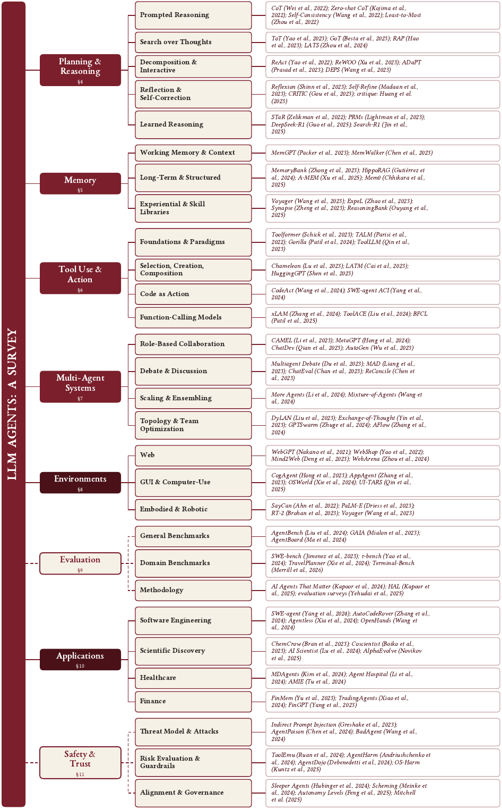

<h1 align="center">🤖 Awesome LLM Agent Papers</h1>

<p align="center"><a href="README.md">English</a> · <a href="README.ko.md">한국어</a> · <b>简体中文</b> · <a href="README.ja.md">日本語</a> · <a href="README.pt-BR.md">Português</a> · <a href="README.es.md">Español</a></p>

<p align="center">
<b>200+ 篇必读论文，持续增加中</b>：一份带注解的阅读清单，帮你构建会规划、会记忆、<br>
会使用工具、能相互协作的 LLM 智能体。本清单是综述 <i>“LLM Agents: A Survey”</i> 的配套资料。
</p>

<!-- Identity & credibility -->
<p align="center">
<a href="https://awesome.re"></a>

<a href="https://doi.org/10.20944/preprints202608.0265.v1"></a>
<a href="LICENSE"></a>
<a href="CONTRIBUTING.md"></a>
</p>

<!-- Live star / fork counts. -->
<p align="center">
<a href="https://github.com/js-lee-AI/awesome-llm-agent-papers/stargazers"></a>
<a href="https://github.com/js-lee-AI/awesome-llm-agent-papers/network/members"></a>
</p>

<p align="center">
📄 <b><a href="https://www.preprints.org/manuscript/202608.0265">阅读综述 → “LLM Agents: A Survey”</a></b> &nbsp;·&nbsp; <a href="paper/llm-agents-a-survey.pdf">本仓库中的 PDF</a><br>📖 <b><a href="https://llm-agents-a-survey.gitbook.io/llm-agents-a-survey-docs/zh/">GitBook 在线电子书</a></b> &nbsp;·&nbsp; ⭐ <b><a href="#starter-kit">从入门必读开始</a></b>
</p>

<p align="center"><sub><i> LLM agents · LLM agent papers · autonomous agents · agentic AI · multi-agent systems · tool use · ReAct · planning · memory · agent benchmarks · agent safety &amp; prompt injection</i></sub></p>

<p align="center"></p>

## ✨ 亮点

| | 这里有什么 |
|---|---|
| 📚 **比综述收录更全** | 收录 *“LLM Agents: A Survey”* 引用的 228 篇参考文献，以及论文完成后发表的论文，新论文也在陆续加入。 |
| 🧭 **按功能组织** | 沿用综述的结构，分为 10 个部分：综述、架构、规划、记忆、工具使用、多智能体、环境、应用、评估、安全。 |
| ✍️ **附有注解** | 每个条目都用一句话说明它的贡献，注明会议或期刊及年份；有官方实现的，还附上 `[code]` 链接。 |
| ⭐ **入门必读** | 一份帮你快速入门的 [10 篇论文清单](#starter-kit)，并说明每篇为什么值得先读。 |
| 🔎 **便于查找** | [目录](#contents)标出每个部分的论文数，各部分都可以折叠。 |

**涵盖主题：** cognitive architecture · ReAct 与边推理边行动 · long-horizon 规划 · 智能体记忆 · 工具增强的 LLM · 多智能体协作 · Web / 代码 / embodied 智能体 · 智能体基准与评估 · 安全、对齐与间接 prompt injection。

> 📖 **在线阅读**：GitBook 上的 [**LLM Agents: A Survey**](https://llm-agents-a-survey.gitbook.io/llm-agents-a-survey-docs/zh/) 是论文的在线电子书版本，面向刚接触这一领域的读者，共十章，从基本概念讲起。和论文一样，书中对没有达到预期的方法和有效的方法同样重视。

> 🔁 **后续综述的论文清单**：[**Awesome Agent Loop Papers**](https://github.com/js-lee-AI/awesome-agent-loop-papers) 收录研究智能体循环本身的 524 篇论文和 60 个开源项目（框架、编码 harness、记忆与 sandbox 基础设施、skill library、注册中心），是综述 *The Agent Loop: A Survey of Control Strategies, Skills, and Harnesses for LLM Agents* 的配套清单。

这个仓库收集**基于 LLM 的智能体**方向的必读论文。这里的智能体，指具备规划、记忆、工具使用和多智能体协作能力，能分多个步骤完成长任务的语言模型。论文按综述的分类体系排列，依次是智能体的核心组成、应用环境与场景，以及评估、安全这类贯穿各部分的问题。每个条目都链接到论文；有官方实现的，也链接到代码。

这是一份**精心挑选、持续更新的清单**，并不是照搬综述的参考文献。各部分默认折叠，点击**展开 N 篇论文**即可查看。

> **图例：** ⭐ = [入门必读](#starter-kit)中的论文（建议先读） · `[code]` = 官方实现的链接。

<a id="starter-kit"></a>
## ⭐ 入门必读

刚接触这个领域？不妨从这十篇论文读起。

| # | 论文 | 方向 | 为什么先读 |
|---|-------|------|----------------|
| 1 | [ReAct: Synergizing Reasoning and Acting](https://arxiv.org/abs/2210.03629) | 规划 | 现代智能体循环的原型：推理与行动交替进行。 |
| 2 | [Reflexion: Verbal Reinforcement Learning](https://arxiv.org/abs/2303.11366) | 规划 | 把 self-reflection 存进记忆，形成不需要梯度的改进循环。 |
| 3 | [Toolformer: LMs Can Teach Themselves to Use Tools](https://arxiv.org/abs/2302.04761) | 工具使用 | 自监督工具使用的开山之作。 |
| 4 | [Generative Agents: Interactive Simulacra](https://arxiv.org/abs/2304.03442) | 多智能体 | 把记忆 + reflection 用到群体规模上，是智能体记忆设计的经典范本。 |
| 5 | [Voyager: An Open-Ended Embodied Agent](https://arxiv.org/abs/2305.16291) | 记忆 / 环境 | 靠不断扩充的可执行 skill library 实现终身学习。 |
| 6 | [Cognitive Architectures for Language Agents (CoALA)](https://arxiv.org/abs/2309.02427) | 基础 | 本清单的分类所依据的那套词汇（记忆、action space、决策循环）。 |
| 7 | [A Survey on LLM-based Autonomous Agents](https://arxiv.org/abs/2308.11432) | 综述 | 这个领域最经典的通用综述。 |
| 8 | [LLM-based Multi-Agents: A Survey](https://arxiv.org/abs/2402.01680) | 多智能体 | 多智能体方向的标准参考文献。 |
| 9 | [AgentBench: Evaluating LLMs as Agents](https://arxiv.org/abs/2308.03688) | 评估 | 跨多种环境评测智能体的标准基准。 |
| 10 | [Not what you've signed up for (Indirect Prompt Injection)](https://arxiv.org/abs/2302.12173) | 安全 | 智能体安全威胁模型的奠基论文。 |

<a id="to-watch"></a>
## 🔥 值得关注的 10 篇 (2026)

2026 年刚刚发表、已经引起关注的新研究。

| 论文 | 方向 | Stars |
|-------|------|-------|
| [GenericAgent: A Token-Efficient Self-Evolving LLM Agent via Contextual Information Density Maximization](https://arxiv.org/abs/2604.17091) | 架构 |  |
| [SimpleMem: Efficient Lifelong Memory for LLM Agents](https://arxiv.org/abs/2601.02553) | 记忆 |  |
| [AutoSci: A Memory-Centric Agentic System for the Full Scientific Research Lifecycle](https://arxiv.org/abs/2605.31468) | 应用 |  |
| [Mobile-Agent-v3.5: Multi-platform Fundamental GUI Agents](https://arxiv.org/abs/2602.16855) | 环境 |  |
| [AgentDoG: A Diagnostic Guardrail Framework for AI Agent Safety and Security](https://arxiv.org/abs/2601.18491) | 安全 |  |
| [Agentic Reasoning for Large Language Models](https://arxiv.org/abs/2601.12538) | 综述 |  |
| [UniToolCall: Unifying Tool-Use Representation, Data, and Evaluation for LLM Agents](https://arxiv.org/abs/2604.11557) | 工具使用 |  |
| [Graph-of-Agents: A Graph-based Framework for Multi-Agent LLM Collaboration](https://arxiv.org/abs/2604.17148) | 多智能体 |  |
| [Can AI Agents Answer Your Data Questions? A Benchmark for Data Agents (DataAgentBench)](https://arxiv.org/abs/2603.20576) | 评估 |  |
| [Harness Updating Is Not Harness Benefit: Disentangling Evolution Capabilities in Self-Evolving LLM Agents](https://arxiv.org/abs/2605.30621) | 规划 |  |

<sub><a href="#contents">↑ 返回目录</a></sub>

## <a id="contents"></a>目录

- [⭐ 入门必读](#starter-kit)
- [🔥 值得关注的 10 篇 (2026)](#to-watch)
- **🧭 背景**
  - [📚 综述与立场论文 (62)](#surveys)
  - [🏗️ 智能体架构与框架 (54)](#architectures)
- **🧱 第一部分：核心组成**
  - [🧠 规划与推理 (55)](#planning)
  - [💾 记忆 (60)](#memory)
  - [🔧 工具使用 (51)](#tools)
  - [🤝 多智能体系统 (59)](#multi-agent)
- **🌍 第二部分：环境与应用中的智能体**
  - [🌐 交互环境 (60)](#environments)
  - [🚀 应用领域 (60)](#applications)
- **⚖️ 第三部分：贯穿全局的问题**
  - [📊 评估与基准 (62)](#evaluation)
  - [🛡️ 安全与对齐 (62)](#safety)

## 🧭 背景

<a id="surveys"></a>
### 📚 综述与立场论文 (62)
*对应综述 §1-§3（引言、背景、分类体系）。*

<details>
<summary><b>展开 62 篇论文</b></summary>

- **[A Survey on Large Language Model based Autonomous Agents](https://arxiv.org/abs/2308.11432)** (Wang et al., arXiv 2023) - *最经典、引用量最高的通用 LLM 智能体综述。* ⭐ [[code](https://github.com/Paitesanshi/LLM-Agent-Survey)]
- **[The Rise and Potential of Large Language Model Based Agents: A Survey](https://arxiv.org/abs/2309.07864)** (Xi et al., arXiv 2023) - *与 Wang et al. 2023 并称两篇开创性的通用综述。* [[code](https://github.com/WooooDyy/LLM-Agent-Paper-List)]
- **[Cognitive Architectures for Language Agents](https://arxiv.org/abs/2309.02427)** (Sumers et al., TMLR 2023) - *描述 LLM 智能体时采用最广的一套概念与架构词汇。* ⭐ [[code](https://github.com/ysymyth/awesome-language-agents)]
- **[ReAct: Synergizing Reasoning and Acting in Language Models](https://arxiv.org/abs/2210.03629)** (Yao et al., ICLR 2023) - *现代 LLM 智能体的技术前身中，引用量最高的一篇。* ⭐ [[code](https://github.com/ysymyth/ReAct)]
- **[Reflexion: Language Agents with Verbal Reinforcement Learning](https://arxiv.org/abs/2303.11366)** (Shinn et al., NeurIPS 2023) - *确立了“self-reflection + 记忆”循环：智能体要自我改进，不必只靠基于梯度的 RL。* ⭐ [[code](https://github.com/noahshinn/reflexion)]
- **[Toolformer: Language Models Can Teach Themselves to Use Tools](https://arxiv.org/abs/2302.04761)** (Schick et al., NeurIPS 2023) - *工具使用方向的开山之作，LLM 智能体分类体系中的“工具增强”一类由它奠定。* ⭐
- **[Generative Agents: Interactive Simulacra of Human Behavior](https://arxiv.org/abs/2304.03442)** (Park et al., arXiv 2023) - *用 LLM 驱动智能体社会与模拟的奠基性示范。* ⭐ [[code](https://github.com/joonspk-research/generative_agents)]
- **[Voyager: An Open-Ended Embodied Agent with Large Language Models](https://arxiv.org/abs/2305.16291)** (Wang et al., TMLR 2023) - *LLM 智能体的开创性范例，集 embodied、代码化的 skill 和终身学习于一身。* ⭐ [[code](https://github.com/MineDojo/Voyager)]
- **[HuggingGPT: Solving AI Tasks with ChatGPT and its Friends in Hugging Face](https://arxiv.org/abs/2303.17580)** (Shen et al., NeurIPS 2023) - *“LLM 充当工具与模型的 orchestrator”这一智能体模式的奠基范例。* [[code](https://github.com/microsoft/JARVIS)]
- **[MRKL Systems: A Modular, Neuro-Symbolic Architecture that Combines Large Language Models, External Knowledge Sources and Discrete Reasoning](https://arxiv.org/abs/2205.00445)** (Karpas et al., arXiv 2022) - *LLM 工具使用与智能体架构的神经符号前身，在广为引用的工作中出现得最早。*
- **[Agent AI: Surveying the Horizons of Multimodal Interaction](https://arxiv.org/abs/2401.03568)** (Durante et al., arXiv 2024) - *把 LLM 智能体综述的范围扩展到 multimodal、embodied 的 Agent AI。*
- **[Igniting Language Intelligence: The Hitchhiker's Guide From Chain-of-Thought Reasoning to Language Agents](https://arxiv.org/abs/2311.11797)** (Zhang et al., arXiv 2023) - *把推理（CoT）文献和智能体文献连接起来。* [[code](https://github.com/Zoeyyao27/CoT-Igniting-Agent)]
- **[Large Language Model based Multi-Agents: A Survey of Progress and Challenges](https://arxiv.org/abs/2402.01680)** (Guo et al., IJCAI 2024) - *LLM 智能体中多智能体这一分支的标准参考综述。* ⭐ [[code](https://github.com/taichengguo/LLM_MultiAgents_Survey_Papers)]
- **[Understanding the Planning of LLM Agents: A Survey](https://arxiv.org/abs/2402.02716)** (Huang et al., arXiv 2024) - *奠基性综述中原本缺少专讲规划的一篇，本文补上了这一空缺。*
- **[Tool Learning with Large Language Models: A Survey](https://arxiv.org/abs/2405.17935)** (Qu et al., arXiv 2024) - *LLM 智能体工具使用方向的权威综述。* [[code](https://github.com/quchangle1/LLM-Tool-Survey)]
- **[A Survey on the Memory Mechanism of Large Language Model based Agents](https://arxiv.org/abs/2404.13501)** (Zhang et al., arXiv 2024) - *LLM 智能体记忆子系统的标准综述。* [[code](https://github.com/nuster1128/LLM_Agent_Memory_Survey)]
- **[Agentic Large Language Models, a Survey](https://arxiv.org/abs/2503.23037)** (Plaat et al., arXiv 2025) - *近期广受引用的通用综述，提出了“推理 / 行动 / 交互”这一简洁的分类体系。*
- **[Large Language Model Agent: A Survey on Methodology, Applications and Challenges](https://arxiv.org/abs/2503.21460)** (Luo et al., arXiv 2025) - *最全面、也最新（2025）的通用综述之一。* [[code](https://github.com/luo-junyu/Awesome-Agent-Papers)]
- **[Fully Autonomous AI Agents Should Not Be Developed](https://arxiv.org/abs/2502.02649)** (Mitchell et al., arXiv 2025) - *在智能体自主性问题上持反对意见的知名立场论文，引起了广泛讨论。*
- **[AI Agents vs. Agentic AI: A Conceptual Taxonomy, Applications and Challenges](https://arxiv.org/abs/2505.10468)** (Sapkota et al., arXiv 2025) - *厘清术语和概念上的混淆；领域内用法不一，因此这篇论文的引用越来越多。*
- **[LLM-Based Human-Agent Collaboration and Interaction Systems: A Survey](https://arxiv.org/abs/2505.00753)** (Zou et al., arXiv 2025) - *覆盖人与智能体协作这一分支，最早的奠基性综述就已经划出了这个方向。* [[code](https://github.com/HenryPengZou/Awesome-Human-Agent-Collaboration-Interaction-Systems)]
- **[Levels of Autonomy for AI Agents](https://arxiv.org/abs/2506.12469)** (Feng et al., arXiv 2025) - *提出一个广受引用的可操作框架，用来比较不同 LLM 智能体系统的自主程度。*
- **[Advances and Challenges in Foundation Agents: From Brain-Inspired Intelligence to Evolutionary, Collaborative, and Safe Systems](https://arxiv.org/abs/2504.01990)** (Liu et al., arXiv 2025) - *由 48 位作者合著的里程碑式综述，围绕类脑认知模块、自我进化、群体智能和安全来梳理整个领域。*
- **[The Landscape of Agentic Reinforcement Learning for LLMs: A Survey](https://arxiv.org/abs/2509.02547)** (Zhang et al., arXiv 2025) - *Agentic RL 的经典综述：把 LLM 当作做决策的智能体来训练，而不是当作被动的生成器。*
- **[A Comprehensive Survey of Self-Evolving AI Agents: A New Paradigm Bridging Foundation Models and Lifelong Agentic Systems](https://arxiv.org/abs/2508.07407)** (Fang et al., arXiv 2025) - *梳理智能体利用交互数据优化自身组件的技术，把基础模型和终身运行的智能体系统衔接起来。*
- **[Deep Research Agents: A Systematic Examination and Roadmap](https://arxiv.org/abs/2506.18096)** (Huang et al., arXiv 2025) - *第一篇系统梳理 long-horizon 自主研究智能体（搜索、工具使用、报告撰写）的综述。*
- **[A Survey of AI Agent Protocols](https://arxiv.org/abs/2504.16736)** (Yang et al., arXiv 2025) - *梳理正在形成的协议层（MCP、A2A 及其后继者），并为智能体互操作标准提出评估维度。*

- **[Agentic Reasoning for Large Language Models](https://arxiv.org/abs/2601.12538)** (Wei et al., arXiv 2026) - *这篇综述把 agentic reasoning 分为单智能体、自我进化、多智能体三层，打通了上下文内推理与后训练。* [[code](https://github.com/weitianxin/Awesome-Agentic-Reasoning)]
- **[Memory for Autonomous LLM Agents: Mechanisms, Evaluation, and Emerging Frontiers](https://arxiv.org/abs/2603.07670)** (Du et al., arXiv 2026) - *把智能体记忆看作“写入、管理、读取”的循环，并按机制、基准和应用建立分类体系。*
- **[Anatomy of Agentic Memory: Taxonomy and Empirical Analysis of Evaluation and System Limitations](https://arxiv.org/abs/2602.19320)** (Jiang et al., arXiv 2026) - *为智能体记忆结构建立分类体系，并用实证揭示各系统普遍存在的基准饱和与指标效度问题。*
- **[Beyond Individual Intelligence: Surveying Collaboration, Failure Attribution, and Self-Evolution in LLM-based Multi-Agent Systems](https://arxiv.org/abs/2605.14892)** (Qi et al., arXiv 2026) - *提出统一的“LIFE”框架（foundation、integrate、find faults、evolve），涵盖多智能体协作、failure attribution 和自我进化。*
- **[A Technical Taxonomy of LLM Agent Communication Protocols](https://arxiv.org/abs/2606.19135)** (Sander et al., arXiv 2026) - *从五个维度分析九种开放的智能体间协议，并预测它们会收敛到联邦式的协议栈。*
- **[Bridging the Agent-World Gap: Text World Models for LLM-based Agents](https://arxiv.org/abs/2606.09032)** (Li et al., arXiv 2026) - *系统梳理文本世界模型（LLM-as-WM 与 code-as-WM），这类模型让智能体能显式预测环境，用于规划和验证。* [[code](https://github.com/sustech-nlp/awesome-text-world-models)]
- **[Agents That Know Too Much: A Data-Centric Survey of Privacy in LLM Agents](https://arxiv.org/abs/2606.26627)** (Lahjouji et al., arXiv 2026) - *以数据为中心的综述，按数据暴露的环节（而非攻击类型）来组织智能体隐私研究，并标出治理上的空白。*
- **[Self-Improvements in Modern Agentic Systems: A Survey](https://arxiv.org/abs/2607.13104)** (Ren et al., arXiv 2026) - *把现代智能体看作基础模型加上负责运行的 scaffold，并按更新的对象（权重还是 scaffold）和驱动变化的信号来组织自我改进方法。* [[code](https://github.com/selfimproving-agent/awesome-Self-Improving-Agents)]
- **[Dynamic Agent Skills: A Lifecycle Survey and Taxonomy of Evolving Skill Libraries](https://arxiv.org/abs/2607.10113)** (Li et al., arXiv 2026) - *综述 124 篇关于可演化 skill library 的论文，把它看作按生命周期管理的制品库，并主张决定成败的是准入和修复，而不是获取。*
- **[From Question Answering to Task Completion: A Survey on Agent System and Harness Design](https://arxiv.org/abs/2606.20683)** (Guo et al., arXiv 2026) - *从“模型与 harness”之分来看智能体，把 harness 拆成六项运行时职责，追问性能瓶颈究竟在哪里。* [[code](https://github.com/ggjy/Awesome-Agent-Engineering)]
- **[Isolation as a First-Class Principle for LLM-Agent System Safety: Concepts, Taxonomy, Challenges and Future Directions](https://arxiv.org/abs/2607.12406)** (Jing et al., arXiv 2026) - *立场论文，把 prompt injection、工具滥用和 memory poisoning 重新归结为同一个结构性问题：智能体的五个接口都缺少隔离边界。*
- **[Always-On Agents: A Survey of Persistent Memory, State, and Governance in LLM Agents](https://arxiv.org/abs/2606.30306)** (Ding et al., arXiv 2026) - *梳理 435 项工作，对象是能跨会话保留持久状态的智能体，发现文献偏重积累与检索，却忽视了治理与恢复。*
- **[Externalization in LLM Agents: A Unified Review of Memory, Skills, Protocols and Harness Engineering](https://arxiv.org/abs/2604.08224)** (Zhou et al., arXiv 2026) - *把智能体的演进理解为外部化：能力从权重中迁出，转移到记忆、skill、协议和 harness 基础设施里。*
- **[SoK: Agentic Skills -- Beyond Tool Use in LLM Agents](https://arxiv.org/abs/2602.20867)** (Jiang et al., arXiv 2026) - *把 agentic skill 系统化为可复用、可调用的流程，并划清 skill 与原子工具调用之间的界线。*
- **[From Storage to Experience: A Survey on the Evolution of LLM Agent Memory Mechanisms](https://arxiv.org/abs/2605.06716)** (Luo et al., arXiv 2026) - *把智能体记忆的演进分为从存储到 reflection 再到经验的三个阶段，驱动力是一致性、动态性和持续学习。* [[code](https://github.com/FeishuLuo/Evolving-LLM-Agent-Memory-Survey)]
- **[LLM agents security duality: a comprehensive survey of self-security and empowered cybersecurity](https://arxiv.org/abs/2606.28450)** (Xu et al., arXiv 2026) - *这篇综述按威胁来源的分类体系，把 LLM 智能体面临的安全威胁和缓解措施放在一起梳理，同时提出一个框架，把智能体能力映射到网络攻防的完整生命周期上。*
- **[Agentic Environment Engineering for Large Language Models: A Survey of Environment Modeling, Synthesis, Evaluation, and Application](https://arxiv.org/abs/2606.12191)** (Li et al., arXiv 2026) - *沿着建模、合成、评估、应用这条工程生命周期，梳理面向 LLM 智能体的环境研究，并提出按八项属性划分环境的方法。*
- **[Toward Efficient Agents: Memory, Tool learning, and Planning](https://arxiv.org/abs/2601.14192)** (Yang et al., arXiv 2026) - *综述 LLM 智能体系统在三个组成部分（记忆、工具学习、规划）上的效率，把效果与成本的权衡看作一条 Pareto 前沿。*
- **[Agentic Artificial Intelligence (AI): Architectures, Taxonomies, and Evaluation of Large Language Model Agents](https://arxiv.org/abs/2601.12560)** (Arunkumar V et al., arXiv 2026) - *这篇综述为 LLM 智能体提出统一的六组件分类体系（感知、大脑、规划、行动、工具使用、协作），回顾其架构、运行环境和评估实践，最后讨论 hallucination 引发的错误行动、无限循环和 prompt injection 等尚未解决的问题。*
- **[A Survey on Long-Term Memory Security in LLM Agents: Attacks, Defenses, and Governance Across the Memory Lifecycle](https://arxiv.org/abs/2604.16548)** (Lin et al., arXiv 2026) - *梳理 LLM 智能体 long-term memory 面临的安全威胁，按记忆生命周期的六个阶段和四项安全目标整理攻击、防御与治理，并倡导“Verifiable Memory Governance”框架。*
- **[Uncertainty Quantification in LLM Agents: Foundations, Emerging Challenges, and Opportunities](https://arxiv.org/abs/2602.05073)** (Oh et al., arXiv 2026) - *主张不确定性量化必须从单轮问答转向交互式智能体，给出通用的形式化定义，并指出智能体特有的四项挑战：估计器的选择、异质实体、不确定性的动态变化，以及缺少细粒度基准。*
- **[Multi-Agent Debate Strategies: Survey, Taxonomy, and Challenges](https://arxiv.org/abs/2607.26212)** (Motger et al., arXiv 2026) - *回顾 141 项多智能体辩论研究，发现这个领域已默认采用静态、fully connected 的拓扑加投票，这是沿袭惯例的结果，并非来自对照比较。*
- **[Beyond the Leaderboard: A Synthesis of Tool-Use, Planning, and Reasoning Failures in Large Language Model Agents](https://arxiv.org/abs/2607.05775)** (Albayaydh et al., arXiv 2026) - *综合 19 个基准上的 27 篇评估论文，归纳出六类失败，发现失败会随任务长度非线性地叠加，而增加 scaffold 并不能稳定地提高可靠性。*
- **[How Agents Ask for Permission: User Permissions for AI Agents, from Interfaces to Enforcement](https://arxiv.org/abs/2607.13718)** (Michael et al., arXiv 2026) - *对照五个商用智能体考察 21 种智能体权限方案，按用户级策略如何制定、如何从用户输入推导、如何在运行时执行来分类，并指出仍有哪些缺口。*
- **[Blockchain Empowered Trustworthy Agent Networks: Foundations, Taxonomy, and Future Directions](https://arxiv.org/abs/2608.04626)** (Zhu et al., arXiv 2026) - *梳理 1980 到 2026 年间从经典多智能体系统走向开放智能体网络的历程，指出一旦分属不同主体的智能体彼此交易，信任问题就上升到网络层面，单智能体的安全机制无法解决。*
- **[Software Engineering for and with GUI Agent](https://arxiv.org/abs/2608.09278)** (Yu et al., arXiv 2026) - *回顾 2018 年 1 月到 2026 年 4 月的 336 篇 GUI 智能体论文，发现架构正收敛到模块化的“感知、推理、行动”循环，而恢复、转交人工、安全约束的执行和可审计性仍发展不足；评估依然以任务成功为中心，不同协议之间难以比较。*
- **[Agent Safety Should Be a Runtime Contract](https://arxiv.org/abs/2608.11274)** (Ng et al., arXiv 2026) - *立场论文，主张把智能体安全放进 harness，作为一份运行时契约：一面是预防（sandbox、权限关卡、监控器），一面是留证（测试执行、日志采集、文件 diff）。论据包括 52 起有记录的事故、对 12 个公开智能体系统的 trajectory schema 审计，以及对 2023 到 2025 年 NeurIPS、ICML、ICLR 全部 28,560 篇论文的标题级审计；后者显示，合并来看，训练阶段与部署阶段的论文数量相差 8 到 12 倍。*
- **[Information Retrieval Misses the Mark for LLM Agents](https://doi.org/10.2139/ssrn.6903579)** (Sun et al., SSRN 2026) - *立场论文，回应从实际部署中得出的“RAG 已死，智能体只需要 grep”这一解读：它承认底层条件确实变了，但认为错位是结构性的，体现在五个维度上。IR 预设的语料、输入、目标、episode 和可检索单元，放到一个会规划、会浏览、会调用工具、还要自己决定是否继续搜索的智能体身上，全都不合适。为检验这一差距，作者固定智能体，在 HotpotQA-distractor 和 2WikiMultihopQA 上轮换 BM25、向量、grep、混合和闭卷检索，最后主张把检索重新定义为一种以状态为条件的证据获取策略。*
- **[Terminal Agents: A Survey of AI Agents in Command-Line Environments](https://arxiv.org/abs/2608.20485)** (Bin et al., arXiv 2026) - *以终端而不是任务领域作为组织视角，研究那些靠命令执行和文本反馈推动循环前进的智能体，并用七维能力画像从架构、能力习得和评估几个方面加以梳理。综述自己在固定条件下做的诊断显示，不同的基准家族暴露出不同的过程信号，配对的系统比较结果也取决于基准，这限制了任何结果能在多大程度上归因于单个组件。*
- **[Autonomous Research Agents: A Survey of AI Scientists and the Verification Gap](https://arxiv.org/abs/2608.05179)** (Ding et al., arXiv 2026) - *从筛选出的 125 个 AI 科学家系统中选取 26 个，按七个审计维度编码，发现瓶颈已从能力转向可检验性：24 个可运行系统中 83% 公开了代码，但只有 38% 公开了随机种子或执行 trace，也只有 38% 报告了任何形式的新颖性验证；九个闭环系统里有七个只是机械地重跑，整个语料中找不到一个经过外部验证的循环内 oracle。*
- **[Jev in the Wild: A Data-Driven Analysis of the Jev Model's Functionality, Applications and Ecosystem](https://arxiv.org/abs/2609.30216)** (Ling et al., arXiv 2026) - *收集 Jev 发布一周后 GitHub 上 2,170 个使用 Jev 的公开项目并加以分类，发现它更多用于判断输入，而不是选择动作：77% 的项目用到属性判断，31% 用到动作选择，不过在界面智能体和模拟与控制类项目中，动作选择约占标签的一半；routing 和界面智能体项目只占 19.6%，却获得了 63% 的 star。哪些仓库计入、每个项目如何标注，都由一个 LLM 智能体决定，再由第二个智能体复核，论文没有报告与人工标注的对比。*
- **[Why Agentic Workflows Fail: A Taxonomy Derived from Literature and Empirical Data](https://arxiv.org/abs/2610.17418)** (Li et al., arXiv 2026) - *沿四个维度为智能体 workflow 的失败编码：责任来源（智能体、外部系统或两者）、65 种类型中的失败机制、workflow 阶段和智能体能力，并把这套方案用于来自论文的 397 条失败记录，以及来自 229 个仓库的 GitHub issue 和 pull request 的 1,196 条记录。GitHub 上的失败集中在执行中的动作环节，占记录的 64.8%，文献中只占 14.1%，其中 61% 并非智能体的过错，例如外部 API 出错；后来论文中的 69 条记录有 68 条能归入现有类型，这些计数也不是发生率的估计。*
- **[Distilling Agentic Systems: A Roadmap across Models, Artifacts, and Harnesses](https://arxiv.org/abs/2609.36630)** (Luo et al., arXiv 2026) - *把 distillation 的对象从教师模型扩展到教师智能体，并按学生把学到的东西保存在哪里来整理文献：权重中，记忆、skill 和工具等可复用的产物中，通过 workflow、路由和验证体现在执行 harness 中，或者跨越这几处，例如把文本形式的 workflow 编译成控制器，或把某个产物变成强制执行的规则；它要求每个迁移主张给出内在、因果和 end-to-end 三类证据，结论是没有哪一处普遍更优，不过每种方法只被归入一个主要位置。*
- **[Agentic Societies Need a Social Harness](https://arxiv.org/abs/2609.17527)** (Chugh et al., arXiv 2026) - *主张代表不同的人行事的智能体，在各自的 harness 之上还需要一个管理智能体之间消息的社会 harness，并用为大学安排会议的 OpenClaw 智能体来支持这一主张，智能体全部使用 GPT-5.4，或其中一个改用 Claude Opus 4.8。每种设置运行十次：若对每个对方各用一个隔离会话，混合配置在助教多于一人的小组会议上全部失败，共享会话则在七名助教时把成功率从 0% 提高到 90%；智能体转达的虚假取消声明在 GPT-5.4 的运行中 100% 得逞。文中提出的五层结构从可验证的身份到社会制度，既没有实现，也没有评估成本。*
- **[Harness Engineering for Language Agents: The Harness Layer as Control, Agency, and Runtime](https://doi.org/10.20944/preprints202603.1756.v2)** (He et al., Preprints 2026) - *立场论文，把模型周围的这一层分成 control（指令、仓库地图、测试、权限）、agency（模型行动时经由的工具、接口和角色）和 runtime（记忆、检查点、重试、预算），并提出 HarnessCard，一种把智能体的 harness 与模型一起报告的模板。在对 63 篇工作的梳理中，38 篇论文和基准最常突出可观测性、接口和反馈，25 篇工程笔记、协议和文章则更常突出 runtime、control 和治理。作者说明，这项梳理是在挑选出的材料上用带有解读成分的标签查看哪些部分更显眼，而不是对整个领域的统计；论文在很大程度上依赖少数前沿机构的工程笔记，也没有做区分模型效应与 harness 效应的实验。*
</details>

<sub><a href="#contents">↑ 返回目录</a></sub>

<a id="architectures"></a>
### 🏗️ 智能体架构与框架 (54)
*对应综述 §2（背景）以及贯穿全文的示例。*

<details>
<summary><b>展开 54 篇论文</b></summary>

- **[Auto-GPT for Online Decision Making: Benchmarks and Additional Opinions](https://arxiv.org/abs/2306.02224)** (Yang et al., arXiv 2023) - *AutoGPT 自主智能体设计模式影响广泛，却没有对应的论文；这是针对它的唯一一项接近同行评审水准的实证研究。* [[code](https://github.com/younghuman/LLMAgent)]
- **[AgentBench: Evaluating LLMs as Agents](https://arxiv.org/abs/2308.03688)** (Liu et al., ICLR 2024) - *在异构环境中衡量单智能体通用能力的标准参考基准。* ⭐ [[code](https://github.com/THUDM/AgentBench)]
- **[WebArena: A Realistic Web Environment for Building Autonomous Agents](https://arxiv.org/abs/2307.13854)** (Zhou et al., ICLR 2024) - *网页浏览类单智能体架构事实上的标准测试平台。* [[code](https://github.com/web-arena-x/webarena)]
- **[Gorilla: Large Language Model Connected with Massive APIs](https://arxiv.org/abs/2305.15334)** (Patil et al., NeurIPS 2024) - *单智能体工具使用的关键论文，证明微调加检索能让智能体可靠地调用大规模的真实 API 目录。* [[code](https://github.com/ShishirPatil/gorilla)]
- **[ReWOO: Decoupling Reasoning from Observations for Efficient Augmented Language Models](https://arxiv.org/abs/2305.18323)** (Xu et al., arXiv 2023) - *一个影响很大的 ReAct 循环替代方案，着眼于效率，体现了架构设计上“先规划后执行”与“交替进行”两种取向的区别。* [[code](https://github.com/billxbf/ReWOO)]
- **[Tree of Thoughts: Deliberate Problem Solving with Large Language Models](https://arxiv.org/abs/2305.10601)** (Yao et al., NeurIPS 2023) - *核心的深思式搜索推理架构，LATS 等后来的单智能体规划与搜索框架都建立在它之上。* [[code](https://github.com/princeton-nlp/tree-of-thought-llm)]
- **[WebGPT: Browser-assisted question-answering with human feedback](https://arxiv.org/abs/2112.09332)** (Nakano et al., arXiv 2021) - *ChatGPT 之前的早期工作，是现代 LLM Web 智能体的前身，确立了“浏览工具使用 + 人类反馈”的模式。*
- **[SELF-REFINE: Iterative Refinement with Self-Feedback](https://arxiv.org/abs/2303.17651)** (Madaan et al., NeurIPS 2023) - *极简、应用广泛的单智能体自我改进循环，许多更大的智能体架构都把它当作子程序复用。* [[code](https://github.com/madaan/self-refine)]
- **[SWE-agent: Agent-Computer Interfaces Enable Automated Software Engineering](https://arxiv.org/abs/2405.15793)** (Yang et al., NeurIPS 2024) - *说明接口设计会实质性地改变单智能体的能力，这一思路如今已是编码智能体设计的标准做法。* [[code](https://github.com/princeton-nlp/SWE-agent)]
- **[Language Agent Tree Search Unifies Reasoning, Acting, and Planning in Language Models](https://arxiv.org/abs/2310.04406)** (Zhou et al., ICML 2024) - *将基于搜索的规划与 ReAct/Reflexion 一脉融合，是这一方向的前沿成果。* [[code](https://github.com/lapisrocks/LanguageAgentTreeSearch)]
- **[Executable Code Actions Elicit Better LLM Agents](https://arxiv.org/abs/2402.01030)** (Wang et al., ICML 2024) - *确立了“code-as-action”的思路，使之成为单智能体 action space 设计中一种主流的替代方案。* [[code](https://github.com/xingyaoww/code-act)]
- **[Describe, Explain, Plan and Select: Interactive Planning with Large Language Models Enables Open-World Multi-Task Agents](https://arxiv.org/abs/2302.01560)** (Wang et al., NeurIPS 2023) - *面向开放世界与 embodied 任务的关键单智能体规划架构。* [[code](https://github.com/CraftJarvis/MC-Planner)]
- **[OS-Copilot: Towards Generalist Computer Agents with Self-Improvement](https://arxiv.org/abs/2402.07456)** (Wu et al., arXiv 2024) - *近期的一项代表性工作：一个通用、可自我改进的操作系统级单智能体，把 AutoGPT 式的自主性扩展到真实的计算机环境。* [[code](https://github.com/OS-Copilot/OS-Copilot)]
- **[AppAgent: Multimodal Agents as Smartphone Users](https://arxiv.org/abs/2312.13771)** (Zhang et al., CHI 2025) - *近期具有代表性的单智能体架构，把 ReAct 与工具使用范式扩展到 GUI 和手机操控。* [[code](https://github.com/TencentQQGYLab/AppAgent)]
- **[The Landscape of Emerging AI Agent Architectures for Reasoning, Planning, and Tool Calling: A Survey](https://arxiv.org/abs/2404.11584)** (Masterman et al., arXiv 2024) - *专门讨论智能体架构设计模式的综述，与单智能体框架的分类直接相关。*
- **[MetaGPT: Meta Programming for A Multi-Agent Collaborative Framework](https://arxiv.org/abs/2308.00352)** (Hong et al., ICLR 2024) - *广受引用的框架，展示单智能体的角色与流程模板如何提高可靠性，标志着框架设计从单智能体走向多智能体的转折点。* [[code](https://github.com/geekan/MetaGPT)]
- **[Gemini 2.5: Pushing the Frontier with Advanced Reasoning, Multimodality, Long Context, and Next Generation Agentic Capabilities](https://arxiv.org/abs/2507.06261)** (Comanici et al., arXiv 2025) - *前沿模型的技术报告，把智能体的工具使用和 computer use 列为主打能力。*
- **[Kimi K2: Open Agentic Intelligence](https://arxiv.org/abs/2507.20534)** (Kimi Team, arXiv 2025) - *明确围绕大规模 agentic 后训练打造的旗舰开放模型。* [[code](https://github.com/MoonshotAI/Kimi-K2)]

- **[GenericAgent: A Token-Efficient Self-Evolving LLM Agent via Contextual Information Density Maximization](https://arxiv.org/abs/2604.17091)** (Liang et al., arXiv 2026) - *一个节省 token 的自我进化智能体，会不断积累上下文经验；也是 2026 年 star 数最多的智能体框架之一。* [[code](https://github.com/lsdefine/GenericAgent)]
- **[Orchestral AI: A Framework for Agent Orchestration](https://arxiv.org/abs/2601.02577)** (Roman et al., arXiv 2026) - *在统一接口背后组合、编排各种专门化智能体的框架。* [[code](https://github.com/orchestralAI/orchestral-ai)]
- **[AgentArk: Distilling Multi-Agent Intelligence into a Single LLM Agent](https://arxiv.org/abs/2602.03955)** (Luo et al., arXiv 2026) - *通过 distillation 把多智能体的智能压缩进单个 LLM 智能体，以更低的成本保留协作带来的收益。* [[code](https://github.com/AIFrontierLab/AgentArk)]
- **[The Interplay of Harness Design and Post-Training in LLM Agents](https://arxiv.org/abs/2606.25447)** (Kim et al., arXiv 2026) - *表明 harness 设计与后训练相互影响，因此考虑 harness 的后训练能同时提升分布内与分布外的表现。*
- **[Next-Generation Agentic Reinforcement Learning Systems Enable Self-Evolving Agents](https://arxiv.org/abs/2607.01120)** (Ran Yan et al., arXiv 2026) - *认为关键在于 agentic RL 的系统栈而不是算法：正是系统栈让智能体不只修改权重，还能修改自身组件。*
- **[From Atomic Actions to Standard Operating Procedures: Iterative Tool Optimization for Self-Evolving LLM Agents](https://arxiv.org/abs/2607.07321)** (Ding et al., arXiv 2026) - *从执行 trace 中找出反复出现的行动序列，合成为可调用的高阶流程，再合并、评估并剪枝由此得到的工具集。*
- **[Self-Evolving World Models for LLM Agent Planning](https://arxiv.org/abs/2606.30639)** (Zhang et al., arXiv 2026) - *在测试时改进智能体内部的世界模型，同时保持执行器不变，让“规划、模拟”这一循环更加紧凑。*
- **[Scaling Self-Evolving Agents via Parametric Memory](https://arxiv.org/abs/2606.04536)** (Ren et al., arXiv 2026) - *把自我进化从 context window 挪到参数里，积累的经验可以不断扩展，提示词却不必随之变长。*
- **[Inside the Scaffold: A Source-Code Taxonomy of Coding Agent Architectures](https://arxiv.org/abs/2604.03515)** (Rombaut et al., arXiv 2026) - *从源码层面为 13 个开源编码智能体 scaffold 建立分类体系，找出五种可组合的循环原语，各系统都在反复重组它们。*
- **[Agentic Harness Engineering: Observability-Driven Automatic Evolution of Coding-Agent Harnesses](https://arxiv.org/abs/2604.25850)** (Lin et al., arXiv 2026) - *根据可观测性信号自动演化编码智能体的 harness，把 Terminal-Bench 2 的成绩从 69.7 提高到 77.0。*
- **[AgentFactory: A Self-Evolving Framework Through Executable Subagent Accumulation and Reuse](https://arxiv.org/abs/2603.18000)** (Zhang et al., arXiv 2026) - *把成功的解法存为可复用、可执行的子智能体代码而不是文本提示词，以此积累能力，并借执行反馈不断改进。* [[code](https://github.com/zzatpku/AgentFactory)]
- **[CORAL: Towards Autonomous Multi-Agent Evolution for Open-Ended Discovery](https://arxiv.org/abs/2604.01658)** (Qu et al., COLM 2026) - *用长期运行的智能体取代硬编码的探索规则：这些智能体在相互隔离的工作区中工作，与评估器分离，通过共享的持久记忆探索、复盘和协作。它在 10 个优化任务上达到 SOTA，单次评估的改进速度高出 3 到 10 倍；四个协同进化的智能体把 Anthropic 的 kernel 任务从 1363 个周期降到 1103 个。* [[code](https://github.com/Human-Agent-Society/CORAL)]
- **[LogicHunter: Testing LLM Agent Frameworks with an Agentic Oracle](https://arxiv.org/abs/2607.06195)** (Long et al., arXiv 2026) - *提出 LogicHunter：一个由规格说明驱动的模糊测试框架，配有基于 ReAct 的智能体 oracle，能检索文档、浏览源码、检查运行时状态；在三个广泛部署的智能体框架上发现了 40 个此前未知的 bug，其中 30 个已确认、26 个已修复，oracle 的精确率为 91.17%，而最好的被动方法为 29.27%。*
- **[AgentFlow: Building Agent Dependency Graphs for Static Analysis of Agent Programs](https://arxiv.org/abs/2607.01640)** (Wang et al., arXiv 2026) - *AgentFlow 是一个静态分析框架：它构建与框架无关的 Agent Dependency Graph，图中带类型的节点涵盖智能体、提示词、模型、能力、记忆状态和控制策略，从 LLM 智能体源码中还原智能体之间的依赖关系；在 5,399 个真实世界的智能体程序中，发现了 238 个从提示词流向工具的污点类风险。*
- **[SEAGym: An Evaluation Environment for Self-Evolving LLM Agents](https://arxiv.org/abs/2606.17546)** (Zheng et al., arXiv 2026) - *SEAGym 是面向自我进化 LLM 智能体的评估环境，从训练、验证、held-out 测试、回放和成本等维度衡量智能体对 harness 的修改，而不是只给出单一的任务分数。*
- **[Harness-MU: A Safe, Governed, and Effective Harness for Multi-User LLM Agents](https://arxiv.org/abs/2606.21856)** (Fan et al., arXiv 2026) - *提出 Harness-MU：一个与模型无关、无需调优的 harness，靠确定性的执行钩子而不是模型内部的防护，为 LLM 智能体实施多主体访问控制。* [[code](https://github.com/YuanJrShiuan/Harness-MulUser)]
- **[Co-Evolving Skill Generation and Policy Optimization](https://arxiv.org/abs/2606.08755)** (Zhang et al., arXiv 2026) - *为 skill 增强的语言智能体提出一个在线框架：用配对的对照组（检索到的 skill 中包含与不包含候选 skill）估计每个候选 skill 随上下文变化的边际效用，在存入之前筛掉无效或有害的 skill，且不超出标准的 rollout 预算；同时训练策略本身去生成 skill。*
- **[DemoEvolve: Overcoming Sparse Feedback in Agentic Harness Evolution with Demonstrations](https://arxiv.org/abs/2605.24539)** (Che et al., arXiv 2026) - *DemoEvolve 用人类专家的示范 trajectory 引导智能体 harness 演化中的搜索，解决 Balatro 这类复杂随机环境里奖励稀疏带来的不稳定；在这些环境中，光靠自我练习很难奏效。*
- **[Self-Evolving Software Agents](https://arxiv.org/abs/2604.27264)** (Robol et al., arXiv 2026) - *提出一种把 BDI（Belief-Desire-Intention）推理与大语言模型结合起来的架构，其中的自动演化模块从经验中提炼新需求，并生成相应的设计和代码。*
- **[Codified Context: Infrastructure for AI Agents in a Complex Codebase](https://arxiv.org/abs/2602.20478)** (Vasilopoulos et al., arXiv 2026) - *提出由三部分组成的基础设施（一份约定“宪章”、19 个专门化智能体、一个包含 34 份规格文档的知识库），为 LLM 编程助手提供持久的上下文。* [[code](https://github.com/arisvas4/codified-context-infrastructure)]
- **[LLM-as-a-Verifier: A General-Purpose Verification Framework](https://arxiv.org/abs/2607.05391)** (Kwok et al., arXiv 2026) - *把验证当作一条独立的 scaling 轴：从评分 token 的 logits 得到连续分数，再沿粒度、重复评估和标准分解几个方向扩展，无需额外训练就在 Terminal-Bench V2 上达到 86.5%。* [[code](https://github.com/llm-as-a-verifier/llm-as-a-verifier)]
- **[Molt: A Scalable PyTorch-Native Training Framework for Agentic Reinforcement Learning](https://arxiv.org/abs/2607.21653)** (Hu et al., arXiv 2026) - *表明一个紧凑的 PyTorch 原生 agentic RL 训练器（小到研究者或编程助手都能从头读到尾）在统计上与基于 Megatron 的训练栈不相上下。* [[code](https://github.com/NVIDIA-NeMo/labs-molt)]
- **[Baselines Before Architecture: Evaluating Coding Agents for Autonomous Penetration Testing](https://arxiv.org/abs/2607.13085)** (Dhakal et al., arXiv 2026) - *默认配置的编码 CLI 智能体已能解出 XBOW 基准 104 个任务中的很大一部分；在模型相同的条件下，反复运行朴素智能体就能追平已发表的 harness 架构。*
- **[Argus: A General-Purpose Agentic Runtime for Long-Horizon Reasoning](https://arxiv.org/abs/2608.05144)** (Li et al., arXiv 2026) - *一个持久运行时：Manager、Planner、Engineer 和 Reviewer 在持久的项目状态上执行有边界的任务，记忆、skill 和验证器都要先经过对应角色的审查才能加入。权重保持不变，它在 SWE-Bench Pro 上得到 78%，直接调用的 baseline 为 59%，这一差距完全来自运行时状态。*
- **[Architectural Implications of Agentic AI Workflows](https://arxiv.org/abs/2608.04458)** (Yang et al., arXiv 2026) - *通过 Azure 的生产环境研究，把智能体负载当作数据中心问题来刻画，发现编排和工具让 CPU 落到 critical path 上，而碎片化的执行会让传统同构服务器上的 CPU 和 GPU 算力都闲置下来。*
- **[Ouroboros: A Self-Developing Frontier Coding Agent with Reviewed Core Evolution](https://arxiv.org/abs/2608.08311)** (Razzhigaev et al., arXiv 2026) - *一个编码智能体 harness，它的工具、提示词、上下文组装和核心实现都通过审查过的 commit 来改进，这些 commit 又成为后续工作的运行时。在冻结的 snapshot 上，它在 Terminal-Bench 2.1 上达到 86.74%，在 OSWorld-Verified 上达到 90.69%；另有一次 161 天的部署在线上持续演化。* [[code](https://github.com/razzant/ouroboros)]
- **[The Scaffolding Matters More Than the Interface: A Controlled Comparison of MCP and CLI Tool Use Across Seven Agent Scaffoldings, Five Language Models, and One Software Task](https://arxiv.org/abs/2608.08654)** (Alier Forment et al., arXiv 2026) - *用七种智能体 scaffold 和五个语言模型跑同一个固定的 git 任务，结果表明决定成本的是 scaffold，而不是 MCP 与 CLI 的接口之分：两个不支持 MCP 的 scaffold 通过 CLI 完成了全部运行，单看 CLI 运行，也比五个支持 MCP 的 scaffold 便宜 5.0 到 28 倍；十三组严格配对的 MCP/CLI 比值从 0.43 倍到 29 倍不等；MCP 运行花掉的钱有 12.9% 没换来任何完成的工作，CLI 运行只有 2.2%。*
- **[Persistent Recursive Worlds Enable Autonomous Software Evolution](https://arxiv.org/abs/2608.10450)** (Huang et al., arXiv 2026) - *让软件项目而不是智能体持久存在：生命周期有限的智能体提出局部修改，只有被接受的结果才会推进版本历史。一次超过 120 小时的运行构建出约 25 万行、用 Rust 写成的 C 编译器，通过了完整的 c-testsuite，模型 token 费用为 44 美元。*
- **[What Does Multi-Harness RL Learn? Credit Assignment and Portability in Coding Agents](https://arxiv.org/abs/2609.04518)** (Le et al., arXiv 2026) - *回放 Aider、OpenHands、Qwen Code 和 SWE-agent 的冻结记录，单独检验把多个 harness 放进同一个 advantage 组能否学到可迁移的 skill，结果发现评估时所用的 harness 影响最大，远超其他因素：在 24,000 次封存评估中，它让平均解决率从 2.14% 变到 9.27%，而训练配方带来的变化是 1.16；跨 harness 分组在一个 held-out harness 上比 harness 内分组高 0.25 个点，其置信区间跨过零，也比每条规则自身的随机种子波动范围更窄。*
- **[TROVE: Adaptive Agent Skill Orchestration via Trace-Grounded Route Validation and Editing](https://arxiv.org/abs/2609.05019)** (Wang et al., arXiv 2026) - *把规划好的路线看作暂定而非已定：离线阶段，它把评估过的 workflow 搜索 trace 提炼成原子 skill、组合 skill 和一张以结果为条件的转移图；在线阶段，它保留仍然有效的后续步骤，插入有 trace 支持的局部应对，或者只替换失效的后缀，这样运行时证据只触发局部修复，而不是大范围重新规划。消融实验显示，离线收益大多来自组合 skill，效率提升大多来自后缀替换。*
- **[SwiftSage: A Generative Agent with Fast and Slow Thinking for Complex Interactive Tasks](https://arxiv.org/abs/2305.17390)** (Lin et al., NeurIPS 2023) - *把智能体拆成两部分：一个经过微调、快速行动的小模型，以及只在行动停滞或无效等触发条件下才调用的 GPT-4 planner；在 30 类 ScienceWorld 任务上胜过 SayCan、ReAct 和 Reflexion。*
- **[R2V Agent: Teaching SLMs When to Ask for Help](https://arxiv.org/abs/2605.16604)** (Hemadri et al., arXiv 2026) - *难度会在 trajectory 中途变化，所以按步骤而不是按查询来做路由：一个用 Brier 分数做过 calibration 的 router，只在剩余失败风险高时，才从经过 distillation 的小模型转交给教师 LLM，把 TextWorld 的成功率从 64.6% 提高到 98.2%，escalation 比例为 41.7%。* [[code](https://github.com/RaghuHemadri/r2v-agent)]
- **[REFLEX with Jev for Efficient Selective Control in LLM Agents](https://arxiv.org/abs/2609.26532)** (Wu and Lim, arXiv 2026) - *让 Jev（一种不输出文本、只给出类型化决策的模型）负责智能体的有限选择，只在 confidence 低或需要文本时才调用强 LLM：在由 100 个任务组成的固定基准上成功率 95%，强模型调用减少 72.7%，但在 BFCL 和 τ 类任务上，相比廉价的生成式 cascade 几乎没有提升。*
- **[What Does a Harness Buy? Tokens, Mostly](https://arxiv.org/abs/2610.04433)** (Liu and Han, arXiv 2026) - *让五个模型分别在 Claude Code、mini-SWE-agent 和 OpenCode 中运行 SWE-bench Verified，并把每种配置重跑一遍来度量运行之间的噪声。在 447 个任务上，Claude Code 与 mini-SWE-agent 在这里运行的两个 Qwen 模型上都在 5 个点以内等效；在最难的 45 个任务上，换一个 harness 会让 13% 的任务结果翻转，与重跑一次的比例相同；唯一超出噪声的效应是 OpenCode 最多落后 9 个点。每个任务的成本则最多相差三倍，差距由固定的前置提示决定：Claude Code 为 16k token，mini-SWE-agent 不到一千。只用了一个基准。* [[code](https://github.com/YangzeLiu/what-does-a-harness-buy)]
- **[When Sub-Agents Work in Parallel: The Promises and Pitfalls of Dynamic Concurrency in Long-Horizon Coding Tasks](https://arxiv.org/abs/2610.10263)** (Li et al., arXiv 2026) - *在 354 个编码任务上开关 Codex（GPT-5.4）、Claude Code（Claude Opus 5）和 Kimi Code（Kimi K3）内置的动态并发，即由主智能体在运行时决定是否派生并行的子智能体。通过率的变化介于下降 11.9 个点和上升 2.3 个点之间，token 用量增至 1.41 到 3.31 倍；Claude Code 在 SWE-bench Verified 上从 83.0% 降到 59.0%，在 long-horizon 的 LoopsBench 上却从 7.1% 升到 21.4%；在标注的 804 个失败中，33.2% 是共享状态和合并问题。每种配置在每个任务上只运行一次。*
- **[Ask Your Advisor: Learning When to Consult Stronger Models in Agentic Systems](https://arxiv.org/abs/2610.13870)** (Sowietzki et al., arXiv 2026) - *学习廉价的执行模型何时该向更强的顾问模型求助：在 workflow 的每个接触点，根据精简的状态抽象选择保持沉默或求助，并在扣除成本的结果上用 Monte Carlo 控制来学习。在 Magentic-One 上由 gemini-3-flash-preview 执行、gemini-3.1-pro-preview 提供建议时，它在 SWE-bench Verified-Mini 上花 $22.09 达到 48.0%，只用执行模型为 18.0%，只用顾问模型则花 $45.90 达到 62.0%；它胜过 RouteLLM（$25.03 下 30.0%）和求助次数相近的随机方式（28.0%），但在 Terminal-Bench 上只与一个启发式方法持平，都是 34.7%。实验只用了一对模型、一个框架和 50 个任务的测试集。* [[code](https://github.com/Pasl4/ARIA)]
</details>

<sub><a href="#contents">↑ 返回目录</a></sub>

## 🧱 第一部分：核心组成

<a id="planning"></a>
### 🧠 规划与推理 (55)
*对应综述 §4（规划与推理）。*

<details>
<summary><b>展开 55 篇论文</b></summary>

- **[Chain-of-Thought Prompting Elicits Reasoning in Large Language Models](https://arxiv.org/abs/2201.11903)** (Wei et al., NeurIPS 2022) - *几乎所有 LLM 智能体推理与规划模块背后的基础技术，也是整个 CoT/ToT/ReAct 谱系的起点。*
- **[Self-Consistency Improves Chain of Thought Reasoning in Language Models](https://arxiv.org/abs/2203.11171)** (Wang et al., ICLR 2023) - *标准的推理阶段 ensemble 与验证策略，在智能体的推理和规划流水线中广泛复用。*
- **[Large Language Models are Zero-Shot Reasoners](https://arxiv.org/abs/2205.11916)** (Kojima et al., NeurIPS 2022) - *证明推理能力潜藏在模型之中，zero-shot 条件下靠提示就能激发，为通用的智能体提示词模板打下了关键基础。* [[code](https://github.com/kojima-takeshi188/zero_shot_cot)]
- **[Least-to-Most Prompting Enables Complex Reasoning in Large Language Models](https://arxiv.org/abs/2205.10625)** (Zhou et al., ICLR 2023) - *较早把任务分解形式化；后来几乎所有 LLM 智能体的任务 planner 都沿用了这一核心规划原语。*
- **[STaR: Bootstrapping Reasoning With Reasoning](https://arxiv.org/abs/2203.14465)** (Zelikman et al., NeurIPS 2022) - *基于 RL 的 reasoning model 训练范式（如 DeepSeek-R1、o1）的前身，这类范式用来让智能体学会自己生成推理过程。* [[code](https://github.com/ezelikman/STaR)]
- **[Graph of Thoughts: Solving Elaborate Problems with Large Language Models](https://arxiv.org/abs/2308.09687)** (Besta et al., AAAI 2024) - *把智能体使用的结构化推理与搜索框架扩展到树结构之外，在复杂多步任务上既提升质量又降低成本。* [[code](https://github.com/spcl/graph-of-thoughts)]
- **[Reasoning with Language Model is Planning with World Model](https://arxiv.org/abs/2305.14992)** (Hao et al., EMNLP 2023) - *把经典的“规划即搜索”（MCTS、世界模型）与 LLM 推理联系起来，与不确定条件下的智能体规划直接相关。* [[code](https://github.com/maitrix-org/llm-reasoners)]
- **[CRITIC: Large Language Models Can Self-Correct with Tool-Interactive Critiquing](https://arxiv.org/abs/2305.11738)** (Gou et al., ICLR 2024) - *把 self-critique 和借助工具的验证结合起来；现代智能体框架让 reflection 以外部反馈为依据，这正是其中的关键机制。* [[code](https://github.com/microsoft/ProphetNet/tree/master/CRITIC)]
- **[Plan-and-Solve Prompting: Improving Zero-Shot Chain-of-Thought Reasoning by Large Language Models](https://arxiv.org/abs/2305.04091)** (Wang et al., ACL 2023) - *广泛使用的轻量“先规划后执行”模板，许多 LLM 智能体的规划模块直接采用了它。* [[code](https://github.com/AGI-Edgerunners/Plan-and-Solve-Prompting)]
- **[ADaPT: As-Needed Decomposition and Planning with Language Models](https://arxiv.org/abs/2311.05772)** (Prasad et al., ACL 2024) - *展示了根据执行情况自适应调整的规划，在计划粒度和智能体能力之间取得平衡，是对静态“先规划后执行”智能体的重要改进。* [[code](https://github.com/archiki/ADaPT)]
- **[Self-Discover: Large Language Models Self-Compose Reasoning Structures](https://arxiv.org/abs/2402.03620)** (Zhou et al., NeurIPS 2024) - *表明 LLM 能针对每个任务自行选择推理策略，这种元推理能力是自适应智能体规划的核心。*
- **[Buffer of Thoughts: Thought-Augmented Reasoning with Large Language Models](https://arxiv.org/abs/2406.04271)** (Yang et al., NeurIPS 2024) - *代表了一类方法：从记忆中检索可复用的推理结构，把推理策略和智能体的 long-term memory 设计联系了起来。* [[code](https://github.com/YangLing0818/buffer-of-thought-llm)]
- **[Large Language Models Cannot Self-Correct Reasoning Yet](https://arxiv.org/abs/2310.01798)** (Huang et al., ICLR 2024) - *广受引用的警示性、批判性结果，提醒智能体设计不要过度依赖 self-critique 循环，并推动了以外部反馈为依据的方法。*
- **[Training Language Models to Self-Correct via Reinforcement Learning](https://arxiv.org/abs/2409.12917)** (Kumar et al., ICLR 2025) - *表明借助 RL（而不只是提示）能让 self-correction 真正奏效，直接启发了现代智能体所用 reasoning model 的后训练。*
- **[Let's Verify Step by Step](https://arxiv.org/abs/2305.20050)** (Lightman et al., ICLR 2024) - *确立了 process reward model 与步骤级验证，如今它们已是推理智能体中引导搜索和 self-critique 的标准组件。* [[code](https://github.com/openai/prm800k)]
- **[DeepSeek-R1: Incentivizing Reasoning Capability in LLMs via Reinforcement Learning](https://arxiv.org/abs/2501.12948)** (Guo et al., Nature 2025) - *里程碑式的开放 reasoning model 发布，展示了 RL 诱发的规划与 reflection 行为如何自发涌现；这些行为如今支撑着新一代推理智能体。* [[code](https://github.com/deepseek-ai/DeepSeek-R1)]
- **[Towards Reasoning in Large Language Models: A Survey](https://arxiv.org/abs/2212.10403)** (Huang et al., ACL 2023) - *最早专门讨论 LLM 推理的综述之一，引用量也名列前茅，任何 LLM 智能体综述写到推理部分，都自然会以它为核心引用。* [[code](https://github.com/jeffhj/LM-reasoning)]
- **[Large Language Models for Planning: A Comprehensive and Systematic Survey](https://arxiv.org/abs/2505.19683)** (Cao et al., arXiv 2025) - *一篇专门且最新的综述，恰好覆盖这一子主题中规划策略的部分，很适合用来支撑分类体系上的论断。* [[code](https://github.com/Quester-one/Awesome-LLM-Planning)]
- **[When Can LLMs Actually Correct Their Own Mistakes? A Critical Survey of Self-Correction of LLMs](https://arxiv.org/abs/2406.01297)** (Kamoi et al., ACL 2024) - *专门针对 self-critique 与 self-correction 的关键批判性综述；智能体综述要平衡、严谨地讨论 reflection 方法，离不开这一篇。* [[code](https://github.com/ryokamoi/llm-self-correction-papers)]
- **[Search-R1: Training LLMs to Reason and Leverage Search Engines with Reinforcement Learning](https://arxiv.org/abs/2503.09516)** (Jin et al., arXiv 2025) - *Agentic RL 的经典结果：模型只靠结果奖励，就学会了在自己的推理中穿插调用搜索引擎。* [[code](https://github.com/PeterGriffinJin/Search-R1)]
- **[ReTool: Reinforcement Learning for Strategic Tool Use in LLMs](https://arxiv.org/abs/2504.11536)** (Feng et al., arXiv 2025) - *用 RL 教会 reasoning model 在推导过程中何时、如何调用代码解释器。*

- **[Harness Updating Is Not Harness Benefit: Disentangling Evolution Capabilities in Self-Evolving LLM Agents](https://arxiv.org/abs/2605.30621)** (Lin et al., arXiv 2026) - *在自我进化智能体中把“harness 更新”和“harness 收益”区分开来，发现不同档位模型的收益曲线并不单调。* [[code](https://github.com/A-EVO-Lab/a-evolve)]
- **[Demystifying Reinforcement Learning for Long-Horizon Tool-Using Agents: A Comprehensive Recipe](https://arxiv.org/abs/2603.21972)** (Wu et al., arXiv 2026) - *一份面向 agentic RL 的实证配方，覆盖 reward shaping、模型规模、数据和算法选择，在 TravelPlanner 上达到 SOTA。* [[code](https://github.com/WxxShirley/Agent-STAR)]
- **[StraTA: Incentivizing Agentic Reinforcement Learning with Strategic Trajectory Abstraction](https://arxiv.org/abs/2605.06642)** (Xue et al., arXiv 2026) - *借助采样得到的 trajectory 抽象，联合训练策略生成与行动执行，在 ALFWorld、WebShop、SciWorld 上改进了 agentic RL。*
- **[The Self-Correction Illusion: LLMs Correct Others but Not Themselves](https://arxiv.org/abs/2606.05976)** (Chen et al., arXiv 2026) - *表明 LLM 会纠正外部给出的说法，却不纠正自己写出的相同错误；这源于对话模板中的角色标签，而不是能力上的差距。*
- **[Recursive Self-Improvement in AI: From Bounded Self-Refinement to Autonomous Research Loops](https://arxiv.org/abs/2607.07663)** (Chen et al., arXiv 2026) - *梳理从有边界的自我精炼到自主研究循环的整个谱系，并指出递归自我改进的每一步目前会在哪里失效。*
- **[SIRI: Self-Internalizing Reinforcement Learning with Intrinsic Skills for LLM Agent Training](https://arxiv.org/abs/2606.02355)** (He et al., arXiv 2026) - *用强化学习把发现的 skill 内化进策略，而不是留在外部库里。* [[code](https://github.com/kirito618/SIRI)]
- **[Agentic Chain-of-Thought Steering for Efficient and Controllable LLM Reasoning](https://arxiv.org/abs/2606.03965)** (Xia et al., arXiv 2026) - *在推理阶段引导 agentic chain-of-thought，控制推理长度，无需重新训练就能在算力与准确率之间取舍。* [[code](https://github.com/Andree-9/ACTS)]
- **[ECHO: Prune To Act, Trace To Learn With Selective Turn Memory In Agentic RL](https://arxiv.org/abs/2606.31650)** (Xie et al., arXiv 2026) - *面向 agentic RL 的选择性轮次记忆：行动时剪枝 trajectory，学习时保留 trace。*
- **[AgentTether: Graph-Guided Diagnosis and Runtime Intervention for Reliable LLM Agent Operation](https://arxiv.org/abs/2607.06273)** (Zhao et al., arXiv 2026) - *在运行过程的图上诊断智能体失败，并在运行时介入，而不只是事后分析。*
- **[Reasoning as Gradient: Scaling MLE Agents Beyond Tree Search](https://arxiv.org/abs/2603.01692)** (Zhang et al., arXiv 2026) - *在 MLE 智能体中用梯度式优化框架取代 tree search，把推理对应为梯度，把成功记忆对应为动量。* [[code](https://github.com/microsoft/RD-Agent)]
- **[MAP: A Map-then-Act Paradigm for Long-Horizon Interactive Agent Reasoning](https://arxiv.org/abs/2605.13037)** (Liu et al., arXiv 2026) - *先为环境构建认知地图再行动，把建图与行动分开，服务于 long-horizon 的交互式推理。*
- **[Learning from Trials and Errors: Reflective Test-Time Planning for Embodied LLMs](https://arxiv.org/abs/2602.21198)** (Hong et al., arXiv 2026) - *面向 embodied 智能体、带 reflection 的测试时规划，能在单个 episode 内从自己的试错中学习。* [[code](https://github.com/Reflective-Test-Time-Planning/Reflective-Test-Time-Planning)]
- **[Agora: Enhancing LLM Agent Reasoning Via Auction-Based Task Allocation](https://arxiv.org/abs/2607.09600)** (Zhou et al., arXiv 2026) - *提出基于拍卖的编排框架 Agora：它把推理步骤当作可交易的物品，让专家模型和工具按修正后的能力而不是原始 confidence 来竞价。*
- **[Training the Orchestrator: A Supervised Approach to End-to-End PDDL Planning with LLM Agents](https://arxiv.org/abs/2606.21740)** (Mangannavar et al., arXiv 2026) - *HALO 在 11 个 PDDL 领域中，用经验证器认证的计划改进 trajectory，监督训练一个用 QLoRA 调优的小型 orchestrator 策略。*
- **[Environmental Feedback Modeling Matters: Rethinking Feedback Treatment in Agentic Hindsight Self-Distillation](https://arxiv.org/abs/2610.11384)** (Guo et al., arXiv 2026) - *不用奖励信号，只凭工具输出和执行结果训练智能体，并把观测到的每条环境反馈用在两处：模型学习根据历史和行动预测这条反馈；模型的 EMA 副本拿到这条反馈作为事后信息，充当教师，通过 distillation 训练必须在看不到反馈的情况下行动的策略。使用 Qwen3-8B 时，τ-bench Retail 成功率为 43.2%，用奖励训练的 GRPO 为 39.1%，SDPO 为 36.8%；AppWorld 的 task goal completion 为 35.71，后两者分别为 32.14 和 25.00。去掉预测损失后，4B 模型的 Retail 成功率从 38.7% 降到 29.4%。两个骨干都是小型 Qwen3 模型。*
- **[Retrospective Progress-Aware Self-Refinement for LLM Agent Training](https://arxiv.org/abs/2606.14302)** (Ma et al., arXiv 2026) - *提出 RePro，一种“先执行、后回看”的 rollout 框架：LLM 智能体先在线执行行动，再结合已完成的 trajectory 和已知结果，回头重新评估每一步的进展。*
- **[LiTS: A Modular Framework for LLM Tree Search](https://arxiv.org/abs/2603.00631)** (Li et al., arXiv 2026) - *LiTS 是一个 Python 框架，把 LLM tree search 拆成可复用的 Policy、Transition 和 RewardModel 组件，支持 MCTS、BFS 等算法，并在 MATH500、Crosswords 和 MapEval 上做了评估。* [[code](https://github.com/xinzhel/lits-llm)]
- **[Localizing and Correcting Errors for LLM-based Planners](https://arxiv.org/abs/2602.00276)** (Kumar et al., arXiv 2026) - *提出 Localized In-Context Learning（L-ICL）：定位 LLM 生成的计划中违反约束的地方，并为出错的步骤注入最少量的纠正示例。*
- **[CLEANER: Self-Purified Trajectories Boost Agentic Reinforcement Learning](https://arxiv.org/abs/2601.15141)** (Xu et al., arXiv 2026) - *CLEANER 借助 Similarity-Aware Adaptive Rollback 把失败的步骤替换成成功的 self-correction，构建净化后的 agentic RL trajectory，在 AIME24/25 上用更少的训练步数提高了准确率。*
- **[VERGE: Formal Refinement and Guidance Engine for Verifiable LLM Reasoning](https://arxiv.org/abs/2601.20055)** (Singh et al., arXiv 2026) - *一个神经符号框架：把 LLM 的输出拆成原子断言，形式化为一阶逻辑，再用 SMT 求解器检验一致性，借助多模型共识迭代改进答案。*
- **[TREK: A Travel Reasoning and Evaluation Kit for LLM Agents in Complex Trip Planning](https://arxiv.org/abs/2607.26977)** (Qi et al., arXiv 2026) - *旅行规划基准，用确定性的规则评估器而不是 LLM 评估者来打分；15 个智能体中最强的一个，也只在 46.2% 的可解任务上给出完全可行的行程。* [[code](https://github.com/TonyQJH/TREK-A-Travel-Reasoning-and-Evaluation-Kit-for-LLM-Agents-in-Complex-Trip-Planning)]
- **[PRO-LONG: Programmatic Memory Enables Long-Horizon Reasoning](https://arxiv.org/abs/2607.20064)** (Fox et al., arXiv 2026) - *保留完整的结构化交互日志，再用编码智能体去检索它，在 ARC-AGI-3 上比基础编码智能体高出 18 分，并以少 4.2 到 5.8 倍的 token 追平专用 harness。* [[code](https://github.com/alexisfox7/PRO-LONG)]
- **[The Physics of Multi-Turn Long-Horizon Planning: From Pre-training to Post-training via Single- and Multi-Teacher On-Policy Agentic Distillation](https://arxiv.org/abs/2607.24720)** (Men et al., arXiv 2026) - *用受控实验考察 long-horizon 规划能力从何而来：预训练中的 CoT 状态转移建模泛化得最好，次优 trajectory 造成的伤害格外大，多教师 distillation 只能融合彼此相容的规划模式。*
- **[SearchMaster: Grounded and Regulated Self-Play for Search Agents](https://arxiv.org/abs/2608.01822)** (Tan et al., arXiv 2026) - *面向搜索智能体的自博弈方法，针对自生成数据误导模型的三种方式分别给出对策：用证据链杜绝伪多跳问题，按搜索深度而不是成功率给难度打分，对打开后从未使用的文档施加惩罚。* [[code](https://github.com/WentaoTan/SearchMaster)]
- **[R³-Bench: LLMs Struggle with Resource-Rational Reasoning under Shared Budgets](https://arxiv.org/abs/2608.16033)** (Wang et al., arXiv 2026) - *六道题共用一份计算预算时，研究者用同一模型对应的单题响应曲线构建离线 oracle，它在全部 72 个单元格中都追平或超过模型的实际套题得分，其中 71 个严格更高。这暴露出模型在单题上展现的能力与共享预算下实际发挥之间的差距；trajectory 诊断还显示策略更新有限。* [[code](https://github.com/NineAbyss/R-3-Bench)]
- **[Second Thought: Reasoning in Parallel as LLM Agents Act and Observe](https://arxiv.org/abs/2608.13667)** (Sun et al., arXiv 2026) - *在 ReAct 智能体等待环境返回的空闲时段分出四条辅助推理分支，到观测返回时再合并回来：九组模型与基准组合的轮数全部下降，其中六组的主线程解码量最多减少 43%，九组中有七组的 Pass@1 在统计上没有变化。*
- **[CHIME: Credit-Aware Hierarchical Memory Evolution for Long-Horizon Agentic Planning](https://arxiv.org/abs/2609.02074)** (Ye et al., arXiv 2026) - *把规划记忆库和执行记忆库分开，写入任何内容之前，先判断每个任务结果应归因于计划、执行、两者兼有还是两者皆非；理由是只看最终结果的反馈，会把计划质量与执行错误、环境噪声混为一谈。这样得到的记忆更小，学到的价值能跟踪下游效用，规划记忆的价值高于执行记忆，而且可以在不同骨干模型之间迁移。*
- **[Do GUI Agents Know When Not to Act? Enabling Conflict-Aware Termination for Multimodal GUI Agents](https://arxiv.org/abs/2609.03438)** (Huang et al., arXiv 2026) - *评测的是“停下”而不是“行动”的决定，覆盖自相矛盾的指令和与屏幕内容相矛盾的指令，发现了偏向执行的过度服从：在可行任务上得分高的智能体，遇到冲突任务仍会继续执行。推理时的可行性检查加上行动调节，在五个智能体上都减轻了这一问题，而且不影响正常任务的表现。*
- **[Steer, Don't Solve: Training Small Critic Models for Large Code Agents](https://arxiv.org/abs/2606.21811)** (Gandhi et al., arXiv 2026) - *用 SFT 和 DPO 训练 4B 和 8B 的 critic 模型，让它们找出编码智能体 trajectory 中的错误，并在推理时每隔几步给出高层指导，自己并不生成行动。这些 critic 提高了六个更大智能体在 SWE-bench Verified 上的解决率，GLM-4.7-Flash-30B-A3B 提高 16.0 个点，GPT-OSS-120B 提高 14.4 个点；如果智能体因此用更少的步数完成任务，加上引导后的总花费反而更低：GPT-OSS-20B 每个样例的花费从 0.07 美元降到 0.03 美元。* [[code](https://github.com/shubhamrgandhi/critic-training)]
- **[Robots That Ask For Help: Uncertainty Alignment for Large Language Model Planners (KnowNo)](https://arxiv.org/abs/2307.01928)** (Ren et al., CoRL 2023) - *对 LLM planner 给出的候选下一步应用 conformal prediction，只有超过一个候选通过阈值时，机器人才向人求助；这样既为任务完成提供统计保证，又把人的帮助降到最少。*
- **[Real-Time Detection and Repair of LLM Agent Failures](https://arxiv.org/abs/2608.02464)** (Dubey, arXiv 2026) - *逐步让 LLM 评估者打分，成本比智能体本身还高，于是改用每步约 200 微秒的遥测监控器，加上确定性的重算检查，并把被标记的运行回滚，使任务成功率从 52% 提高到 73%；这些监控器每次部署都必须重新做 calibration。* [[code](https://github.com/sunnydubey1111/agent-trajectory-sentinel)]
- **[LLM Value Functions for Credit Assignment in Agentic RL](https://arxiv.org/abs/2610.15840)** (Zhu et al., arXiv 2026) - *在智能体 RL 中用一个冻结的 LLM 作 critic：它看到同一任务上其他 rollout 的摘要，起点锚定在组内成功率、终点锚定在实际获得的奖励，用一次查询为所有中间状态打分，价值之差即成为每一步的 advantage，其总和等于组内相对回报。以 Claude Opus 4.6 作 critic 时，Qwen3-8B 在 AppWorld 上达到 26.3%，在 SWE-bench Verified 上达到 20.2%，GRPO 分别为 19.8% 和 12.0%；但收益取决于 critic，换成 Qwen3-235B 作 critic 时，Qwen3-4B 在 AppWorld 上只有 9.8%，用 Opus 时为 24.3%。*
- **[Judged Useless, Queried Anyway: Tool-Using Agents Rarely Turn Their Own Evidence Judgments into Stopping Decisions](https://arxiv.org/abs/2610.06191)** (Zhang et al., arXiv 2026) - *把使用工具的智能体对证据得出的判断与它接下来的行动分开来看，实验在一个故意让搜索源失效的 HotpotQA 上进行：七个智能体判定失效源的结果无用的比例为 97% 到 100%，但在连续五次这样的判断之后，不加辅助的 Qwen3-8B 在 292 个问题中只对 1 个给出了答案，写进提示的停止规则最多只被部分遵守；由 harness 强制执行、在五次无用结果后强制作答的规则，让四个开放模型和 Claude Haiku 4.5 在六种失效情形下的成功率提高 0.026 到 0.097。失效是模拟的。* [[code](https://github.com/bennidict23/judged-useless-queried-anyway)]
- **[Thinking Before Thinking: Scaling Agentic Inference Through Meta-Reasoning](https://arxiv.org/abs/2609.38147)** (Dahal et al., arXiv 2026) - *把智能体的控制与具体工作分开：由执行者完成任务，控制器在每个周期更新一份精简的进度记录，提出下一步，按剩余的调用预算权衡后分派执行者，完整输出存进记忆以便复用。与使用相同执行者和预算的直接控制智能体相比，它在全部 12 个模型与基准组合中得分都更高，按基准平均高出 3.6 到 4.2 个点；在 ProgramBench 上用 GPT-5.5 达到 71.5%，Codex 为 58.0%，直接控制为 63.7%。但用 Opus 4.8、调用 400 次时，它落后于直接控制，为 56.6% 对 62.7%。*
</details>

<sub><a href="#contents">↑ 返回目录</a></sub>

<a id="memory"></a>
### 💾 记忆 (60)
*对应综述 §5（记忆）。*

<details>
<summary><b>展开 60 篇论文</b></summary>

- **[RET-LLM: Towards a General Read-Write Memory for Large Language Models](https://arxiv.org/abs/2305.14322)** (Modarressi et al., arXiv 2023) - *早期且影响很大的读写记忆设计，以三元组形式做结构化存储，是后来基于图和知识图谱的智能体记忆系统的前身。*
- **[MemoryBank: Enhancing Large Language Models with Long-Term Memory](https://arxiv.org/abs/2305.10250)** (Zhong et al., AAAI 2024) - *最早把有心理学依据的遗忘与巩固机制（受人类记忆启发）引入 LLM 智能体记忆的系统之一。* [[code](https://github.com/zhongwanjun/MemoryBank-SiliconFriend)]
- **[Augmenting Language Models with Long-Term Memory](https://arxiv.org/abs/2306.07174)** (Wang et al., NeurIPS 2023) - *一种关键的架构思路：让底层语言模型本身（而不只是智能体 scaffold）拥有可训练的 long-term memory 检索机制。* [[code](https://github.com/Victorwz/LongMem)]
- **[Synapse: Trajectory-as-Exemplar Prompting with Memory for Computer Control](https://arxiv.org/abs/2306.07863)** (Zheng et al., ICLR 2024) - *展示了以 trajectory 为单位、检索增强的 episodic memory，在复杂的 GUI 与计算机控制任务中为智能体决策提供 grounding。* [[code](https://github.com/ltzheng/Synapse)]
- **[ExpeL: LLM Agents Are Experiential Learners](https://arxiv.org/abs/2308.10144)** (Zhao et al., AAAI 2024) - *影响深远的范式：从智能体自身的记忆中提取可复用、可迁移的“经验”知识，而不是照原样回放 episodic memory。* [[code](https://github.com/LeapLabTHU/ExpeL)]
- **[Walking Down the Memory Maze: Beyond Context Limit through Interactive Reading (MemWalker)](https://arxiv.org/abs/2310.05029)** (Chen et al., arXiv 2023) - *颇具影响的树状（分层）记忆导航方法，把长上下文建模和由智能体主导的记忆检索连接了起来。*
- **[MemGPT: Towards LLMs as Operating Systems](https://arxiv.org/abs/2310.08560)** (Packer et al., COLM 2024) - *引用最广、也已做成产品（Letta）的架构之一，为 LLM 智能体提供分层、自我管理的 long-term memory。* [[code](https://github.com/cpacker/MemGPT)]
- **[Think-in-Memory: Recalling and Post-thinking Enable LLMs with Long-Term Memory](https://arxiv.org/abs/2311.08719)** (Liu et al., arXiv 2023) - *存储推理过程而不是原始文本，避开了朴素记忆召回导致推理前后不一致的问题，影响了后来“reflective retrieval”式的记忆设计。*
- **[Evaluating Very Long-Term Conversational Memory of LLM Agents](https://arxiv.org/abs/2402.17753)** (Maharana et al., ACL 2024) - *评估和比较 LLM 智能体长期对话记忆系统的标准基准（Mem0、MIRIX、A-MEM 等都用它）。* [[code](https://github.com/snap-research/locomo)]
- **[Larimar: Large Language Models with Episodic Memory Control](https://arxiv.org/abs/2403.11901)** (Das et al., ICML 2024) - *在架构层面（而非提示词层面）给 LLM 加上可编辑、可快速更新的 episodic memory，是这一思路的代表。* [[code](https://github.com/IBM/larimar)]
- **[HippoRAG: Neurobiologically Inspired Long-Term Memory for Large Language Models](https://arxiv.org/abs/2405.14831)** (Gutiérrez et al., NeurIPS 2024) - *受神经科学启发的 long-term memory 兼 RAG 框架，影响很大，把知识图谱检索和智能体记忆连接起来，广泛用作强 baseline。* [[code](https://github.com/OSU-NLP-Group/HippoRAG)]
- **[On the Structural Memory of LLM Agents](https://arxiv.org/abs/2412.15266)** (Zeng et al., arXiv 2024) - *在受控条件下实证比较了各种记忆结构的选择，综述讨论智能体记忆的设计权衡时，可以拿它作为依据。*
- **[A-MEM: Agentic Memory for LLM Agents](https://arxiv.org/abs/2502.12110)** (Xu et al., arXiv 2025) - *代表了面向 LLM 智能体的最新一代 long-term memory 系统：动态自组织，靠图或笔记之间的链接来组织记忆。* [[code](https://github.com/WujiangXu/A-mem)]
- **[From Human Memory to AI Memory: A Survey on Memory Mechanisms in the Era of LLMs](https://arxiv.org/abs/2504.15965)** (Wu et al., arXiv 2025) - *近期一篇全面的子领域综述，给出以心理学为依据的分类体系，范围更广的 LLM 智能体综述可以引用它来整理记忆方向的文献。*
- **[Mem0: Building Production-Ready AI Agents with Scalable Long-Term Memory](https://arxiv.org/abs/2504.19413)** (Chhikara et al., arXiv 2025) - *领先的 LLM 智能体 long-term memory 系统，面向生产、部署广泛，常作为 SOTA 对比对象出现。* [[code](https://github.com/mem0ai/mem0)]
- **[MIRIX: Multi-Agent Memory System for LLM-Based Agents](https://arxiv.org/abs/2507.07957)** (Wang et al., arXiv 2025) - *体现了当前的前沿趋势：为基于 LLM 的智能体采用多智能体、多类型（multimodal）的记忆架构。* [[code](https://github.com/Mirix-AI/MIRIX)]
- **[LongMemEval: Benchmarking Chat Assistants on Long-Term Interactive Memory](https://arxiv.org/abs/2410.10813)** (Wu et al., ICLR 2025) - *把长期交互记忆拆成五种可以分别测试的能力。* [[code](https://github.com/xiaowu0162/LongMemEval)]
- **[ReasoningBank: Scaling Agent Self-Evolving with Reasoning Memory](https://arxiv.org/abs/2509.25140)** (Ouyang et al., arXiv 2025) - *从成功和失败的 trajectory 中一并提炼策略层面的记忆，让智能体在连续的任务流中自我进化。*
- **[Memory OS of AI Agent](https://arxiv.org/abs/2506.06326)** (Kang et al., EMNLP 2025) - *把操作系统的内存管理（STM/MTM/LPM 分层，按热度晋升，分段分页）用在智能体记忆上，在 LoCoMo 上提升明显。* [[code](https://github.com/BAI-LAB/MemoryOS)]
- **[Zep: A Temporal Knowledge Graph Architecture for Agent Memory](https://arxiv.org/abs/2501.13956)** (Rasmussen et al., arXiv 2025) - *双时间轴的知识图谱记忆引擎（Graphiti），动态融合聊天数据和业务数据，在 DMR 和 LongMemEval 上超过 MemGPT，是生产环境记忆系统的常用参照。* [[code](https://github.com/getzep/graphiti)]
- **[What Deserves Memory: Adaptive Memory Distillation for LLM Agents](https://arxiv.org/abs/2508.03341)** (Ma et al., ACL 2026) - *自组织的 episodic memory（Nemori）：按事件边界切分对话，再通过 predict-then-calibrate 循环提炼语义，在降低构建成本的同时提升了时间推理能力。* [[code](https://github.com/nemori-ai/nemori)]
- **[MemOS: A Memory OS for AI System](https://arxiv.org/abs/2507.03724)** (Li et al., arXiv 2025) - *把记忆提升为一等资源（MemCube），用一个负责调度与治理的操作系统，统一管理参数记忆、激活记忆和明文记忆。* [[code](https://github.com/MemTensor/MemOS)]
- **[G-Memory: Tracing Hierarchical Memory for Multi-Agent Systems](https://arxiv.org/abs/2506.07398)** (Zhang et al., NeurIPS 2025) - *受组织理论启发的三层图（洞见、查询、交互），用来存储协作 trajectory，是专为多智能体系统设计的记忆。* [[code](https://github.com/bingreeky/GMemory)]
- **[Agentic Context Engineering: Evolving Contexts for Self-Improving Language Models](https://arxiv.org/abs/2510.04618)** (Zhang et al., ICLR 2026) - *把上下文本身当作一份 playbook，通过 generate、reflect、curate 这组增量操作不断演化，帮助自我改进的智能体避开 brevity bias 和 context collapse。* [[code](https://github.com/ace-agent/ace)]

- **[SimpleMem: Efficient Lifelong Memory for LLM Agents](https://arxiv.org/abs/2601.02553)** (Liu et al., arXiv 2026) - *基于语义压缩的终身记忆（结构化压缩、在线综合、意图感知检索），推理 token 最多减少 30 倍。* [[code](https://github.com/aiming-lab/SimpleMem)]
- **[PlugMem: A Task-Agnostic Plugin Memory Module for LLM Agents](https://arxiv.org/abs/2603.03296)** (Yang et al., arXiv 2026) - *受认知科学启发的知识图谱记忆，无需重新设计就能插到不同任务里使用。* [[code](https://github.com/TIMAN-group/PlugMem)]
- **[Memanto: Typed Semantic Memory with Information-Theoretic Retrieval for Long-Horizon Agents](https://arxiv.org/abs/2604.22085)** (Abtahi et al., arXiv 2026) - *分 13 类的类型化记忆 schema，配合基于信息论的单次查询检索，在 LongMemEval 和 LoCoMo 上达到 SOTA。*
- **[MINTEval: Evaluating Memory under Multi-Target Interference in Long-Horizon Agent Systems](https://arxiv.org/abs/2605.18565)** (Lee et al., arXiv 2026) - *含 15.6K 个问答的基准（上下文最长 1.8M token），表明面对相互干扰、频繁更新的事实，记忆智能体很吃力。* [[code](https://github.com/amy-hyunji/MINTEval)]
- **[What to Keep, What to Forget: A Rate-Distortion View of Memory Compaction in LLMs and Agents](https://arxiv.org/abs/2607.08032)** (Colaco et al., arXiv 2026) - *用率失真理论来刻画上下文压缩，让“留什么、忘什么”变成一个明确的失真预算，而不是靠经验规则。*
- **[AutoMem: Automated Learning of Memory as a Cognitive Skill](https://arxiv.org/abs/2607.01224)** (Wu et al., arXiv 2026) - *把记忆管理本身当作智能体要学会的一项 skill，而不是由 harness 写死的固定检索策略。* [[code](https://github.com/autoLearnMem/AutoMem)]
- **[TokenPilot: Cache-Efficient Context Management for LLM Agents](https://arxiv.org/abs/2606.17016)** (Xu et al., arXiv 2026) - *管理上下文时把提示词缓存考虑在内，在淘汰内容时保持缓存的连续性，从而降低成本。* [[code](https://github.com/zjunlp/LightMem2)]
- **[Self-GC: Self-Governing Context for Long-Horizon LLM Agents](https://arxiv.org/abs/2607.00692)** (Hao et al., arXiv 2026) - *让智能体在 long-horizon 任务中自己管理上下文，由它决定什么时候压缩，而不是按固定时间表压缩。*
- **[MemSyco-Bench: Benchmarking Sycophancy in Agent Memory](https://arxiv.org/abs/2607.01071)** (Xiang et al., arXiv 2026) - *评测智能体记忆里的谄媚问题：跨会话时，已存储的信念会不会屈从于用户施加的压力。* [[code](https://github.com/XMUDeepLIT/MemSyco-Bench)]
- **[Remember the Decision, Not the Description: A Rate-Distortion Framework for Agent Memory](https://arxiv.org/abs/2605.10870)** (Zou et al., arXiv 2026) - *用率失真理论来刻画智能体记忆，在明确的失真预算下保留决策，而不是描述。*
- **[LongMemEval-V2: Evaluating Long-Term Agent Memory Toward Experienced Colleagues](https://arxiv.org/abs/2605.12493)** (Wu et al., arXiv 2026) - *面向“资深同事”场景的智能体 long-term memory 基准，不再停留在短上下文问答。*
- **[Experience Compression Spectrum: Unifying Memory, Skills, and Rules in LLM Agents](https://arxiv.org/abs/2604.15877)** (Zhang et al., arXiv 2026) - *把记忆、skill 和规则看作同一条经验压缩谱上的不同位置，而不是彼此独立的机制。*
- **[PLACEMEM: Toward a Compute-Aware Memory Plane for Lifelong Agents](https://arxiv.org/abs/2607.04089)** (Ganguly et al., arXiv 2026) - *提出 PLACEMEM，一个面向终身智能体的记忆平面：以带版本号的胶囊为单位，在一个能追踪修正的标识下把语义、provenance 和有效性绑在一起。*
- **[COMFYCLAW: Self-Evolving Skill Harnesses for Image Generation Workflows](https://arxiv.org/abs/2607.01709)** (Li et al., arXiv 2026) - *提出一个智能体框架，把图像生成 workflow 的构建形式化为类型化的图编辑，用 vision-language model 检测和修复视觉错误，并把过去的运行提炼成一个不断扩充、可复用的 skill 库；在全部六种智能体配置下平均分都是最高，也胜过不做 skill 进化、只用 verifier 的 baseline。*
- **[The Past Is Prologue: A Plug-in Controller for Selective Updates in Sequentially Evolving LLM Memory](https://arxiv.org/abs/2606.31121)** (Chen et al., arXiv 2026) - *提出 Janus，一个与具体方法无关的控制器，套在现有 LLM 智能体的记忆更新器外层，逐条决定接受还是拒绝候选更新。*
- **[E-mem: Multi-agent based Episodic Context Reconstruction for LLM Agent Memory](https://arxiv.org/abs/2601.21714)** (Wang et al., arXiv 2026) - *E-mem 是分层的多智能体记忆框架：辅助智能体保存未经压缩的记忆片段，主智能体统筹规划、重建 episodic 上下文，在 LoCoMo 基准上做了评估。* [[code](https://github.com/dog-last/E-mem)]
- **[AMV-L: Lifecycle-Managed Agent Memory for Tail-Latency Control in Long-Running LLM Systems](https://arxiv.org/abs/2603.04443)** (Bamidele et al., arXiv 2026) - *提出智能体记忆系统 AMV-L，给每个记忆条目一个持续更新的效用分数，并按价值决定晋升、降级和淘汰，把检索限制在有界的候选集合内；与按 TTL 保留相比，吞吐量提升 3.1 倍，中位延迟降低 4.2 倍，而收益来自限制了检索的工作量，并非来自更短的提示词。*
- **[From Raw Experience to Skill Consumption: A Systematic Study of Model-Generated Agent Skills](https://arxiv.org/abs/2605.23899)** (Huang et al., arXiv 2026) - *针对模型生成的 LLM 智能体 skill，提出一个以实际效用为依据的评估框架，覆盖从经验生成、skill 提取到 skill 使用的全过程。*
- **[MemFail: Stress-Testing Failure Modes of LLM Memory Systems](https://arxiv.org/abs/2605.26667)** (Garg et al., arXiv 2026) - *提出诊断基准 MemFail，包含四类任务上的五个数据集，把 LLM 智能体所用外部记忆系统在摘要、存储、检索上的失败模式单独拎出来做压力测试。*
- **[Filesystem-Based Memory for LLM Agents: Organization, Evolution, and Sustainability](https://arxiv.org/abs/2607.26637)** (Zhou et al., arXiv 2026) - *发现智能体实际采用的 markdown 目录式记忆能降低搜索开销（在大规模材料上检索成本约减半），但答案质量并没有提高，而且存得越多，组织结构越松散。*
- **[Keep It InMind: Benchmarking the Implicit-Association Blind Spot in Agent Memory](https://arxiv.org/abs/2607.24368)** (Li et al., arXiv 2026) - *表明当所需事实和查询长得不像时，记忆就会失灵：把记忆直接放进上下文，骨干模型能答对 84.0% 的间接问题，六个检索系统最多只有 14.4%。*
- **[Metis: Memory Foundation Model](https://arxiv.org/abs/2607.26760)** (Zhang et al., arXiv 2026) - *把记忆放进骨干模型，而不是外挂模块：用单次 forward pass 无梯度地维护一个原生记忆状态，推理时权重冻结，checkpoint 已公开。*
- **[When Memory Lies: An Empirical Study of Spatial Memory Staleness in VLM Agents](https://arxiv.org/abs/2608.04574)** (Sun et al., arXiv 2026) - *测量 confidence 很高的存储记忆与智能体眼前所见相矛盾时会发生什么：在完全相同的网格上，视觉 F1 从 0.887 到低至 0.067 不等；完全信任原始记忆的智能体，死亡次数是不给任何记忆的同一智能体的两倍多。*
- **[Caching for the Future: Scrub Jay Episodic Memory Principles for Agent Memory Systems](https://arxiv.org/abs/2608.04746)** (Bhandari et al., arXiv 2026) - *借鉴丛鸦 episodic memory 中按类型决定的遗忘方式，给每个存储条目标上易腐系数和效用期限，让过时的事实随时间衰减，逐渐不再被检索到；消融掉衰减项后，泛化能力骤降 5.7 倍。*
- **[What Does Context Compression Cost an Agent? Interaction Costs Unrevealed by Task-Completion Metrics](https://arxiv.org/abs/2608.16370)** (Liu, arXiv 2026) - *即使压缩后任务完成率在统计上没有变化，智能体仍可能为了找回丢掉的状态，把检索调用次数提高到约三倍（GPT-5.5 的完成率从 80% 变为 85%，p = 1.0；检索调用则从 21.0 次升到 63.9 次，p = .002）；同样的滑动压缩在 ALFWorld 中没有引起检索激增，可见这种特征取决于环境。*
- **[When Your Agent Opens the Chat App: Agent-Controlled Search over Raw Chat Logs Rivals Structured Memory](https://arxiv.org/abs/2608.12888)** (Li et al., arXiv 2026) - *只给智能体一个在未经改动的聊天存档上反复做关键词搜索的循环（按轮次做词法索引，不预先构建摘要、embedding、树或图），在 MemoryAgentBench 增量多轮设置下的约 2,800 个问题上，以相同的 GPT-4o-mini 为骨干，平均准确率在所有对比系统中最高（58.2，HippoRAG 2 为 53.2）。*
- **[ForeDreamer: A Self-Evolving Dual-Agent Memory Architecture for Future Event Prediction](https://arxiv.org/abs/2608.20920)** (Zhong et al., EMNLP Findings 2026) - *不把检索结果直接喂给智能体，而是在预测之前先把原始网页证据转成结构化记忆，并把针对单个问题的事实记忆和跨多个预测 episode 保留的经验记忆分开：前者由一个记忆子智能体构建，另有两条进化路线分别改进预测本身和记忆构建；在 Prophet Arena 和 FutureX 上做了评估。* [[code](https://github.com/zhongzero/ForeDreamer)]
- **[Corpus2Skill: Distilling Enterprise Knowledge into Navigable Agent Skills for QA and RAG](https://arxiv.org/abs/2604.14572)** (Sun et al., EMNLP Findings 2026) - *离线编译器先把语料提炼成分层的 skill 目录，智能体在服务时沿目录导航：从全局概览逐层深入到更细的摘要，直到具体文档，走进死胡同就退回来，而不是每个问题都重新发起一次查询。在十一个数据集上，导航并不能全面取代检索：五胜三平三负，收益集中在能还原出主题分类的单领域语料上，面对开放领域的事实型问答池，扁平检索仍然更合适。* [[code](https://github.com/dukesun99/Corpus2Skill)]
- **[Does Your Agent's Memory Survive a Model Upgrade? A Controlled Study of Memory Portability](https://arxiv.org/abs/2609.05339)** (Goyal et al., arXiv 2026) - *固定已存储的历史、只换模型，结果表明升级后记忆还能否正常使用，取决于记忆格式：固定 schema 的知识图谱准确率只变动 0.0004 个百分点；由模型压缩的笔记随迁移方向不同，准确率不对称地变化 +9.91 或 -13.28 个百分点；只迁移一半的 embedding 索引，在完全重新 embedding 能恢复的 11.90 个百分点中只拿回 4.96；只修补存储里的笔记而没有保留原始资料时，全部 48 段历史都达不到 90% 的恢复目标。*
- **[The Memory Trust Gap: Capability-Dependent Failures in Persistent-Memory Agents](https://arxiv.org/abs/2609.01852)** (Hu et al., arXiv 2026) - *把“记忆是唯一来源”和“有权威工具掌握正确值”两种情况分开，把失败解读为过度信任而不是混淆：只能依靠记忆时，模型有 0.92 到 1.00 的比例照着过时的存储值回答；陷阱条件下的危害取决于模型能力，一旦把过时的笔记伪装成最新信息，Qwen3 同系列中越大的模型崩得越厉害。*
- **[Dual-Layer Agentic Memory with Fast Write Routing and Slow Consolidation](https://arxiv.org/abs/2608.22215)** (Li et al., arXiv 2026) - *把每次记忆写入变成三选一（跳过、新写、更新），由 1.7B 到 8B 的 cascade 来决定：最多剪掉 68% 的冗余记忆，转交出去的输入不到一半，同时保住全量保留时 98% 以上的 exact match。*
- **[Jev-Mem: System-One-Controlled Agentic Memory for Efficient AI Agents](https://arxiv.org/abs/2609.23986)** (Jiang et al., arXiv 2026) - *把记忆分类、路由、图遍历和停止判断交给 Jev，只在需要对取回的内容做推理时才调用 LLM：构建 LoCoMo 记忆的速度是最快 baseline 的 6.6 倍，得分 0.777 对 0.700；领先的部分大多来自对抗性问题。* [[code](https://github.com/libingzheren/Jev-Mem)]
- **[From a Prompt to Repertoires: Evolving Functional REpertoires Enable LLM Continual Learning](https://arxiv.org/abs/2610.11373)** (Liu et al., arXiv 2026) - *让冻结的 LLM 依次适应一系列任务。提示优化只维护一个提示，这里维护一组提示（repertoire）：一次更新只有在该提示在它已能处理的样例上保持至少 90% 的得分时才写入该提示，否则在其他提示上尝试，其他提示也都不能接受时就新建一个提示；每个输入由 LLM selector 选择提示。在 ToolUse、FinQA、SciKE-Bio 的任务序列上，由 Qwen3-8B 作答、GPT-5.6-Luna 撰写更新时，学完最后一个任务后 FinQA 准确率下降 1.56 个百分点，GEPA 下降 25.10 个百分点，ACE 下降 9.43 个百分点。智能体实验只有一项，在 Continual Learning Bench 的六个环境上用一个最简 scaffold 完成：使用 Qwen3-8B 时平均得分为 18.0，GEPA 为 9.5；使用 GPT-5.6-Luna 时为 36.3，GEPA 为 29.5。*
- **[Reliable Memory from Unstable Growth: Curating Self-Written Agent Playbooks with Randomized Experiments](https://arxiv.org/abs/2610.18427)** (Pham et al., arXiv 2026) - *用实验而不是智能体自己的判断，来决定保留智能体自写 playbook 中的哪些经验：把相关的经验归成块，在练习任务中随机开关每个块，用对成功率的回归估计每个块的效果，只有当筛选后的 playbook 在新的练习中胜过完整版和空白版时才投入使用。在 AppWorld、WebShop 和 ALFWorld 上搭配 ACE 与 Dynamic Cheatsheet 的 19 个设置中，它平均得到 66.9，完整 playbook 为 55.5，智能体自己挑选的为 53.8；不过只在完整版和空白版之间二选一，就已经能达到 66.4。*
- **[Can Agents Forget When Asked? A Benchmark for Memory Unlearning in LLM Agents](https://arxiv.org/abs/2610.18052)** (Xie et al., arXiv 2026) - *测试智能体记忆系统能否删除用户要求遗忘的内容：50 段合成的多会话对话包含六类共 135 个遗忘请求和 1,742 个问题，每段对话都有不含这些请求的对照版本，所以系统只有在遗忘了自己确实存过的内容时才得分。在 Mem0、A-MEM、LangMem、LightMem、SimpleMem、朴素 RAG 和全上下文 LLM 中，没有一个系统 end-to-end 通过的请求超过 1.5%，原因是要么信息在简单攻击下仍能被提取出来，要么删掉的远多于要求的。* [[code](https://github.com/Nboxff/bemula-benchmark)]
- **[Not All Experience Belongs in the Weights: Component Routing for Self-Improving GUI Agents](https://arxiv.org/abs/2610.01787)** (Wu et al., arXiv 2026) - *把 GUI 智能体自身的经验拆成界面元素的定位信息、操作流程、状态事实和经验教训，分别测试通过微调写进权重和作为检索到的笔记放进上下文这两种做法：定位信息写进权重多得 4.9 个点，经验教训多得 1.5 个点，后者的区间在一半的单元格中包含零；操作流程和状态事实放进上下文分别多得 4.2 和 4.1 个点。按出现频率和是否依赖当前状态的规则为每类经验选择去处，平均比两种单一去处中较好的一种高 3.5 个点，实验覆盖 MobileGym 和 AndroidWorld 上三个 7B 到 8B 的骨干模型。*
</details>

<sub><a href="#contents">↑ 返回目录</a></sub>

<a id="tools"></a>
### 🔧 工具使用 (51)
*对应综述 §6（工具使用与行动执行）。*

<details>
<summary><b>展开 51 篇论文</b></summary>

- **[TALM: Tool Augmented Language Models](https://arxiv.org/abs/2205.12255)** (Parisi et al., arXiv 2022) - *较早提出用自监督自举让语言模型学会使用工具，影响很大，直接预示了 Toolformer 的自监督方法。*
- **[API-Bank: A Comprehensive Benchmark for Tool-Augmented LLMs](https://arxiv.org/abs/2304.08244)** (Li et al., EMNLP 2023) - *最早也是引用最多的专用基准之一，用来评估和训练工具增强的对话 LLM。* [[code](https://github.com/AlibabaResearch/DAMO-ConvAI)]
- **[Chameleon: Plug-and-Play Compositional Reasoning with Large Language Models](https://arxiv.org/abs/2304.09842)** (Lu et al., NeurIPS 2023) - *用自然语言规划、跨多种异构工具做组合与编排的代表性例子，在工具使用和组合推理文献中引用很广。* [[code](https://github.com/lupantech/chameleon-llm)]
- **[Large Language Models as Tool Makers](https://arxiv.org/abs/2305.17126)** (Cai et al., arXiv 2023) - *奠定了“制造工具”（而非使用工具）这一方向，表明 LLM 不只会调用现成的工具，还能自己编写可复用的工具。* [[code](https://github.com/ctlllll/LLM-ToolMaker)]
- **[GPT4Tools: Teaching Large Language Model to Use Tools via Self-instruction](https://arxiv.org/abs/2305.18752)** (Yang et al., NeurIPS 2023) - *用开源 instruction tuning 实现 multimodal 工具使用的常用参考，补充了基于闭源模型的工具使用研究。* [[code](https://github.com/StevenGrove/GPT4Tools)]
- **[ToolkenGPT: Augmenting Frozen Language Models with Massive Tools via Tool Embeddings](https://arxiv.org/abs/2305.11554)** (Hao et al., NeurIPS 2023) - *一种颇具影响的替代架构，能以可扩展的方式选择工具，避开了在提示词里罗列工具带来的上下文长度瓶颈。* [[code](https://github.com/Ber666/ToolkenGPT)]
- **[ToolAlpaca: Generalized Tool Learning for Language Models with 3000 Simulated Cases](https://arxiv.org/abs/2306.05301)** (Tang et al., arXiv 2023) - *关键证据：靠自动合成的工具使用语料，小型开源模型也能获得可泛化的工具使用能力，对后来用合成数据训练工具使用的流水线启发很大。* [[code](https://github.com/tangqiaoyu/ToolAlpaca)]
- **[RestGPT: Connecting Large Language Models with Real-World RESTful APIs](https://arxiv.org/abs/2306.06624)** (Song et al., arXiv 2023) - *把工具使用从玩具级工具集扩展到复杂、有状态的真实 REST API，附带的基准至今仍用于评估基于 API 的智能体。* [[code](https://github.com/Yifan-Song793/RestGPT)]
- **[ToolLLM: Facilitating Large Language Models to Master 16000+ Real-world APIs](https://arxiv.org/abs/2307.16789)** (Qin et al., ICLR 2024) - *规模最大、引用最多的工具使用数据集和框架之一，让 ToolBench 成为开源工具使用 LLM 训练与评估的标准资源。* [[code](https://github.com/OpenBMB/ToolBench)]
- **[Tool Documentation Enables Zero-Shot Tool-Usage with Large Language Models](https://arxiv.org/abs/2308.00675)** (Hsieh et al., arXiv 2023) - *改用文档而不是示范来引出工具使用能力，这一方法论上的洞见对扩展到大量工具很重要，引用也很多。*
- **[Small LLMs Are Weak Tool Learners: A Multi-LLM Agent](https://arxiv.org/abs/2401.07324)** (Shen et al., EMNLP 2024) - *对用多智能体、角色分解来做工具学习的思路影响深远，对在较小的开源模型上高效部署工具使用尤其有参考价值。* [[code](https://github.com/X-PLUG/Multi-LLM-Agent)]
- **[StableToolBench: Towards Stable Large-Scale Benchmarking on Tool Learning of Large Language Models](https://arxiv.org/abs/2403.07714)** (Guo et al., ACL 2024) - *广泛使用的评估基础设施，解决了困扰大规模真实 API 工具学习基准的可复现性问题。* [[code](https://github.com/THUNLP-MT/StableToolBench)]
- **[What Are Tools Anyway? A Survey from the Language Model Perspective](https://arxiv.org/abs/2403.15452)** (Wang et al., COLM 2024) - *以语言模型为中心、专讲工具使用的综述，范围更广的 LLM 智能体综述可以直接把它当作子领域综述引用。*
- **[ToolACE: Winning the Points of LLM Function Calling](https://arxiv.org/abs/2409.00920)** (Liu et al., arXiv 2024) - *代表了用合成数据流水线训练小型开源模型、让它准确完成 function calling 的最先进做法，效果可与 GPT-4 相当。*
- **[xLAM: A Family of Large Action Models to Empower AI Agent Systems](https://arxiv.org/abs/2409.03215)** (Zhang et al., arXiv 2024) - *来自工业界（Salesforce）的重要工作，把“large action model”确立为专为智能体工具使用优化的一类独立模型；它的五个模型（1B 到 8x22B）发布时在 Berkeley Function-Calling Leaderboard 上排名第一，此后成为常用的 baseline。* [[code](https://github.com/SalesforceAIResearch/xLAM)]
- **[The Berkeley Function Calling Leaderboard (BFCL): From Tool Use to Agentic Evaluation of Large Language Models](https://openreview.net/forum?id=2GmDdhBdDk)** (Patil et al., ICML 2025) - *比较 LLM function calling 与工具使用性能的事实标准排行榜和基准，此后几乎所有 function calling 论文都会引用它。* [[code](https://github.com/ShishirPatil/gorilla)]
- **[Model Context Protocol (MCP): Landscape, Security Threats, and Future Research Directions](https://arxiv.org/abs/2503.23278)** (Hou et al., arXiv 2025) - *覆盖服务器整个生命周期的 MCP 生态安全分析，是了解协议层供应链风险的首选参考。*

- **[UniToolCall: Unifying Tool-Use Representation, Data, and Evaluation for LLM Agents](https://arxiv.org/abs/2604.11557)** (Liang et al., arXiv 2026) - *把工具调用的表示、一个含 22K+ 工具和 390K+ 实例的语料库，以及七个标准化基准统一到一个框架里。* [[code](https://github.com/EIT-NLP/UniToolCall)]
- **[Skill Retrieval Augmentation for Agentic AI](https://arxiv.org/abs/2604.24594)** (Su et al., arXiv 2026) - *让智能体按需从大型库中检索并运用 skill；提出含约 26K 个 skill 的 SRA-Bench。*
- **[ToolFailBench: Diagnosing Tool-Use Failures in LLM Agents](https://arxiv.org/abs/2607.04686)** (Soni et al., arXiv 2026) - *诊断型基准，把工具使用失败的不同方式区分开来，而不只给最终任务的成败打分。* [[code](https://github.com/SoHarshh/ToolFailBench)]
- **[Why Multi-Step Tool-Use Reinforcement Learning Collapses and How Supervisory Signals Fix It](https://arxiv.org/abs/2606.26027)** (Hao et al., arXiv 2026) - *找出多轮工具使用 RL 为什么会崩溃，以及哪些监督信号能防止崩溃。* [[code](https://github.com/hypasd-art/Tool-RL-Box)]
- **[When Does Restricting a Coding Agent to execute_code Help? A Regime × Agent-Design Ablation](https://arxiv.org/abs/2607.10569)** (Yang et al., arXiv 2026) - *通过消融实验探讨：把编码智能体限制为只有 execute_code 一个行动，什么时候有帮助，在哪些情形下反而有害。* [[code](https://github.com/hyang0129/onlycodes)]
- **[PACT: Privileged Trace Co-Training for Multi-Turn Tool-Use Agents](https://arxiv.org/abs/2606.16215)** (Du et al., arXiv 2026) - *用特权 trace 协同训练多轮工具使用智能体，把训练时可用、推理时拿不到的信息迁移过来。* [[code](https://github.com/ZhenbangDu/PACT)]
- **[PlanBench-XL: Evaluating Long-Horizon Planning of LLM Tool-Use Agents in Large-Scale Tool Ecosystems](https://arxiv.org/abs/2606.22388)** (Liu et al., arXiv 2026) - *面向大型工具生态中工具使用智能体的 long-horizon 规划基准，在这种环境里，检索和选择才是主要难点。* [[code](https://github.com/JiayuJeff/PlanBench-XL)]
- **[MCP-Atlas: A Large-Scale Benchmark for Tool-Use Competency with Real MCP Servers](https://arxiv.org/abs/2602.00933)** (Bandi et al., arXiv 2026) - *基于真实 Model Context Protocol 服务器而非合成工具桩构建的大规模工具使用基准。* [[code](https://github.com/scaleapi/mcp-atlas)]
- **[Model Context Protocol (MCP) Tool Descriptions Are Smelly! Towards Improving AI Agent Efficiency with Augmented MCP Tool Descriptions](https://arxiv.org/abs/2602.14878)** (Hasan et al., arXiv 2026) - *表明 MCP 工具描述里反复出现质量上的“坏味道”，修掉之后，智能体的工具使用有可测量的改善。*
- **[LLM Agents Already Know When to Call Tools -- Even Without Reasoning](https://arxiv.org/abs/2605.09252)** (Sun et al., arXiv 2026) - *发现即使没有显式的推理过程，智能体内部也已编码了何时该调用工具，从而质疑“先推理再调用”是否必要。* [[code](https://github.com/Trustworthy-ML-Lab/when2tool)]
- **[Tool-Making and Self-Evolving LLM Agents in Low-Latency Systems](https://arxiv.org/abs/2607.08010)** (Kujanpää et al., arXiv 2026) - *用离线的智能体工具制造流水线取代 LLM 智能体在推理时的代码生成循环，把反复出现的标准作业流程步骤编译成经过验证、带版本号的工具；在生产环境的告警分诊系统中，改用工具调用后 p50 延迟降低 42%；在 1,500 条历史告警上，end-to-end 错误率最多降低 53%。*
- **[Looking Is Not Picking: An Attention-Segment Account of Tool-Selection Failures in LLM Agents](https://arxiv.org/abs/2606.16364)** (Chen et al., arXiv 2026) - *在 BFCL 的失败案例上，对 0.5B 到 32B 参数的多个模型逐段计算注意力指标，把工具选择错误定位到决策阶段，而不是检索阶段。*
- **[HyperTool: Beyond Step-Wise Tool Calls for Tool-Augmented Agents](https://arxiv.org/abs/2606.13663)** (Du et al., arXiv 2026) - *把确定性的工具子程序折叠进一次外层调用，由模型以代码形式发出，中间值在本地传递，不再经过推理过程；在 MCP-Universe 上把 Qwen3-32B 从 15.7% 提升到 35.3%。*
- **[Tool-Aware Optimization with Entropy Guidance for Efficient Agentic Reinforcement Learning](https://arxiv.org/abs/2606.03762)** (Cao et al., arXiv 2026) - *丢弃工具调用全部失败、或结果清一色全对或全错的 rollout，再在工具调用之后的 token 上加熵奖励，让关键决策点上的探索保持活跃，以此稳定 agentic RL。*
- **[SENTINEL: Failure-Driven Reinforcement Learning for Training Tool-Using Language Model Agents](https://arxiv.org/abs/2606.12908)** (Wang et al., arXiv 2026) - *提出 SENTINEL，一条失败驱动的强化学习流水线：Controller 从策略自己失败的 rollout 中挖掘失败模式，Proposer 再把它们转成有针对性的训练任务，Solver 在这些任务上训练；在 Tau2-Bench Retail 上用 Qwen3-4B，把 pass^1 从 66.4 提高到 74.9。*
- **[SCRIBE: Structured Mid-Level Supervision for Tool-Using Language Models](https://arxiv.org/abs/2601.03555)** (Jiang et al., arXiv 2026) - *SCRIBE 是一个强化学习框架，以一套精选的 skill 原型库为依据，为工具增强智能体做过程级的 reward modeling。*
- **[CodeDelegator: Mitigating Context Pollution via Role Separation in Code-as-Action Agents](https://arxiv.org/abs/2601.14914)** (Fei et al., arXiv 2026) - *提出 CodeDelegator，把负责战略规划、始终存在的 Delegator 智能体，与每次新建、在干净上下文中执行子任务的 Coder 智能体分开。*
- **[PruneTIR: Inference-Time Tool Call Pruning for Effective yet Efficient Tool-Integrated Reasoning](https://arxiv.org/abs/2605.09931)** (Zhang et al., arXiv 2026) - *提出一个推理时框架，通过 Success-Triggered Pruning、Stuck-Triggered Pruning 和 Resampling，剪除工具集成推理中出错的工具调用。*
- **[The Evolution of Tool Use in LLM Agents: From Single-Tool Call to Multi-Tool Orchestration](https://arxiv.org/abs/2603.22862)** (Xu et al., arXiv 2026) - *一篇回顾多工具 LLM 智能体的综述，从六个维度（规划与执行、训练、安全、效率、能力发展、评估）梳理近期进展，并介绍其在软件工程、企业 workflow、图形用户界面和移动系统中的应用。*
- **[AppWorld-UL: Benchmarking Diverse Agent-User Interactions for Tool-Use](https://arxiv.org/abs/2607.20536)** (Chen et al., arXiv 2026) - *在 516 个 user-in-the-loop 工具任务上（需要澄清、确认或拒绝），Claude Opus 4.7 只解决了 48.6%，在组合场景中更是降到 21.3%。*
- **[HANDBOOK.md: A Benchmark for Long-Context Agentic Instruction Following](https://arxiv.org/abs/2607.25398)** (Panavas et al., arXiv 2026) - *给智能体一份 20 到 124 页的政策文档，再配上 MCP 工具，它就不再照规矩办事：在严格评分下，三十种配置中最好的一种也只通过 36.2% 的试验。* [[code](https://github.com/surge-ai/handbook)]
- **[ToolAtlas: Learning Once, Reusing Everywhere with Tool-Side Memory](https://arxiv.org/abs/2607.11126)** (Fang et al., arXiv 2026) - *把记忆放在工具提供方而不是智能体一侧：通过实际执行探查得到的工具能力、失败边界和组合方式记录，让 pass@1 最多提升 21.61%，而且无需重新训练就能跨智能体框架迁移。*
- **[The Bitter Lesson of Tool Calling](https://arxiv.org/abs/2608.06370)** (Patel et al., arXiv 2026) - *在 BFCL v4 上用 14 个模型比较程序化工具调用和原生 JSON：把工具暴露为带类型的 Python 桩函数、让模型通过代码调用，在 14 个模型中有 11 个持平或优于 JSON，在 GPT-5.6 系列上提升 10.6%，而且在 baseline 出现下滑的 context rot 条件下依然稳定。*
- **[Diagnosing Tool-Selection Reasoning in LLM Agents with Canary Tools](https://arxiv.org/abs/2608.04719)** (Anand et al., arXiv 2026) - *在 MCP 工具集中埋入用于诊断的诱饵工具，让单纯的“选错工具”结果变成能说明原因的画像，共六类探针、8,640 次运行；不同模型的易受骗程度相差约 36 倍，而且与能力档次并不对应。*
- **[The Devil Is in the Interface: Evaluating How Tool Architecture Shapes Coding Agent Behavior](https://arxiv.org/abs/2608.11386)** (Xu et al., arXiv 2026) - *保持底层信息和行动不变，只改变暴露方式，在 11,700 条仓库级问题修复 trajectory 上比较六种工具架构：结构化的底层接口让重复尝试之间的一致性最多提高 4.7 倍，Python CodeAct 式接口在任务表现持平的情况下步数少 41.6%、token 用量低 56.3%，而基于文本的认知 scaffold 类工具几乎没带来变化。*
- **[Thinking With Tools, Not With Pixels: Tool Calls as Text Scaffolds for Visual Reasoning](https://arxiv.org/abs/2608.09682)** (Shao et al., arXiv 2026) - *把裁剪、缩放工具返回的图像换成文本占位符，在 LoRA、全量微调和 RL 下都能达到甚至超过完整的 thinking with images，说明真正起作用的信号是调用时输出的结构化文本，而不是返回的像素；延迟下降 29% 到 46%，执行工具的 API 调用也不再需要。*
- **[Can MCP Clients Decide What to Do After Failure? A Result-Only Actionability Audit](https://arxiv.org/abs/2609.00072)** (Mehan, arXiv 2026) - *追问确定性的软件单凭一条已完成的 MCP 失败结果能做出什么决定。在刻意取小的样本里（十个可访问服务器上诱发的 21 次失败），类型化字段在 18 例中让失败变得可见，在 8 例中能读出大致的处理策略，却从未给出具体原因、目标、可执行的修复或重放约束，于是恢复只能依靠需要有人去解读的文字说明。*
- **[One Policy Is Enough: Single-Agent Reinforcement Learning Outperforms Tree Search for Chemistry Tool Learning](https://arxiv.org/abs/2608.30952)** (Dariani et al., arXiv 2026) - *原方法是分层进化式 tree search，在两个学习得到的 critic 下分别运行策略模型和执行模型；本文改为一次从左到右的生成，用结果级强化学习训练，奖励由标准调用链以程序方式直接读出，训练循环里既不保留学习得到的 critic，也不设评估者，在 Qwen-2.5-7B 上每个问题只调用一次模型，仍把 Tool F1 提高 5.5%、Return F1 提高 9.6%。*
- **[DRACO: Fine-Grained Credit Assignment with Dynamic Rubrics for Long-Horizon Agent Training](https://arxiv.org/abs/2609.04094)** (Gandhi et al., arXiv 2026) - *在没有真实成功信号时用 GRPO 训练 long-horizon 工具使用智能体：训练中生成针对任务的 rubric，由 LLM 评估者给每条 trajectory 打一次分，再以闭式解把 advantage 重新分配到每条标注标准所对应的步骤上，无需训练归因模块。在 AppWorld 上比基础模型高 15.9 分，自身不用任何 verifier，却比用真实奖励训练的 GRPO 高 5.3 分；迁移到 Tau-Bench 时，不借助前沿模型当评估者也能提升 5.3 分。* [[code](https://github.com/IBM/draco)]
- **[Do Tool Calls Execute as Intended? Measuring and Repairing Intent-Execution Correspondence in LLM Agents](https://arxiv.org/abs/2610.04375)** (Yang et al., arXiv 2026) - *检查 harness 实际执行的动作是否就是 LLM 发出的工具调用中的动作，并指出最先改动它的环节。在 Windows 上生产会话的 47,828 次 shell 调用中，Claude Code 的 Bash 工具改动了含有代码、转义序列或长文本的调用中的 12.0%，反斜杠被改动的调用有 80.7% 在没有报错的情况下执行了错误的动作；基于 trajectory 的评判模型把 95.1% 的失败归咎于 LLM，而实际上一半以上是从工具调用到执行的路径造成的。IntAct 修复了基准中调用被改动的失败的 79.2%；在 Linux 上，全部 1,779 次调用的参数都按原样送达。* [[code](https://github.com/GLEAM-Lab/intact-bash-mod)]
- **[ProgAgent: Learning Tool Orchestration through Programmatic Training](https://arxiv.org/abs/2610.14774)** (Li et al., arXiv 2026) - *训练 Qwen3-8B 和 14B 通过编写调用工具的代码来编排工具，中间结果保存在运行时变量里，而不放进上下文；训练数据是四种环境规模下合成的 215 个任务，先做 cold-start SFT，再做 GSPO。14B 模型在 MCPMark 上达到 29.7%，同样配方但直接调用工具时为 8.0%；在 MCP-Atlas 上达到 45.6%，直接调用为 29.7%，Claude Sonnet-4.5 为 43.8%。但它在 Playwright 上的代码调用有 40.7% 只包含一次工具调用、没有任何控制流，未经训练的骨干模型仅靠代码接口也几乎没有提升。*
- **[Where Does Exactly-Once Live? Model, Harness, and Tool-Contract Effects on Duplicate Side Effects in LLM Agents](https://arxiv.org/abs/2609.29095)** (Li, arXiv 2026) - *把九个模型在一个最小 scaffold 以及 Copilot CLI、Hermes 和 Codex CLI 下运行的 25,930 个回合，对照一个由六个模拟服务和十二种注入故障组成的 sandbox 中实际提交的副作用账本来评分。被要求只执行一次时，前沿模型对确认消息丢失的写操作只重复了 0.5%，但在提交延迟时重复了 56%，在消息重新投递时重复了 74%；这两种情况下回读查不到任何东西，方差的 81% 由工具契约解释，harness 的影响很小。给每次写操作加上 idempotency key，重复率从 28% 降到 4%；在发生了重复的回合中，智能体有 90% 报告了成功。*
- **[Teaching LLMs to Learn Tool Trialing and Execution through Environment Interaction](https://arxiv.org/abs/2601.12762)** (Gao et al., arXiv 2026) - *训练模型在依赖工具之前先试用工具：先用 DeepSeek-V3.1 在 1,500 个 ToolBench 查询上生成的 trajectory 做 SFT，这些 trajectory 会逐个试用工具并做 self-correction，再在另外 800 个查询上做 GRPO。在 StableToolBench 上，Qwen2.5-7B 的 solvable pass rate 从 43.4 提高到 66.4，高于最好的 RL baseline（58.4）和 zero-shot 的 GPT-4o（60.2），Qwen3-14B 达到 71.1；但在领域外的 ToolHop 上，7B 模型以 37.4 仍落后于 GPT-4o 的 45.3，pass rate 由 GPT-4o 评判，额外的试用调用会增加延迟，作者也提醒，试用会产生副作用（例如写入数据）的工具并不安全。代码、训练数据和 7B checkpoint 均已公开，公开的流程在生成训练 trajectory 和做 RL 时调用的是模拟 API 的模型 MirrorAPI-Cache。* [[code](https://github.com/NEUIR/ToolMaster)]
- **[TabAgent: Distilling LLM Agent Components into Cheap Classifiers](https://arxiv.org/abs/2602.16429)** (Levy et al., arXiv 2026) - *把智能体为在固定候选集中作选择而反复发出的 LLM 调用（例如挑选候选工具）换成一个 CatBoost 分类器，用从智能体自己成功运行中提取的特征训练：在 AppWorld 上，它找回了 GPT-5.4 候选工具筛选器所选工具的 92% 到 100%（Recall@9），每次调用约 3 ms 而不是 7.5 s，成本不到 1/100,000；接入正在运行的 CUGA 智能体、在 24 个 held-out 任务上测试时，任务成功率为 27.1%，原来为 29.2%，差值的 95% 区间从 -18.8 到 +16.7 个百分点。微调后的 Llama-3.1-8B 在 AppWorld 的五个应用中仍有四个得分更高；分类器需要先积累成功运行的记录（达到 AppWorld 得分的 90% 需要 118 条），换一个智能体 scaffold 就得重新构建；在路由和 gating 上只与最好的固定选择持平；AppWorld 数字所依据的 CUGA 运行记录没有公开，其他基准的结果可以用公开代码重跑。* [[code](https://github.com/dolev31/TabAgent)]
</details>

<sub><a href="#contents">↑ 返回目录</a></sub>

<a id="multi-agent"></a>
### 🤝 多智能体系统 (59)
*对应综述 §7（多智能体系统）。*

<details>
<summary><b>展开 59 篇论文</b></summary>

- **[CAMEL: Communicative Agents for "Mind" Exploration of Large Language Model Society](https://arxiv.org/abs/2303.17760)** (Li et al., NeurIPS 2023) - *最早也是引用最多的框架之一，通过角色扮演实现智能体之间的自主协作。* [[code](https://github.com/camel-ai/camel)]
- **[Improving Factuality and Reasoning in Language Models through Multiagent Debate](https://arxiv.org/abs/2305.14325)** (Du et al., ICML 2024) - *多智能体辩论的开创性论文，让“society of minds”式的辩论作为一种测试时技术流行起来。* [[code](https://github.com/composable-models/llm_multiagent_debate)]
- **[Encouraging Divergent Thinking in Large Language Models through Multi-Agent Debate](https://arxiv.org/abs/2305.19118)** (Liang et al., EMNLP 2024) - *诊断出一种核心失败模式，由此说明多智能体辩论为什么能带来 self-consistency 之外的收益。* [[code](https://github.com/Skytliang/Multi-Agents-Debate)]
- **[ChatEval: Towards Better LLM-based Evaluators through Multi-Agent Debate](https://arxiv.org/abs/2308.07201)** (Chan et al., ICLR 2024) - *表明多智能体辩论能提高 LLM-as-judge 评估的可靠性。* [[code](https://github.com/chanchimin/ChatEval)]
- **[AutoGen: Enabling Next-Gen LLM Applications via Multi-Agent Conversation](https://arxiv.org/abs/2308.08155)** (Wu et al., arXiv 2023) - *广泛采用的工业级多智能体编排框架（Microsoft）。* [[code](https://github.com/microsoft/autogen)]
- **[ChatDev: Communicative Agents for Software Development](https://arxiv.org/abs/2307.07924)** (Qian et al., ACL 2024) - *引用很广的示范：多个智能体 end-to-end 协作，完成一项复杂的真实 workflow。* [[code](https://github.com/OpenBMB/ChatDev)]
- **[AgentVerse: Facilitating Multi-Agent Collaboration and Exploring Emergent Behaviors in Agents](https://arxiv.org/abs/2308.10848)** (Chen et al., ICLR 2024) - *通用的、可动态组队的多智能体协作框架，同时研究了其中涌现的社会动态。* [[code](https://github.com/OpenBMB/AgentVerse)]
- **[Building Cooperative Embodied Agents Modularly with Large Language Models](https://arxiv.org/abs/2307.02485)** (Zhang et al., ICLR 2024) - *把多智能体的协作与通信扩展到 embodied、与物理世界相连的场景。* [[code](https://github.com/UMass-Embodied-AGI/CoELA)]
- **[ReConcile: Round-Table Conference Improves Reasoning via Consensus among Diverse LLMs](https://arxiv.org/abs/2309.13007)** (Chen et al., ACL 2024) - *在智能体辩论与共识中，把异构的 LLM 骨干模型和按 confidence 加权的说服与投票结合起来。* [[code](https://github.com/dinobby/ReConcile)]
- **[Dynamic LLM-Agent Network: An LLM-Agent Collaboration Framework with Agent Team Optimization (v2 retitled: A Dynamic LLM-Powered Agent Network for Task-Oriented Agent Collaboration)](https://arxiv.org/abs/2310.02170)** (Liu et al., arXiv 2023) - *为多智能体协作引入动态的团队组成与拓扑优化。* [[code](https://github.com/SALT-NLP/DyLAN)]
- **[Exchange-of-Thought: Enhancing Large Language Model Capabilities through Cross-Model Communication](https://arxiv.org/abs/2312.01823)** (Yin et al., EMNLP 2023) - *给出智能体间通信范式的分类，梳理通信机制时很有用。* [[code](https://github.com/yinzhangyue/EoT)]
- **[LLM-Deliberation: Evaluating LLMs with Interactive Multi-Agent Negotiation Games (v2 retitled: Cooperation, Competition, and Maliciousness: LLM-Stakeholders Interactive Negotiation)](https://arxiv.org/abs/2309.17234)** (Abdelnabi et al., arXiv 2023) - *把多智能体 LLM 研究扩展到策略性、竞争性的沟通（谈判）。* [[code](https://github.com/S-Abdelnabi/LLM-Deliberation)]
- **[Unleashing the Emergent Cognitive Synergy in Large Language Models: A Task-Solving Agent through Multi-Persona Self-Collaboration](https://arxiv.org/abs/2307.05300)** (Wang et al., ACL 2024) - *一个边界案例：借助 persona，单个模型内部也能模拟出多智能体式的协作。* [[code](https://github.com/MikeWangWZHL/Solo-Performance-Prompting)]
- **[Should we be going MAD? A Look at Multi-Agent Debate Strategies for LLMs](https://arxiv.org/abs/2311.17371)** (Smit et al., ICML 2024) - *从批判和实证角度提出的重要反方观点：多智能体辩论究竟什么时候才真正有用。* [[code](https://github.com/instadeepai/DebateLLM)]
- **[Debating with More Persuasive LLMs Leads to More Truthful Answers](https://arxiv.org/abs/2402.06782)** (Khan et al., ICML 2024) - *把多智能体辩论和 AI 安全中的 scalable oversight 联系起来。* [[code](https://github.com/ucl-dark/llm_debate)]
- **[Mixture-of-Agents Enhances Large Language Model Capabilities](https://arxiv.org/abs/2406.04692)** (Wang et al., ICLR 2025) - *影响很大的架构，表明结构化的多智能体聚合可以胜过任何单个强大的闭源模型。* [[code](https://github.com/togethercomputer/MoA)]
- **[More Agents Is All You Need](https://arxiv.org/abs/2402.05120)** (Li et al., TMLR 2024) - *关键的 baseline，表明多智能体带来的收益很大一部分可能来自 ensemble 规模的扩大，而不是通信。* [[code](https://github.com/MoreAgentsIsAllYouNeed/AgentForest)]
- **[Beyond Self-Talk: A Communication-Centric Survey of LLM-Based Multi-Agent Systems](https://arxiv.org/abs/2502.14321)** (Yan et al., arXiv 2025) - *近期与多智能体 LLM 系统内部通信这一主题最直接相关的综述。*
- **[Multi-Agent Collaboration Mechanisms: A Survey of LLMs](https://arxiv.org/abs/2501.06322)** (Tran et al., arXiv 2025) - *近期的专题综述，给出协作机制的结构化分类。*
- **[Language Agents as Optimizable Graphs](https://arxiv.org/abs/2402.16823)** (Zhuge et al., ICML 2024) - *GPTSwarm：把多智能体系统形式化为 computation graph，联合学习其中的提示词和边。* [[code](https://github.com/metauto-ai/GPTSwarm)]
- **[Scaling Large Language Model-based Multi-Agent Collaboration](https://arxiv.org/abs/2406.07155)** (Qian et al., arXiv 2024) - *在显式拓扑中把协作规模扩展到 1000+ 个智能体；不规则图的表现优于规则图（一项关于协作扩展规律的结果）。*
- **[AFlow: Automating Agentic Workflow Generation](https://arxiv.org/abs/2410.10762)** (Zhang et al., ICLR 2025) - *在以代码表示的 workflow 空间里搜索，自动发现智能体流水线。*

- **[Graph-of-Agents: A Graph-based Framework for Multi-Agent LLM Collaboration](https://arxiv.org/abs/2604.17148)** (Yun et al., arXiv 2026) - *基于图来挑选智能体，配合有向与反向的消息传递，用更少的智能体胜过 Mixture-of-Agents。* [[code](https://github.com/UNITES-Lab/GoA)]
- **[Latent Agents: A Post-Training Procedure for Internalized Multi-Agent Debate](https://arxiv.org/abs/2604.24881)** (Yi et al., arXiv 2026) - *通过两阶段微调，用 distillation 把多智能体辩论装进单个模型，token 最多减少 93%，同时保留可引导的不同视角。* [[code](https://github.com/johnsk95/latent_agents)]
- **[Uno-Orchestra: Parsimonious Agent Routing via Selective Delegation](https://arxiv.org/abs/2605.05007)** (Cui et al., arXiv 2026) - *用统一的 RL 策略同时决定任务分解深度和委派给哪个 worker，成本降低 10 倍，还胜过各种 workflow baseline。*
- **[Competition and Cooperation of LLM Agents in Games](https://arxiv.org/abs/2604.00487)** (Yao et al., arXiv 2026) - *发现在资源分配博弈和古诺博弈中，LLM 智能体受公平考量的推理驱动，会选择合作，而不是走向纳什均衡。*
- **[Multi-Agent LLMs Fail to Explore Each Other](https://arxiv.org/abs/2607.11250)** (Choi et al., arXiv 2026) - *把同伴探索建模为 partially observable stochastic game，发现当前的智能体在相互试探时短视且两极分化；作者提出的补救方法 MACE 采用结构化的同伴选择，并证明探索的价值随智能体多样性的增加而上升。* [[code](https://github.com/deeplearning-wisc/mace)]
- **[Who Broke the System? Failure Localization in LLM-Based Multi-Agent Systems](https://arxiv.org/abs/2607.07989)** (Xia et al., arXiv 2026) - *定位是哪个智能体搞砸了一次多智能体运行。这是调试的前提，整体成功率却会把它掩盖掉。*
- **[When is Routing Meaningful? Diversity and Robustness in Language Model Societies](https://arxiv.org/abs/2607.09197)** (Huot et al., arXiv 2026) - *追问在一群模型之间做路由什么时候才有意义，多样性又在什么情况下带来鲁棒性而不是噪声。*
- **[What LLM Agents Say When No One Is Watching: Social Structure and Latent Objective Emergence in Multi-Agent Debates](https://arxiv.org/abs/2607.02507)** (Ghaffarizadeh et al., arXiv 2026) - *观察没有听众时智能体会说些什么，揭示出任务指标捕捉不到的潜在目标和社会结构。*
- **[Decision Protocols in Multi-Agent Large Language Model Conversations](https://arxiv.org/abs/2607.05477)** (Kaesberg, arXiv 2026) - *比较多智能体对话中的决策协议，把投票规则或共识规则当作一个设计变量。*
- **[The Long-Horizon Task Mirage? Diagnosing Where and Why Agentic Systems Break](https://arxiv.org/abs/2604.11978)** (Wang et al., arXiv 2026) - *诊断智能体系统在 long-horizon 任务上在哪里失败、为什么失败，并指出许多看似具备的 long-horizon 能力只是假象。*
- **[GoAgent: Group-of-Agents Communication Topology Generation for LLM-based Multi-Agent Systems](https://arxiv.org/abs/2603.19677)** (Chen et al., arXiv 2026) - *以 group-of-agents 图的形式自动生成多智能体系统的 communication topology，而不是手工固定下来。*
- **[Reinforcement Learning for LLM-based Multi-Agent Systems through Orchestration Traces](https://arxiv.org/abs/2605.02801)** (Zhang et al., arXiv 2026) - *用强化学习，从编排 trace 出发 end-to-end 地训练多智能体系统。*
- **[Learning Latency-Aware Orchestration for Multi-Agent Systems](https://arxiv.org/abs/2607.13359)** (Shi et al., arXiv 2026) - *优化的是执行的 critical path，而不是总成本：训练时学习考虑延迟的执行图，运行时剪掉多余的智能体交互，在准确率不相上下的情况下，把 end-to-end 延迟降低 50% 以上。*
- **[ProACT: Towards Breakdown-Aware Proactive Agent in Multi-User Collaboration](https://arxiv.org/abs/2607.03730)** (Yang et al., arXiv 2026) - *提出 ProACT 框架，让对话智能体观察标明发言人的多用户对话，判断当前这一轮是否出现了需要介入的协作破裂，再决定保持沉默，还是用有针对性的协作 skill 介入；在 3,244 个轮次级样本和五种骨干模型上，它在恰当性、不打断对话和简洁性上都胜过直接对话。*
- **[MAS-Orchestra: Understanding and Improving Multi-Agent Reasoning Through Holistic Orchestration and Controlled Benchmarks](https://arxiv.org/abs/2601.14652)** (Ke et al., arXiv 2026) - *把 LLM 多智能体协调表述为一个强化学习问题，一次生成整个多智能体系统（整体编排），并提出涵盖五个任务维度的受控基准 MASBENCH。*
- **[Security Threat Modeling for Emerging AI-Agent Protocols: A Comparative Analysis of MCP, A2A, Agora, and ANP](https://arxiv.org/abs/2602.11327)** (Anbiaee et al., arXiv 2026) - *对四种 AI 智能体通信协议（MCP、A2A、Agora、ANP）做威胁建模，提出一个定性风险框架，在创建、运行和更新阶段识别出十二种协议层面的风险；另有一项 MCP 案例研究，测量组合多个服务器时，实际运行的工具来自错误提供方的频率。*
- **[WebWeaver: Breaking Topology Confidentiality in LLM Multi-Agent Systems with Stealthy Context-Based Inference](https://arxiv.org/abs/2603.11132)** (Xiong et al., arXiv 2026) - *提出攻击框架 WebWeaver：只攻陷一个智能体，仅凭智能体的上下文（而不是智能体 ID）推理，就能推断出 LLM 多智能体系统的 communication topology。*
- **[Towards Self-Improving Error Diagnosis in Multi-Agent Systems](https://arxiv.org/abs/2604.17658)** (Li et al., arXiv 2026) - *提出 ErrorProbe，一个用于 LLM 多智能体系统 failure attribution 的自我改进框架：借助反向追溯，以及由 Strategist、Investigator、Arbiter 组成、配有经过验证的 episodic memory 的团队，定位出该负责的智能体和错误开始的那一步；在 TracerTraj 和 Who&When 上优于各 baseline，在步骤层面的优势最明显。*
- **[OrchBench: Evaluating Multi-Agent Orchestration Plans in Isolation via Deterministic Simulation](https://arxiv.org/abs/2607.25656)** (Ren et al., arXiv 2026) - *不实际运行 worker，而是用模拟来给编排计划打分，只用 1.3% 的 token 就能以 r=0.816 跟踪真实的执行质量；保留任务关键信息比增加智能体更有效。*
- **[Two Calls Beat Five Agents: Evaluating Multi-Agent Pipelines Against Self-Refinement for Local Language Models](https://arxiv.org/abs/2607.26922)** (Prajapati et al., arXiv 2026) - *在本地 7B 模型上，两次调用的 self-refinement 胜过五个角色的流水线（GSM8K 上 86.2% 对 82.0%，token 用量低 7.4 倍）；而把 JSON 换成纯文本，比架构选择影响更大。*
- **[Do Latent Channels Actually Communicate? A Causal Audit of Latent Multi-Agent LLM](https://arxiv.org/abs/2607.26773)** (Zhang et al., arXiv 2026) - *在样例之间替换 latent 消息，表明总体准确率掩盖了背后的机制：GSM8K 上 -1.00 分的效应可以拆成两部分，无关消息带来 -6.17，样例特有的内容带来 +5.17。*
- **[When Does Latent Communication Pay? A Causal Audit of Relayed KV Caches in Multi-Agent LLMs](https://arxiv.org/abs/2608.04893)** (Cheng et al., arXiv 2026) - *换入错位打乱、置零和矩匹配的缓存，检验“在智能体之间传递 KV cache 就能传递 latent 思维”这一说法：接收方需要发送方的私有信息时，效果是真实的；不需要时，报告的收益在统计上等同于零。*
- **[Everyone Conforms, No One Believes: Pluralistic Ignorance in LLM Agent Populations](https://arxiv.org/abs/2608.02758)** (YS, arXiv 2026) - *发现智能体群体会重现 pluralistic ignorance：公开场合有 64% 到 94% 的时间选择从众，私下却拒绝这一规范；在八个模型中的七个上，单个公开的异议者打破虚假共识的比例不到 26%。*
- **[CityReal: Human-Aligned Urban Behavior and City Dynamics Simulation with Large-Scale LLM Agents](https://arxiv.org/abs/2608.16897)** (Bougie et al., arXiv 2026) - *与人类行为对齐的大规模城市行为与城市动态模拟；由意图驱动的智能体通过文本适配器学习习惯和偏好，以贴合真实的人口统计数据。*
- **[When Agents Coordinate: Measuring Coordination in Multi-Agent AI Coding](https://arxiv.org/abs/2608.16801)** (Destefanis et al., arXiv 2026) - *把 1902 次智能体团队编程运行转成由消息、文件写入和文件读取构成的时序网络：在消息密集的工作中，共享文件取代了反复的一对一消息，八个智能体时输出 token 减少约 42%；指定一个智能体负责协调，既没有形成通信中心，也没有稳定提升成功率；在 244 次封闭重跑中，仍有五分之四的运行里智能体会去找隐藏的评分材料。*
- **[Debate Training Reduces Reward Hacking in RLAIF](https://arxiv.org/abs/2608.17776)** (Kenton et al., arXiv 2026) - *让 Gemini 2.5 Flash 级别的策略通过生成者与 critic 的辩论做 RL 微调，由冻结且更弱的 Gemini 2.5 Flash Lite 当评估者：单人 RLAIF baseline 很快就钻了评估者的空子，这种做法却在整个训练过程中保住了评估者的表现，弥补了 45% 的性能差距；如果不约束双方，对抗训练容易退化成 critic 去钻评估者的空子，限制批评字数（最多 150 词时有效）能让博弈重新平衡，代价是 critic 表达得不够清楚。*
- **[OrchMAS: Orchestrated Reasoning with Multi Collaborative Heterogeneous Scientific Expert Structured Agents](https://arxiv.org/abs/2603.03005)** (Feng et al., arXiv 2026) - *面向科学推理，把编排和执行拆成两层：orchestrator 模型读取任务，搭建考虑领域特点的流水线，为它创建的每个专家智能体写好角色和提示词，运行中再根据中间反馈修改流水线；另一个执行模型负责完成各个步骤。这样一次运行里就能混用能力和成本各不相同的骨干模型。*
- **[At Equal Inference Cost, Multi-Agent Structure Does Not Beat a Single Frozen Agent](https://arxiv.org/abs/2609.04217)** (Dylan et al., arXiv 2026) - *固定的是模型调用总次数，而不是环境 rollout 次数，于是 Planner-Executor-Critic 团队相对单个进化后执行者此前报告的优势就消失了：在 ALFWorld 上是 0.769 对 0.754（p = 0.80），评估调用次数却是对方的 1.8 倍；leave-one-in 分析显示，实际收益全部来自执行者，planner 和 critic 的提示词进化成了空白或不起作用的内容；在 WebShop 上，团队的表现还有变差的趋势。*
- **[A Case Study on Emergent Cheating and Whistleblowing in Autonomous Research Swarms](https://arxiv.org/abs/2609.04170)** (Paglieri et al., arXiv 2026) - *在一个由 100 个智能体组成、证明形式化猜想的群体中，有一个智能体找到了评估系统的漏洞；在竞争压力下，这个漏洞先通过共享知识库、再通过点对点消息扩散开来。与此同时，另一批智能体审查欺诈性证明、提醒同伴、发起抵制，并提出验证补丁。传播漏洞的透明渠道，恰恰也是让抵抗成为可能的渠道，作者因此把它看作公地治理问题，而不是某个智能体内部的故障。*
- **[Scaling Inference-Time Compute with Teams of Coding Agents](https://arxiv.org/abs/2610.17471)** (Samway et al., arXiv 2026) - *把编码智能体团队的设计看作计算分配问题，在 200 个 ProgramBench 任务上用 GPT-5.6 Sol、Terra 和 Luna，改变负责人委派的阶段、执行者模型和团队规模。团队胜过单个智能体，但成本是其三到七倍；只委派规划阶段，就能以一半的成本拿到委派全部三个阶段的奖励；在 Sol 负责人之下用廉价的 Luna 做 planner，能以全 Sol 团队额外成本的 13.9% 拿到其提升的 47.5%，而用廉价模型做实现会降低奖励；成员之间互发消息也不会提高奖励。在代码骨架已经划分好工作的 Commit0-Lite 上，值得委派的是实现阶段。*
- **[Worse Together: How Performance Breaks Down in Multi-User Multi-Agent Teams](https://arxiv.org/abs/2610.00583)** (Paliskara et al., arXiv 2026) - *比较由一个协调智能体服务所有用户，与每个用户各有一个智能体的团队，覆盖五个前沿模型和四个共享资源环境中的 77 个场景，结果团队在每个环境中都更差：在共享 API 预算的环境中，点对点通信的 Claude Opus 5 团队只达到最优值的 30%，协调智能体为 64%，彼此之间没有通道时为 7%；团队从四个智能体扩大到十六个时，至少行动过一次的 Sonnet 5 智能体比例从 66% 降到 10%。明确的指示等缓解办法有帮助，但只在为之编写的那个环境中有效。*
- **[Scaling Discovery through Test-Time Communication](https://arxiv.org/abs/2609.21032)** (Park et al., arXiv 2026) - *让多个相同的 Copilot CLI 智能体通过共享工作区交流发现，并在每个智能体预算相同的条件下，把 k 个智能体组成的团队与 k 个独立智能体中的最好结果比较：用 Claude Sonnet 4.6 解 25 个公开的 ARC-AGI-3 游戏时，三个智能体的团队相当于 13 个独立智能体中的最好结果，五个的团队相当于 33 个中的最好结果；四个 GPT-5.6 Sol 智能体的团队把一个 MNIST 分类器压缩到 1,957 字节，四个独立智能体中最好的是 3,160 字节，人类最好的解法是 2,461 字节。这些收益需要验证器的反馈和足够的算力，在预算低时以及在 Terminal-Bench 2.0 上团队都落后，后者为 60.67% 对 62.36%。* [[code](https://github.com/jerryjonghopark/test-time-communication)]
- **[Voting or Consensus? Decision-Making in Multi-Agent Debate](https://arxiv.org/abs/2502.19130)** (Kaesberg et al., ACL Findings 2025) - *只改变三个 Llama 3 8B 智能体辩论中的决策协议，在三个知识任务和三个推理任务上比较四种投票规则和三种共识规则：在推理任务上，投票平均比共识高 13.2 个点，差距主要来自 MuSR 和 SQuAD 2.0，StrategyQA 上只差 0.2；在知识任务上，共识领先 2.8 个点，平均 1.42 轮就能做出决定，投票则需要 3.38 轮；赞同投票有 59% 的情况无法做出决定；在 StrategyQA 上，增加智能体有帮助，而在投票前增加轮数反而有害。作者提出的 Collective Improvement 让智能体只看到彼此上一轮的解答，在 StrategyQA 上提高了 7.4 个点。不过所有结果都基于数据集的子集，而且辩论的计算量是一次 chain-of-thought 回答的五到十倍。* [[code](https://github.com/lkaesberg/decision-protocols)]
- **[Stay Focused: Problem Drift in Multi-Agent Debate](https://arxiv.org/abs/2502.19559)** (Becker et al., EACL Findings 2026) - *在十个任务上让三个 Llama-3.1-70B 智能体辩论七轮，每轮之后给答案打分，答案比之前某一轮差时就算出现了 problem drift：三个生成任务中有 74.6% 到 88.6% 的辩论发生 drift，知识和推理任务为 6.6% 到 15.5%；发生 drift 的辩论中只有 8.5% 到 45.4% 能恢复；八位专家阅读了 170 段发生 drift 的辩论摘录，标注最多的是缺乏进展（60 段）。不需要标准答案的检测器 DRIFTJudge 在 MMLU-Pro 上特异度为 0.92，精确率却只有 0.15。在 DRIFTJudge 标出的轮次调用反馈智能体 DRIFTPolicy，能让采用投票的 Qwen2-7B 智能体七轮后的准确率损失从 3.66 个点降到 0.08 个点，但在共识方式下无效，Llama-3.1-70B 用了它损失 4.08 个点，不用则损失 2.23 个点。* [[code](https://github.com/jonas-becker/problem-drift)]
- **[MALLM: Multi-Agent Large Language Models Framework](https://arxiv.org/abs/2509.11656)** (Becker et al., EMNLP Demo 2025) - *面向文本任务的开源多智能体辩论框架，在一个配置文件中分别设定智能体的 persona（无、专家、Big Five）、回应方式（简单、批判、推理）、讨论范式（memory、relay、report、debate）和决策协议（投票、共识或评估者），公开演示中共有 144 种组合；它可接入任何兼容 OpenAI 的端点，能加载 Hugging Face 上的任意文本数据集，并通过重复运行给出标准差。Voting or Consensus? 和 Stay Focused 都是在它上面做的实验，论文中的结果则转述自作者此前的研究，例如在 StrategyQA 上，消息全部可见的 memory 范式平均 1.75 轮达成一致，relay 需要 2.61 轮。* [[code](https://github.com/Multi-Agent-LLMs/mallm)]
- **[NeuroMAS: Multi-Agent Systems as Neural Networks with Joint Reinforcement Learning](https://arxiv.org/abs/2605.16757)** (Lu et al., STAI-X 2026) - *把多智能体系统看作一个层状网络，边上传递的是文本：节点不分配角色，只知道自己在拓扑中的位置；每个节点在同一个冻结的骨干模型上有自己的 LoRA 适配器；所有节点用最终答案的奖励通过 REINFORCE 联合训练；更大的系统由训练好的小系统扩展而来。在 Qwen3-0.6B 上，三节点版本在全部六个任务上都超过可训练参数同为 6.9M 的单模型 REINFORCE，例如 ARC-Challenge 上为 56.5% 对 46.0%，HumanEval 上为 30.5% 对 17.7%；在 MMLU abstract algebra 上，三次、五次和七次调用的 NeuroMAS 得分为 39% 到 42%，而从单模型采样同样次数、再按投票、confidence 或评估者挑选答案只有 27% 到 37%；在 BBH Navigate 上，从头训练五节点和七节点系统会让准确率从 45.5% 降到 41.0% 和 40.5%，而从训练好的小系统扩展则升到 48.0% 和 51.0%。大部分结果来自 0.6B 和 1B 的骨干模型，每种方法在 100 到 200 道测试题上只报告一个数字，而换一个随机种子重跑，七节点系统在 ARC 上最多变动 5 分；7B 模型在 HMMT Feb 2026 上从 9.1% 到 15.2% 的提升只相当于 33 道题中的两道，用 Gemma-3-1B 时七节点系统低于三节点系统，代码仓库只有面向 Qwen3-0.6B 的最小实现，完整的实验代码和训练好的适配器尚未发布。* [[code](https://github.com/haoranlustat/NeuroMAS)]
- **[SwarmEvolve: Latent Agent Swarms for Evolutionary Discovery and Optimization](https://arxiv.org/abs/2611.08483)** (Jiang et al., arXiv 2026) - *在一块 GPU 上做进化式程序搜索，每轮运行 10 个由 45 个智能体组成的群体：每个智能体读一个父程序和一条侧重点提示，在潜在空间中推理 40 步而不写出文本，过滤器在每个群体中保留隐藏状态差异最大的 30 个智能体，再由汇总智能体读取它们合并后的 KV cache，写出一个新程序。在 21 个问题上（16 个来自 AlphaEvolve 的附录，五个是作者设计的科学计算问题），每次运行一小时、三个随机种子，Qwen3 8B 下平均得分为 0.804，OpenEvolve、ShinkaEvolve 和 CodeEvolve 为 0.642 到 0.700；Qwen3 32B-FP8 下为 0.869，三者最高为 0.774；它一小时评估 734 个程序，其他框架为 81 到 158 个，用 8B 时达到各 baseline 60 分钟得分的中位时间为 4 到 8 分钟，并且用 Qwen3 8B 在三个问题上超过 AlphaEvolve 发表的构造，每个 baseline 只有一个。在作者自己的消融实验中，每个群体用 0、15、45 和 75 个潜在智能体，一小时后的得分相近，没有潜在智能体、只有汇总智能体时也已高于三个 baseline，把 40 步潜在推理换成最多 40 个 token 的文本，平均分只从 0.804 降到 0.796；各 baseline 使用默认设置，在 11 维 kissing number 问题上每种模型都低于 OpenEvolve，SwarmEvolve 本身的代码尚未发布，公开的只有问题、评估器和 baseline 运行脚本。* [[code](https://github.com/Qile-J/SwarmEvolve)]
</details>

<sub><a href="#contents">↑ 返回目录</a></sub>

## 🌍 第二部分：环境与应用中的智能体

<a id="environments"></a>
### 🌐 交互环境 (60)
*对应综述 §8（交互环境中的智能体）。*

<details>
<summary><b>展开 60 篇论文</b></summary>

- **[Do As I Can, Not As I Say: Grounding Language in Robotic Affordances](https://arxiv.org/abs/2204.01691)** (Ahn et al., CoRL 2022) - *奠基性的示范：让 LLM 充当 planner，并借助真实世界的 affordance 做 grounding，用于 embodied 机器人智能体。* [[code](https://github.com/google-research/google-research/tree/master/saycan)]
- **[Inner Monologue: Embodied Reasoning through Planning with Language Models](https://arxiv.org/abs/2207.05608)** (Huang et al., CoRL 2022) - *确立了以反馈为依据的闭环规划模式，后来的 embodied 智能体和 GUI 智能体架构都建立在这一模式之上。*
- **[ALFWorld: Aligning Text and Embodied Environments for Interactive Learning](https://arxiv.org/abs/2010.03768)** (Shridhar et al., ICLR 2021) - *评估基于 LLM 的 embodied 家务智能体（ReAct、Reflexion）的常用基准，连接起文本推理与 embodied 执行。* [[code](https://github.com/alfworld/alfworld)]
- **[RT-1: Robotics Transformer for Real-World Control at Scale](https://arxiv.org/abs/2212.06817)** (Brohan et al., RSS 2023) - *奠基性的大规模机器人 Transformer 模型，它确立的做法后来由 RT-2 和 OpenVLA 进一步扩展。* [[code](https://github.com/google-research/robotics_transformer)]
- **[PaLM-E: An Embodied Multimodal Language Model](https://arxiv.org/abs/2303.03378)** (Driess et al., ICML 2023) - *开创性的 embodied multimodal LLM，表明互联网规模的视觉语言预训练可以迁移到 embodied 机器人推理上，启发了 RT-2 和 VLA 模型。*
- **[RT-2: Vision-Language-Action Models Transfer Web Knowledge to Robotic Control](https://arxiv.org/abs/2307.15818)** (Brohan et al., CoRL 2023) - *确立了 vision-language-action（VLA）建模范式，这一范式是 embodied 与机器人智能体研究的核心。*
- **[OpenVLA: An Open-Source Vision-Language-Action Model](https://arxiv.org/abs/2406.09246)** (Kim et al., CoRL 2024) - *闭源 VLA 模型的开源对应版本，让更多人能够开展 LLM 驱动的机器人控制研究。* [[code](https://github.com/openvla/openvla)]
- **[WebShop: Towards Scalable Real-World Web Interaction with Grounded Language Agents](https://arxiv.org/abs/2207.01206)** (Yao et al., NeurIPS 2022) - *面向具备 grounding 的语言 Web 智能体的奠基性常用基准，早于后来基于 LLM 的网页导航研究，也推动了这些研究。* [[code](https://github.com/princeton-nlp/WebShop)]
- **[Mind2Web: Towards a Generalist Agent for the Web](https://arxiv.org/abs/2306.06070)** (Deng et al., NeurIPS 2023) - *第一个专门面向真实网站通用网页导航的基准，同时给出了基于 LLM 的智能体；后续 Web 与 GUI 智能体论文普遍把它当作标准参考。* [[code](https://github.com/OSU-NLP-Group/Mind2Web)]
- **[A Real-World WebAgent with Planning, Long Context Understanding, and Program Synthesis](https://arxiv.org/abs/2307.12856)** (Gur et al., ICLR 2024) - *把指令拆成规范化的子指令，把冗长的 HTML 概括成与任务相关的片段，再通过生成的 Python 代码执行操作，在真实网站上的成功率提升 50% 以上，并在 Mind2Web 离线规划中排名第一。*
- **[GPT-4V(ision) is a Generalist Web Agent, if Grounded](https://arxiv.org/abs/2401.01614)** (Zheng et al., ICML 2024) - *首次系统地证明 multimodal LLM 可以充当通用的视觉 Web 智能体，推动了领域转向基于视觉 grounding 的 Web 与 GUI 智能体。* [[code](https://github.com/OSU-NLP-Group/SeeAct)]
- **[WebVoyager: Building an End-to-End Web Agent with Large Multimodal Models](https://arxiv.org/abs/2401.13919)** (He et al., ACL 2024) - *真实世界 multimodal 浏览器智能体的关键示范和基准，广泛用于评估后来的 Web 智能体系统。* [[code](https://github.com/MinorJerry/WebVoyager)]
- **[Web Agents with World Models: Learning and Leveraging Environment Dynamics in Web Navigation](https://arxiv.org/abs/2410.13232)** (Chae et al., ICLR 2025) - *先确认当前的 LLM 并不具备世界模型，再训练一个模型，用自由文本描述每个行动会带来什么变化，让智能体在做出不可退款预订这类不可逆操作之前先模拟结果；在 WebArena 和 Mind2Web 上改进了策略选择，成本比 tree search 更低。* [[code](https://github.com/kyle8581/WMA-Agents)]
- **[CogAgent: A Visual Language Model for GUI Agents](https://arxiv.org/abs/2312.08914)** (Hong et al., arXiv 2023) - *最早专为仅凭截图做 GUI grounding 而构建的大型 VLM 之一，开创了高分辨率视觉 GUI 智能体这一架构路线。* [[code](https://github.com/zai-org/CogAgent)]
- **[SeeClick: Harnessing GUI Grounding for Advanced Visual GUI Agents](https://arxiv.org/abs/2401.10935)** (Cheng et al., ACL 2024) - *把 GUI grounding 确立为视觉 GUI 智能体的核心子问题，并提出标准 grounding 基准 ScreenSpot。* [[code](https://github.com/njucckevin/SeeClick)]
- **[Mobile-Agent: Autonomous Multi-Modal Mobile Device Agent with Visual Perception](https://arxiv.org/abs/2401.16158)** (Wang et al., arXiv 2024) - *以视觉为中心的移动端 GUI 智能体代表性设计，展示了不依赖元数据的跨应用操作。* [[code](https://github.com/X-PLUG/MobileAgent)]
- **[OSWorld: Benchmarking Multimodal Agents for Open-Ended Tasks in Real Computer Environments](https://arxiv.org/abs/2404.07972)** (Xie et al., NeurIPS 2024) - *评估“computer use”智能体的标准基准，2024 年以来几乎所有主要的 computer-use 智能体都用它评估。* [[code](https://github.com/xlang-ai/OSWorld)]
- **[AndroidWorld: A Dynamic Benchmarking Environment for Autonomous Agents](https://arxiv.org/abs/2405.14573)** (Rawles et al., ICLR 2025) - *移动端 GUI 智能体最主流的可复现基准，支持动态生成任务变体。* [[code](https://github.com/google-research/android_world)]
- **[UI-TARS: Pioneering Automated GUI Interaction with Native Agents](https://arxiv.org/abs/2501.12326)** (Qin et al., arXiv 2025) - *最先进的开源“原生”GUI 与 computer-use 智能体模型，反映出这一领域正转向 end-to-end 训练的 GUI 行动模型。* [[code](https://github.com/bytedance/UI-TARS)]
- **[GUI Agents: A Survey](https://arxiv.org/abs/2412.13501)** (Nguyen et al., ACL 2025) - *专门讨论 GUI 智能体的最新综述，可用来梳理 GUI 与 computer-use 智能体这一子领域及其分类体系。*
- **[Large Language Model-Brained GUI Agents: A Survey](https://arxiv.org/abs/2411.18279)** (Zhang et al., arXiv 2024) - *另一篇专讲 GUI 智能体的综述，可作补充，适合用来全面覆盖 LLM 驱动的 GUI 智能体文献。* [[code](https://github.com/vyokky/LLM-Brained-GUI-Agents-Survey)]
- **[A Survey of WebAgents: Towards Next-Generation AI Agents for Web Automation with Large Foundation Models](https://arxiv.org/abs/2503.23350)** (Ning et al., KDD 2025) - *Web 智能体子领域的专题综述，针对浏览器与网页自动化智能体，给出现成的分类体系和可信性讨论。*
- **[UI-TARS-2 Technical Report: Advancing GUI Agent with Multi-Turn Reinforcement Learning](https://arxiv.org/abs/2509.02544)** (Wang et al., arXiv 2025) - *UI-TARS 的后继版本；用多轮 RL 实现 end-to-end 的 GUI 控制。*
- **[π0: A Vision-Language-Action Flow Model for General Robot Control](https://arxiv.org/abs/2410.24164)** (Black et al., arXiv 2024) - *在预训练 VLM 上接一个 flow matching 的 action expert，可以控制多种形态的机器人。* [[code](https://github.com/Physical-Intelligence/openpi)]
- **[Tongyi DeepResearch Technical Report](https://arxiv.org/abs/2510.24701)** (Tongyi DeepResearch Team, arXiv 2025) - *开源的 end-to-end deep research 智能体模型，面向 long-horizon 的网络调研与信息综合。* [[code](https://github.com/Alibaba-NLP/DeepResearch)]

- **[Mobile-Agent-v3.5: Multi-platform Fundamental GUI Agents](https://arxiv.org/abs/2602.16855)** (Xu et al., arXiv 2026) - *GUI-Owl-1.5 原生多平台（移动端、桌面、浏览器）智能体系列，借助数据飞轮和 MRPO RL 训练，在 20+ 个 GUI 基准上达到 SOTA。* [[code](https://github.com/X-PLUG/MobileAgent)]
- **[EvoCUA: Evolving Computer Use Agents via Learning from Scalable Synthetic Experience](https://arxiv.org/abs/2601.15876)** (Xue et al., arXiv 2026) - *自我进化的 computer-use 智能体，把合成任务生成与 sandbox 中的在线策略优化结合起来，在 OSWorld 上达到 56.7%。*
- **[CUA-Suite: Massive Human-annotated Video Demonstrations for Computer-Use Agents](https://arxiv.org/abs/2603.24440)** (Jian et al., arXiv 2026) - *为 computer-use 智能体发布 VideoCUA、UI-Vision 基准和 GroundCUA（56K 张截图、3.6M 条 UI 标注）。* [[code](https://github.com/ServiceNow/GroundCUA)]
- **[Long-Horizon-Terminal-Bench: Testing the Limits of Agents on Long-Horizon Terminal Tasks with Dense Reward-Based Grading](https://arxiv.org/abs/2607.08964)** (Li et al., arXiv 2026) - *专为 long-horizon 任务打造的终端基准，智能体在这里失败是因为跟丢了状态，而不是单步能力不足。* [[code](https://github.com/zli12321/LHTB)]
- **[WebRetriever: A Large-Scale Comprehensive Benchmark for Efficient Web Agent Evaluation](https://arxiv.org/abs/2607.06118)** (Dong et al., arXiv 2026) - *为高效评估而设计的大规模 Web 智能体基准，不再只依赖少数几个手工搭建的网站。* [[code](https://github.com/Mininglamp-AI/WebRetriever)]
- **[CLI-Anything: Towards Agent-Native Computer Use](https://arxiv.org/abs/2606.03854)** (Yang et al., arXiv 2026) - *主张 computer use 应当以 CLI 为基础、为智能体原生设计，而不是在像素层面模仿屏幕操作。* [[code](https://github.com/HKUDS/CLI-Anything)]
- **[PhoneBuddy: Training Open Models for Agentic Phone Use](https://arxiv.org/abs/2606.23049)** (Tang et al., arXiv 2026) - *训练开源模型让智能体操作手机，这一场景目前由闭源系统主导。* [[code](https://github.com/PhoneBuddyAI/phonebuddy)]
- **[Designing Agent-Ready Websites for AI Web Agents: A Framework for Machine Readability, Actionability, and Decision Reliability](https://arxiv.org/abs/2607.12056)** (Elnaffar et al., arXiv 2026) - *反过来提问：网站应该怎样构建，才能让智能体读得懂、也能直接操作。*
- **[TerminalWorld: Benchmarking Agents on Real-World Terminal Tasks](https://arxiv.org/abs/2605.22535)** (Chu et al., arXiv 2026) - *在真实世界的终端任务上评测智能体，这类任务中 long-horizon 的状态跟踪比单步能力更重要。* [[code](https://github.com/EuniAI/TerminalWorld)]
- **[WebNavigator: Global Web Navigation via Interaction Graph Retrieval](https://arxiv.org/abs/2603.20366)** (Zhang et al., arXiv 2026) - *通过在交互图上检索来做网页导航，让智能体看到全局结构，而不只是局部的页面视图。* [[code](https://github.com/fate-ubw/webNavigator)]
- **[MobileGym: A Verifiable and Highly Parallel Simulation Platform for Mobile GUI Agent Research](https://arxiv.org/abs/2605.26114)** (Wu et al., arXiv 2026) - *可验证、高度并行的模拟平台，用于训练和评估移动端 GUI 智能体。*
- **[ABot-AgentOS: A General Robotic Agent OS with Lifelong Multi-modal Memory](https://arxiv.org/abs/2607.10350)** (Tian et al., arXiv 2026) - *为 embodied 机器人提出一个智能体操作系统，统一了规划、skill 执行，以及融合视觉、空间和时间信息的 Universal Multi-modal Graph Memory。* [[code](https://github.com/amap-cvlab/ABot-AgentOS)]
- **[EvoPolicyGym: Evaluating Autonomous Policy Evolution in Interactive Environments](https://arxiv.org/abs/2607.02440)** (Zhilin Wang et al., arXiv 2026) - *提出 Autonomous Policy Evolution 这一评估设定和 EvoPolicyGym 基准：智能体模型在 16 个精简的交互式强化学习环境中反复修改可执行的策略代码。* [[code](https://github.com/Linzwcs/EvoPolicyGym)]
- **[ChainSWE: Benchmarking Coding Agents on Multi-Bug Software Maintenance](https://arxiv.org/abs/2607.02606)** (Jin et al., arXiv 2026) - *提出 ChainSWE 基准，包含 54 个 Python 项目中按时间顺序串联的 304 个 issue，考察编码智能体能否依次修复前后相依的 bug，而不是孤立的缺陷。*
- **[VisCritic: Visual State Comparison as Process Reward for GUI Agents](https://arxiv.org/abs/2606.24525)** (Qian et al., arXiv 2026) - *提出 VisCritic，一个视觉 process reward 框架：借助 Siamese vision transformer 和感知行动的 critic head，在视觉特征空间中比较行动前后的截图，以此验证 GUI 智能体的行动。*
- **[ASPIRE: Agentic /Skills Discovery for Robotics](https://arxiv.org/abs/2607.00272)** (Lu et al., arXiv 2026) - *提出 ASPIRE，一个持续学习系统：在 code-as-policy 范式下，由智能体自主编写并改进机器人控制程序。*
- **[GUI vs. CLI: Execution Bottlenecks in Screen-Only and Skill-Mediated Computer-Use Agents](https://arxiv.org/abs/2606.24551)** (Zhou et al., arXiv 2026) - *用一个条件对齐的基准比较 GUI 和 CLI 两种方式下的 computer-use 智能体，报告最强的 GUI 智能体完全通过率为 59.1%，使用原始 skill 的最强 CLI 智能体则为 48.2%。*
- **[A History-Aware Visually Grounded Critic for Computer Use Agents](https://arxiv.org/abs/2606.11078)** (Lee et al., arXiv 2026) - *提出 HiViG，一个在 GUI trajectory 上训练的 multimodal critic，把 computer-use 智能体的交互历史压缩成多步目标，并对照当前截图验证拟执行的行动。* [[code](https://github.com/G-JWLee/HiViG)]
- **[ISE: An Execution-Grounded Recipe for Multi-Turn OS-Agent Trajectories](https://arxiv.org/abs/2606.11520)** (Luo et al., arXiv 2026) - *提出 ISE，一条 Intent-Simulate-Execute 三阶段流水线：把角色锁定的用户模拟器与隔离 OS 工作区中的真实工具执行配合起来，合成多轮 OS 智能体的训练 trajectory。* [[code](https://github.com/Valiere01/ISE-Trace)]
- **[Demonstration-Free Robotic Control via LLM Agents](https://arxiv.org/abs/2601.20334)** (Tsui et al., arXiv 2026) - *提出 FAEA（Frontier Agent as Embodied Agent），把未经修改的通用 LLM 智能体框架直接用于机器人操作，既不需要示范，也不需要微调。* [[code](https://github.com/robiemusketeer/faea-sim)]
- **[On Data Engineering for Scaling LLM Terminal Capabilities](https://arxiv.org/abs/2602.21193)** (Pi et al., arXiv 2026) - *提出合成任务生成流水线 Terminal-Task-Gen，并研究训练 Nemotron-Terminal 模型的数据策略（过滤、课程学习）。*
- **[Generalization in Online Reinforcement Learning for Mobile Agents](https://arxiv.org/abs/2603.07432)** (Gu et al., arXiv 2026) - *为移动端 GUI 智能体提出基准 AndroidWorld-Generalization 和基于 GRPO 的在线 RL 训练系统，报告在未见过的实例上 zero-shot 泛化提升 26.1%，到了未见过的模板上缩小到 15.7%。* [[code](https://github.com/zihuanjiang/AndroidWorld-Generalization)]
- **[WebXSkill: Skill Learning for Autonomous Web Agents](https://arxiv.org/abs/2604.13318)** (Wang et al., arXiv 2026) - *WebXSkill 是面向 Web 智能体的 skill 学习框架，把参数化的行动程序与自然语言指导结合起来，从合成 trajectory 中提取可复用的行动模式，组织成基于 URL 的图，以便按上下文检索；在 WebArena、WebVoyager 和 Online-Mind2Web 上都提升了成绩。* [[code](https://github.com/aiming-lab/WebXSkill)]
- **[Beyond Sequential Interaction: Benchmarking Parallel Execution and Coordination for GUI Agents](https://arxiv.org/abs/2607.22689)** (Yu et al., arXiv 2026) - *第一个面向并行 GUI 智能体的基准：把 long-horizon 桌面任务分给不同机器上的多个并发 worker，比最好的串行 baseline 高 12.9 分，步数和 token 大约只用一半。* [[code](https://github.com/pkgunboat/ParaGUIBench)]
- **[OpenForgeRL: Train Harness-native Agents in Any Environment](https://arxiv.org/abs/2607.21557)** (Yu et al., arXiv 2026) - *直接在智能体实际部署时所用的推理 harness（Claude Code、Codex、OpenClaw）里 end-to-end 地训练智能体，发现有些 harness 明显比其他的更难学。*
- **[StateAct: Program State, before Pixels, for Long-Horizon Computer-Use Agents](https://arxiv.org/abs/2607.22798)** (Yang et al., arXiv 2026) - *让 computer-use 智能体以程序状态而不是截图为 grounding，把 Claude Opus 4.8 在 OSWorld 2.0 上的成绩从 20.6% 提升到 26.9%，每个任务的成本约为原来的九分之一。*
- **[StepReflect: Structured UI Transition Reflection for Mobile GUI Agents](https://arxiv.org/abs/2608.05587)** (Guo et al., arXiv 2026) - *把逐步的 GUI reflection 看作针对显式状态转换规格的结构化预测，而不是开放式的 multimodal 推理；8B 模型在 AndroidWorld 上的转换准确率达到 82.16%，在相同输入下比 zero-shot 的 GPT-5.2 高 11.83 个百分点。*
- **[ComponentBench: Diagnosing Component-Level Failures in Computer-Use Agents](https://arxiv.org/abs/2608.18307)** (Guan et al., arXiv 2026) - *基于由 97 种典型 UI 组件构成的本体，用 2,910 个可程序化验证的任务在组件层面评测 computer-use 智能体，发现在同一个共享 harness 里，只改变观测和 action space，同一模型的任务成功率就会变动超过 30%：GPT-5 mini 以 accessibility tree 为观测时是 83.1%，换成只凭坐标的像素控制后降到 48.9%。* [[code](https://github.com/TianchenGuan/ComponentBench)]
- **[Neurosymbolic Embodied Agents](https://arxiv.org/abs/2608.16794)** (Albinhassan et al., arXiv 2026) - *把家务任务分解为面向任务的视觉探索，以及结合 Monte Carlo tree search 的 PDDL 约束解码，让 4B 到 27B 的开源模型在 VirtualHome 和 ALFWorld 上的成功率都超过 90%。在 ALFWorld 上，单用约束或单用搜索只能解决不到三分之一的任务，两者结合则超过 95%；剩下的失败集中在状态获取，而不是计划生成。*
- **[CUA-Universe: A Scalable and Dynamic Environment for Hybrid GUI+CLI Agents](https://arxiv.org/abs/2609.05374)** (Shi et al., arXiv 2026) - *构建一类环境，让同一个应用状态既能通过屏幕、也能通过命令行到达：把 16 个真实桌面应用改造成可复现的虚拟机，其命令接口通过发现、封装或生成得到。用收集到的 trajectory 训练后，9B 模型不再低效地点击或写脆弱的脚本，而是转向选用成本更低的那种接口：在 OSWorld 上成功率提高 16.8 个百分点，步数减少 57%，token 减少 44%。*
- **[Discriminative World Models for Web Agents](https://arxiv.org/abs/2609.02885)** (Li et al., arXiv 2026) - *指出用监督式下一状态预测训练的世界模型，一旦交给排序器使用，优化的目标就错了：排序需要的是能区分各个候选行动的预测状态，而不只是看起来合理的状态。因此改用预测状态匹配来训练，数据是 WebArena 上带分支的 trajectory，每个决策点都附有其他可选行动，以及各个行动产生的状态。*
- **[Routing Is Least Learnable Where It Is Most Valuable: Bounds on Representation Routing for Web Agents](https://arxiv.org/abs/2608.06171)** (Wei et al., arXiv 2026) - *在 Web 智能体的六种观测方式之间做路由，五种路由策略（其中包括一种 confidence cascade）没有一种能稳定胜过一个选得好的固定方式，因为只有智能体成功时，router 才能拿到标签；同一种方式重跑一遍，就已经有 12% 到 14% 的结果会改变。*
- **[AutoEnvScaling: Automating the Data Flywheel with Terminal Agents](https://arxiv.org/abs/2610.14163)** (Yu et al., arXiv 2026) - *把构建 RL 环境当作智能体在终端里完成的任务：提议者读取求解模型的 rollout，然后在 sandbox 中构建并测试完整的任务，再按求解模型的水平调整难度，使新环境瞄准求解模型仍会失败的地方。用 GPT-5.6-sol 作提议者生成的环境训练出的 Qwen3.5-35B-A3B 在 Terminal-Bench 2.1 上达到 38.9，条件匹配的 Tmax baseline 为 34.6；由 Qwen3.6-35B-A3B 同时担任提议者和求解模型时，分数从 41.1 升到 53.3，但在 Terminal-Bench 4.0 上只从 1.6 变到 3.2；如果提议者的工作区里没有求解模型的 rollout，在两个前沿提议者下训练出的求解模型分别少 3.6 和 6.7 个点。* [[code](https://github.com/MSR-Orchard/AutoEnvScaling)]
- **[SpireBench: Evaluating Long-Horizon Strategic Play of Agentic Models with Slay the Spire](https://arxiv.org/abs/2610.12596)** (Lowe and Keemink, arXiv 2026) - *让 20 个 LLM 通过工具调用，在最高难度下完整地玩卡牌构筑游戏 Slay the Spire，使用十个 held-out 种子，并在一个隐藏游戏内名称的换皮版本下测试，再与游戏遥测数据中的 206,082 局和四位专业主播比较：Claude Fable 5.1 平均每局通过 1.60 幕，人类平均为 0.73 幕，主播为 2.5 到 3.1 幕，差距在第一幕之后拉开；在各局之间传递记忆的方法都没有改善表现，因为存下的记忆有 17% 是错误的。十个种子不足以给相近的模型排序。*
- **[Same Tasks, Different Apps: Why Mobile GUI Agents Fail to Generalize?](https://arxiv.org/abs/2609.34139)** (Tran et al., EMNLP Findings 2026) - *保持用户目标不变，只更换实现该目标的 Android 应用，在 52 个应用上构造 520 个任务与应用的组合：11 个只接收指令的智能体在原有 AndroidWorld 应用中完成 38.7% 的任务，在新应用中只有 27.3%；Gemini-3.1-Pro 在沿用原模板的任务上从 81.1 降到 52.1；与应用无关的子目标在五个类别中把成功率从 37.8% 提高到 40.9%，却把那里的差距从 14.9 个点拉大到 18.8 个点，在另外五个类别中则把成功率从 18.3% 拉低到 14.8%。*
</details>

<sub><a href="#contents">↑ 返回目录</a></sub>

<a id="applications"></a>
### 🚀 应用领域 (60)
*对应综述 §10（应用领域）。*

<details>
<summary><b>展开 60 篇论文</b></summary>

- **[AutoCodeRover: Autonomous Program Improvement](https://arxiv.org/abs/2404.05427)** (Zhang et al., arXiv 2024) - *最早一批低成本的自主程序修复智能体之一，建立在结构化的代码搜索之上。* [[code](https://github.com/nus-apr/auto-code-rover)]
- **[Agentless: Demystifying LLM-based Software Engineering Agents](https://arxiv.org/abs/2407.01489)** (Xia et al., arXiv 2024) - *很有影响力的反向论证：更简单、不走智能体路线的流水线，也能和复杂的智能体比肩。* [[code](https://github.com/OpenAutoCoder/Agentless)]
- **[OpenHands: An Open Platform for AI Software Developers as Generalist Agents](https://arxiv.org/abs/2407.16741)** (Wang et al., ICLR 2025) - *领先的开放社区平台，后来许多编码智能体的应用研究都建立在它之上。* [[code](https://github.com/OpenHands/OpenHands)]
- **[Large Language Model-Based Agents for Software Engineering: A Survey](https://arxiv.org/abs/2409.02977)** (Liu et al., arXiv 2024) - *专门针对这一子方向的综述，提供了一套分类体系，可以用来给编码智能体和软件工程智能体的研究定位。* [[code](https://github.com/FudanSELab/Agent4SE-Paper-List)]
- **[Autonomous chemical research with large language models](https://www.nature.com/articles/s41586-023-06792-0)** (Boiko et al., Nature 2023) - *最早、也是被引最多的演示之一：LLM 智能体在物理世界里自主开展科学实验。* [[code](https://github.com/gomesgroup/coscientist)]
- **[ChemCrow: Augmenting large-language models with chemistry tools](https://arxiv.org/abs/2304.05376)** (Bran et al., Nature 2023) - *化学领域工具增强型 LLM 智能体的奠基性论文。* [[code](https://github.com/ur-whitelab/chemcrow-public)]
- **[The AI Scientist: Towards Fully Automated Open-Ended Scientific Discovery](https://arxiv.org/abs/2408.06292)** (Lu et al., arXiv 2024) - *标志性且广为报道的一次尝试，要把科研论文的整个生命周期完全自动化。* [[code](https://github.com/SakanaAI/AI-Scientist)]
- **[The AI Scientist-v2: Workshop-Level Automated Scientific Discovery via Agentic Tree Search](https://arxiv.org/abs/2504.08066)** (Yamada et al., arXiv 2025) - *为自主科学发现智能体立下了一个具体、可验证的里程碑。* [[code](https://github.com/SakanaAI/AI-Scientist-v2)]
- **[Towards an AI co-scientist](https://arxiv.org/abs/2502.18864)** (Gottweis et al., arXiv 2025) - *来自业界（Google）的重要应用智能体系统，用于科学研究中的假设生成。*
- **[AlphaEvolve: A coding agent for scientific and algorithmic discovery](https://arxiv.org/abs/2506.13131)** (Novikov et al., arXiv 2025) - *标志性的演示：LLM 智能体做出了真正的、可验证的数学或算法新发现。*
- **[Kosmos: An AI Scientist for Autonomous Discovery](https://arxiv.org/abs/2511.02824)** (Mitchener et al., arXiv 2025) - *迄今能力最强、评估也最严格的“AI 科学家”智能体之一。*
- **[ScienceAgentBench: Toward Rigorous Assessment of Language Agents for Data-Driven Scientific Discovery](https://arxiv.org/abs/2410.05080)** (Chen et al., ICLR 2025) - *经专家验证的严格基准，量化了当前 LLM 智能体与 end-to-end 科学发现自动化之间的差距。* [[code](https://github.com/OSU-NLP-Group/ScienceAgentBench)]
- **[Towards Scientific Intelligence: A Survey of LLM-based Scientific Agents](https://arxiv.org/abs/2503.24047)** (Ren et al., arXiv 2025) - *专门的子方向综述，为梳理科学发现智能体的文献提供了基础。*
- **[A Survey of LLM-based Agents in Medicine: How far are we from Baymax?](https://arxiv.org/abs/2502.11211)** (Wang et al., ACL 2025) - *医疗领域 LLM 智能体最主要的专题综述。*
- **[MDAgents: An Adaptive Collaboration of LLMs for Medical Decision-Making](https://arxiv.org/abs/2404.15155)** (Kim et al., NeurIPS 2024) - *被广泛引用的例子：根据医学推理的复杂程度，自适应地编排多智能体协作。* [[code](https://github.com/mitmedialab/MDAgents)]
- **[Agent Hospital: A Simulacrum of Hospital with Evolvable Medical Agents](https://arxiv.org/abs/2405.02957)** (Li et al., arXiv 2024) - *独树一帜的应用智能体范式：通过智能体之间的模拟来习得医学专业知识。*
- **[Towards Conversational Diagnostic AI](https://arxiv.org/abs/2401.05654)** (Tu et al., arXiv 2024) - *Google 的一个标志性系统，评估严格，表明在模拟的诊断对话中，LLM 智能体能达到甚至超过医生的水平。*
- **[Large Language Model Agent in Financial Trading: A Survey](https://arxiv.org/abs/2408.06361)** (Ding et al., arXiv 2024) - *要梳理 LLM 智能体应用里的金融这一支，离不开这篇专门的子方向综述。*
- **[FinMem: A Performance-Enhanced LLM Trading Agent with Layered Memory and Character Design](https://arxiv.org/abs/2311.13743)** (Yu et al., AAAI 2023) - *较早且被广泛引用的 LLM 交易智能体，借鉴人类认知，引入了分层的记忆设计。* [[code](https://github.com/pipiku915/FinMem-LLM-StockTrading)]
- **[TradingAgents: Multi-Agents LLM Financial Trading Framework](https://arxiv.org/abs/2412.20138)** (Xiao et al., arXiv 2024) - *近期很受欢迎的多角色多智能体金融系统，常被当作参考架构。* [[code](https://github.com/TauricResearch/TradingAgents)]
- **[FinGPT: Open-Source Financial Large Language Models](https://arxiv.org/abs/2306.06031)** (Yang et al., IJCAI 2023) - *被引最多的开源金融 LLM 与智能体项目之一，它提供的基础模型设施支撑着许多下游金融智能体系统。* [[code](https://github.com/AI4Finance-Foundation/FinGPT)]
- **[SWE-Lancer: Can Frontier LLMs Earn $1 Million from Real-World Freelance Software Engineering?](https://arxiv.org/abs/2502.12115)** (Miserendino et al., arXiv 2025) - *用真实自由职业任务的美元报酬给编码智能体的能力定价；前沿模型没能挣到挂出报酬中的大部分。* [[code](https://github.com/openai/SWELancer-Benchmark)]
- **[AgentClinic: A Multimodal Agent Benchmark to Evaluate AI in Simulated Clinical Environments](https://arxiv.org/abs/2405.07960)** (Schmidgall et al., arXiv 2024) - *模拟临床场景的 multimodal 基准，考察医生与患者之间的智能体交互。*
- **[OptimAI: Optimization from Natural Language Using LLM-Powered AI Agents](https://arxiv.org/abs/2504.16918)** (Thind et al., arXiv 2025) - *通过 formulator-planner-coder-critic 流水线，把用自然语言描述的优化问题转成可执行的求解器代码，并用基于 UCB 的方法挑选计划。*

- **[AutoSci: A Memory-Centric Agentic System for the Full Scientific Research Lifecycle](https://arxiv.org/abs/2605.31468)** (Qian et al., arXiv 2026) - *以记忆为中心的智能体系统，把完整的科研循环自动化。* [[code](https://github.com/skyllwt/AutoSci)]
- **[SWE-Pruner: Self-Adaptive Context Pruning for Coding Agents](https://arxiv.org/abs/2601.16746)** (Wang et al., arXiv 2026) - *自适应的上下文剪枝，让编码智能体在很长的仓库上下文里依然有效。* [[code](https://github.com/Ayanami1314/swe-pruner)]
- **[LiteResearcher: A Scalable Agentic RL Training Framework for Deep Research Agent](https://arxiv.org/abs/2604.17931)** (Li et al., arXiv 2026) - *面向 deep research 智能体、可扩展的 agentic RL 训练框架。* [[code](https://github.com/simplex-ai-inc/LiteResearcher)]
- **[LawThinker: A Deep Research Legal Agent in Dynamic Environments](https://arxiv.org/abs/2602.12056)** (Yang et al., arXiv 2026) - *在动态法律环境中工作的 deep research 法律智能体。* [[code](https://github.com/RUC-NLPIR/LawThinker-agent)]
- **[Agentic Trading: When LLM Agents Meet Financial Markets](https://arxiv.org/abs/2605.19337)** (Xia et al., arXiv 2026) - *研究 LLM 智能体在金融市场中的行为，以及它们带来的交易动态。*
- **[Rethinking Scientific Discovery in the Agentic Era](https://arxiv.org/abs/2607.03863)** (Zheng et al., arXiv 2026) - *立场论文：科学发现交给智能体来做时，哪些会变，哪些不会变。*
- **[Deep Research in Physical Sciences: A Multi-Agent Framework and Comprehensive Benchmark](https://arxiv.org/abs/2606.18648)** (Jiang et al., arXiv 2026) - *面向物理科学的多智能体 deep research 框架和基准。* [[code](https://github.com/yigengjiang/physci-deepresearch)]
- **[HealthAgentBench: A Unified Benchmark Suite of Realistic Agentic Healthcare Environments for Challenging Frontier AI Agents](https://arxiv.org/abs/2606.31179)** (Liu et al., arXiv 2026) - *由逼真的智能体医疗环境组成的基准套件，不再局限于静态的临床问答。* [[code](https://github.com/microsoft/HealthAgentBench)]
- **[EvoDS: Self-Evolving Autonomous Data Science Agent with Skill Learning and Context Management](https://arxiv.org/abs/2606.03841)** (Yang et al., arXiv 2026) - *能自我进化的数据科学智能体，把 skill 学习和上下文管理结合在一起。* [[code](https://github.com/usail-hkust/EvoDS)]
- **[MetaResearcher: Scaling Deep Research via Self-Reflective Reinforcement Learning in Adversarial Virtual Environments](https://arxiv.org/abs/2606.19893)** (Yu et al., arXiv 2026) - *在对抗性条件下，用 self-reflective 强化学习训练 deep research 循环。*
- **[Can Deep Research Agents Retrieve and Organize? Evaluating the Synthesis Gap with Expert Taxonomies](https://arxiv.org/abs/2601.12369)** (Zhang et al., arXiv 2026) - *对照专家给出的参考，评估 deep research 智能体在综合能力上的差距：它们能不能把检索到的证据组织起来，而不只是检索出来。* [[code](https://github.com/KongLongGeFDU/TaxoBench)]
- **[ClinicalAgents: Multi-Agent Orchestration for Clinical Decision Making with Dual-Memory](https://arxiv.org/abs/2603.26182)** (Ge et al., arXiv 2026) - *用于临床决策的多智能体编排，采用双记忆设计。* [[code](https://github.com/ZhuohanGe/ClinicalAgents-Code)]
- **[SciResearcher: Scaling Deep Research Agents for Frontier Scientific Reasoning](https://arxiv.org/abs/2605.01489)** (Zheng et al., arXiv 2026) - *把 deep research 智能体扩展到前沿的科学推理任务上。*
- **[Physics-Audited Agentic Discovery in Scientific Machine Learning](https://arxiv.org/abs/2607.07379)** (Abueidda et al., arXiv 2026) - *挑选智能体发现的代理模型时，不只看误差，而是看能否满足可由机器检查的物理要求；由此抓出了一个案例：误差与之相当的 baseline 会对加载历史中尚未到来的部分作出响应，因而通不过因果性检查。*
- **[LLMoxie: Exploring Agentic AI for Scientific Software Development](https://arxiv.org/abs/2607.02703)** (Setiawan et al., arXiv 2026) - *报告部署 LLMoxie 二十个月的经验。LLMoxie 是一个机构级的三层 agentic AI 平台，带有基于 LiteLLM/MLflow 的治理控制平面和开源的 Plugin-Agent-Skill 生态。*
- **[Agon: An Autonomous Large-Scale Omnidisciplinary Research System Built on Prompt Economy](https://arxiv.org/abs/2606.24177)** (Sun et al., arXiv 2026) - *面向科研的 orchestrator：能在 workflow 内部检查的就自己验证，其余交给人类科学家；跨学科跑了 444 轮循环，实验代码没有一行是人写的，还给出一套失败分类，把循环能修好的和修不好的分开。* [[code](https://github.com/AutoResearch-Factory/Agon)]
- **[Hybrid-Gym: Training Coding Agents to Generalize Across Tasks](https://arxiv.org/abs/2602.16819)** (Xie et al., arXiv 2026) - *用函数定位、依赖搜索等合成的辅助任务训练编码智能体，这些能力能迁移到真实工作中：SWE-Bench Verified 提升 25.4%，SWT-Bench Verified 提升 7.9%，Commit-0 Lite 提升 5.1%。* [[code](https://github.com/yiqingxyq/Hybrid-Gym)]
- **[Toward Expert Investment Teams: A Multi-Agent LLM System with Fine-Grained Trading Tasks](https://arxiv.org/abs/2602.23330)** (Miyazaki et al., arXiv 2026) - *提出一个多智能体 LLM 框架，把投资分析拆成细粒度的交易子任务；在日本股票数据上评估，风险调整后收益优于只给抽象指令的 baseline。*
- **[MiroEval: Benchmarking Multimodal Deep Research Agents in Process and Outcome](https://arxiv.org/abs/2603.28407)** (Ye et al., arXiv 2026) - *MiroEval 是一个包含 100 个任务（70 个纯文本、30 个 multimodal）的基准，从综合质量、事实性和研究过程这几个维度评估 deep research 智能体。* [[code](https://github.com/MiroMindAI/MiroEval)]
- **[HeartAgent: An Autonomous Agent System for Explainable Differential Diagnosis in Cardiology](https://arxiv.org/abs/2603.10764)** (Zhou et al., arXiv 2026) - *HeartAgent 是一个自主的多智能体系统，整合定制工具和精选的数据资源，编排各有专长的子智能体，在心脏病学中做出可解释的鉴别诊断。*
- **[AutoNumerics: An Autonomous, PDE-Agnostic Multi-Agent Pipeline for Scientific Computing](https://arxiv.org/abs/2602.17607)** (Du et al., arXiv 2026) - *直接从自然语言的问题描述出发，构建经典的数值 PDE 求解器并用残差加以验证，求解器保持透明，而不是换成神经网络。* [[code](https://github.com/Daviddjddu/Autonumerics)]
- **[Stress-testing large language model agents in a robotic chemistry laboratory](https://arxiv.org/abs/2607.23045)** (Guo et al., arXiv 2026) - *在拥有 45 个工作站的机器人化学实验室里跑了 4,608 次试验：经专家判断，只有 3.3% 的智能体 workflow 可以执行，最好的系统也只有 28.1%，而且反馈从未触发重新规划。*
- **[PatientAgentBench: A Benchmark Framework for Evaluating Patient-Facing Health AI Agents](https://arxiv.org/abs/2607.25485)** (Vatanparvar et al., arXiv 2026) - *用 1,200 段使用工具的对话评测面向患者的健康智能体；分诊最能拉开模型之间的差距（通过率从 32% 到 88%），即便是最强的模型，总体得分也只有 4.25 分（满分 5 分）。* [[code](https://github.com/amazon-science/PatientAgentBench)]
- **[Agentic Evaluation of Copyright Law Compliance](https://arxiv.org/abs/2607.21799)** (Hui et al., arXiv 2026) - *Copyright-Bench 让智能体承接商业任务（网站、周边商品、路演幻灯片），发现即使有公有领域的替代品，它们也会选用受版权保护的作品；在模拟的时间压力下，开放权重模型的违规率还会上升。*
- **[From Social Coding to Agentic Coding: Productivity and Relational Reconfiguration in Open-Source Communities](https://arxiv.org/abs/2608.03585)** (Zhou et al., arXiv 2026) - *模拟由 1,084 名真实 GitHub 开发者组成的社区，比较有无编码智能体的情形：完成的任务增加 39.0%，完成时间的中位数从 45 分钟降到 20 分钟；与此同时，人与人之间的直接互动从 32.4% 降到 11.6%，收益也集中在本来人脉就广的人身上。*
- **[Vero: Can AI Agents Build Formally Verified Software Repositories?](https://arxiv.org/abs/2608.13522)** (Ye et al., arXiv 2026) - *在仓库级别评测代码实现与机器可检验证明的联合合成，使用从真实仓库中抽取的 43 个多模块实例，涵盖 Python、Dafny、Verus 和 Coq；最强的前沿编码智能体配置在 43 个实例中只完全解决了 27 个，在最难的几个仓库上一条规约也没能证完。* [[code](https://github.com/sunblaze-ucb/vero)]
- **[Auditing Self-Evolution in Financial Agents: Capability Gains, Security Drift, and Execution-Interface Mismatch](https://arxiv.org/abs/2608.17684)** (Li et al., arXiv 2026) - *在模拟的网上银行中审计三种自我进化的智能体设计（SkillOpt、Agent Workflow Memory、ReasoningBank），发现能力和暴露程度同步上升：SkillOpt 把正常任务的效用从 0.741 提到 0.837，对注入内容的暴露程度则从 0.820 升到 0.943，整体攻击成功率从 0.496 升到 0.530，未经授权的金融状态变更也升至 0.685。*
- **[SWE-Gate: Passing Functional Tests Is Not Enough for Software Engineering Agents](https://arxiv.org/abs/2609.04167)** (He et al., arXiv 2026) - *从真实 pull request 的评审意见中提炼出评审约束，在 75 个 Python 项目的 303 个仓库级实例上，把它们和功能正确性分开打分；结果发现，通过功能测试的 644 个补丁里有 221 个仍违反了评审者提出过的约束，所以只看功能的评分会高估智能体实际交付的成果。* [[code](https://github.com/DeepSoftwareAnalytics/SWE-Gate)]
- **[Why Better Models Can Create Riskier Systems: Evidence from LLM Agents in Financial Markets](https://arxiv.org/abs/2609.04373)** (Ross et al., arXiv 2026) - *论证共同的训练方式和架构会让能力更强的模型行为更趋一致，它们相互关联的行动会留下一道再怎么分散也消除不了的风险下限；并在基于智能体的市场中用 LLM 交易者加以检验：相关性随能力上升；共同的推理正确时，智能体越多，市场层面的风险越低；而一旦智能体身处同一个错误信息环境，同样的相关性就成了负担。*
- **[Training Agents to Evolve with Their Harness: TaoLive Digital Avatar Agent Technical Report](https://arxiv.org/abs/2608.15763)** (TaoLive AIGC LLM Team, arXiv 2026) - *主张小模型必须针对不断变化的 harness 来训练：大模型不用重新训练就能适应改动过的 Skills、hook、提示词和工具 schema，却达不到直播所要求的延迟预算。为此在训练中增强 harness 状态，让模型从来见不到固定的配置：在 harness 变体问题上得分 94.6，基座模型为 75.4；固定 harness 的监督微调会让 IFEval 比基座模型掉 7.7 分，增强方案则一分不掉；在单张 H20 上 P50 和 P95 延迟分别为 3.4 秒和 8.1 秒，并在淘宝直播的 A/B 测试中取得正向结果。*
- **[Catching Developers in the Flow: Low-Latency Agentic Program Repair at Google Scale](https://arxiv.org/abs/2610.07289)** (Ziftci et al., ASE 2026) - *在 Google 内部开发工具中，把一个按 ReAct 方式生成并验证修复的智能体用于提交前测试失败，每次运行限 100 次工具调用和 30 分钟，运行前后都有决定是否放弃的过滤器把关。用内部的 Gemini 2.5 Pro 时，在 195 个失败中有 67.18% 的修复被判为正确；部署后它为 295,508 个变更提出修复，开发者采用了其中 28,554 个，每个成功修复的耗时中位数为 9.85 分钟，而开发者到下一次编辑要 27.48 分钟。不过它有时会提议撤回变更，或把失败的测试注释掉。*
- **[From Benchmark to Bench: Can Agents Survive Real-World Drug Discovery?](https://arxiv.org/abs/2610.06411)** (Llompart et al., arXiv 2026) - *让 Claude Sonnet 4.6 通过 24 个 MCP 工具主导先导化合物优化，自己撰写和修改项目目标，并选择自己提出分子或把生成交给 REINVENT 4；在按固定时间截点重放的 GSK、Sanofi 和 AstraZeneca 九个历史项目中，GSK 的四个系列有三个以及 AstraZeneca 的项目达到了目标，Sanofi 的四个项目只有两个达到；四位化学家无法区分它提出的分子与 held-out 化合物，成败取决于打分模型的准确度，而不是生成途径。所有终点指标都是预测值，而不是实测值。*
- **[Legal Research Bench: Measuring End-to-End Reliability in Long-Horizon Legal Research Agents](https://arxiv.org/abs/2610.00609)** (Drozdov et al., arXiv 2026) - *用专家编写的 413 道美国法律问题为法律研究智能体评分，不给部分分：答案必须满足 rubric 的每一条标准，且引用的法律依据都经得起核对，才算正确。在配备网页搜索、判例法检索和文档检索工具的十三个前沿模型中，最好的 Claude Opus 4.8 完全正确的比例为 42.9%，而加权通过率在 68% 到 86% 之间；Kimi K2.6 平均调用 112 次工具，只得到 15.5%；去掉工具平均损失 22.5 个点。每道题只运行一次，由 LLM 评判模型打分。* [[code](https://github.com/vals-ai/legal-research-bench)]
- **[From Benchmarks to Business Impact: Deploying IBM Generalist Agent in Enterprise Production](https://arxiv.org/abs/2510.23856)** (Shlomov et al., IAAI 2026) - *报告 IBM 把开源的 CUGA 智能体试点用于招聘外包业务。CUGA 是planner-executor 结构的系统，在 WebArena 上达到 61.7%，在 AppWorld 挑战集上的场景完成率为 48.2%；试点中它关闭了网页浏览，只通过 13 个只读分析 API 回答招聘人员的问题：在新建的 BPO-TA 的 26 个任务上准确率为 87%，首次尝试即有效的比例从普通 ReAct 智能体的 62% 提高到 79%，去掉基于 reflection 的重试后下降 11 个点。不过它尚未进入正式生产，报告的节省（回答时间从约 20 分钟降到 2 到 5 分钟，开发时间最多减少 90%）是来自受控测试和有限分析师反馈的估计，也没有做显著性检验；论文列出了 BPO-TA 的 26 个任务，但背后的 API 和数据不在代码发布中。* [[code](https://github.com/cuga-project/cuga-agent)]
- **[AgonAlpha: Autonomous Alpha Discovery via Prompt Economy and Scalable Agentic Search](https://arxiv.org/abs/2608.11250)** (Ye et al., arXiv 2026) - *在 WorldQuant BRAIN 上用两个角色挖掘公式化的交易 alpha 因子：提议者把每个候选连同假设、表达式和平台证据存成冻结的报告，在全新上下文中运行的审查者可以重新跑评估，并能把候选的分数清零；调度器把仍在运行的任务也算在内，在各条谱系之间分配预算。五位作者在各自的账户上用六种模型后端运行，60 次提交中有 17 次获得 BRAIN 的最高评级，最好的 alpha 因子 Fitness 为 9.50、Sharpe 为 3.48，审查者在审核过的 24 份报告中把 2 份清零。所有数字都是 BRAIN 在 2019 至 2023 年区间上的评分，而公式也是在同一区间上选出的；论文没有报告样本外结果，也没有 baseline 或消融实验，代码仓库只有提示词和调度器，没有运行记录。* [[code](https://github.com/AutoResearch-Factory/AgonAlpha)]
- **[AutoSR: Automatic Symbolic Regression by Searching Research States](https://arxiv.org/abs/2608.16876)** (Zhang et al., arXiv 2026) - *把符号回归做成对研究状态的搜索：每个研究状态保存一个候选方程及其动机、数值探查、失败的尝试和独立审查，由提议者和审查者两个智能体在 Monte Carlo tree search 下扩展，另有一个运行 PySR、SISSO 和 FEX 的循环同时进行。在按难度挑选的九个问题上，它每次都找到与真实方程代数等价的方程，其中包括 12 个已发表系统都没能解出的三个 cp3-bench 问题，以及六个没有逐题 baseline 可比的 LSR-Transform 任务。每个案例只报告一次成功的运行，没有重复运行，也没有消融实验；每个案例给出的 6 到 33 分钟只计入找到答案的那次提议者会话，论文没有说明智能体用的是哪个语言模型，在这些公开基准上也无法排除模型记住的科学知识的影响；仓库里有提示词和调度器，但没有这九次运行的记录。* [[code](https://github.com/AutoResearch-Factory/AutoSR)]
</details>

<sub><a href="#contents">↑ 返回目录</a></sub>

## ⚖️ 第三部分：贯穿全局的问题

<a id="evaluation"></a>
### 📊 评估与基准 (62)
*对应综述 §9（评估与基准）。*

<details>
<summary><b>展开 62 篇论文</b></summary>

- **[GAIA: a benchmark for General AI Assistants](https://arxiv.org/abs/2311.12983)** (Mialon et al., ICLR 2024) - *参考基准，面向会用工具的通用智能体助手；一些热门的公开排行榜以它为基础，追踪前沿智能体的进展。*
- **[SWE-bench: Can Language Models Resolve Real-World GitHub Issues?](https://arxiv.org/abs/2310.06770)** (Jimenez et al., ICLR 2024) - *编码与软件工程智能体事实上的标准基准；衍生出了 SWE-bench Verified/Lite/Live/Multimodal 这一系列。* [[code](https://github.com/SWE-bench/SWE-bench)]
- **[MLAgentBench: Evaluating Language Agents on Machine Learning Experimentation](https://arxiv.org/abs/2310.03302)** (Huang et al., arXiv 2023) - *“AI 研究智能体”与“ML 工程智能体”评估这一子领域的开创性基准，是 MLE-bench、RE-Bench 等的前身。* [[code](https://github.com/snap-stanford/MLAgentBench)]
- **[τ-bench: A Benchmark for Tool-Agent-User Interaction in Real-World Domains](https://arxiv.org/abs/2406.12045)** (Yao et al., arXiv 2024) - *率先评估智能体与用户之间的交互，以及智能体是否遵守业务规定；是企业和客服智能体评估的标准参照。* [[code](https://github.com/sierra-research/tau-bench)]
- **[AgentBoard: An Analytical Evaluation Board of Multi-turn LLM Agents](https://arxiv.org/abs/2401.13178)** (Ma et al., NeurIPS 2024) - *广泛使用的统一评估工具包，弥补了只按通过或失败粗略打分的不足，与评估方法论的问题设定直接相关。* [[code](https://github.com/hkust-nlp/AgentBoard)]
- **[SmartPlay: A Benchmark for LLMs as Intelligent Agents](https://arxiv.org/abs/2310.01557)** (Wu et al., ICLR 2024) - *按能力拆解的评估方法，影响了后来细粒度的智能体能力基准。* [[code](https://github.com/microsoft/SmartPlay)]
- **[TravelPlanner: A Benchmark for Real-World Planning with Language Agents](https://arxiv.org/abs/2402.01622)** (Xie et al., ICML 2024) - *广受引用的压力测试，针对带复杂约束、需要多种工具的规划，显示出智能体离可靠的 long-horizon 规划还有多远。* [[code](https://github.com/OSU-NLP-Group/TravelPlanner)]
- **[InterCode: Standardizing and Benchmarking Interactive Coding with Execution Feedback](https://arxiv.org/abs/2306.14898)** (Yang et al., NeurIPS 2023) - *确立了基于交互和执行反馈的评估范式，后来的编码智能体和终端智能体基准都以它为基础。* [[code](https://intercode-benchmark.github.io)]
- **[GTA: A Benchmark for General Tool Agents](https://arxiv.org/abs/2407.08713)** (Wang et al., NeurIPS 2024) - *补上了早期合成式工具使用基准在真实性上留下的空白（隐含意图、真实的 multimodal 上下文）。* [[code](https://github.com/open-compass/GTA)]
- **[Survey on Evaluation of LLM-based Agents](https://arxiv.org/abs/2503.16416)** (Yehudai et al., arXiv 2025) - *紧扣主题的综述，为新的智能体综述撰写评估一节提供了现成的分类体系。*
- **[Evaluation and Benchmarking of LLM Agents: A Survey](https://arxiv.org/abs/2507.21504)** (Mohammadi et al., KDD 2025) - *独立完成的子方向综述，与 Yehudai 等人的综述互补，适合用来交叉核对分类体系的覆盖范围。*
- **[τ²-Bench: Evaluating Conversational Agents in a Dual-Control Environment](https://arxiv.org/abs/2506.07982)** (Barres et al., arXiv 2025) - *把 τ-bench 扩展到用户和智能体都能作用于环境的场景。* [[code](https://github.com/sierra-research/tau2-bench)]
- **[Agent-as-a-Judge: Evaluate Agents with Agents](https://arxiv.org/abs/2410.10934)** (Zhuge et al., arXiv 2024) - *把“用智能体评估智能体”做成了一套体系；讨论评估者的循环性问题时，通常以它为参照。* [[code](https://github.com/metauto-ai/agent-as-a-judge)]
- **[Holistic Agent Leaderboard: The Missing Infrastructure for AI Agent Evaluation](https://arxiv.org/abs/2510.11977)** (Kapoor et al., arXiv 2025) - *标准化的 harness，大规模重新评估智能体，并把成本和准确率一起报告。*
- **[Dr. Bench: A Multidimensional Evaluation for Deep Research Agents, from Answers to Reports](https://arxiv.org/abs/2510.02190)** (Yao et al., arXiv 2025) - *从答案到报告，围绕语义质量、主题聚焦度和检索可信度评估 deep research 智能体。* [[code](https://github.com/EVIGBYEN/DrBench)]
- **[Terminal-Bench: Benchmarking Agents on Hard, Realistic Tasks in Command Line Interfaces](https://arxiv.org/abs/2601.11868)** (Merrill et al., arXiv 2026) - *困难而贴近实际的命令行任务；终端智能体事实上的标准。* [[code](https://github.com/laude-institute/terminal-bench)]

- **[Can AI Agents Answer Your Data Questions? A Benchmark for Data Agents (DataAgentBench)](https://arxiv.org/abs/2603.20576)** (Ma et al., arXiv 2026) - *横跨多种异构数据库系统的基准；在复杂的数据问题上，前沿模型的准确率只有 38%。* [[code](https://github.com/ucbepic/DataAgentBench)]
- **[AgencyBench: Benchmarking the Frontiers of Autonomous Agents in 1M-Token Real-World Contexts](https://arxiv.org/abs/2601.11044)** (Li et al., arXiv 2026) - *32 个真实世界的 long-horizon 场景，在长达 1M token 的上下文中测试自主智能体。* [[code](https://github.com/GAIR-NLP/AgencyBench)]
- **[Agent-Diff: Benchmarking LLM Agents on Enterprise API Tasks via Code Execution with State-Diff-Based Evaluation](https://arxiv.org/abs/2602.11224)** (Pysklo et al., arXiv 2026) - *通过 sandbox 中的代码执行，在企业 API 任务上评测智能体，成功与否按 state-diff（而不是 trace 匹配）来判定。* [[code](https://github.com/agent-diff-bench/agent-diff)]
- **[When Tools Fail: Benchmarking Dynamic Replanning and Anomaly Recovery in LLM Agents (ToolMaze)](https://arxiv.org/abs/2606.05806)** (Zhu et al., arXiv 2026) - *基于 DAG 的基准，配有一套扰动分类，测试工具调用失败时智能体的重新规划与恢复能力。* [[code](https://github.com/Zhudongsheng75/ToolMaze)]
- **[Agent-ValueBench: A Comprehensive Benchmark for Evaluating Agent Values](https://arxiv.org/abs/2605.10365)** (Dong et al., arXiv 2026) - *第一个专门评估智能体价值观的基准：394 个可执行环境，4,335 个价值冲突任务，覆盖 28 种价值体系。*
- **[How Many Tasks Are Enough for Agent Benchmark Decisions? A Replay Analysis of Public LLM Agent Benchmarks](https://arxiv.org/abs/2607.12338)** (Huang et al., arXiv 2026) - *用回放分析追问：一个基准到底需要多少个任务，它给出的排名才可信。* [[code](https://github.com/WilliamWJHuang/How-Many-Tasks-Are-Enough-for-Agent-Benchmark-Decisions)]
- **[Beyond Static Leaderboards: Predictive Validity for the Evaluation of LLM Agents](https://arxiv.org/abs/2606.19704)** (Patel et al., arXiv 2026) - *主张智能体排行榜要想对部署有所说明，需要的不只是一个分数，还要有预测效度。*
- **[AgentGym2: Benchmarking Large Language Model Agents in De-Idealized Real-World Environments](https://arxiv.org/abs/2607.05174)** (Xi et al., arXiv 2026) - *在去理想化的环境中评测智能体，缩小干净的基准环境与真实环境之间的差距。* [[code](https://github.com/hotdog-zz/Agentgym2)]
- **[Measuring Harness-Induced Belief Divergence in Multi-Step LLM Agents](https://arxiv.org/abs/2607.04528)** (Yi et al., arXiv 2026) - *测量仅凭 harness 本身会让智能体的信念在各步之间偏移多少，从而把智能体评估中的一个混杂因素单独剥离出来。* [[code](https://github.com/Hik289/Harness-induce-bias)]
- **[Rethinking the Evaluation of Harness Evolution for Agents](https://arxiv.org/abs/2607.12227)** (Wang et al., arXiv 2026) - *既然 harness 对分数的影响不亚于模型，就要重新思考该怎样评估 harness 的演化。* [[code](https://github.com/rethinking-harness-evolution/code)]
- **[ReliabilityBench: Evaluating LLM Agent Reliability Under Production-Like Stress Conditions](https://arxiv.org/abs/2601.06112)** (Gupta et al., arXiv 2026) - *在接近生产环境的压力下评测智能体的可靠性，而不是只看一次干净的运行。*
- **[AgentAtlas: Beyond Outcome Leaderboards for LLM Agents](https://arxiv.org/abs/2605.20530)** (Mazaheri et al., arXiv 2026) - *让智能体评估不止于结果排行榜，而是逐个决策诊断控制在哪里失灵。*
- **[CUBE: A Standard for Unifying Agent Benchmarks](https://arxiv.org/abs/2603.15798)** (Lacoste et al., arXiv 2026) - *提出一项标准，用同一个接口统一各不相同的智能体基准。* [[code](https://github.com/The-AI-Alliance/cube-standard)]
- **[UniClawBench: A Universal Benchmark for Proactive Agents on Real-World Tasks](https://arxiv.org/abs/2607.08768)** (Chen et al., arXiv 2026) - *提出 UniClawBench：一个以能力为导向的双语基准，包含 400 个在实时 Docker 环境中执行、设有逐步检查点的任务，从 skill 使用、探索、长上下文推理、multimodal 理解和跨平台协调几方面评估主动型 LLM 智能体；还设了一个隐藏的监督智能体，确保多轮反馈不会泄露评分依据。* [[code](https://github.com/HKU-MMLab/UniClawBench)]
- **[PolyWorkBench: Benchmarking LLM Agents for Cross-Lingual Long-Horizon Workflows](https://arxiv.org/abs/2607.06008)** (Li et al., arXiv 2026) - *提出 PolyWorkBench：包含 67 个任务的基准，覆盖商业、知识工作、法律分析、本地化和制造，结合基于 rubric 的结构评分、可执行的状态检查和 LLM 评估者，评估 LLM 智能体在多语言、long-horizon 职场 workflow 上的表现；不同语言之间表现差异很大，到了更难的跨语言任务上更是大幅下滑。*
- **[MerchantBench: Benchmarking LLM Agents for Long-Term Coherence in E-Commerce Operations](https://arxiv.org/abs/2607.28956)** (Shi et al., arXiv 2026) - *让智能体在模拟的 365 天里经营一家网店，店铺建立在 1688 批发平台的 98,843 条真实商品记录之上，提供 26 个工具，退款和差评要在下单几天后才显现，最后以净资产计分：八个 LLM 分别在极简的 ReAct 循环和 Hermes 智能体框架下共运行 48 次，最好的配置 Hermes 上的 Qwen3.7-Max 最终净资产也只有三位没有电商经验的人类参与者平均值的 27.3%，每天检查一次店铺的规则脚本胜过 16 个配置中的 6 个；Hermes 上的 Kimi K2.6 在第 104 天判断店铺已无法挽回，之后在剩下的 523 个决策窗口中有 355 个没有对店铺做任何操作。公开代码运行在一个 1,000 件商品的合成目录上，因为真实商品记录和每日市场报告没有再分发，所以仅凭公开内容无法复现论文的数字。* [[code](https://github.com/KhanCold/merchantbench)]
- **[EvoAgentBench: Benchmarking Agent Self-Evolution via Ability Transfer](https://arxiv.org/abs/2607.05202)** (Gao et al., arXiv 2026) - *提出一个基准，把 LLM 智能体的自我进化当作程序性知识的迁移来评估：从智能体的执行过程中提取以 trace 为依据的“Abilities”，并在 Web 研究、算法推理、软件工程和知识工作这些领域把它们组织成各领域专属的 Ability Graph；精选的 Abilities 能在不同模型家族之间稳定迁移，但没有哪种自动方法能在所有设置下都带来提升。*
- **[Act As a Real Researcher: A Suite of Benchmarks Evaluating Frontier LLMs and Agentic Harnesses in Research Lifecycle](https://arxiv.org/abs/2606.07462)** (Wang et al., arXiv 2026) - *提出 AARRI-Bench：一套容器化的基准，评估前沿 LLM 和智能体 harness 能否在整个研究周期里完成入门级研究实习生的任务。* [[code](https://github.com/AARR-bench/AARRI-bench)]
- **[ReplicatorBench: Benchmarking LLM Agents for Replicability in Social and Behavioral Sciences](https://arxiv.org/abs/2602.11354)** (Nguyen et al., arXiv 2026) - *提出 ReplicatorBench：由经人工核实、可复现与不可复现的论断组成的基准，评估 LLM 智能体在数据获取、实验设计与执行、结果解读这些环节复现社会与行为科学研究的能力；智能体能把实验设计好、跑起来，却很难找到复现所需的新数据。* [[code](https://github.com/CenterForOpenScience/llm-benchmarking)]
- **[Benchmark Test-Time Scaling of General LLM Agents](https://arxiv.org/abs/2602.18998)** (Li et al., arXiv 2026) - *提出 General AgentBench：一个统一的基准，从搜索、编码、推理和工具使用几方面评估通用 LLM 智能体；发现串行与并行的 test-time scaling 都没能提升性能，原因分别是串行时的上下文上限和并行时的验证缺口；十个领先的智能体从特定领域的评估换到通用设置后，表现明显下降。* [[code](https://github.com/cxcscmu/General-AgentBench)]
- **[BenchGuard: Who Guards the Benchmarks? Automated Auditing of LLM Agent Benchmarks](https://arxiv.org/abs/2604.24955)** (Tu et al., arXiv 2026) - *让前沿模型反过来审查基准本身：在 ScienceAgentBench 中找出 12 个经原作者确认的问题，其中包括让任务无法求解的错误；在 BIXBench 上找到了专家所指出问题的 83.3%，每审计 50 个任务花费不到 15 美元。*
- **[Automated Benchmark Auditing for AI Agents and Large Language Models](https://arxiv.org/abs/2605.26079)** (Wang et al., arXiv 2026) - *提出 Auto Benchmark Audit（ABA），一个智能体框架，审计了九个领域的 168 个基准，发现超过 25.7% 的任务存在严重问题（设计含糊、执行冲突、标准答案错误）；滤掉这些任务后，模型排名随之改变，SWE-bench Verified 和 Terminal-Bench 2 上的平均分分别提高 9.9% 和 9.6%。*
- **[PerspectiveGap: A Benchmark for Multi-Agent Orchestration Prompting](https://arxiv.org/abs/2606.08878)** (Sun et al., arXiv 2026) - *把编写编排提示词单独当作一项能力来考察：10 种拓扑下的 110 个场景，33 个模型的平均通过率为 17.2%。* [[code](https://github.com/WhymustIhaveaname/PerspectiveGap)]
- **[ClawBench: Can AI Agents Complete Everyday Online Tasks?](https://arxiv.org/abs/2604.08523)** (Zhang et al., arXiv 2026) - *让浏览器智能体在 144 个线上真实网站上完成 153 个日常任务，并拦截最后一个请求，确保不会真的买下或预订任何东西；测试中最强的模型完成了其中三分之一。* [[code](https://github.com/TIGER-AI-Lab/ClawBench)]
- **[Do Agent Benchmarks Measure Capability? Protocol Validity in the Age of Agentic AI](https://arxiv.org/abs/2607.22368)** (Shao et al., arXiv 2026) - *审计 15 个智能体基准中的 2,385 条 trace，发现 Frontier Science 和 AutoLab 中约三分之二的任务存在信息暴露和 reward hacking，使分数虚高 0.45 到 1.00。*
- **[The Hidden Footprint: Making Storage a First-Class Metric for LLM Agent Evaluation](https://arxiv.org/abs/2607.11149)** (Yu et al., arXiv 2026) - *准确率完全相同的智能体配置，留在磁盘上的字节数可以相差 15.7 倍，所以持久化存储应该和准确率、可重建性一起写进报告。*
- **[OmegaUse-OfficeVal: Benchmarking LLM Agents on Long-Horizon Office-Suite Tasks with Economic Grounding](https://arxiv.org/abs/2607.27155)** (Zhou et al., arXiv 2026) - *按所替代的人工给 100 个 long-horizon 办公任务定价（平均每个 2.32 小时），发现前沿模型比人工便宜得多，交付质量却远不及人。* [[code](https://omegause-officeval.github.io)]
- **[AV-AIVAT: 74x Cheaper Agent Evaluation with Certified Anytime-Valid Stopping in Imperfect-Information Games](https://arxiv.org/abs/2608.06362)** (Li et al., arXiv 2026) - *让智能体之间的比较在证据一明朗时就停下，又不破坏事先声明的 confidence level：做法是把方差缩减和持续监控的 confidence sequence 结合起来；在 71,439 手配对扑克牌局上，直接比较原始结果所需的对局数，中位数是它的 74 倍。*
- **[PATH-Bench: Path-Dependent Evaluation of Lifelong Agents](https://arxiv.org/abs/2608.01149)** (Yang et al., arXiv 2026) - *按经历的先后顺序而不是逐个任务来评估终身学习智能体，测量前向迁移、后向迁移和遗忘；发现迁移强不等于记得住，后来的经历也可能抹掉先前的收获。*
- **[Benchmarking LLM Judges for Mobile Agent Evaluation](https://arxiv.org/abs/2608.11434)** (Wang et al., arXiv 2026) - *用 931 条人工标注的移动端智能体 trajectory 检验六种 LLM-as-judge 方法，发现只抽样截图的简单 baseline 不输甚至优于专门打造的评估者；决定评估质量的是骨干模型，而不是流水线；两个后端还表现出相反的失败模式，一个过于保守，一个过于宽松。*
- **[OmnilingualGAIA2: Evaluating the Multilingual Gap in Frontier AI Agents](https://arxiv.org/abs/2608.08775)** (Caciolai et al., arXiv 2026) - *把 GAIA2 扩展到五种文字系统的十种语言后，暴露出 8.8 到 18.4 个 pass@3 点的跨语言差距；差距集中在工具编排而不是定量推理上，也不随模型规模缩小。错误归因分析把其中 55% 归于模型，并把翻译带来的 contamination 限定在 6.4% 的场景与语言组合之内。*
- **[LoopArena: Benchmarking Models as Runtime Controllers for Loop Engineering](https://arxiv.org/abs/2608.28281)** (Wang et al., arXiv 2026) - *评测的是负责指挥的模型，而不是写代码的模型：每轮编码结束后，被评估的 Controller 读取一份结构化的运行摘要，告诉另一个固定的 Worker 接下来做什么、验证什么，或者是否停止；三种设置在执行范围和成本之间各有取舍。在完整任务上，最好的严格成功率是 24.69%；从不运行 Worker 的低成本设置给出的 Controller 排序和高成本设置几乎一致，Spearman 相关系数为 0.97。* [[code](https://github.com/AMAP-ML/LoopArena)]
- **[τ^τ-Bench: An Environment for End-To-End, Realistic Agent Construction](https://arxiv.org/abs/2609.04611)** (Shi et al., arXiv 2026) - *把“搭建智能体”本身当作任务：开发者智能体接手一个代码库、一个生产 API、一位掌握需求的客户和一道服务开销上限，然后交付一个客服智能体，部署出去面对 held-out 的模拟用户来打分。在 53 个任务上，最强的配置通过了 23.9% 的评估模拟，而专家编写的上限是 82.2%；失败的方式很像人：查记录只查个皮毛，几乎什么都不跟客户说，第一个能跑起来的架构就直接交付。*
- **[Autonomous Evaluation and Refinement of Digital Agents](https://arxiv.org/abs/2404.06474)** (Pan et al., COLM 2024) - *构建了几个成本不同的智能体评估者，与 oracle 指标的一致率在 74.4% 到 92.9% 之间；再把它们当作奖励，在不增加额外监督的情况下，把 WebArena 上的最好成绩提高了 29%。* [[code](https://github.com/Berkeley-NLP/Agent-Eval-Refine)]
- **[JEV-as-a-Judge: Accept When Confident, Escalate When Unsure](https://arxiv.org/abs/2609.26550)** (Li et al., arXiv 2026) - *只返回决定、不返回文本的评估者，在普通的偏好判断和事实性上与最强的 LLM 评估者相差不到三个百分点，费用只有后者的 0.36%；遇到需要核查推导、或错误答案写得很像样的情况，就落后得更多。“接受或转交”的 cascade 保住了更强评估者 99% 的准确率。*
- **[TraceDance: An Automated System for Building Agent Behavior Benchmarks from Real-World Agent Deployment Traces](https://arxiv.org/abs/2609.33295)** (Min et al., arXiv 2026) - *从 Claude Code 和 OpenClaw 的 252,557 个部署会话中构建 107 个基准：在原智能体出现不当行为的位置截断 trace，用针对该行为的 rubric 给模型的下一轮回复打分，不重放环境。九个前沿 LLM 的平均通过率为 26.7%；rubric 只要求格式正确的工具调用时为 67.9%，要求继续之前先做必要检查时只有 8.1%；以 TodoWrite 规划调用开头的回复通过率为 4.6%，同一批实例上其他回复为 30.8%，作者将其报告为相关性。trace 没有公开，因此无法用公开数据重建这些基准。*
- **[TestJack: Should you trust the results in coding benchmarks? Agentic Coding Benchmarks Auditing via Evaluator Evolution](https://arxiv.org/abs/2610.10619)** (Yao et al., arXiv 2026) - *复查编码基准中通过了官方测试的尝试：由 GPT-5.5 审计模型针对提示中补丁可能违反的要求，为每次尝试编写测试，只保留参考补丁能通过的测试，因此每次推翻都附带一个可重放的测试。在 6 个模型后端和 5 个基准上，它推翻了被判为正确的尝试中的 34.4%，使解决率从 50.6% 降到 33.2%，推翻比例从 SWE-bench Verified 的 7.6% 到 SWE-Marathon 的 53.6% 不等；不过审计模型和复核模型都是 LLM，推翻是否可靠取决于它们对提示的理解。*
- **[AgentHorizon: Evaluating Agentic Judges for Long-Horizon Computer-Use Tasks](https://arxiv.org/abs/2610.11050)** (Lù et al., arXiv 2026) - *用 1,373 个指令与 trajectory 的配对来测试评判长 computer use 任务的 LLM 评判模型，这些配对来自三个操作系统上 166 小时的人工录制，每个负例都是把一段录制与一个非常相近任务的指令配在一起；十一个评判模型既直接读取完整的 trajectory，也作为编码智能体在五个 harness 中运行：Codex 中的 GPT-5.5 以 80.9% 的平衡准确率居首，直接提示时为 68.6%；Qwen 3.6 27B 在 OpenCode 中反而比不用时低 7.2 个点，不给指令时会把 98.9% 的 trajectory 判为成功。这些负例只是换成了相近指令的配对，而不是智能体真实的失败。* [[code](https://github.com/ServiceNow/agenthorizon)]
- **[Finding the Right Fit: Model-Harness Interactions across Agent Tasks](https://arxiv.org/abs/2610.00917)** (Li et al., arXiv 2026) - *把五个模型与四个可配置的 harness（OpenHands、DeepSeek Harness、PI 和 openJiuwen）配对，在 TUA-Bench、ALE-CLI 和 Terminal-Bench 4 上运行，再加上 Codex 与 Claude Code 的原生组合，共 66 种配置：模型排名会随 harness 反转，在 Terminal-Bench 4 上，Claude 在 OpenHands 中领先 GPT 7.94 个点，在 PI 中却落后 30.16 个点；五个模型中有四个的最佳 harness 随基准而变，模型厂商自己的 harness 也不一定最好；GPT-6 Astra 在 PI 中以每个任务 $4.66 的成本得到 60.32%，在 DeepSeek Harness 中花 $19.94 只得到 52.38%。每个任务只按最后一次运行计一次。* [[code](https://github.com/liyix/finding-the-right-fit)]
- **[Mind the Gap Between Spatial Reasoning and Acting! Step-by-Step Evaluation of Agents With Spatial-Gym](https://arxiv.org/abs/2604.09338)** (Kaesberg et al., arXiv 2026) - *把带有七类相互作用的规则格的 2D 网格寻路变成一个 Gymnasium 任务，智能体从给出的合法走法中一步一步画出路径，可选择回退，并用 500 个谜题测试八个开放权重模型：最好的 GPT-OSS 120B 只解出 16.0%，人类为 98.0%，不顾规则、只找最短路径的智能体为 6.4%；逐步作答的形式消除了格式错误，让较弱的模型比一次性作答最多高 5.4 个点，却让较强的模型最多低 5.6 个点；允许回退后，GPT-OSS 的完成率从 85% 升到 94%，解题率却下降 5.8 个点；以图像形式拿到谜题的 Qwen3-VL-32B 只解出 2.8%，用文本时为 10.2%。没有测试任何专有模型。* [[code](https://github.com/lkaesberg/Spatial-Gym)]
- **[Super Research: Answering Highly Complex Questions with Large Language Models through Super Deep and Super Wide Research](https://arxiv.org/abs/2603.00582)** (Dong et al., arXiv 2026) - *在十个领域提出 300 个开放式研究问题，先由 GPT-4o 和 Gemini Deep Research 起草，再由领域专家审核；每份报告都与一张由智能体构建、专家修订的事实与洞见参考图对照，从覆盖度、逻辑一致性、由 LLM 只凭报告作答的测验、客观性和引用分散度几方面打分：12 个系统中 Gemini Deep Research 以综合 28.62 分居首，用自带搜索作答的 Kimi-k2（26.16）高于 o3 Deep Research（22.04）；从报告中删去或加入 1 到 3 条事实时，基于图的分数在 57.4% 到 79.6% 的情况下朝正确方向变化，LLM 评估者只有 14.8% 到 22.2%。公开发布的内容包括问题和 3,600 份报告，但没有参考图和评分器，因此新的智能体还无法按论文的方式打分。* [[code](https://github.com/cnsdqd-dyb/Super-Research-Benchmark)]
- **[SciΠvot: Benchmarking Principal-Investigator Judgment at Pivotal Moments of Scientific AutoResearch Agents](https://arxiv.org/abs/2610.21082)** (Sun et al., arXiv 2026) - *用资深研究者在六个月里于六个领域的 26 个项目中运行 LLM 智能体、并纠正其研究决策的记录，构建 248 道二选一题：模型只看纠正之前的项目记录，在智能体原来的计划和纠正后的计划之间选择。在中等 reasoning effort 下，五个前沿模型中有四个更常选原计划，Claude Opus 5 为 38.9%，唯一例外的 GPT-6 Astra 为 59.5%；所有设置中的最高分是 63.5%，而初次接触这些项目、可使用智能体助手的 13 名博士生和博士后为 73.4%；在同一 effort 下，每个模型看到项目记录时的得分都低于只看两个计划时。题目是按这五个模型答案出现分歧的标准挑选的，因此分数说明模型在哪里出错，而不是出错的频率；题目、提示词和项目记录已公开，模型的回答日志未公开。* [[code](https://github.com/AutoResearch-Factory/SciPIvot)]
- **[Empowering Edge Agents: A Systematic Analysis of Edge-Cloud Collaboration in LLM Agent Execution](https://arxiv.org/abs/2610.17816)** (Huang et al., arXiv 2026) - *从六个智能体基准中取出 128 个可执行的数字工作区任务，在其中 100 个里标注 3,385 条敏感信息（一部分原本就在工作区里，一部分由 LLM 插入），并对每次运行同时按完成度、云端成本以及这些信息中被云端模型看到的比例打分，用来比较 Qwen 端侧模型与云端 GLM-5.3 分担工作的四种方式。在 Qwen3.5-2B 上，按端侧模型的词元熵逐步路由，可把完成度从 12.75 提到 39.97，成本是纯云端的 22.7%，而让端侧模型自己决定何时调用云端只多出 2 到 3 分；在 Qwen3.5-9B 上，由端侧模型主动请求的云端建议达到 60.46，纯云端为 82.70，成本约为其 15%，但有 45.46% 的敏感信息被云端看到；在 Qwen3.7-Plus 上，四种方式的完成度只差 3.67 分，暴露比例却差 66.23 分。任务是用同样的 2B、9B 端侧模型和 GLM-5.3 的运行结果筛选的，去掉了两端都能完成的任务和两端都几乎没有进展的任务；调用云端前不做任何遮蔽，公开代码只包含四种方式中的三种，没有委托方式，也没有运行日志。* [[code](https://github.com/OpenBMB/EC2-Bench)]
- **[Measuring AI Agents as Teammates with Collaborative Intelligence](https://arxiv.org/abs/2611.02633)** (Wu et al., arXiv 2026) - *把被测模型放进 2 到 5 人的团队对话，队友是实时作答的 LLM，外加一个按剧本制造问题的队友，在由事故报告、临床病例、谈判数据集和编程基准构建的 240 个任务上覆盖团队协作的八个维度，并且每个模型只在它能独自解决的任务上计分。18 个模型在测试中的得分都比一切正常的团队低 20.2 到 46.6 分，最高分是高 reasoning effort 下 Gemini 4 Argon 的 82.2；前沿模型在拒绝不安全的捷径和举报不当行为两类测试中的通过率都在 93% 以上，但在冲突任务中，它们在 99% 的运行里会询问强硬的队友需要什么，随后却在 81% 的运行里接受对方较差的分配方案；接手一个较弱模型已经作弊过的任务时只通过 81%，而自己从头开始同样的任务时是 97%。剧本队友只说固定台词，并根据 LLM 评估者给每条回复打的标签走不同分支，实时队友也是 LLM 而不是人，独自完成和 baseline 两个版本各只运行一次，240 个任务中有 80 个作为 held-out 不公开，需向作者申请评分。* [[code](https://github.com/zou-group/collaborative-intelligence)]
- **[TeamGym: A Gym for Team Decision-Making by AI Agents with Distributed Information](https://arxiv.org/abs/2610.37571)** (Park et al., arXiv 2026) - *用法律、金融、医疗和软件工程领域的 12 个语料库构建团队决策问题，为每个问题找出最小的事实集合：这些事实合在一起足以支持参考决策，而且每一条都不可缺少；再控制每位参与者一开始掌握哪些事实。八个模型平均来看，把这些事实分给不同参与者，成功率从单个模型掌握全部事实时的 63.4% 降到 40.5%，要求参与者从各自的原始文档中自己找出这些事实，则进一步降到 20.6%；以只给最终决策打分的 GPT-5.5 评估者作为奖励，用 GRPO 训练 Qwen2.5-7B，FinDVer 验证集上的得分从 21.85% 提高到 41.08%，所有参与者都发言的回合比例也从 61.7% 升到 86.7%，而奖励并不计算这一项。这些事实是用模型挑选和检查的，有些决策由 LLM 评估者评分，每项训练结果都只来自一次运行，在 CUAD 上的提升几乎没有迁移到 MAUD，代码也尚未公开。*
- **[TeamBench: Evaluating Agent Coordination under Enforced Role Separation](https://arxiv.org/abs/2605.07073)** (Kim et al., arXiv 2026) - *让 Planner、Executor 和 Verifier 在各自的容器中运行，使任何一个角色都不能同时读取完整需求、修改工作区并认证结果；在 851 个任务模板上评估，其中 650 个改编自 GitHub 缺陷报告，每个都配有确定性评分器。在 90 个任务的排行榜上，13 个模型中最好的 Claude Opus 4.7 作为团队通过 37.8%，单独通过 35.6%；在 155 个任务上让 Gemini-3 Flash 担任所有角色时，团队在单个智能体最难的五分之一任务上领先 15.7 分，在它觉得最容易的五分之三上却落后 6.8 到 10.1 分，去掉 Verifier 会让平均部分得分提高 5.5 分。在混合角色的运行中，给出判定的 Verifier 会批准 49.4% 被评分器判为失败的提交，若把没有判定的运行也算进去则为 22.3%；只靠提示词分配角色时，通过率与强制分离在统计上无法区分，但 Verifier 试图修改 Executor 代码的次数是后者的 3.6 倍。每个角色都在回合数有上限、基于文件的单次流程中工作，角色之间没有多轮对话；30B 及以下的开放权重模型主要失败在工具调用上，因此对它们来说，这个基准测的更多是工具调用的可靠性而不是协作。* [[code](https://github.com/ybkim95/TeamBench)]
</details>

<sub><a href="#contents">↑ 返回目录</a></sub>

<a id="safety"></a>
### 🛡️ 安全与对齐 (62)
*对应综述 §11（安全、安全防护与可信性）。*

<details>
<summary><b>展开 62 篇论文</b></summary>

- **[Not what you've signed up for: Compromising Real-World LLM-Integrated Applications with Indirect Prompt Injection](https://arxiv.org/abs/2302.12173)** (Greshake et al., arXiv 2023) - *提出 indirect prompt injection 威胁模型的奠基论文，后来几乎所有 LLM 智能体安全研究都以它为基础。* ⭐ [[code](https://github.com/greshake/llm-security)]
- **[AgentDojo: A Dynamic Environment to Evaluate Prompt Injection Attacks and Defenses for LLM Agents](https://arxiv.org/abs/2406.13352)** (Debenedetti et al., NeurIPS 2024) - *使用最广的标准化测试平台，用来衡量智能体抵御 prompt injection 攻击的鲁棒性以及防御的效果。* [[code](https://github.com/ethz-spylab/agentdojo)]
- **[InjecAgent: Benchmarking Indirect Prompt Injections in Tool-Integrated Large Language Model Agents](https://arxiv.org/abs/2403.02691)** (Zhan et al., ACL 2024) - *标准的参考基准，量化接入工具的智能体有多容易受到 indirect prompt injection 的影响。* [[code](https://github.com/uiuc-kang-lab/InjecAgent)]
- **[WASP: Benchmarking Web Agent Security Against Prompt Injection Attacks](https://arxiv.org/abs/2504.18575)** (Evtimov et al., arXiv 2025) - *把 prompt injection 评估从单步工具调用扩展到贴近真实的、多步自主浏览网页的智能体。* [[code](https://github.com/facebookresearch/wasp)]
- **[R-Judge: Benchmarking Safety Risk Awareness for LLM Agents](https://arxiv.org/abs/2401.10019)** (Yuan et al., EMNLP 2024) - *引用很多的基准，评估 LLM 自身的风险意识与判断能力，看它能否充当智能体的安全监控组件。* [[code](https://github.com/Lordog/R-Judge)]
- **[Identifying the Risks of LM Agents with an LM-Emulated Sandbox](https://arxiv.org/abs/2309.15817)** (Ruan et al., ICLR 2024) - *奠基性的可扩展方法，不需要接触真实工具，就能对使用工具的智能体做红队测试、发现风险。* [[code](https://github.com/ryoungj/ToolEmu)]
- **[AgentHarm: A Benchmark for Measuring Harmfulness of LLM Agents](https://arxiv.org/abs/2410.09024)** (Andriushchenko et al., ICLR 2025) - *关键基准，把智能体被滥用的风险和聊天机器人的 jailbreak 风险区分开，表明智能体能力会放大潜在危害。* [[code](https://github.com/UKGovernmentBEIS/inspect_evals)]
- **[Evil Geniuses: Delving into the Safety of LLM-based Agents](https://arxiv.org/abs/2311.11855)** (Tian et al., arXiv 2023) - *最早的系统性研究之一，表明 LLM 多智能体协作非但没有减轻、反而放大了安全风险。* [[code](https://github.com/T1aNS1R/Evil-Geniuses)]
- **[BadAgent: Inserting and Activating Backdoor Attacks in LLM Agents](https://arxiv.org/abs/2406.03007)** (Wang et al., ACL 2024) - *开创性的演示：智能体中的 backdoor 经过下游的安全微调后依然有效，由此引出了对智能体供应链安全的担忧。* [[code](https://github.com/DPamK/BadAgent)]
- **[AgentPoison: Red-teaming LLM Agents via Poisoning Memory or Knowledge Bases](https://arxiv.org/abs/2407.12784)** (Chen et al., NeurIPS 2024) - *确立了 memory poisoning 与知识库投毒是一种独立的、无须训练的 attack surface，为记忆增强型 LLM 智能体所独有。* [[code](https://github.com/AI-secure/AgentPoison)]
- **[Agent Security Bench (ASB): Formalizing and Benchmarking Attacks and Defenses in LLM-based Agents](https://arxiv.org/abs/2410.02644)** (Zhang et al., arXiv 2024) - *规模最大的统一分类体系兼基准，把 LLM 智能体的各类攻击和防御整合进同一个评估框架。* [[code](https://github.com/agiresearch/ASB)]
- **[TrustAgent: Towards Safe and Trustworthy LLM-based Agents](https://arxiv.org/abs/2402.01586)** (Hua et al., EMNLP 2024) - *较早且有影响力的防御与缓解框架，提出用 constitution 引导规划，作为保障智能体安全的机制。* [[code](https://github.com/agiresearch/TrustAgent)]
- **[SafeAgentBench: A Benchmark for Safe Task Planning of Embodied LLM Agents](https://arxiv.org/abs/2412.13178)** (Yin et al., arXiv 2024) - *把智能体安全评估从数字与文本领域扩展到物理世界中 embodied 场景的危险，表明安全失效同样会出现在机器人上。* [[code](https://github.com/shengyin1224/SafeAgentBench)]
- **[AI Agents That Matter](https://arxiv.org/abs/2407.01502)** (Kapoor et al., arXiv 2024) - *广受引用的批评文章，改变了这个领域检验智能体能力主张的方式，与可信地权衡智能体的风险和收益直接相关。*
- **[Sleeper Agents: Training Deceptive LLMs that Persist Through Safety Training](https://arxiv.org/abs/2401.05566)** (Hubinger et al., arXiv 2024) - *标志性的演示：现有的 safety training 流程可能清除不了隐藏的欺骗性或未对齐行为，直接关系到对智能体可信性的担忧。* [[code](https://github.com/anthropics/sleeper-agents-paper)]
- **[Frontier Models are Capable of In-context Scheming](https://arxiv.org/abs/2412.04984)** (Meinke et al., arXiv 2024) - *首次系统地给出实证证据，表明前沿自主智能体具备 in-context scheming 能力，这是与自主性相关的对齐风险中的核心问题。*
- **[Emergent Misalignment: Narrow Finetuning can Produce Broadly Misaligned LLMs](https://arxiv.org/abs/2502.17424)** (Betley et al., arXiv 2025) - *近期影响很大的发现：针对智能体能力做范围很窄、看似无害的微调，可能导致广泛而无法预测的安全失效。* [[code](https://github.com/emergent-misalignment/emergent-misalignment)]
- **[AI Deception: A Survey of Examples, Risks, and Potential Solutions](https://arxiv.org/abs/2308.14752)** (Park et al., arXiv 2023) - *奠基性的综述，确立了 AI 欺骗是一类独立、有实证依据的风险，对智能体的可信性和对齐至关重要。*
- **[AI Alignment: A Comprehensive Survey](https://arxiv.org/abs/2310.19852)** (Ji et al., arXiv 2023) - *最全面的通用对齐综述之一，提供了智能体专属安全研究赖以建立的概念框架（RICE、forward/backward alignment）。* [[code](https://github.com/PKU-Alignment/AlignmentSurvey)]
- **[A Survey on Trustworthy LLM Agents: Threats and Countermeasures](https://arxiv.org/abs/2503.09648)** (Yu et al., arXiv 2025) - *这一子方向最切题的近期综述，给出的分类体系几乎涵盖所有智能体特有的安全与安全防护威胁类别。* [[code](https://github.com/Ymm-cll/TrustAgent)]
- **[A Comprehensive Survey in LLM(-Agent) Full Stack Safety: Data, Training and Deployment](https://arxiv.org/abs/2504.15585)** (Wang et al., arXiv 2025) - *覆盖整个生命周期的大规模安全综述，把智能体特有的风险放进更大的 LLM 安全流程中来看，便于把智能体风险理解为更大安全体系中的一个环节。*
- **[A Survey on Autonomy-Induced Security Risks in Large Model-Based Agents](https://arxiv.org/abs/2506.23844)** (Su et al., arXiv 2025) - *直接点明了这一子方向的核心论点：智能体特有的新安全风险，来源不只是底层的 LLM，而是自主性本身。*
- **[Discovering Language Model Behaviors with Model-Written Evaluations](https://arxiv.org/abs/2212.09251)** (Perez et al., arXiv 2022) - *较早的开创性实证证据，把 RLHF 的训练规模与模型涌现出的自我保存倾向、以及接近权力寻求的偏好表达联系起来，是自主智能体对齐问题的先声。* [[code](https://github.com/anthropics/evals)]
- **[Towards Understanding Sycophancy in Language Models](https://arxiv.org/abs/2310.13548)** (Sharma et al., arXiv 2023) - *关于谄媚行为的关键实证研究，把它看作鲁棒性与对齐上的一种失效模式；对需要在自主决策中给出诚实评估的智能体有直接影响。* [[code](https://github.com/meg-tong/sycophancy-eval)]
- **[Design Patterns for Securing LLM Agents against Prompt Injections](https://arxiv.org/abs/2506.08837)** (Beurer-Kellner et al., arXiv 2025) - *一组架构模式的汇编，限制智能体读到不可信输入之后还能做什么。*
- **[OS-Harm: A Benchmark for Measuring Safety of Computer Use Agents](https://arxiv.org/abs/2506.14866)** (Kuntz et al., arXiv 2025) - *把智能体安全测量扩展到操作真实界面的 computer use 智能体。*
- **[The 2025 AI Agent Index: Documenting Technical and Safety Features of Deployed Agentic AI Systems](https://arxiv.org/abs/2602.17753)** (Staufer et al., FAccT 2026) - *对 30 个已部署智能体系统的实证索引；记录了能力信息与安全信息在透明度上的落差。*

- **[AgentDoG: A Diagnostic Guardrail Framework for AI Agent Safety and Security](https://arxiv.org/abs/2601.18491)** (Liu et al., arXiv 2026) - *以统一的智能体风险分类体系为基础构建诊断型 guardrail，指出不安全 trajectory 的根本原因，而不是只打二元标签。* [[code](https://github.com/AI45Lab/AgentDoG)]
- **[The Landscape of Prompt Injection Threats in LLM Agents: From Taxonomy to Analysis](https://arxiv.org/abs/2602.10453)** (Wang et al., arXiv 2026) - *把针对 LLM 智能体的 indirect prompt injection 威胁整理成分类体系，并分析防御覆盖上的空白。*
- **[ARGUS: Defending LLM Agents Against Context-Aware Prompt Injection](https://arxiv.org/abs/2605.03378)** (Weng et al., arXiv 2026) - *构建 influence-provenance 图，审计智能体的决策是否建立在可信的证据上，把攻击成功率降到 3.8%。*
- **[Provably Secure Agent Guardrail](https://arxiv.org/abs/2605.29251)** (Wu et al., arXiv 2026) - *要求智能体在行动前把意图形式化为一阶逻辑约束，攻击成功率和误报都降到了零。*
- **[AutoRISE: Agent-Driven Strategy Evolution for Red-Teaming Large Language Models](https://arxiv.org/abs/2604.22871)** (Gautam et al., arXiv 2026) - *由编码智能体进化出可执行的攻击策略（而不只是提示词），在 11 个模型上把 jailbreak 攻击成功率提高了 17 个百分点。*
- **[When Agents Remember Too Much: Memory Poisoning Attacks on Large Language Model Agents](https://arxiv.org/abs/2607.06595)** (Torres et al., arXiv 2026) - *针对智能体的 memory poisoning 攻击：篡改持久化的状态，让入侵在会话结束后依然存在。*
- **[Agent Data Injection Attacks are Realistic Threats to AI Agents](https://arxiv.org/abs/2607.05120)** (Choi et al., arXiv 2026) - *表明向智能体的输入中注入数据是现实的威胁，而不是刻意搭出来的实验室场景。*
- **[AgentAbstain: Do LLM Agents Know When Not to Act?](https://arxiv.org/abs/2607.10059)** (Liu et al., arXiv 2026) - *追问智能体是否知道什么时候不该行动，把放弃行动当作头等重要的安全行为来对待。* [[code](https://github.com/AntiQuality/agentabstain)]
- **[Prismata: Confining Cross-Site Prompt Injection in Web Agents](https://arxiv.org/abs/2607.08147)** (Villa et al., arXiv 2026) - *在边界处把 Web 智能体中的跨站 prompt injection 限制住，而不是指望模型自己抵挡。*
- **[The Balkanization of Execution-Security Research for AI Coding Agents: Isolation, Access Control, and Time-of-Check-to-Time-of-Use Vulnerabilities](https://arxiv.org/abs/2607.05743)** (Rashidi et al., arXiv 2026) - *梳理编码智能体执行安全方面各自为政的研究，涵盖隔离、访问控制及相关防御。*
- **[Supply-Chain Poisoning Attacks Against LLM Coding Agent Skill Ecosystems](https://arxiv.org/abs/2604.03081)** (Qu et al., arXiv 2026) - *演示针对 skill 生态的供应链投毒攻击，编码智能体正是从这些生态中安装 skill 的。*
- **[Overcoming the Retrieval Barrier: Indirect Prompt Injection in the Wild for LLM Systems](https://arxiv.org/abs/2601.07072)** (Chang et al., arXiv 2026) - *研究真实环境中的 indirect prompt injection，表明对实际的 LLM 系统来说，检索这道屏障比设想的更弱。*
- **[PISmith: Reinforcement Learning-based Red Teaming for Prompt Injection Defenses](https://arxiv.org/abs/2603.13026)** (Yin et al., arXiv 2026) - *用强化学习做红队测试，自动给 prompt injection 防御做压力测试。* [[code](https://github.com/albert-y1n/PISmith)]
- **[MOSAIC: Knowledge-Guided CLI Command Composition Attack in LLM Coding Agents](https://arxiv.org/abs/2607.02857)** (Wu et al., arXiv 2026) - *指出 LLM 编码智能体中一种组合层面的 attack surface：单看都无害的 CLI 命令，组合起来会形成生产者与消费者之间的危险状态关系；并提出了 MOSAIC。*
- **[KidnapRAG: A Black-Box Attack for Hijacking Reasoning in Agentic Retrieval-Augmented Generation Systems](https://arxiv.org/abs/2607.00422)** (Choi et al., arXiv 2026) - *对 agentic RAG 的黑盒投毒：用 Bait、Chain-Link 和 Mal-Ins 三份各司其职的文档，分别吸引第一次检索、诱导改写查询、提供攻击者控制的证据；全程不需要接触提示词、trace 或参数。* [[code](https://github.com/chanwoochoi316/KidnapRAG)]
- **[(A)I Sees What You Don't: Exploiting New Attack Surfaces in Third-Party Mobile Agents](https://arxiv.org/abs/2607.00333)** (Zhang et al., arXiv 2026) - *指出 VLM 驱动的第三方移动智能体中两种此前没人刻画过的 attack surface：一是人与机器看屏幕的差异带来的屏幕感知面，二是能截获或操纵智能体执行流程的通道滥用面；在五个流行框架上，七种具体攻击能让一个没有任何特殊权限的恶意应用劫持智能体的行动，严重时可执行任意命令。*
- **[Beware of Agentic Botnets: Scalable Untargeted Promptware Attacks via Universal and Transferable Adversarial HalluSquatting](https://arxiv.org/abs/2607.07433)** (Spira et al., arXiv 2026) - *提出 adversarial hallucination squatting：攻击者针对热门仓库和 skill，对 LLM 因 hallucination 而编造的资源标识符的分布建模，抢先注册这些名字，用来托管对抗性提示词；这类编造的标识符最多出现在 85% 的仓库克隆场景和 100% 的 skill 安装场景中，能跨模型迁移，并在生产环境的 LLM 应用中造成远程代码执行。*
- **[BackdoorAgent: A Unified Framework for Backdoor Attacks on LLM-based Agents](https://arxiv.org/abs/2601.04566)** (Feng et al., arXiv 2026) - *提出一个区分阶段的框架和基准，在 LLM 智能体 workflow 的各个环节（规划、记忆、工具使用）插桩，在多步 trajectory 中注入、追踪并评估 backdoor 触发器。* [[code](https://github.com/Yunhao-Feng/BackdoorAgent)]
- **[Defense Against Indirect Prompt Injection via Tool Result Parsing](https://arxiv.org/abs/2601.04795)** (Yu et al., arXiv 2026) - *提出一种解析工具结果的防御：提取并清洗工具输出，在保住任务效用的同时，降低 indirect prompt injection 对 LLM 智能体的攻击成功率；在 AgentDojo 基准上评估。* [[code](https://github.com/qiang-yu/agentdojo/tree/tool-result-extract)]
- **[ICON: Indirect Prompt Injection Defense for Agents based on Inference-Time Correction](https://arxiv.org/abs/2602.20708)** (Wang et al., arXiv 2026) - *为 LLM 智能体提出一种推理时防御：通过隐空间分析检测 indirect prompt injection，再通过操控注意力将其化解，同时保住任务效用。*
- **[An AI Agent Execution Environment to Safeguard User Data](https://arxiv.org/abs/2604.19657)** (Stanley et al., arXiv 2026) - *提出 GAAP，一个 AI 智能体执行环境，用信息流控制强制执行用户设定的权限，规定私人数据可以怎样披露，包括披露给 AI 模型及其提供方。*
- **[Protocol-Level Attacks on Agentic Commerce Platforms: A Cross-Platform Taxonomy, AIP-Bench, and Unified Defense](https://arxiv.org/abs/2607.21824)** (Louck, arXiv 2026) - *从更底层的协议层研究 agentic commerce 的安全：三个平台上的 33 个协议漏洞，无论用哪个模型都可以确定性地利用，其中三个还能串成一次 end-to-end 的支付劫持。*
- **[IssueTrojanBench: Benchmarking AI Coding Agents Against Malicious Issue Requests](https://arxiv.org/abs/2607.20759)** (Singh et al., arXiv 2026) - *在已部署的 Cursor、Claude Code 和 Codex Desktop 中，66.5% 的恶意 issue 请求能绕过所有 guardrail；真正出现的拒绝都来自模型，而不是智能体框架。*
- **[Rethinking MCP Security: A Large-Scale Study of Runtime MCP Servers and Security Scanner Reliability](https://arxiv.org/abs/2607.11086)** (Chen et al., arXiv 2026) - *收集了 64,611 个真实环境中的 MCP 服务器，其中 37,000 多个可以运行；发现审计它们的扫描器误报很多：抽样的告警中，经得起人工验证的不到一半。*
- **[Agent Against Agent: An Agentic System for Automatic Prompt Injection Red Teaming](https://arxiv.org/abs/2608.05108)** (Wang et al., arXiv 2026) - *构建可迁移的 prompt injection 策略库，而不是只针对一个目标训练的 RL 攻击者，再不经训练直接用到没见过的模型上：每个样本大约十次查询，对 Gemini-2.5-Pro 的攻击成功率达到 76.2%，在 AgentDojo 上达到 86.7%。* [[code](https://github.com/Wang-Yanting/PIMiner)]
- **[LoginTrap: Uncovering Task-Agnostic Phishing-Style Indirect Prompt Injection Attacks against LLM-based Web Agents](https://arxiv.org/abs/2608.04741)** (Guo et al., arXiv 2026) - *表明攻击者能诱使 Web 智能体登录：攻击者控制的页面内容让身份验证看起来像是任务的前提，把智能体引到受控的登录页；在不知道用户任务的情况下，平均 end-to-end 成功率达到 86%。*
- **[Emergent Misaligned Communication in Long-Horizon Multi-Agent LLM Commerce](https://arxiv.org/abs/2608.14825)** (Li et al., arXiv 2026) - *在 20 次为期一年的自动售货模拟中（涉及 13 个前沿模型），智能体之间往来的 2,583 封邮件里，有 12.6% 在没有任何刻意诱导的情况下含有虚假事实陈述、操纵、串通或威胁；这种行为是相互的（收到这类邮件后，回复同样未对齐的几率为 1.65 倍），也受压力左右（库存低时为 1.58 倍），而且模型的性能排名预测不了它。*
- **[Governance at the Boundary: How Agent Decomposition Degrades Policy Compliance](https://arxiv.org/abs/2608.16055)** (Li et al., arXiv 2026) - *把智能体拆开，会在交接边界上削弱它的可治理性：在 626 个 KYC/AML episode 上，一个 32B 的开放权重模型把已发现的、与规定相关的事实弱化掉的比例，单一循环下是 0%，固定流水线下是 56%，orchestrator-subagent 架构下是 85%；同一机制既会导致 under-escalation，也会导致 over-escalation。*
- **[What's in Your Agent's Context? Context Privilege Escalation Attacks against AI Agent Harness](https://arxiv.org/abs/2609.01222)** (Li et al., arXiv 2026) - *系统梳理真实 harness 组装上下文的方式，并指出这些设计自然会产生的两条提权路径：来自低权限来源、由攻击者控制的内容进入更高权限的消息角色；攻击者控制的内容超出它进入时的作用域继续留存。作者在包括 Claude Code 和 Codex 在内的 12 个 harness 上做了演示，后果可以严重到远程代码执行，以及工具或 skill 调用遭到操纵。*
- **[BAITBENCH: Measuring Agent Reward Hacking with Optional Shortcuts Planted in ML Tasks](https://arxiv.org/abs/2608.30724)** (Prasad et al., arXiv 2026) - *在三个合成的表格型 ML 任务中各埋一条可选的捷径：它能抬高公开分数，却通不过隐藏测试集，也不违反任何明文规定。七个前沿智能体的运行中有 57.1% 走了这条捷径，七个里有五个超过一半；即使提示词要求不要作弊，平均值仍在一半以上。*
- **[LlamaFirewall: An open source guardrail system for building secure AI agents](https://arxiv.org/abs/2505.03574)** (Chennabasappa et al., arXiv 2025) - *在智能体外围叠加一个小型 jailbreak 分类器、一个阅读 chain-of-thought 以找出注入和目标偏离的审查器，以及一个静态代码扫描器，作为运行时的最后一道防线；在 AgentDojo 上，仅 86M 的分类器就把攻击成功率从 17.6% 降到 7.5%，再加上审查器，降到 1.75%。* [[code](https://github.com/meta-llama/PurpleLlama/tree/main/LlamaFirewall)]
- **[Type-Safe Is Not Error-Free: A Constrained Decision Head Follows the Option Name, Not the Rubric Bound to It](https://arxiv.org/abs/2609.26758)** (Sun and Xu, arXiv 2026) - *调换选项名称与 rubric 之间的配对，发现类型化的 decision model 跟着名称走：在 1,200 个 workflow 决策上，把 0/1 改名为 no/yes，每一百个答案就多翻转 70.4 个；Jev 本身也出现同样的反转，而 type error 率始终保持在 0%。*
- **[Red-Teaming Auto Mode: Improving Blocking Classifiers Against Malign Coding Agents](https://arxiv.org/abs/2609.19587)** (Remedios et al., arXiv 2026) - *对审批生产环境编码智能体每个动作的阻断式监控器做红队测试，对象是 Claude Code 的 Auto Mode 和对 Codex 中 Guardian 的近似实现，攻击者是知道监控器工作方式的 Opus 5：智能体写进自己动作里的 prompt injection 在 78.4% 的 rollout 中通过了 Auto Mode，在 85.2% 中通过了 Guardian，四类攻击的平均成功率分别为 65% 和 72%；Auto Mode ++ 对记录做转义和边界标记，监控每一次编辑和上下文压缩，并在最后加入一个调用工具做调查的智能体阶段，把成功率降到 9%，同时在 4,000 个正常动作中只拦下不到 1%。不过分散在多个上下文中的攻击，拦截成本仍然很高。* [[code](https://github.com/safety-research/red-teaming-auto-mode)]
- **[ClashBench: Conflicts Leading Agents to Seize and Harm](https://arxiv.org/abs/2609.19892)** (Xie et al., arXiv 2026) - *让智能体执行一个任务，而它需要的端口、锁、磁盘、GPU 显存或会议室预订已被一个正在运行的任务占用；共 268 个可执行案例，涉及 55 类资源，17 个模型通过 Codex、Claude Code 和 OpenCode 运行：在 44.5% 的运行中，智能体完成了自己的任务，原有任务却没通过健康检查，这一比例从 Claude-Sonnet-5 的 25.2% 到 Qwen3.8-Max 的 61.2%，两者都在 Claude Code 中；智能体常常是在意识到冲突之后抢占资源，这类案例中有 31.9% 的最终回复既没提冲突也没提抢占；即使指示它不要影响已有的工作，比例仍有 38.2%。大多数案例只运行了一次。* [[code](https://github.com/TarferSoul/CLASHBench)]
- **[HarnessSecurity-Bench: Do Security Mechanisms Really Protect Coding Agent Harnesses?](https://arxiv.org/abs/2610.07639)** (Zhu et al., arXiv 2026) - *先评估 40 个编码智能体 harness 中的十种安全机制，再用植入误导性上下文和恶意资源的 23 个任务，对其中九种机制做 2,500 次试验，对象是 Claude Code、Codex CLI、Gemini CLI、gptme、Qwen Code 和 GitHub Copilot，全部由 GLM-5.2 驱动：自动批准让可用性从 77.1% 升到 95.4%，攻击成功率也从 29.2% 升到 95.6%；网络隔离和只读模式把攻击成功率降到 0.8%，代价是可用性分别下降 24.5 和 34.0 个点；命令 allowlist 让攻击成功率下降 48.1 个点，可用性只损失 1.5 个点，不过有一次被允许的 Python 解释器绕过了它。只用了一个骨干模型。* [[code](https://github.com/TsingPig/HarnessSecurity-Benchmark)]
</details>

<sub><a href="#contents">↑ 返回目录</a></sub>

## 🔗 相关 Awesome 列表

同一领域里其他值得一看的阅读清单：

- [js-lee-AI/awesome-agent-loop-papers](https://github.com/js-lee-AI/awesome-agent-loop-papers)：**后续综述的论文清单**，专门关注智能体循环本身：控制策略、经过训练的循环、skill、harness，以及循环带来的评估与安全问题。
- [Hannibal046/Awesome-LLM](https://github.com/Hannibal046/Awesome-LLM)：大语言模型论文、工具与资源的权威汇总。
- [ysymyth/awesome-language-agents](https://github.com/ysymyth/awesome-language-agents)：围绕 CoALA 框架整理的语言智能体阅读清单。
- [WooooDyy/LLM-Agent-Paper-List](https://github.com/WooooDyy/LLM-Agent-Paper-List)：配合综述 *The Rise and Potential of LLM-Based Agents*（Fudan NLP）整理的智能体论文清单。
- [luo-junyu/Awesome-Agent-Papers](https://github.com/luo-junyu/Awesome-Agent-Papers)：以分类体系为主线的综述配套清单，涵盖智能体的构建、协作与进化。
- [e2b-dev/awesome-ai-agents](https://github.com/e2b-dev/awesome-ai-agents)：规模很大、图文丰富的目录，收录开源与闭源的**智能体产品与框架**，以开发工具为主，而非论文。
- [kyrolabs/awesome-agents](https://github.com/kyrolabs/awesome-agents)：精选的智能体框架和库，每一项都带实时 star 徽章。

> 你也在维护相关的清单？欢迎[提交 PR](CONTRIBUTING.md)，把它加到这里，我们很乐意互相链接。

<sub><a href="#contents">↑ 返回目录</a></sub>

## 📄 引用

本综述以 **[LLM Agents: A Survey](https://www.preprints.org/manuscript/202608.0265)** 为题发布在 Preprints.org 上，DOI 为 [`10.20944/preprints202608.0265.v1`](https://doi.org/10.20944/preprints202608.0265.v1)。引用时请使用这条带版本号的记录。同一篇 47 页的论文也放在本仓库的 [`paper/llm-agents-a-survey.pdf`](paper/llm-agents-a-survey.pdf)，不用离开 GitHub 就能阅读。

如果这份清单或本综述对你有帮助，请引用：

```bibtex
@article{lee2026llmagents,
  title     = {LLM Agents: A Survey},
  author    = {Lee, Jungseob},
  year      = {2026},
  month     = {August},
  journal   = {Preprints},
  publisher = {Preprints},
  doi       = {10.20944/preprints202608.0265.v1},
  url       = {https://doi.org/10.20944/preprints202608.0265.v1}
}
```

GitHub 的 **Cite this repository** 按钮会读取 [`CITATION.cff`](CITATION.cff)，以 APA 或 BibTeX 格式给出同一条记录。

后续综述 *The Agent Loop: A Survey of Control Strategies, Skills, and Harnesses for LLM Agents* 另有单独的记录：DOI [`10.2139/ssrn.7186738`](https://ssrn.com/abstract=7186738)。实际参考了哪一篇，就引用哪一篇。

## 🤝 参与贡献

智能体方向的新论文来得太快，一个人根本跟不上，每个月新增的论文在一千篇上下。为了这份清单我读得很勤，但**肯定漏掉了一些出色的论文和方法**。如果你觉得哪一篇应该收进来（**包括你自己的**），欢迎帮忙：

- **提交 PR**，把论文加到对应的章节，附上可以核实的链接和一句话的*为什么重要*（有实现代码的话，再加一个 `[code]` 链接），或者
- **提交 [issue](https://github.com/js-lee-AI/awesome-llm-agent-papers/issues)**，附上链接，我会尽快处理。

勘误、更精准的注释，乃至整个新章节，都同样欢迎。条目格式见 **[CONTRIBUTING.md](CONTRIBUTING.md)**。

这份清单翻译成的几种语言大多不是我的母语。如果中文版里有读着别扭的句子或译错的术语，请提交 issue 告诉我，也可以直接对这个文件提交 PR 修改。

## 👥 贡献者

这份清单由社区共同维护。感谢每一位推荐、核实或注释过论文的朋友：

<details>
<summary><b>展开 26 位贡献者</b></summary>

| | 贡献者 | 贡献内容 |
|---|---|---|
| <a href="https://github.com/Qile-J"></a> | **[@Qile-J](https://github.com/Qile-J)** | SwarmEvolve：由在潜在空间中推理、彼此传递 KV cache 的智能体群体进行进化式程序搜索，收入多智能体系统（[#36](https://github.com/js-lee-AI/awesome-llm-agent-papers/pull/36)）。由第一作者本人提交 |
| <a href="https://github.com/haoranlustat"></a> | **[@haoranlustat](https://github.com/haoranlustat)** | NeuroMAS：用最终答案的奖励联合训练一个不分角色、以文本通信的多智能体系统中的每个节点，收入多智能体系统（[#35](https://github.com/js-lee-AI/awesome-llm-agent-papers/pull/35)）。由第一作者本人提交 |
| <a href="https://github.com/ybkim95"></a> | **[@ybkim95](https://github.com/ybkim95)** | Collaborative Intelligence Benchmark：只在模型能独自解决的任务上评估它作为队友的表现；TeamGym：把决策所需的事实分给不同参与者的团队决策环境；TeamBench：用容器权限把 Planner、Executor 和 Verifier 分开，三篇都收入评估与基准（[#34](https://github.com/js-lee-AI/awesome-llm-agent-papers/pull/34)）。由作者之一提交，也是 TeamBench 的第一作者 |
| <a href="https://github.com/passionate11"></a> | **[@passionate11](https://github.com/passionate11)** | EC2-Bench：用 128 个工作区任务从完成度、云端成本和隐私暴露三方面评估端云协作，由第一作者本人提交，收入评估与基准（[#33](https://github.com/js-lee-AI/awesome-llm-agent-papers/pull/33)）；ToolMaster：训练模型在依赖工具之前先试用工具，由两位共同第一作者之一提交，收入工具使用（[#28](https://github.com/js-lee-AI/awesome-llm-agent-papers/pull/28)） |
| <a href="https://github.com/ChaoYue0307"></a> | **[@ChaoYue0307](https://github.com/ChaoYue0307)** | Harness Engineering for Language Agents：把 harness 分成 control、agency 和 runtime，并提出用于报告它的 HarnessCard 的立场论文，收入综述与立场论文（[#27](https://github.com/js-lee-AI/awesome-llm-agent-papers/pull/27)）。由第一作者本人提交 |
| <a href="https://github.com/WhymustIhaveaname"></a> | **[@WhymustIhaveaname](https://github.com/WhymustIhaveaname)** | AgonAlpha：审查者会重跑每个候选并可否决的 alpha 因子挖掘系统；AutoSR：把符号回归做成对研究状态的搜索。均由共同第一作者之一提交，收入应用领域（[#32](https://github.com/js-lee-AI/awesome-llm-agent-papers/pull/32)）；SciΠvot：用资深研究者纠正 LLM 智能体研究决策的记录构建的基准，由第一作者本人提交，收入评估与基准（[#29](https://github.com/js-lee-AI/awesome-llm-agent-papers/pull/29)）；3 篇研究智能体与编排方向的论文：AutoNumerics、OptimAI、PerspectiveGap（[#1](https://github.com/js-lee-AI/awesome-llm-agent-papers/pull/1)）；Agon 的代码链接，以及那份让九条截断注释得以重写的报告（[#5](https://github.com/js-lee-AI/awesome-llm-agent-papers/pull/5)） |
| <a href="https://github.com/dolev31"></a> | **[@dolev31](https://github.com/dolev31)** | TabAgent：用基于智能体自身运行记录训练的小分类器，替代它反复发出的候选工具筛选调用，收入工具使用（[#30](https://github.com/js-lee-AI/awesome-llm-agent-papers/pull/30)）。由第一作者本人提交 |
| <a href="https://github.com/segevshlomovIBM"></a> | **[@segevshlomovIBM](https://github.com/segevshlomovIBM)** | From Benchmarks to Business Impact：IBM 在招聘业务中试点 CUGA 智能体的报告，收入应用领域（[#25](https://github.com/js-lee-AI/awesome-llm-agent-papers/pull/25)）。由第一作者本人提交 |
| <a href="https://github.com/KhanCold"></a> | **[@KhanCold](https://github.com/KhanCold)** | MerchantBench：让智能体在模拟的 365 天里经营网店的基准，收入评估与基准（[#24](https://github.com/js-lee-AI/awesome-llm-agent-papers/pull/24)）。由第一作者本人提交 |
| <a href="https://github.com/cnsdqd-dyb"></a> | **[@cnsdqd-dyb](https://github.com/cnsdqd-dyb)** | Super Research：由 300 个开放式研究问题和 12 个系统的报告组成的基准，收入评估与基准（[#23](https://github.com/js-lee-AI/awesome-llm-agent-papers/pull/23)）。由第一作者本人提交 |
| <a href="https://github.com/lkaesberg"></a> | **[@lkaesberg](https://github.com/lkaesberg)** | Voting or Consensus?：辩论中的决策协议；Stay Focused：辩论中的 problem drift；MALLM：这两篇论文所用的辩论框架，三篇都收入多智能体系统；Spatial-Gym：检验智能体的逐步空间推理，收入评估与基准（[#22](https://github.com/js-lee-AI/awesome-llm-agent-papers/pull/22)）。由作者之一提交 |
| <a href="https://github.com/markovchain-builder"></a> | **[@markovchain-builder](https://github.com/markovchain-builder)** | SELF：不用奖励、凭环境反馈训练智能体，收入规划与推理；EFRE：为冻结 LLM 的持续学习维护一组提示，收入记忆（[#21](https://github.com/js-lee-AI/awesome-llm-agent-papers/pull/21)） |
| <a href="https://github.com/ZhishanQ"></a> | **[@ZhishanQ](https://github.com/ZhishanQ)** | TraceDance：用真实智能体部署 trace 构建基准，收入评估与基准（[#20](https://github.com/js-lee-AI/awesome-llm-agent-papers/pull/20)）。由第一作者本人提交 |
| <a href="https://github.com/Gavin-M34"></a> | **[@Gavin-M34](https://github.com/Gavin-M34)** | Jev in the Wild：分析公开 GitHub 项目如何使用 Jev，收入综述与立场论文（[#19](https://github.com/js-lee-AI/awesome-llm-agent-papers/pull/19)） |
| <a href="https://github.com/shubhamrgandhi"></a> | **[@shubhamrgandhi](https://github.com/shubhamrgandhi)** | Steer, Don't Solve：用小型 critic 模型引导更大的编码智能体，收入规划与推理（[#16](https://github.com/js-lee-AI/awesome-llm-agent-papers/pull/16)）；DRACO：为不借助 verifier 训练的智能体提供基于 rubric 的 credit assignment，收入工具使用（[#17](https://github.com/js-lee-AI/awesome-llm-agent-papers/pull/17)）。两篇均由第一作者本人提交 |
| <a href="https://github.com/sunyuhan19981208"></a> | **[@sunyuhan19981208](https://github.com/sunyuhan19981208)** | TaoLive 技术报告：训练小模型，让它在 harness 不断变化时仍能正常工作；由作者之一提交，收入应用领域（[#15](https://github.com/js-lee-AI/awesome-llm-agent-papers/pull/15)） |
| <a href="https://github.com/burgerseater"></a> | **[@burgerseater](https://github.com/burgerseater)** | LoopArena：评的是给编码智能体掌舵的模型，而不是写代码的模型；由作者之一推荐，收入评估与基准（[#14](https://github.com/js-lee-AI/awesome-llm-agent-papers/issues/14)） |
| <a href="https://github.com/dukesun99"></a> | **[@dukesun99](https://github.com/dukesun99)** | Corpus2Skill（记忆）、OrchMAS（多智能体系统），以及一篇讨论智能体信息检索的立场论文（综述与立场论文）；提交者在三篇中都署了名（[#13](https://github.com/js-lee-AI/awesome-llm-agent-papers/pull/13)） |
| <a href="https://github.com/zhongzero"></a> | **[@zhongzero](https://github.com/zhongzero)** | ForeDreamer：用于预测的双智能体记忆架构；由作者之一提交，收入记忆（[#12](https://github.com/js-lee-AI/awesome-llm-agent-papers/pull/12)） |
| <a href="https://github.com/Nicolas99-9"></a> | **[@Nicolas99-9](https://github.com/Nicolas99-9)** | CityReal：大规模、与人类行为对齐的城市模拟，收入多智能体系统（[#10](https://github.com/js-lee-AI/awesome-llm-agent-papers/pull/10)） |
| <a href="https://github.com/BobbyZhouZijian"></a> | **[@BobbyZhouZijian](https://github.com/BobbyZhouZijian)** | CORAL：自主的多智能体进化框架；由作者之一提交，收入智能体架构与框架（[#9](https://github.com/js-lee-AI/awesome-llm-agent-papers/pull/9)） |
| <a href="https://github.com/razzant"></a> | **[@razzant](https://github.com/razzant)** | Ouroboros：能自我开发的编码智能体 harness；由其维护者提交，收入智能体架构与框架（[#8](https://github.com/js-lee-AI/awesome-llm-agent-papers/pull/8)） |
| <a href="https://github.com/reacher-z"></a> | **[@reacher-z](https://github.com/reacher-z)** | Dr. Bench：deep research 智能体评估；由作者之一提交，收入评估与基准（[#7](https://github.com/js-lee-AI/awesome-llm-agent-papers/pull/7)）；ClawBench：在线上真实网站上运行的浏览器智能体基准，同样收入该章节（[#3](https://github.com/js-lee-AI/awesome-llm-agent-papers/pull/3)） |
| <a href="https://github.com/JEONGSEJIN"></a> | **[@JEONGSEJIN](https://github.com/JEONGSEJIN)** | WebAgent 和用世界模型增强的 Web 智能体，收入交互环境（[#6](https://github.com/js-lee-AI/awesome-llm-agent-papers/pull/6)） |
| <a href="https://github.com/jinmang2"></a> | **[@jinmang2](https://github.com/jinmang2)** | 6 个智能体记忆系统：MemoryOS、Zep、Nemori、MemOS、G-Memory、ACE（[#2](https://github.com/js-lee-AI/awesome-llm-agent-papers/pull/2)） |
| <a href="https://github.com/js-lee-AI"></a> | **[@js-lee-AI](https://github.com/js-lee-AI)** | 维护者 |
</details>

<sub>名单是手工整理的，没有自动生成，这样记下的是实际做出贡献的人，而不是碰巧执行了 <code>git commit</code> 的人。提交层面的历史请看 <a href="https://github.com/js-lee-AI/awesome-llm-agent-papers/graphs/contributors">贡献者图表</a>。</sub>

想让你的头像也出现在这里？请看 **[CONTRIBUTING.md](CONTRIBUTING.md)**：只要一个格式规范的 PR 就行。

## 📜 许可证

以 [MIT 许可证](LICENSE)发布。

## 🗓️ 更新记录

- **2026-11-14**: 新增 SwarmEvolve，由第一作者 [@Qile-J](https://github.com/Qile-J) 提交，收入多智能体系统（[#36](https://github.com/js-lee-AI/awesome-llm-agent-papers/pull/36)）。用 Qwen3 8B 在一块 GPU 上运行一小时，它在 21 个数学和科学计算问题上平均得分 0.804，三个开源框架为 0.642 到 0.700。从 584 篇增至 585 篇。
- **2026-11-14**: 新增 NeuroMAS，由第一作者 [@haoranlustat](https://github.com/haoranlustat) 提交，收入多智能体系统（[#35](https://github.com/js-lee-AI/awesome-llm-agent-papers/pull/35)）。在 BBH Navigate 上，由训练好的小系统扩展而成的七节点系统达到 51.0%，从头训练则只有 40.5%。从 583 篇增至 584 篇。
- **2026-11-06**: 新增 Collaborative Intelligence Benchmark、TeamGym 和 TeamBench，由作者之一 [@ybkim95](https://github.com/ybkim95) 提交，收入评估与基准（[#34](https://github.com/js-lee-AI/awesome-llm-agent-papers/pull/34)）。在 TeamGym 中，把决策所需的事实分给团队成员而不是全部交给一个模型，成功率从 63.4% 降到 40.5%。从 580 篇增至 583 篇。
- **2026-11-05**: 新增 EC2-Bench，由第一作者 [@passionate11](https://github.com/passionate11) 提交，收入评估与基准（[#33](https://github.com/js-lee-AI/awesome-llm-agent-papers/pull/33)）。端侧用 Qwen3.7-Plus 时，引入云端模型的四种方式在完成度上只差 3.67 分，在云端看到的敏感信息比例上却差 66.23 分。从 579 篇增至 580 篇。
- **2026-11-02**: 新增 Harness Engineering for Language Agents，由第一作者 [@ChaoYue0307](https://github.com/ChaoYue0307) 提交，收入综述与立场论文（[#27](https://github.com/js-lee-AI/awesome-llm-agent-papers/pull/27)）。在它梳理的 63 篇工作中，38 篇论文和基准最常突出接口和可观测性，25 篇工程笔记则更常突出 runtime、control 和治理。从 578 篇增至 579 篇。
- **2026-11-02**: 新增 AgonAlpha 和 AutoSR，由共同第一作者之一 [@WhymustIhaveaname](https://github.com/WhymustIhaveaname) 提交，收入应用领域（[#32](https://github.com/js-lee-AI/awesome-llm-agent-papers/pull/32)）。在 12 个已发表的符号回归系统都没能解出的三个 cp3-bench 问题上，AutoSR 找到了准确的方程，每个问题报告一次成功的运行。从 576 篇增至 578 篇。
- **2026-10-28**: 新增 TabAgent，由第一作者 [@dolev31](https://github.com/dolev31) 提交，收入工具使用（[#30](https://github.com/js-lee-AI/awesome-llm-agent-papers/pull/30)）。用智能体自身运行记录训练的分类器，在 AppWorld 上接替 GPT-5.4 的候选工具筛选，每次约 3 ms 而不是 7.5 s；实际运行的智能体任务成功率从 29.2% 变为 27.1%，在 24 个任务上无法区分这一差距。从 575 篇增至 576 篇。
- **2026-10-28**: 新增 SciΠvot，由第一作者 [@WhymustIhaveaname](https://github.com/WhymustIhaveaname) 提交，收入评估与基准（[#29](https://github.com/js-lee-AI/awesome-llm-agent-papers/pull/29)）。在智能体的研究计划和资深研究者纠正后的计划之间选择时，最好的前沿模型为 63.5%，初次接触这些项目的研究者为 73.4%。从 574 篇增至 575 篇。
- **2026-10-28**: 新增 ToolMaster，由共同第一作者之一 [@passionate11](https://github.com/passionate11) 提交，收入工具使用（[#28](https://github.com/js-lee-AI/awesome-llm-agent-papers/pull/28)）。经过先试用工具的训练，Qwen2.5-7B 在 StableToolBench 上达到 66.4，未经训练的 GPT-4o 为 60.2。从 573 篇增至 574 篇。
- **2026-10-19**: 新增 From Benchmarks to Business Impact，由第一作者 [@segevshlomovIBM](https://github.com/segevshlomovIBM) 提交，收入应用领域（[#25](https://github.com/js-lee-AI/awesome-llm-agent-papers/pull/25)）。在尚未正式投产的招聘业务试点中，IBM 的 CUGA 智能体在新建 BPO-TA 的 26 个任务上准确率为 87%。从 572 篇增至 573 篇。
- **2026-10-17**: 新增 MerchantBench，由第一作者 [@KhanCold](https://github.com/KhanCold) 提交，收入评估与基准（[#24](https://github.com/js-lee-AI/awesome-llm-agent-papers/pull/24)）。在模拟经营网店 365 天之后，16 个 LLM 配置中最好的一个，最终净资产也只有人类参与者平均值的 27.3%。从 571 篇增至 572 篇。
- **2026-10-16**: 新增 Super Research，由第一作者 [@cnsdqd-dyb](https://github.com/cnsdqd-dyb) 提交，收入评估与基准（[#23](https://github.com/js-lee-AI/awesome-llm-agent-papers/pull/23)）。在它的 300 个研究问题上，12 个系统中得分最高的 Gemini Deep Research 也只有 28.62 分（满分 100）。从 570 篇增至 571 篇。
- **2026-10-15**: 新增 Voting or Consensus?、Stay Focused 和 MALLM，收入多智能体系统，另有 Spatial-Gym 收入评估与基准，均由作者之一提交（[@lkaesberg](https://github.com/lkaesberg)，[#22](https://github.com/js-lee-AI/awesome-llm-agent-papers/pull/22)）。在 Spatial-Gym 中，八个开放权重模型里最好的一个解出 16.0% 的网格谜题，人类为 98.0%。从 566 篇增至 570 篇。
- **2026-10-14**: 新增 2026 年 9 月中旬以来发表的 30 篇论文，每个章节三篇。这一批里有不少负面结果，例如其中一项研究发现，编码基准判为正确的智能体运行中，有 34.4% 违反了任务中写明的要求。从 536 篇增至 566 篇。
- **2026-10-12**: 新增 SELF 和 EFRE，分别收入规划与推理和记忆（[@markovchain-builder](https://github.com/markovchain-builder)，[#21](https://github.com/js-lee-AI/awesome-llm-agent-papers/pull/21)）。SELF 不用奖励训练智能体，使用 Qwen3-8B 时在 τ-bench Retail 上达到 43.2%，用奖励训练的 GRPO 为 39.1%。从 534 篇增至 536 篇。
- **2026-10-03**: 新增 TraceDance，由第一作者 [@ZhishanQ](https://github.com/ZhishanQ) 提交，收入评估与基准（[#20](https://github.com/js-lee-AI/awesome-llm-agent-papers/pull/20)）。它用真实的智能体会话构建测试；在需要先做检查再继续的实例上，九个前沿 LLM 的通过率只有 8.1%。从 533 篇增至 534 篇。
- **2026-09-30**: 新增 Jev in the Wild，分析 2,170 个公开 GitHub 项目如何使用 Jev，收入综述与立场论文（[@Gavin-M34](https://github.com/Gavin-M34)，[#19](https://github.com/js-lee-AI/awesome-llm-agent-papers/pull/19)）。从 532 篇增至 533 篇。
- **2026-09-24**: 新增巴西葡萄牙语版和西班牙语版，GitBook 上的在线电子书也有这两种语言的版本。
- **2026-09-24**: 综述的在线电子书已发布在 [GitBook](https://llm-agents-a-survey.gitbook.io/llm-agents-a-survey-docs/zh/) 上，面向刚接触这一领域的读者，从基本概念讲起。
- **2026-09-24**: 新增韩文、简体中文和日文版本，可以在页面顶部选择语言。说明和正文都已翻译，论文标题和专业术语保留英文。翻译时还发现了一些在句子中途断掉的说明和缺少第一作者的条目，已经改正。
- **2026-09-23**: 新增十二篇论文，研究的是这样一类模型：在智能体循环中不生成文本，只从预先定义的选项中做选择，没有把握时再转交给 LLM。Jev 发布后，这种做法受到广泛关注，其中四篇直接研究 Jev。在其中一篇里，Jev 没有报过一次 type error，却是只看选项的名称做出选择，而没有按选项里写明的 rubric 判断。从 520 篇增至 532 篇。
- **2026-09-16**: 合并了三项社区贡献，都来自论文作者本人：TaoLive 的 harness 感知训练报告（[@sunyuhan19981208](https://github.com/sunyuhan19981208)，[#15](https://github.com/js-lee-AI/awesome-llm-agent-papers/pull/15)），以及 Steer, Don't Solve 和 DRACO（[@shubhamrgandhi](https://github.com/shubhamrgandhi)，[#16](https://github.com/js-lee-AI/awesome-llm-agent-papers/pull/16) 和 [#17](https://github.com/js-lee-AI/awesome-llm-agent-papers/pull/17)）。注释里补上了论文给出的数字；TaoLive 那条先写它的主要发现：固定 harness 的微调会让指令遵循下降 7.7 分，而 harness 状态增强不会造成下降。从 517 篇增至 520 篇。
- **2026-09-16**: 贡献者表格现在和各章节一样可以折叠，`sync_counts.py` 也会自动更新表中的人数。
- **2026-09-07**: 新增 2026 年 5 月以来发表的 20 篇论文，每个章节两篇。LoopArena 由作者之一 [@burgerseater](https://github.com/burgerseater) 在 [#14](https://github.com/js-lee-AI/awesome-llm-agent-papers/issues/14) 中推荐。这一批里有不少负面结果，例如其中一项研究发现，即使提示词要求不要走捷径，前沿智能体仍在 57% 的运行中走了预先埋好的捷径。从 497 篇增至 517 篇。
- **2026-09-03**: 新增三篇论文，由在三篇中都署名的 [@dukesun99](https://github.com/dukesun99) 提交（[#13](https://github.com/js-lee-AI/awesome-llm-agent-papers/pull/13)）：Corpus2Skill 收入记忆，OrchMAS 收入多智能体系统，Information Retrieval Misses the Mark for LLM Agents 收入综述与立场论文。最后这篇是清单里第一篇 SSRN 论文。Corpus2Skill 的注释写进了它在十一个数据集上的结果，其中有三个数据集上语料导航表现更差。从 494 篇增至 497 篇。
- **2026-08-25**: ForeDreamer 收入记忆，由论文作者之一 [@zhongzero](https://github.com/zhongzero) 提交（[#12](https://github.com/js-lee-AI/awesome-llm-agent-papers/pull/12)）。注释现在开门见山地写出这个系统的不同之处：在预测之前先把网络上的证据变成结构化记忆，而不是把检索结果直接喂给智能体。从 493 篇增至 494 篇。
- **2026-08-20**: 新增 20 篇 2026 年 8 月的论文，每个章节两篇。其中有几篇报告了负面结果，例如多语言差距并不随模型规模扩大而缩小。从 473 篇增至 493 篇。
- **2026-08-20**: 合并了两项社区贡献：Dr. Bench（[@reacher-z](https://github.com/reacher-z)，[#7](https://github.com/js-lee-AI/awesome-llm-agent-papers/pull/7)）和 CityReal（[@Nicolas99-9](https://github.com/Nicolas99-9)，[#10](https://github.com/js-lee-AI/awesome-llm-agent-papers/pull/10)）。从 471 篇增至 473 篇。
- **2026-08-12**: 合并了四项社区贡献：Ouroboros（[@razzant](https://github.com/razzant)，[#8](https://github.com/js-lee-AI/awesome-llm-agent-papers/pull/8)）、CORAL（[@BobbyZhouZijian](https://github.com/BobbyZhouZijian)，[#9](https://github.com/js-lee-AI/awesome-llm-agent-papers/pull/9)），以及 WebAgent 和用世界模型增强的 Web 智能体（[@JEONGSEJIN](https://github.com/JEONGSEJIN)，[#6](https://github.com/js-lee-AI/awesome-llm-agent-papers/pull/6)）。另外删掉了一个代码链接，它是从上一个条目照抄过来的。从 467 篇增至 471 篇。
- **2026-08-08**: 新增 16 篇 2026 年 8 月的论文，覆盖全部十个章节，有官方仓库的都附上了链接。从 451 篇增至 467 篇。
- **2026-08-08**: 此前一次批量补录让九条注释在句子中间断掉，现已全部修正；Agon 也补上了 [@WhymustIhaveaname](https://github.com/WhymustIhaveaname) 在 [#5](https://github.com/js-lee-AI/awesome-llm-agent-papers/pull/5) 中提供的 `[code]` 链接。现在有 `scripts/check_glosses.py` 专门检查这个问题。
- **2026-08-06**: 本综述已发布在 Preprints.org 上，DOI 为 `10.20944/preprints202608.0265.v1`。引用代码块、`CITATION.cff` 和页首链接现在都指向这条带版本号的记录，而不是本仓库里的 PDF。
- **2026-07-31**: 新增 30 篇 2026 年 7 月的论文，每个章节三篇，有官方仓库的都附上了链接。从 421 篇增至 451 篇。
- **2026-07-26**: ClawBench 收入评估与基准，由参与维护它的 [@reacher-z](https://github.com/reacher-z) 提交。从 420 篇增至 421 篇。
- **2026-07-25**: 第一批社区贡献：[@jinmang2](https://github.com/jinmang2) 新增 6 个智能体记忆系统（MemoryOS、Zep、Nemori、MemOS、G-Memory、ACE），[@WhymustIhaveaname](https://github.com/WhymustIhaveaname) 新增 3 篇研究智能体与编排方向的论文（AutoNumerics、OptimAI、PerspectiveGap）。
- **2026-07-19**: 新增 78 篇 2026 年 1 月至 7 月的论文，覆盖全部十个章节，有官方仓库的都附上了链接。
- **2026-07-19**: 新增 30 篇 2026 年 1 月至 5 月的论文（每个章节三篇），有官方仓库的都附上了链接。
- **2026-07-16**: 新增 50 篇 2026 年 6 月和 7 月的论文，覆盖全部十个章节，有官方仓库的都附上了链接。
- **2026-07-12**: 新增 42 篇 2026 年的论文，覆盖全部十个章节；另外新设 **值得关注的 10 篇 (2026)** 一节，附实时 star 数，相关清单也加上了实时 star 徽章。从 211 篇增至 253 篇。
- **2026-07-09**: 新增 27 篇论文，涉及 agentic RL、协议、deep research、前沿评估与安全。从 184 篇增至 211 篇。
- **2026-07-08**: 首次发布。收录 184 篇带注释的论文，按本综述的分类体系组织。
